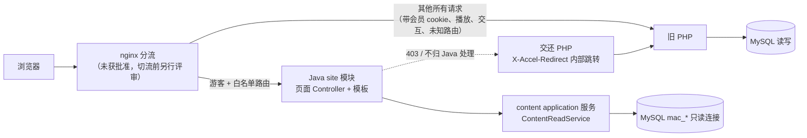

## 前台只读页面重写方案（首批三页：首页、分类/筛选列表、视频详情）（MACC-6）

> **状态：方案草稿，待用户审查。** 本文只做设计，不实现页面，也不创建模拟页面或接口。审查通过前不派实现任务。
>
> 输入：
> - 前台兼容清单 `docs/frontend/01-pages-url-compat.md`（以下简称"清单"，MACC-5）
> - 正式契约 `docs/contracts/content-read.openapi.yaml`（以下简称"契约"，MACC-4 已合并）
> - 首批后端计划 `docs/architecture/01-batch1-content-read-plan.md`（以下简称"01 计划"）、开发规范 `docs/architecture/02-agent-development-rules.md`（"02 规范"）
> - 迁移草稿 `docs/analysis/03-migration-plan-draft.md`（"03 草稿"，仍是草稿）
>
> 证据标注：
> - **【已证实】**：仓库代码或已合并契约中可直接核对，给出 `文件:行号`（行号基于本 worktree，提交 `9af83fb`）。
> - **【需求】**：本方案提出、尚未实现的需求或建议，需要审查或批准。
> - **【待验证】**：依赖线上配置、真实数据、缺失模板或未做的实验，本文不下结论。

### 0. 已确定与未确定

| 事项 | 状态 | 依据 |
|---|---|---|
| 新系统 Java + Spring Boot + MyBatis、沿用 MySQL、模块化单体，今后主要由智能体开发 | 【已证实】用户已确认 | `AGENTS.md`"重构目标"；01 计划第 1 节 |
| 后端只读接口：分类树、视频分页列表（只支持 `categoryId` + 白名单排序）、视频公开详情、健康检查 | 【已证实】已合并 | 契约 `paths` |
| 前台渲染形态（服务端渲染 / 前后端分离 / PHP 兼容层） | **未决定**，本文给推荐 | 03 草稿第 8 节第 2 条 |
| 具体模板引擎、是否使用 Vue/React 等前端框架 | **未决定**，本文只给评估标准，不选型 | 本任务要求 |
| 线上模板、线上伪静态/路由配置 | 【待验证】仓库中缺失 | `template/default/html/index.html` 为 0 字节；清单 2.4 |
| 部署、切 nginx 流量 | **未获批准** | `AGENTS.md`"重构目标" |

### 1. 三种方案的取舍

#### 1.1 候选方案

| | A. 服务端渲染（SSR，Java 单体内的 `site` 模块） | B. 前后端分离静态应用（SPA/静态站 + `/api/v1`） | C. PHP 兼容过渡层 |
|---|---|---|---|
| 做法 | 新增 `site` 模块（03 草稿第 1 节已规划：前台渲染、SEO URL、播放页等），在同一个 jar 内用服务端模板输出 HTML；进程内调用 `content` 的 application 服务 | 独立前端工程（Node 工具链构建），浏览器经公开 API 取数，客户端渲染 | 继续用 ThinkPHP 渲染：要么补回模板，要么让 PHP 控制器改调 Java API；或实现 `{maccms:*}` 标签兼容层（03 草稿 4.7 乙） |
| SEO / canonical / 真实 404 | 原生支持：首屏即完整 HTML，可返回真正的 404/301 状态码 | 需要额外的预渲染或 SSR 框架；纯客户端渲染只能"软 404"，canonical 需要客户端注入 | 与旧站一致（但旧站本身没有 canonical 证据，清单 2.3） |
| 与旧 URL 共存 | 同一路径由 nginx 分流到 Java 或 PHP，Java 用"交还 PHP"响应处理不归它管的情况（第 3.3 节） | 需要一个 HTML 入口 + 前端路由去匹配旧 URL 形态，旧 URL 解析逻辑落在浏览器里 | 不需要改路由 |
| 授权边界 | 服务端判定、服务端过滤字段，浏览器拿不到 API 之外的东西 | API 必须对外公开（当前后端默认只监听 127.0.0.1，无 CORS 配置：`backend/src/main/resources/application.yml:41`），浏览器可直接调用全部公开接口 | 沿用 PHP 授权，但所有旧问题也一并保留 |
| 对智能体开发 | 一种语言、一条构建（`./mvnw verify`）、一套测试（MockMvc 断言 HTML/状态码/头）；字段只经过已有的契约 DTO，护栏测试可复用 | 两种语言、两条构建与依赖链；需额外维护 API 客户端与类型同步；智能体对主流前端框架熟悉，但跨仓库/跨工具链的一致性检查更多 | 在即将退役的 PHP 上继续投入；改 PHP 业务代码需用户另行批准；模板仍然缺失 |
| 模块化单体契合度 | 高：`site` 是单体内的一个模块，只依赖 `content` 的 application 层 | 中：后端仍是单体，但前台成为单体之外的第二个部署物 | 低：增加 PHP 与 Java 的耦合点 |
| 隐式写入 | 新进程只读连接（`application.yml:11-12` `read-only: true`），游客请求不再经过 PHP 的 `label_user` | 同 A（API 只读） | 每个页面仍经过 `index/Base` 构造（`application/index/controller/Base.php:11-18`），会员到期 UPDATE 保留 |
| 首批工作量 | 中：模板 + URL 生成/解析 + 图片地址规范化 | 中到高：除页面外还要解决 SEO 与路由 | 低（补模板）到高（标签兼容层，`application/common/taglib/Maccms.php` 体系庞大） |
| 回滚 | nginx 把路由切回 PHP | 同左，另需处理静态资源缓存 | 无切换，无需回滚，但也没有前进 |

#### 1.2 推荐（待用户批准）

**推荐 A：Java 单体内的服务端渲染（`site` 模块），页面以渐进增强为原则，交互一律跳转或交还给 PHP。** 理由：

1. 首批三页都是内容页，SEO、canonical 与真实 HTTP 状态码是硬需求；A 不需要额外的预渲染层。
2. "今后主要由智能体开发"：A 把页面、URL 规则、字段护栏放进同一个工程、同一套 `./mvnw verify`，智能体改一处就能在一次构建里看到契约、HTML 与路由测试是否一起通过，出错面最小。
3. 授权边界最简单：浏览器只拿到服务端已经过滤的 HTML；公开 API 不需要为前台对公网开放，也就不存在"前端绕过授权直接调 API"的新攻击面。
4. 与 03 草稿的规划一致：`site` 模块本来就是"前台渲染、SEO URL、播放页"的归属（03 草稿第 1 节）；对应 03 草稿 4.7 的"甲：按新的模板引擎改写"。

本推荐**不等于**批准了任何具体模板引擎或前端框架。需要用户决定：

| 编号 | 决策点 | 本文建议 |
|---|---|---|
| D1 | 渲染形态 A / B / C | A |
| D2 | 模板引擎 | 由一个限时选型小任务（spike）按下表标准比较后提交用户确认；本文不选 |
| D3 | 是否允许页面使用前端框架（Vue/React 等）做局部交互 | 首批不需要：三页的交互只有链接、分页、表单 GET；如需轮播等，用无框架的少量原生 JS，且无 JS 时内容仍可用 |
| D4 | canonical 与非规范 URL 是否 301 | 见第 5 节；涉及与旧站行为差异，需批准 |
| D5 | 详情页是否保留 PHP 计数（`ajax/hits`） | 见第 6.3 节 |
| D6 | 视觉风格：沿用线上模板还是重新设计 | 取决于能否拿到线上模板；本方案不承诺还原线上样式 |

D2 模板引擎的评估标准（候选可包括 Spring Boot 生态中常见的服务端模板引擎，选型时逐项核实与 Spring Boot 4.1.1 的兼容性，【待验证】）：

| 标准 | 原因 |
|---|---|
| 默认输出转义（HTML 上下文自动转义，显式标记才输出原始 HTML） | 防 XSS；`vod_content` 等原始 HTML 必须走白名单过滤后才能原样输出（契约 `VideoDetail.content` 描述） |
| 模板引用的字段在构建期可检查（类型安全或编译期报错） | 智能体改 DTO 后，模板引用错误应在 `./mvnw verify` 中失败，而不是上线后空白 |
| 有官方或活跃维护的 Spring Boot 集成，支持 Boot 4.1 / Jakarta | 避免引入停更依赖 |
| 便于在 MockMvc 测试中断言输出 | 验收自动化 |
| 支持布局/片段复用 | 组件边界（第 7.2 节） |

#### 1.3 `site` 模块的边界

- 新包 `com.maccms.backend.site`，分层沿用 02 规范第 2 节：`web`（页面 Controller、视图模型）→ `application`（URL 生成/解析、canonical、图片地址规范化、站点设置）→ 无 `infrastructure`（`site` 不拥有任何表，03 草稿第 1 节）。
- `site` 只能调用 `content` application 层的公开服务（当前为 `ContentReadService`，`backend/src/main/java/com/maccms/backend/content/application/ContentReadService.java:48,53,77`），**不得**直接使用 `content` 的 Mapper 或行记录。
- 【需求】`ContentReadService` 当前返回的是 `content.api.dto` 下与契约一一对应的 DTO。`site` 直接使用这些 DTO 等于"前台只依据契约字段开发"，与 02 规范第 1 节一致；但 02 规范第 2 节写明"不能使用对方的 DTO 内部类型"。需后端负责人确认：把这些契约 DTO 视为 `content` 的已发布类型供 `site` 使用，或在 `content.application` 暴露专用的只读视图类型。实现任务开始前必须定下来。
- 不新增 HTTP 回环调用（`site` 不经 `http://127.0.0.1:18280/api/v1` 取数）：同一进程内回环只增加延迟与故障点。公开 API 照常保留给其他客户端。

### 2. 总体数据流

- **Java 只服务游客。**【需求】请求携带旧会员登录 cookie（`user_id`、`user_check`，写入见 `application/common/model/User.php:385-390`，ThinkPHP cookie 前缀为空 `application/config.php:222`）时，nginx 把首批三页也路由给 PHP。原因：契约一律按游客判定（契约 `info.description`"访问者一律按旧系统的游客…判定可见性"），会员能看到的分类/详情范围可能更大（01 计划第 5 节第 7 条）。这样也保证会员请求仍经过 PHP 的 `label_user`，到期降级写入照旧发生（第 6.2 节）。
- **Java 不写库**：只读连接已由 `application.yml:11-12` 与 `DatabaseAccountGuard` 保证；`site` 模块不新增任何数据源。
- **本地阶段没有 nginx 分流**：Java 只在 `127.0.0.1` 上响应白名单路由（第 5.4 节的本地验证策略）。

### 3. 首批三页

字段名一律用契约中的 JSON 名；"MACC-4 实际字段"指契约已声明且有契约测试的字段（`backend/src/test/java/com/maccms/backend/content/ContentApiContractTest.java`），"未实现"指清单第 3 节中的 A/B 档需求但契约没有。

#### 3.1 共用：站点外壳

| 区块 | 数据来源 | 状态 |
|---|---|---|
| 导航分类树 | `GET /api/v1/video-categories`（进程内 `listCategories()`），`items[].children[]` | 【已证实】已实现 |
| 站点名、站点关键词/描述、Logo、ICP、统计代码 | 旧配置 `site.*`（`application/extra/maccms.php:18-44`）、`seo.vod.*`（`:620-626`） | **未实现**。新系统没有站点配置来源。【需求】首批用 `site` 模块自己的配置项（环境变量/外部配置文件，值由运维从线上配置人工抄录，不读 `D:\Ai\MACCMS\prod-config\`、不入仓库）；统一来源由 03 草稿 3.5 节决定，待批准 |
| 站点关闭（`site_status=0` 输出关闭页） | `application/index/controller/Base.php:73-79`；仓库值 `site_status='1'`（`maccms.php:40`） | 【需求】Java 不读 PHP 配置；站点关闭由 nginx 统一处理或 Java 配置开关，二选一，实现前确定 |
| 移动端独立模板（`mob_status`、`mob_template_dir`，`maccms.php:36-37`） | 旧系统按 UA 切模板 | 【需求】新页面只做响应式单模板；线上是否开启移动模板【待验证】 |
| 搜索框 | 表单 `GET` 提交到旧搜索 URL（搜索归 PHP，01 计划第 8 节） | 【需求】只是一个指向 PHP 的表单，不调用 `ajax/suggest`（`static/js/home.js:381`） |
| 会员入口 | 链接到 PHP `user/login`、`user/index` | 【需求】Java 不显示登录状态（游客页面），文案用"登录 / 会员中心" |

#### 3.2 首页

| 项 | 方案 |
|---|---|
| 旧入口 | `GET /`、`/index.php`（`application/index/controller/Index.php:11-14`，模板 `index/index`）；分页别名 `index-<page?>` 仅在特殊分支（清单 2.2） |
| 区块（【缺模板】旧首页区块由模板标签决定，无法核对，以下是新设计） | ① 推荐位：`listVideos(sort=level, order=desc, pageSize=N)`；② 各顶级分类最新：对导航中的每个顶级分类调用 `listVideos(categoryId, sort=time, pageSize=N)`；③ 全站最新：`listVideos(sort=time)`；④ 热门：`listVideos(sort=hits_week)` |
| API 映射 | 全部为已实现接口；N 次分类区块 = N 次查询，【需求】顶级分类区块数量设上限（如 ≤8）并在实现任务里用本地数据量测首屏耗时 |
| 未实现/差异 | 旧推荐语义是"按推荐等级筛选"（`vod_level` 某值，`application/common/model/Vod.php:290-294`），契约只能按 `level` **排序**，不能"只取 level=9 幻灯片"——首页推荐位只能近似；【需求】后端补 `level` 筛选参数（后续契约变更，见第 9 节）。热搜词、幻灯片专用图（`picSlide` 已有字段，但无"只取幻灯片"筛选）、文章/专题区块均不在首批 |
| 分页 | 首页不分页；`index-<page>` 形态不承接（交 PHP） |
| 空结果 | 某区块无数据时隐藏该区块；全部为空时显示"暂无内容"并返回 200 |
| 错误 | 任一区块查询失败（`SERVICE_UNAVAILABLE`/`INTERNAL_ERROR`）→ 整页 503（见 7.3），不输出半残页面被缓存 |

#### 3.3 分类列表页（`vod/type`）与筛选页（`vod/show`）

**分类页**

| 项 | 方案 |
|---|---|
| 旧入口 | `vod/type`（`application/index/controller/Vod.php:17-21`），参数 `id` + `page`；`id` 形态受 `rewrite.type_id` 控制（`maccms.php:495`） |
| 首批承接范围 | 【需求】只承接**数字 type_id**；`type_en` 拼音形态、编码 id 形态交 PHP（编码依赖 `encode_key`，仓库已清空，清单 2.4） |
| 数据 | 分类信息：从分类树中按 id 查找（`listCategories()`，无单独的分类详情接口）；列表：`listVideos(categoryId=id, sort, order, page, pageSize)` |
| 子分类 | 契约行为：结果包含该分类与可见的**直接**子分类（契约 `/api/v1/videos` 描述；旧依据 `Vod.php:336-351`） |
| SEO | `<title>`：`title` 非空用 `title`，否则 `name` + 站点名；`keywords`/`description` 用分类的同名字段（契约 `Category`）。旧标题拼接规则在模板里【缺模板】，属新设计 |
| 每页条数 | 默认 20，与旧配置一致（`maccms.php:92`；契约 `pageSize` 默认 20） |
| 排序 | 首批固定 `sort=time, order=desc`（旧默认，01 计划 4.2）；排序切换属于筛选页 |
| 分页 | `page` 从 URL 读取；第 1 页 URL 不带页码（旧 `mac_url` 把 `page=1` 置空，`application/common.php:1740-1744`）。分页导航用真实 `<a href>`，显示当前页前后窗口（旧默认窗口 5，`application/common.php:517`） |
| 越界 | 契约：`page>totalPages` 返回 200 空列表；`page>1000` 或非法值返回 400（契约 `page` 最大 1000）。【需求】页面层：`page` 非正整数、`page>1000`、或 `totalPages>0 且 page>totalPages` → **404 页**（防止无限分页的重复页被收录）。与旧行为不同（旧系统空页照常 200，见 `mac_page_param` 空结果分支 `application/common.php:522-524`），属差异，见第 10 节 |
| 空结果 | `total=0`（分类存在但没有可见视频）→ 200，显示"该分类暂无内容"，保留分类导航 |
| 不存在 | 契约 `CATEGORY_NOT_FOUND`（不存在、停用、或游客无列表权限）→ 404 页。**与旧行为不同**：旧系统分类查不到时走 ThinkPHP 的 error 跳转页（`application/common/controller/All.php:177-178`），无权限时 error 并跳 `user/index`（`All.php:180-185`）；见第 10 节 |

**筛选页**

| 项 | 方案 |
|---|---|
| 旧入口 | `vod/show`（`application/index/controller/Vod.php:23-28`），参数 `area/by/class/lang/letter/level/order/page/state/tag/year` 等（清单 1.2） |
| 旧开关 | `check_show`：`app.show=0` 时整页关闭报错，`show_verify=1` 时要求验证码（`application/index/controller/Base.php:29-43`）。**仓库配置 `app.show='0'`**（`maccms.php:64`），即仓库默认下筛选页是关闭的；线上值【待验证】 |
| API 映射 | 契约**只支持** `categoryId` 与 `sort`/`order`；`area/year/lang/class/letter/level/tag/state` 均**未实现**（01 计划第 5 节第 8 条）。筛选候选值已有：`Category.extend`（`classes/area/lang/year/star/director/state/version`） |
| 结论 | 【需求】**筛选页不进入首批实现**，作为第二步：先由后端在契约中加筛选参数（同一提交改 OpenAPI + DTO + 契约测试，02 规范第 1 节），并核实线上 `app.show`。在此之前 `vod/show` 全部交 PHP。分类页上可以展示 `extend` 候选值，但只做成指向旧筛选 URL 的链接 |
| 排序映射（为第二步准备） | 旧 `by` 取值与契约 `sort` 对照：time/time_add/id/score/hits/hits_day/hits_week/hits_month/up/down/level 一一对应；旧 `rnd`（随机）契约不支持（契约 `sort` 描述），遇到时交 PHP |

#### 3.4 视频公开详情页（`vod/detail`）

| 项 | 方案 |
|---|---|
| 旧入口 | `vod/detail`（`application/index/controller/Vod.php:55-64`），首批只承接数字 `vod_id`（`rewrite.vod_id` 形态，`maccms.php:493`）；拼音/编码形态交 PHP |
| 数据 | `getVideo(id)`（契约 `GET /api/v1/videos/{id}`）；面包屑用 `category`（`CategoryRef`，含 `parentId`，父级名称从分类树查） |
| 200 | 渲染契约 `VideoDetail` 字段（第 3.5 节） |
| 404 `VIDEO_NOT_FOUND` | 不存在 / 未审核 / 分类不可见 / 游客无详情权限 → Java 404 页。旧系统：缺失走 `page_error` 404 模板（`application/common/controller/All.php:390-393`、`:98-115`），游客无权限走 error 跳转（`All.php:408-413`），后者是差异（第 10 节）。会员请求不会到达 Java（第 2 节），所以不会把"会员有权限"误判为 404 |
| 403 `VIDEO_PASSWORD_REQUIRED` | 【需求】**交还 PHP**（第 4.2 节机制），由 PHP 输出观看密码页（`Vod.php:61-63`）并经 `ajax/pwd` 写 session（`application/index/controller/Ajax.php:400-457`）。Java 不渲染密码表单，不代理密码校验 |
| 403 `VIDEO_COPYRIGHT_RESTRICTED` | 【需求】**交还 PHP**，由 PHP 按 `copyright_status` 选择版权页（`Vod.php:58-60`）。注意后端开关 `copyright-hides-detail` 默认 true，而仓库配置 `copyright_status='1'`（`maccms.php:73`），上线前须对齐线上值（01 计划第 9 节） |
| 400 | 路径中的 id 非法（契约 `id` 范围 1..4294967295）→ 404 页（对用户而言就是"没有这个页面"） |
| 播放入口 | **主要缺口。** 旧详情页的剧集列表与"立即播放"来自 `vod_play_list` 解析（`mac_url_vod_play($info,'first')` 在无播放列表时返回空串，`application/common.php:2572-2583`）；契约有意不含任何播放字段（C 档，清单 3.2）。因此新详情页**无法**列出播放源和剧集，也无法确定合法的 `sid/nid`。【需求】二选一，由用户/后端确认： (a) 后端新增"剧集索引"只读接口：只返回 `sid`、播放源显示名、`nid`、剧集标题，**不含任何地址、试看、积分信息**，并按旧逻辑过滤未启用的播放器（`mac_play_list`，`application/common.php:1346` 起）；需要单独的契约与安全评审。 (b) 首批详情页只放一个"播放"链接，指向旧 PHP 播放页的 `sid=1&nid=1`；风险是第一个播放源被禁用或不存在时链接失效。 建议 (a)，在它就绪前详情页可以在本地实现与验收，但**不具备切流量条件** |
| 评论 | 首批不渲染评论区（旧评论由模板经 `comment/ajax` 加载，`application/index/controller/Comment.php:30`）。【需求】放"查看/发表评论"链接到 PHP 评论页；是否需要嵌入列表留待 interact 模块 |
| 评分/顶踩 | 只读展示 `score`/`scoreNum`/`up`/`down`；不放可点击的评分、顶踩控件（它们会调用 PHP 的写接口，`static/js/home.js:241-300`） |
| 相关推荐 | `vod_rel_vod` 未进契约（01 计划 4.4 "从不查询"）；【需求】首批用同分类最新 `listVideos(categoryId, pageSize=6)` 代替，属新设计 |
| 剧情分集 | `vod_plot*` 未进契约；首批不展示 |

#### 3.5 字段边界：MACC-4 已实现 vs 未实现

| 页面需要（清单第 3 节档位） | 契约字段（已实现） | 未实现 / 不进入 |
|---|---|---|
| 分类导航、SEO（A） | `Category.id/name/enName/parentId/title/keywords/description/sort/children` | — |
| 分类图、筛选字典（B） | `Category.logo/pic/extend` | 图片地址规范化（见下） |
| 视频标题、副标题、URL（A） | `id/name/subTitle/enName/letter/color` | — |
| 分类与标签（A） | `category`、`classes`、`tag` | `type_id_1` 不单独输出（`CategoryRef.parentId` 可替代） |
| 海报（A） | `pic/picThumb/picSlide` | 原样返回库内值，可能是相对路径、完整 URL 或 `mac:` 前缀（契约 `info.description`）。【需求】`site` 实现与 `mac_url_img`（`application/common.php:1633-1657`）等价的规范化：`mac:` 前缀按 `upload.protocol` 替换（`maccms.php:157`），相对路径按 `upload.mode` 拼本地前缀或 `remoteurl`（`:158`），`img_key` 命中时加 `img_api`；需要这些配置的线上值【待验证】，用 PHP 生成的测试向量对拍 |
| 演职员、简介（A） | `actor/director/writer/behind/blurb/content` | `content` 是原始 HTML，**必须白名单过滤**（契约 `VideoDetail.content`）；其他文本字段可能含 HTML 实体（契约 `info.description`），【需求】统一"先解码一次实体、再按上下文转义输出"，用真实数据样本验证不出现 `&amp;amp;`【待验证】 |
| 更新状态（A） | `remarks/pubdate/total/serial/finished` | — |
| 筛选展示（A） | `area/lang/year/version/state`、`tv/weekday/duration` | — |
| 评分与热度（A，只读展示） | `score/scoreAll/scoreNum/doubanId/doubanScore/hits*/up/down` | — |
| 时间（A） | `updatedAt/addedAt`（Unix 秒） | 时区：【需求】统一按站点时区（配置项）格式化，默认 Asia/Shanghai【待验证】 |
| 推荐等级（A） | `level`（只表示推荐等级，不是会员等级，清单 3.2） | 按 level 筛选 |
| 版权标记（B） | `copyright`（布尔） | 详情被版权拦截时由 PHP 处理，不在 Java 渲染提示 |
| 观看密码提示（B） | 列表项 `detailPasswordRequired` | 密码本身从不返回；详情 403 交 PHP |
| 积分/试看提示（B） | **无** | `vod_points*`、`vod_trysee` 不查询（01 计划 4.4）；首批不展示收费/试看文案 |
| 相关推荐、剧情（B） | **无** | 见 3.4 |
| 播放源/地址（C） | **无，也不应有** | 播放全部留在 PHP（第 6 节） |
| 站点设置、热搜词 | **无** | 见 3.1 |
| `vod_color`（标题颜色） | `color` | 【需求】只接受 `#RGB`/`#RRGGBB` 等白名单格式再写入 `style`，否则忽略 |

#### 3.6 移动端与键盘验收（三页通用）

在清单 3.4 的基础上细化为可测项：

| 项 | 验收要求 | 验证方式 |
|---|---|---|
| 响应式 | 375、768、1280、1440、1920 px 宽度下无横向滚动；375 px 下导航可折叠且可用 | 浏览器自动化截图 + `document.documentElement.scrollWidth <= innerWidth` 断言 |
| 触控目标 | 分页、导航、海报链接可点区域 ≥ 44×44 CSS px | 同上 |
| 键盘 | 不用鼠标可完成：打开导航 → 进入分类 → 翻页 → 进入详情 → 点"播放/评论/登录"链接；Tab 顺序与视觉顺序一致；Enter 触发链接，Space 触发按钮 | 自动化键盘脚本 + 人工抽查 |
| 焦点 | 所有交互元素有可见 focus 样式（不只靠颜色）；提供"跳到主要内容"链接 | 同上 |
| 无 JS | 关闭 JS 时三页内容、分页、导航全部可用；所有链接是真实 `<a href>`；分页不依赖 JS | 无 JS 模式下重复上述键盘脚本 |
| 语义 | 每页一个 `<h1>`；列表用 `<ul>/<li>`；图片有 `alt`（视频名）；`<html lang="zh-CN">` | HTML 断言测试 |
| 图片 | 海报指定宽高比、`loading="lazy"`（首屏除外）；图片加载失败显示占位（旧站有 `static/images/nopic.gif`） | 截图 |
| 对比度 | 正文与背景对比度 ≥ 4.5:1 | 设计 token 校验 |

### 4. 与 PHP 的跳转与交还

#### 4.1 三类出口

| 出口 | 何时用 | 例子 |
|---|---|---|
| 普通链接（浏览器跳转到 PHP URL） | 用户主动进入 PHP 负责的功能 | 登录、注册、会员中心、搜索表单、播放页、评论页、筛选页（第二步前） |
| 交还 PHP（服务端内部转交，浏览器 URL 不变） | Java 接到了请求，但这个具体资源应由 PHP 处理 | 详情 403（观看密码、版权）、`type_en`/编码 id 形态、未知参数组合 |
| Java 自己返回 404/503 | 资源在游客语义下确实不存在，或新系统故障 | 第 3 节各页的 404 与 503 |

#### 4.2 "交还 PHP"的机制（需求，部署时评审）

问题：新旧系统共用同一个 URL（canonical 必须与旧站一致，03 草稿 4.5），Java 不能用 302 把浏览器"跳回 PHP"——跳到的还是同一个 URL，nginx 又会送回 Java，形成循环。

【需求】建议：Java 返回 `X-Accel-Redirect: /@php-fallback`（或等价的内部 location），由 nginx 在内部把**原始请求**（方法、URI、cookie 不变）转给 PHP upstream；浏览器只看到 PHP 的响应。要求：

- 只对 `GET`/`HEAD` 使用；Java 白名单路由本来就只接受这两种方法。
- 交还响应不带正文、不带 `Set-Cookie`、不缓存（`Cache-Control: no-store`）。
- nginx 的内部 location 设为 `internal`，外部无法直接访问；交还最多一次，PHP 的响应不会再回到 Java。
- 交还原因写入 Java 访问日志（第 7.4 节），但不记录 cookie。

备选：在 nginx 层用规则（cookie、路径形态）事先把这些请求留在 PHP；但 403 的原因只有查过库才知道，nginx 无法预判，所以仍需要上面的机制兜底。

#### 4.3 本地缺模板的影响

所有指向 PHP 的链接与交还，在本仓库**本地都会落到"模板文件不存在"的 500**（`AGENTS.md`"本地运行与测试"第 4 步）。这是环境限制，不是新页面的缺陷；本地验收只检查链接/交还的**目标 URL 与响应头**是否正确，不检查 PHP 渲染结果。

### 5. 旧 URL 与 canonical

#### 5.1 已知事实（引自清单第 2 节）

- 仓库配置：`pathinfo_depr='/'`（`maccms.php:47`）、`rewrite.status=0`（`:490`）、`route_status=0`（`:489`）、`suffix=html`（`:484`）、`suffix_hide=0`（`:488`）。
- 在该配置下 `mac_url` 生成形如 `/index.php/vod/detail/id/123.html`、`/index.php/vod/type/id/1.html` 的 URL（`application/common.php:2395-2423`）；第 1 页不带页码（`:1740-1744`）。
- 同一内容在不同配置下还可能以 `?s=`、路由别名、静态化路径出现（清单 2.1、2.2），旧代码没有统一的 canonical 输出，仓库模板也没有 `<link rel="canonical">` 的证据（清单 2.3）。
- 线上 `rewrite`、`route`、`path.*`、`view.*`、nginx 规则、`domain.php` 绑定【待验证】（清单 2.4），属于**部署/切流量前**的核实项。

#### 5.2 设计

【需求】`site.application` 中实现两个纯函数组件，配置驱动、不读 PHP 文件：

1. **URL 生成器**：输入页面类型 + 参数 + URL 配置（`rewrite.status`、`suffix`、`suffix_hide`、`pathinfo_depr`、`route_status`、`route` 文本、`type_id`/`vod_id` 形态），输出与 `mac_url` 一致的 URL。首批只要求覆盖：首页、`vod/type`（数字 id、分页）、`vod/detail`（数字 id），以及链接到 PHP 的 `vod/play`、`vod/search`、`vod/show`、`user/*`。
2. **URL 解析器**：识别同一资源的各种可达形态（PATHINFO 含/不含 `index.php`、`?s=` 的 `/` 与 `-` 分支、别名），得到"页面类型 + 参数"，或返回"不认识 → 交还 PHP"。

canonical 规则：

| 页面 | canonical | 状态 |
|---|---|---|
| 首页 | 站点根 URL | 【需求】 |
| 分类第 1 页 | 生成器对 `(vod/type, id)` 的输出 | 【需求】 |
| 分类第 n 页 | **自引用**（指向第 n 页本身），不指向第 1 页 | 【需求】，需用户确认（清单 2.3 说明此项缺模板证据） |
| 详情 | 生成器对 `(vod/detail, id)` 的输出 | 【需求】 |
| 筛选页（第二步） | 待定：建议无筛选条件时指向分类页，有条件时自引用并评估 `noindex` | 待定 |

非规范形态：【需求】Java 识别出资源后，若请求 URL 不等于 canonical，**301 到 canonical**（03 草稿 4.5 已提出，属新行为，需 D4 批准）。在 D4 批准前，实现可以只输出 `<link rel="canonical">`、不做 301。

**canonical 的"规范形态"必须以线上配置为准**；在线上配置核实前，任何环境都不能对外启用 301。

#### 5.3 Java 白名单路由

【需求】Java 只匹配以下形态，其余全部不注册（由 nginx 留给 PHP，或在本地直接 404）：

- `/`、`/index.php`
- 当前 URL 配置下 `vod/type` 的数字 id 形态（含分页）
- 当前 URL 配置下 `vod/detail` 的数字 id 形态
- 解析器认得出的上述两者的非规范形态（用于 301 或 canonical）

#### 5.4 本地合成验证策略（不访问线上、不碰共享开发库）

1. **URL 黄金向量**：在 PHP 环境里写一个只调用 `mac_url`/`mac_url_type`/`mac_url_vod_detail` 的 CLI 脚本，用**合成的配置组合**（仓库默认；`rewrite.status=1`；`suffix_hide=1`；`route_status=1` + 仓库默认 `route` 文本；`pathinfo_depr='-'`）和合成的 `info` 数组生成期望 URL，输出为 JSON 测试向量提交到 `backend/src/test/resources/`。如果脚本需要数据库（例如分类缓存），只连**一次性库**（与 `-Pmysql-it` 相同的 `maccms_it_*` 方式），不连 `maccms_dev`。该脚本本身是否需要改 PHP 业务代码【待验证】：若需要，改为在测试工程内复制函数逻辑并人工核对，不改旧 PHP。
2. **生成器/解析器单元测试**：对每组配置逐条比对向量；解析器对每条向量做"解析 → 再生成"往返测试。
3. **页面 HTTP 测试**（MockMvc）：对白名单路由断言状态码、`<link rel="canonical">`、301 的 `Location`、交还响应头。
4. **本地 nginx 演练**（可选，实现阶段）：用本机 nginx 起一个**不占用 80/8080/8072/8073/8082** 的独立端口，Java 与 PHP 内置服务器（同样连一次性库）作为两个 upstream，验证"游客 → Java、带会员 cookie → PHP、交还 → PHP 不循环"。PHP 端返回缺模板 500 是预期结果，只看是哪一端响应。
5. 编码 id（`rewrite.vod_id=2`、`encode_key`）不在首批，不做向量。

### 6. 继续留在 PHP 的能力与授权边界

#### 6.1 能力清单

以下全部**继续由 PHP 处理**，新页面只放链接或交还，不通过公开 API 或 Java 页面实现（清单第 4 节）：

| 能力 | 旧入口 | 新页面的处理 |
|---|---|---|
| 登录/注册/退出/会员中心 | `user/login`、`user/reg`、`user/logout`、`user/index` | 链接 |
| 评论（列表、发表、顶踩、举报） | `comment/*`（`application/index/controller/Comment.php:18-22,30,37,119,140`） | 链接；不嵌入、不代理 |
| 留言 | `gbook/*` | 链接 |
| 积分购买/试看确认 | `user/ajax_buy_popedom`（`application/index/controller/User.php:101` 起） | 不出现（详情页不展示收费信息） |
| 观看密码 | 密码页 + `ajax/pwd`（`Ajax.php:400-457`） | 详情 403 → 交还 PHP |
| 播放、下载 | `vod/play`、`vod/player`、`vod/down` | 链接；播放权限、试看、加密、`player_aaaa` 全在 PHP（清单 1.5） |
| 支付回调 | `payment/notify`（只有 POST 分支调用适配器，`application/index/controller/Payment.php:13-36`） | 与前台页面无关，nginx 永远留给 PHP |
| 计数（hits/digg/score） | `ajax/hits`、`ajax/digg`、`ajax/score`（`Ajax.php:152,302,347`） | 见 6.3 |
| 搜索 | `vod/search` | 表单 GET 提交到 PHP |

#### 6.2 授权与隐式写入的边界

- **公开 API 不能成为绕过授权的通道**：契约已保证不返回播放/下载地址、密码、积分、试看、会员组（契约 `VideoDetail.description`；01 计划 4.4 "从不查询"列表 + `ReadOnlyGuardrailsTest`）。`site` 模块只用这些字段，**不得**为了页面需要另开 Mapper 或 SQL 读取这些列；需要新字段必须走契约变更（02 规范第 1 节）。
- **游客判定**：Java 只按游客渲染；带会员 cookie 的请求不进 Java（第 2 节）。Java 不读取、不校验、不签发、不改写任何会员 cookie 或 PHP session。
- **隐式写入**：旧前台每个继承 `index/Base` 的页面都会调用 `label_user`，会员组到期时执行 `UPDATE group_id=2`（`Base.php:17`；`application/common/model/User.php:455-466`）。游客请求不触发这条写入，会员请求仍留在 PHP，所以把游客的三页切到 Java **不改变**这条写入的发生条件。这一点依赖第 2 节的 cookie 分流规则；如果将来让会员请求也进入 Java，必须先按 03 草稿 3.3.1 处理。
- **GET 不一定只读**：新页面上指向 PHP 的链接里有些是带写副作用的 GET（清单第 4 节"风险"；03 草稿 3.1）。【需求】新页面**不**直接链接到这些带副作用的端点（`ajax/hits`、`ajax/digg`、`ajax/score`、`user/ajax_ulog`、`user/ajax_buy_popedom`、`user/visit`、`ajax/referer`）；只链接到页面级 URL。指向登录、会员、评论等非内容页的链接加 `rel="nofollow"`。
- **静态资源**：新页面**不引入**旧 `static/js/home.js`，因为它会在页面加载时自动调用 `ajax/hits`（`static/js/home.js:214-219`）、`user/ajax_ulog`（`:521`）、`ajax/referer`（`:563`）等写接口。

#### 6.3 点击计数（D5，需用户决定）

旧详情页的点击数由模板中的 `.mac_hits` 元素 + `home.js` 在加载后请求 `ajax/hits?type=update` 写入（`static/js/home.js:214-219` → `Ajax.php:152-203`）。游客详情页切到 Java 后：

| 选项 | 结果 | 写入方 |
|---|---|---|
| 甲：不计数 | 被 Java 服务的游客访问不再增加 hits；排行榜（`sort=hits*`）逐渐失真 | 无 |
| 乙（建议）：保留 PHP 计数 | Java 详情页带一段很小的独立脚本，加载后向 PHP `ajax/hits` 发一次请求，与旧模板行为一致；PHP 仍是唯一写入方（03 草稿 3.3 计数字段在阶段 0～4 归 PHP） | PHP |

乙要求：脚本独立于 `home.js`、只调用 `ajax/hits`、受配置开关控制（本地与测试默认**关闭**，避免对开发库产生写入）、对爬虫不额外放大（旧系统同样由 JS 触发，行为一致）。

### 7. 实现前置条件、组件边界、错误、可观测性、回滚

#### 7.1 前置条件（实现任务开始前必须满足）

| # | 条件 | 阻塞什么 |
|---|---|---|
| P1 | 用户批准本方案的 D1（渲染形态），以及 D2 选型 spike 的结论 | 全部实现 |
| P2 | 后端负责人确认 `site` 如何使用 `content` 的读服务（第 1.3 节） | 全部实现 |
| P3 | D6：拿到线上模板（只用于参考结构与文案，不复制其中可能的 PHP 代码），或确认重新设计 | 视觉验收；**不承诺还原线上样式** |
| P4 | 站点设置的来源（第 3.1 节） | 首页与页面外壳 |
| P5 | 剧集索引接口 (a) 或降级方案 (b) 的选择（第 3.4 节） | 详情页能否切流量（不阻塞本地实现） |
| P6 | 线上 URL 配置与 nginx 规则核实（第 5.1 节） | canonical 与 301 对外启用、切流量（不阻塞本地实现） |
| P7 | 线上 `user.status`、`copyright_status`、游客组权限核实（01 计划第 9 节） | 切流量 |
| P8 | 部署与 nginx 分流方案单独评审并获批准 | 切流量 |

P1、P2、P4 满足即可开始本地实现；P3、P5～P8 只影响验收范围或上线。

#### 7.2 设计 token 与组件边界

- **设计 token**（【需求】）：颜色、字号阶梯、间距阶梯、圆角、阴影、断点、focus 样式、海报宽高比，集中在一个 CSS 变量文件中，模板与组件只引用 token。线上模板拿到后，通过改 token 贴近原风格，而不是改组件。
- **组件**（服务端模板片段，每个只接收明确的视图模型，不自行取数）：

| 组件 | 输入 | 使用页面 |
|---|---|---|
| 页面外壳（head/SEO/canonical、页眉、导航、页脚） | 站点设置、分类树、页面 SEO 视图模型 | 全部 |
| 分类导航 | 分类树 | 全部 |
| 视频卡片 | `VideoSummary` 的子集 + 已规范化的图片 URL + 详情 URL | 首页、分类、详情（相关） |
| 视频网格/列表区块 | 标题、卡片列表、"更多"链接 | 首页、分类 |
| 分页 | 当前页、总页数、页 URL 生成函数 | 分类 |
| 面包屑 | 分类链 | 分类、详情 |
| 详情元数据表 | `VideoDetail` 子集 | 详情 |
| 富文本（简介正文） | 已白名单过滤的 HTML | 详情 |
| 空状态 / 错误页（404、503） | 文案、返回链接 | 全部 |

- 边界规则：组件不调用服务、不拼 URL（URL 全部由生成器给出）、不输出未转义文本（富文本组件除外，且只接收过滤后的值）。

#### 7.3 错误处理

| 情况 | HTTP | 页面 | 缓存 |
|---|---|---|---|
| 正常 | 200 | 正常 | 【需求】可加短 `Cache-Control`，具体 TTL 待定（并行期 PHP 后台改数据后的可见延迟需用户接受，03 草稿第 7 节"缓存不一致"） |
| 分类/视频不存在、越界页 | 404 | Java 404 页，含导航与首页链接；`noindex` | 短缓存或不缓存 |
| 观看密码、版权 | （交还 PHP） | PHP 输出 | `no-store` |
| 数据库不可用（`SERVICE_UNAVAILABLE`） | 503 + `Retry-After` | 简单维护页，不调用任何查询 | `no-store` |
| 未预期异常 | 500 | 通用错误页，不含异常信息 | `no-store` |

- 模板渲染异常同样走 500，不输出半页 HTML（【需求】模板先渲染到缓冲区再写出）。
- 异常日志沿用 `SafeExceptionLog`：只记录类型与栈帧，不记录 message（02 规范第 4 节）。
- 不提供"回退到 PHP"的自动兜底：503/500 时由 nginx 层决定是否切回（7.5），避免 Java 故障时把全部流量悄悄压到 PHP。

#### 7.4 可观测性

【需求】

- 访问日志字段：时间、路由名（`home`/`vod_type`/`vod_detail`）、状态码、耗时、结果分类（`ok`/`not_found`/`handoff_password`/`handoff_copyright`/`handoff_unrecognized`/`redirect_canonical`/`error`）、请求 ID。**不记录** cookie、session、查询串中的未知参数值、User-Agent 之外的个人信息。
- 指标：按路由的请求数、状态码分布、p50/p95/p99 耗时、交还 PHP 的比例与原因、数据库查询耗时、首页区块查询次数。
- 健康检查沿用 `/actuator/health`（契约），不新增暴露端点。
- 切流量后重点看：404 比例突增（URL 解析或 canonical 有误）、交还比例突增、蜘蛛抓取错误（03 草稿 4.5"监控"）。

#### 7.5 回滚

- 本地阶段：页面代码在独立分支/提交，回滚即 `git revert`；不涉及数据，无需数据回滚。
- 切流量后（未获批准，仅作设计）：nginx 把白名单路由切回 PHP 即可，Java 从不写库，**没有任何数据需要回迁**（03 草稿第 6 节"只读路由"）。回滚后用黄金 URL 抽样验证 PHP 正常；回滚耗时待演练。
- 前提：PHP 实例在整个并行期一直运行、配置不变；PHP 模板必须在线上可用（本仓库缺模板，不能据此在本地演练 PHP 侧渲染）。
- 若已启用 301：回滚到 PHP 后，PHP 对所有形态都返回 200，不会与 301 冲突；但搜索引擎可能已缓存 301，回滚前需评估（这也是 D4 需要谨慎的原因）。

### 8. 交付验收标准（供后续实现任务使用）

实现任务交付时逐条给出结论；本方案本身的验收见文末。

| # | 验收项 | 验证方式 |
|---|---|---|
| F1 | 三页（首批实现范围：首页、分类页、详情页；筛选页另行）在本地 Java 进程内可访问，状态码符合第 3、7.3 节 | MockMvc 页面测试 + 本地启动后 `curl -i` |
| F2 | 页面只使用契约已声明字段；`site` 不新增 Mapper/SQL；`ReadOnlyGuardrailsTest` 继续通过 | `./mvnw verify` + 代码审查 |
| F3 | 输出中不出现任何播放/下载地址、密码、积分、试看字段（用集成测试的哨兵值断言 HTML 中不存在） | `./mvnw verify -Pmysql-it`（一次性库） |
| F4 | 404/越界页/空结果/503 行为符合表格 | 页面测试 |
| F5 | 观看密码、版权视频返回交还响应头，正文为空、`no-store` | 页面测试 |
| F6 | URL 生成器与 PHP 黄金向量 100% 一致（覆盖第 5.4 节的配置组合）；解析器往返测试通过 | 单元测试 |
| F7 | 每页输出唯一 `<link rel="canonical">`，与生成器一致 | 页面测试 |
| F8 | `content` 富文本经白名单过滤：`<script>`、事件属性、`javascript:` URL 全部被移除 | 单元测试（合成恶意样本） |
| F9 | 图片地址规范化与 `mac_url_img` 测试向量一致 | 单元测试 |
| F10 | 第 3.6 节移动端/键盘/无 JS 各项通过 | 浏览器自动化 + 截图附在交付评论 |
| F11 | 页面不引入 `static/js/home.js`，不包含指向带写副作用端点的链接（D5 选乙时的计数脚本除外，且默认关闭） | HTML 断言 |
| F12 | 访问日志不含 cookie/session；异常日志无 message | 日志捕获测试 |
| F13 | 本地验证未连接 `maccms_dev` 以外的已有库做写入，PHP 请求只打一次性库 | 交付评论如实说明 |
| F14 | 与旧版差异写入 `docs/architecture/` 对应文档 | 文档审查 |

### 9. 后续拆分建议（方案批准前不派发）

| 顺序 | 子任务 | 负责方向 | 依赖 |
|---|---|---|---|
| 1 | 模板引擎选型 spike（只做最小页面外壳 + 测试，按 1.2 节标准出报告，用户确认后才合并依赖） | 后端 | D1 批准 |
| 2 | `site` 骨架：模块包、页面外壳、站点设置配置、设计 token、404/503 页、日志字段 | 后端（与前端协作 token/样式） | 1、P2、P4 |
| 3 | URL 生成器/解析器 + PHP 黄金向量脚本（一次性库） | 后端 | 2 |
| 4 | 图片地址规范化 + 富文本白名单过滤 + 文本实体处理 | 后端 | 2 |
| 5 | 分类页 | 后端 + 前端样式 | 3、4 |
| 6 | 详情页（含交还 PHP 响应） | 后端 + 前端样式 | 3、4 |
| 7 | 首页 | 后端 + 前端样式 | 5 |
| 8 | 契约扩展：列表筛选参数（含 `level` 筛选）→ 筛选页 | 后端契约在先，页面在后 | 5，核实 `app.show` |
| 9 | 契约扩展：剧集索引只读接口（需安全评审） | 后端 | P5 |
| 10 | 本地 nginx 分流与交还演练 | 后端 | 6 |
| 11 | 部署/切流量方案（含 D4 301、D5 计数、缓存 TTL、回滚演练） | 队长/用户决策 | P6～P8 |

前端智能体的配合点（在对应任务中提出，不在本任务派活）：设计 token 与组件样式、移动端/键盘验收脚本、`docs/frontend/` 中兼容清单的后续更新。

### 10. 与旧版的差异（汇总）

| # | 方面 | 旧 PHP | 新页面（方案） | 是否需批准 |
|---|---|---|---|---|
| 1 | 分类不存在/停用/游客无权限 | error 跳转页（`All.php:177-185`） | 404 页 | 是（随本方案） |
| 2 | 详情游客无权限 | error 跳 `user/index`（`All.php:408-413`） | 404 页（契约行为） | 是 |
| 3 | 越界分页 | 200 空页 | 404 | 是 |
| 4 | 非规范 URL | 各形态都 200 | 输出 canonical；D4 批准后 301 | 是（D4） |
| 5 | 首页推荐位 | 模板按推荐等级筛选 | 按 `level` 排序近似 | 是（或等契约扩展） |
| 6 | 详情播放/剧集 | 列出全部播放源与剧集 | 首批无剧集列表（等剧集索引接口），只有播放链接 | 是（P5） |
| 7 | 评论、评分、顶踩 | 页面内交互 | 只读数字 + 链接到 PHP | 是 |
| 8 | 点击计数 | 模板 JS 调 `ajax/hits` | 取决于 D5 | 是（D5） |
| 9 | 移动端 | 可配置独立移动模板 | 响应式单模板 | 是 |
| 10 | 分类停用后的页面 | 仍可访问（01 计划第 5 节第 2 条） | 404 | 已在 MACC-4 接受 |
| 11 | 版权视频 | 由 `copyright_status` 决定 | 契约 403 → 交还 PHP，最终仍由 PHP 决定 | 否（行为等价，需对齐开关） |
| 12 | 每视频/每分类自定义模板（`vod_tpl`、`type_tpl*`，`All.php:398-406`） | 生效 | 不支持，统一模板 | 是 |
| 13 | 筛选页 | `app.show` 控制 | 首批不承接，留在 PHP | 否 |

### 11. 风险与待验证

- **模板缺失**是最大的不确定性：首页区块、标题拼接、canonical、样式都只能新设计；线上用户会看到外观变化（D6）。
- **剧集索引**未定时，详情页的核心功能（选集播放）缺失，不能切流量。
- **会员 cookie 分流**依赖 nginx 规则；规则写错会让会员看到游客版本（可见范围变小，不会扩大），或让游客落到 PHP（无害）。不会导致越权，因为 Java 永远按游客判定。
- **canonical/301** 一旦对外启用，回滚有搜索引擎缓存的残留影响（7.5）。
- **数据量**：首页多区块查询与 MyISAM 下带条件 `COUNT(*)` 的耗时未测（01 计划第 9 节），实现任务需在一次性库上用合成大数据量测试。
- **文本实体与富文本**的真实分布未知，过滤规则需用真实样本（脱敏后）复核【待验证】。
- **图片配置**（`upload.*`）线上值未知，规范化结果【待验证】。
- **Spring Boot 4.1 与候选模板引擎的兼容性**未核实【待验证】，由选型 spike 确认。
