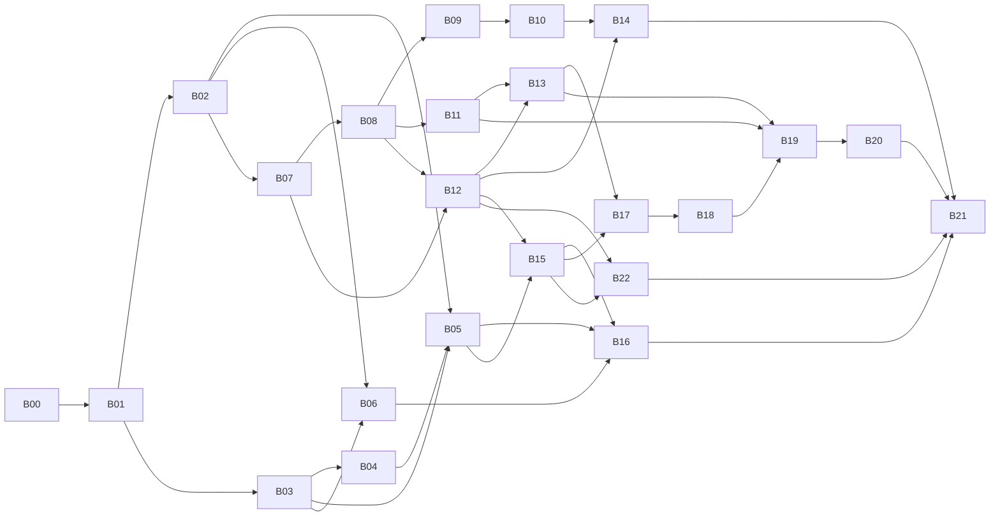

## 09 总体路线图：完整系统（前台 + 后台 + 采集）分批实施（MACC-23 / MACC-24 修订）

> **状态：路线图定稿稿（MACC-24 第三轮，已按用户对 D2～D8 的决定修订），待队长验收。** 本文只是计划，不实现任何产品功能，不部署，不访问线上站点或数据库。
>
> **依据与优先级**（从高到低）：
> 1. 用户 2026-10-16 在 MACC-23 追加的三条硬性要求：功能一样、MySQL 表一样、尽量不要外部调用（见第 1 节）。
> 2. 用户 2026-10-16 对 D2～D9 的答复（第 8.1 节）。D1（外部调用取舍）仍未决，见第 8.2 节。
> 3. MACC-23 任务说明（完整系统、批次化、验收与回滚要求、未获批准事项）。
> 4. `docs/analysis/03-migration-plan-draft.md`（以下简称"03 草稿"）。**03 草稿中与第 1、2 项冲突的设想全部作废**，逐条见第 2 节。
>
> 证据标记沿用 01 文档：【确认】读代码或本地运行确认；【静态】只读代码；【待核实】仓库证据不足。路径相对仓库根目录。

### 0. 一页摘要

- **范围**：新系统（Java，`backend/`）在功能上与旧 MacCMS v10 对齐，**不增不减**；沿用现有 26 张 `mac_*` 表，**零结构变更**（不建表、不加列、不改列，也不改索引、引擎、字符集、触发器）；运行时**默认不发起任何出站网络调用**。
- **配置与权限**：配置仍以 `application/extra/*.php`、`application/route.php` 这类 `var_export` 格式的 PHP 数组文件为唯一来源（与 `mac_arr2file` 相同，`application/common.php:126-139`）；管理员权限仍用 `mac_admin.admin_auth` 的 `,控制器/方法,` 文本语义；采集分类绑定仍在 `application/extra/bind.php`。
- **外部调用**：旧系统共 13 类服务端出站或依赖外部平台的调用点（E01～E13，第 4.1 节），另有 3 类由页面让浏览器访问外部地址的访问点（W1 播放器解析与播放器外部资源、W2 外链图片与外部播放/下载地址、W3 支付网关跳转，第 4.2 节）。这 16 项**全部"未获用户确认"**，其外部行为全部不进入可实施批次：可实施批次在获得确认前**只能采用替代方案，或把外部行为关闭（搁置）**。可以用本地替代的（采集→本地文件源，上传→本地存储，图片与播放→本站本地地址等）放进可实施批次，只做本地版本；没有本地替代的（支付、短信、邮件、第三方登录、公众号、搜索引擎推送、回链检测、插件市场、外部解析与外链资源的放行等）在可实施批次中一律走"未开通/禁用"路径，其外部行为单列为"待确认批次"P01～P11，等用户对 D1 的答复。
- **数据库工具与安装向导**：旧后台的"还原备份""执行 SQL""优化表""修复表"以及旧安装向导的"建库建表"会执行结构语句或表维护语句，新系统的任何入口都拒绝 DDL，管理员手工操作也不例外；这些步骤不进入可实施批次，等用户决定（D10、D11）。
- **用户已决定（2026-10-16，第 8.1 节）**：D2 六项安全问题全部修复，与旧版的行为差异逐条列在第 5.5 节并写进对应批次验收；D3 上线时整体切换，开发期新系统对生产只读、不改旧 PHP；D4 保留模板在线编辑（jte 运行时重编译，B15）；D5 保留本地插件的安装/启用/禁用（B15），插件市场联网安装/升级属 E13，仍按 D1 未决处理；D6 沿用不加盐 md5；D7 接受全表扫描；D8 保留完整的旧版安装向导（B22）。
- **批次**：本修订占用 MACC-24（B00）；实施批次 B01～B22 在建任务时依次取号（MACC-25 起），号码在第 5.1 节回填。顺序是：积压合并 → 只读补全 → 写入基础 → 会员与互动 → 后台（登录鉴权 → 内容 → 会员财务 → 系统配置 → 生成/定时 → 安装向导）→ 采集（配置 → 本地预览 → 入库）→ 全量验收与切换演练。
- **仍等用户**：第 8.2 节待决 3 项（D1 外部调用、D10 数据库工具、D11 安装向导建库建表），第 8.3 节待补充 2 项（D9 线上模板缺失、线上配置未答复）。它们不影响 B01～B14 开工；需要答复的批次在批次表中标出。

### 1. 硬性约束

#### 1.1 功能一样（不增不减）

- **对齐基线**：仓库中的旧代码（生产备份 2026-07-11）的可观察行为，包括页面与接口的输入输出、URL、写库效果、配置项及其生效方式、后台菜单与权限点（`application/admin/common/auth.php`）。线上配置与模板缺失（01 第 1 节），凡是依赖线上取值的地方按"仓库代码 + 配置项全部取值"对齐，线上取值【待核实】。
- **不增**：不加旧系统没有的功能或配置项。03 草稿中的"按资源站并发与限速、断点续采、TLS 校验开关、SSRF 网段屏蔽"（03 第 4.4 节）、"新系统自己的登录日志表"（03 第 4.3 (7) 节）等新增能力全部撤回。纯内部实现上的不同（例如进程内缓存代替 ThinkPHP 文件缓存、计数用原子 `x=x+1` 代替先读后写）不算功能增减，但要在对应批次文档里写明差异。
- **不减**：旧系统的每个功能都要么在某个可实施批次里实现，要么列在第 4 节（因外部调用待确认）或第 8 节（等用户决定），不允许无记录地丢掉。完整对照见第 3 节。
- **安全问题怎么算**：01 第 10 节的哈希登录、openid 直接登录、定时任务无鉴权等六项问题，用户已决定**全部修复**（D2）。修复不增加功能、不改表，但对外行为与旧版不同；每一项的旧行为、新行为、所属批次与验收用例见第 5.5 节，并写进对应批次的验收要点，批次文档把它们记为"有意差异"。

#### 1.2 MySQL 表一样（零结构变更）

| 允许 | 不允许 |
|---|---|
| 对现有 `mac_*` 表执行 `SELECT/INSERT/UPDATE/DELETE`，按"表 + 操作"单一写入方规则（02 规范第 3 节）；写入只在本地开发库或一次性库上发生，直到用户批准切换 | `CREATE/ALTER/DROP/RENAME/TRUNCATE TABLE`（**无论由代码执行还是由管理员在后台手工执行**：旧后台"执行 SQL"、"还原备份"中的结构语句同样禁止，见 B15 与 D10；旧安装向导的 `CREATE DATABASE` 与执行 `install.sql` 建表同样禁止，见 B22 与 D11；插件 SQL 中的结构语句同样禁止，见 B15）；新增表、列、索引、FULLTEXT；修改列类型、长度、默认值；引擎（MyISAM→InnoDB）和字符集（utf8→utf8mb4）转换；触发器、存储过程、视图、事件；在应用代码里放 `schema.sql`、Flyway/Liquibase 等任何自动迁移 |
| 新系统自己的运行状态放在**库外**：会话在进程内存，缓存在进程内，采集预览缓存放在本地运行目录，日志写文件 | 为新系统的运行状态新建任何表（包括"新系统自己的日志表"、"采集断点表"、"权限拆行表"） |
| 测试时在一次性库 `maccms_it_*` 中原样导入 `application/install/sql/install.sql` | 在 `maccms_dev` 或任何已有库上导入、清空、改结构 |

- **没有结构迁移，也就没有迁移脚本**。旧数据**不需要迁移**：新旧系统读写同一套表。所谓"切换"只是某个"表 + 操作"的写入方从 PHP 换成 Java。原 MACC-23 要求的"新表/列的前向+回滚脚本"改为**数据层面的回滚演练**：切换前对受影响的表做快照，切换窗口内的新写入可以逐行核对，回滚时只用 DML 恢复。做法见 B07。
- **后果需要用户知道**（不是新的待决问题，而是本约束的直接结果）：
  - 资金类表（`mac_user` 积分、`mac_order`、`mac_card`、`mac_cash`）仍是 MyISAM，没有事务。新系统靠"单语句原子 + 条件更新 + 检查影响行数 + 固定写入顺序与补偿"保证一致，与旧系统相比只会更严，不会更松。
  - 密码仍是不加盐的 md5：`mac_user.user_pwd` 是 `varchar(32)`、`mac_admin.admin_pwd` 是 `char(32)`（`install.sql:633,75`），放不下 bcrypt/argon2 的输出，也不能加 v2 列，所以 03 第 4.3 (3)(7) 节的渐进升级整体撤回。**用户已接受（D6）**。
  - 关键字搜索只能是 `LIKE '%x%'` 扫描，与旧系统相同；MACC-19 测得 100 万行时的代价不能靠 FULLTEXT 或换引擎解决。**用户已接受（D7）**：不加索引、不改引擎与字符集。

#### 1.3 尽量不要外部调用

- **默认**：新系统运行时不发起任何出站网络请求（HTTP、SMTP、FTP、第三方 SDK、DNS 查询外部主机等）。B02 增加一条静态护栏测试，扫描 `backend/src/main` 中的出站网络 API（`java.net.http`、`HttpURLConnection`、`URL.openConnection/openStream`、`Socket`、Spring `RestClient/RestTemplate/WebClient`、JavaMail、FTP 客户端、jsoup `Jsoup.connect` 等），只允许出现在一个**空的** `integration` 包白名单里；任何外部调用获批前，这个包保持为空。
- **浏览器侧外部访问点同样受控**：页面让浏览器去访问外部地址（播放器解析接口、外链图片、外部播放地址、支付网关跳转等，第 4.2 节 W1～W3）虽然不是服务端出站，但同样是"未获用户确认"的外部调用。B02 增加一个**部署级**的"浏览器侧外部地址放行"参数（环境变量，按 W1/W2/W3 分项，默认全部关闭；不是站点配置项，不出现在后台，不写入 `application/extra/*.php`）。关闭时页面不输出任何指向外部主机的地址，按第 4.2 节"未批准前的行为"处理；某项获批后才打开该项，打开后与旧版行为一致。
- **入站接口不算出站**：Provide（对外提供资源）、Receive（外部推送入库）、Timming（外部 cron 触发）由别人调用本系统，本系统不因此向外发请求，可以进入可实施批次。微信公众号回调与支付回调虽然也是入站，但离开第三方平台就无法使用，所以放在第 4 节一起等用户决定。
- **获批流程**（E01～E13 与 W1～W3 相同）：第 4 节某一项需要实现时，先停下，在任务评论里告知调度员转报用户；用户明确同意后，把该项状态改为"已确认（日期、范围）"，再为它建批次。未确认之前，对应功能按第 4.1 节的"替代方案"或第 4.2 节"未批准前的行为"实现，或者不实现、只保留配置项的读写。
- **构建期不在此列**：Maven Wrapper 和依赖下载发生在开发机构建时，不是运行时调用；生产包是自包含 jar。

### 2. 03 草稿中被本修订取代的设想

| 03 草稿位置 | 原设想 | 本修订的处理 |
|---|---|---|
| 第 2 节 阶段 A "拟新增的表或列" | `sys_config`（配置入库） | **撤回**。配置仍在 `application/extra/*.php` 和 `route.php`，格式与 `mac_arr2file` 相同。Java 读取见 B02，写回见 B15 |
| 同上 | `collect_bind`（分类绑定入库） | **撤回**。仍用 `application/extra/bind.php`，键为 `md5(采集URL)_远程分类ID`（`common/model/Collect.php:211-217`），见 B17 |
| 同上 | `admin_permission`（权限拆行） | **撤回**。Java 后台直接按 `admin_auth` 文本判定，权限码与 `auth.php` 一一对应，见 B12 |
| 同上；第 4.3 (3)(7) 节 | `mac_user.user_pwd_v2/_src`、`mac_admin.admin_pwd_v2/_src`、`BEFORE UPDATE` 触发器 | **撤回**。密码按旧语义只写 `user_pwd`、`admin_pwd`（03 第 4.3 (1) 节的逐入口字节语义仍然有效），见 B09、B12 与 D6 |
| 第 2 节 引擎与字符集转换 | MyISAM→InnoDB、utf8→utf8mb4 作为独立维护步骤 | **移出路线图**。属于表结构变更，本路线图不计划；以后若要做，需用户另行批准 |
| 第 4.3 (7) 节 | 新后台登录记录写到新系统自己的日志表 | **撤回**。写应用日志文件，不记录密码和会话标识 |
| 第 3.3 节 阶段 1 | 搜索结果缓存放在新系统自己的 Redis | **撤回**。不引入新的基础设施；需要缓存时用进程内缓存。`vod_search_optimise` 打开时，旧行为是写 `mac_vod_search`，新系统在 B11 按旧行为实现 |
| 第 4.4 节 | 采集新增能力：并发限速、断点续采、TLS 校验、SSRF 防护 | **撤回**（功能增加）。在线采集本身待确认（第 4 节 E01）；获批时再和用户确定 TLS 与 SSRF 的处理 |
| 第 4.4、4.6 节 | Timming 改为必须鉴权；Provide IP 白名单只信任可信代理 | **按 D2（已决：修复）实施**，鉴权与可信代理都用部署级参数（环境变量），不新增站点配置项，见第 5.5 节 ③④ |
| 第 3.2～3.7 节 | 分阶段绞杀：PHP 写入守卫 G1、内网入库端点 E1、到期降级开关 C1、会员组缓存 C2 等 PHP 改动，以及数据库账号表级权限 | **撤回**（D3 已决：上线时整体切换）。不改旧 PHP、不调整数据库账号；切换前的并行开发期新系统对生产只读 |
| 第 4.7 节 | 模板走改写（甲）还是兼容层（乙） | 前台已经按改写路线实施（MACC-7/9/13/14，jte）。D4 已决保留模板在线编辑：用 jte 运行时重编译实现，见 B15 与第 5.6 节 |
| 第 5 节 | 影子流量（nginx mirror） | 涉及部署与生产流量，仍未获批准；本路线图的验收只用本地黄金样本与一次性库 |

03 草稿中**仍然有效**的内容：第 3.1 节旧写入入口清单、第 4.1～4.2 节内容与播放串兼容、第 4.3 (1)(4)(6) 节密码字节语义/cookie/会员组规则、第 4.5～4.6 节 URL 与接口协议、第 5 节黄金样本方法（只在一次性库上采集）。

### 3. 现状盘点与功能对齐总表

#### 3.1 MACC-3～22 成果与合并状态

核对方式：2026-10-16 在本任务工作区执行 `git merge-base --is-ancestor`、`git cherry -v main <分支>`。main 当前为 `3f81c72`。Multica 上 MACC-3～20、22 状态均为 `in_review`，MACC-21 为 `todo`。

| 任务 | 成果 | main 合并状态 |
|---|---|---|
| MACC-3 | 现状分析、Go/Java 选型、迁移草稿（`docs/analysis/01～03`） | 已合入（分支头 `ca0b884` 是 main 祖先） |
| MACC-4 | Java 工程骨架、content 首批只读 API、契约 1.0.0 | 已合入（`3ba858b`，整合提交 `39d9039`） |
| MACC-5 | 前台页面与旧 URL 兼容清单（`docs/frontend/`） | 内容已由整合提交 `9af83fb` 合入；分支上的原始提交未作为祖先合入，无需再合 |
| MACC-6 | 前台只读页面方案（`03-frontend-readonly-plan.md`） | 已合入（等价提交 `a9dbdbc`、`e64f7b3`、`5303e8d`） |
| MACC-7 | 模板引擎选型实验（jte）（`04-site-template-spike.md`） | 已合入（`340b2f9`、`650c258`） |
| MACC-8 | content 已发布只读类型与依赖边界护栏 | 已合入（`9870f92`） |
| MACC-9 | site jte 骨架与站点配置 | 已合入（`a98b53d`） |
| MACC-10 | 旧 URL 生成/解析与 PHP 黄金向量 | 已合入（`255c471`、整合 `9413b74`） |
| MACC-11 | 图片地址规范化 | 已合入（`b3e7e1c`） |
| MACC-12 | 富文本白名单过滤 | 已合入（`143af3c`、`ac068f4`、`a96cfd3`） |
| MACC-13 | 视频卡片与分页组件、响应式样式 | 已合入（`1461539`）。Kimi 分支上另有 `1ac9f78`，经逐文件比对是 MACC-10 文件的副本（除 `05-site-skeleton.md` 的旧版外与 main 相同），**不合并** |
| MACC-14 | 首页、分类、视频详情 SSR 三页 | 三页已合入（`10a0701`）。**后续修复 `a0f49e6`（沿 cause 链识别被 MyBatis 包装的连接故障，返回 503）未合入 main，也不在整合分支里**；整合分支的 `ContentReadService` 仍只捕获外层异常类型。要在 B01 补上 |
| MACC-15 | 三页响应式样式与 CSS 护栏 | 已合入（`e947b1c`、`3f81c72`）。Kimi 分支上的 `4a05971` 只有 `.qwen/tmp/` 截图，**不合并** |
| MACC-16 | 搜索与筛选方案（`09-content-search-filter-plan.md`） | **未合入**，在整合分支 `agent/codex/macc-2` |
| MACC-17 | base-url 长度与旧 PHP 子目录兼容 | **未合入**，在整合分支 |
| MACC-18 | 搜索/筛选只读 API，契约 1.1.0 | **未合入**，在整合分支 |
| MACC-19 | 一次性库搜索性能、EXPLAIN 与表锁测量 | **未合入**，在整合分支 |
| MACC-20 | SSR 搜索页 | **未合入**，在整合分支 |
| MACC-21 | 搜索页响应式样式（Kimi） | 未开始（`todo`） |
| MACC-22 | MySQL 1028 排序中止归为 503 | **未合入**，在整合分支 |

整合分支 `agent/codex/macc-2`（头 `edd5eea`）的分叉点就是 main `3f81c72`，可以快进合并。合并后 `docs/architecture/` 下会同时有 `09-content-search-filter-plan.md` 和本文 `09-roadmap.md` 两个 09 编号，内容不冲突，本修订按任务要求保留文件名。

**已有能力**（合并整合分支之后）：视频分类、视频分页列表、视频公开详情、视频搜索与筛选（关键字默认关闭）的只读 API；首页、分类/筛选列表、视频详情、搜索四个 SSR 页面（只对游客，默认关闭）；旧 URL 生成与解析、图片地址、富文本过滤；模块边界、只读连接、异常日志脱敏等护栏。**没有任何写库路径，没有任何出站调用。**

#### 3.2 功能对齐总表（旧功能 → 批次）

"本地版"指去掉外部调用后能在本地实现的部分；"E0x"、"Wx"指第 4 节外部调用清单的编号；"Dx"指第 8 节的决策编号（8.1 已决、8.2 待决、8.3 待补充）。

| 旧功能（入口） | 批次 | 说明 |
|---|---|---|
| 首页、视频分类/筛选/详情/搜索（`index/controller/{Index,Vod,Search}`） | 已有 + B04 | 剩余筛选参数（`letter/state/version/actor/director/tag/ids/timeadd` 等）、`rnd` 在 B03/B04；页面中的外链图片（W2）获批前由 B02 的放行参数关闭，改用本地占位图 |
| 视频播放、下载页，`player_aaaa`，观看密码，试看（`Vod::play/player/down/downer`、`Ajax::pwd`） | B05（游客）+ B10（会员权限与扣积分） | 前端播放器资源原样复用（加载外部脚本的 `iva` 播放器除外）；播放器解析接口与外部脚本（W1）、外部播放/下载地址（W2）在获批前关闭，按第 4.2 节处理 |
| 文章、专题、演员、角色、网址、剧情各页及 `ajax_*`、`rss`（`Art/Topic/Actor/Role/Website/Plot`） | B03 + B05 | |
| 地图、RSS（baidu/google/so/sogou/bing/sm）、自定义标签页、帮助、公告、版权页、二维码、桌面快捷方式、联想词、`ajax/data` | B06 | 二维码在本地生成 |
| 手机模板（`mob_status`）、语言包（`application/lang/zh-cn.php`、`zh-tw.php`） | B05、B12 | |
| 资源站对外接口 Provide（`api/controller/Provide.php`） | B06（只读）+ B11（`detail_inc_hits` 计数） | |
| 会员注册、登录、退出、资料、头像、密保找回（`index/controller/User.php`） | B08 + B09 | 短信/邮件验证码、绑定、找回走 E06/E07；第三方登录走 E10 |
| 会员中心：收藏、播放/下载记录、积分日志、购买观看权限、升级会员组、卡密充值、提现、推广、订单 | B10 | 在线支付下单与回调走 E04/E05；本地创建订单在 B10 |
| 评论、留言（`Comment`、`Gbook`）及顶踩、举报 | B11 | |
| 点击、顶踩、评分、网址访问计数、搜索优化写 `mac_vod_search` | B11 | |
| 后台登录、锁屏、管理员管理、权限、首页、清缓存 | B12 | |
| 后台内容管理：视频（含批量、分集剧情、查重）、分类（扩展、转移）、文章、专题、演员、角色、网址、友链、评论、留言、附件、图片、上传 | B13 | 远程图片同步走 E02；远程存储走 E08，本地上传在 B13 |
| 后台会员与财务：会员、会员组、卡密、订单、提现、积分日志、行为日志、推广访问 | B14 | |
| 后台系统配置（`System::config*` 各组）、URL 路由生成、播放器/服务器/下载器、站群、模板管理（含在线编辑、向导、删除）与广告、数据库工具、推送配置 | B15 | 模板在线编辑按 D4 保留（jte 运行时重编译，第 5.6 节）；数据库工具中的"还原备份、执行 SQL、优化表、修复表"见 D10（不进入可实施批次）；邮件测试走 E07；回链检测走 E11；推送执行走 E09 |
| 静态生成（`Make`）、定时任务（`Timming`） | B16 | 定时任务中的在线采集、规则采集、推送任务分别依赖 E01/E03/E09 |
| 采集源、分类绑定、采集参数、自定义规则节点管理 | B17 | |
| 资源站采集解析与预览 | B18（本地文件源） | 在线抓取走 E01 |
| 采集入库（合并规则）、Receive 入库接口 | B19 | |
| 自定义规则采集（`Cj`） | B20（本地 HTML 源） | 在线抓取走 E03 |
| 支付、短信、邮件、远程存储、搜索引擎推送、第三方登录、微信公众号、插件市场；浏览器侧的播放器解析、外链图片与外部播放/下载地址、支付网关跳转 | 待确认批次 P01～P11 | 第 4 节 |
| 插件机制（`Addon`）：本地插件列表、启用/禁用、配置、卸载 | B15 | D5 已决保留，做法见第 5.7 节；插件市场联网安装/升级属 E13（D1 未决），获批前返回"未开通" |
| 在线升级（`Update`） | 不实施 | 旧代码中 `Update.php` 是空类（8 行），只有欢迎页留了链接（`welcome.html:45-46`）；对齐结果就是"无此功能" |
| 安装向导（`install.php`，`application/install/controller/Index.php`） | B22 | D8 已决保留完整旧版向导；其中"建库建表"两步执行 DDL，与 1.2 节冲突，见 D11 |

### 4. 外部调用清单

**状态说明**：本节所有条目当前均为 **"未获用户确认"**（D1 未决，第 8.2 节）。获批后在"确认状态"列写明日期与范围。行号来自当前提交的静态核对【静态】。

**获批前的统一口径**：E01、E02、E03、E08 采用本节既定的本地替代方案进入可实施批次（B18/B19 本地文件源、库内图片地址不变、B20 本地 HTML 源、上传只落本地存储）；E04～E07、E09～E13 一律走"未开通/禁用"路径（按各行"无外部调用的替代方案"列的提示与关闭行为），不阻塞任何可实施批次；W1～W3 按第 4.2 节"未批准前的行为"关闭。MACC-23 评论中出现过"E04～E13 已获保留"的说法，与用户 D2～D9 答复中"D1 尚未答复"的表述冲突，**本文不采纳**，以用户对 D1 的明确答复为准（第 8.2 节 D1）。

#### 4.1 服务端出站调用与依赖外部平台的入站集成

| 编号 | 调用点（旧代码） | 目的 | 所属批次 | 无外部调用的替代方案 | 确认状态 |
|---|---|---|---|---|---|
| E01 | 资源站采集抓取：`application/common/model/Collect.php:169`（`vod_xml`）、`:319`（`vod_json`）、`:1078`（`art_json`）、`:1405`（`actor_json`）、`:1697`（`role_json`）、`:1996`（`website_json`）、`:2286`（`comment_json`）；底层 `mac_curl_get`（`application/common.php:607`）；入口 `admin/controller/Collect.php`，定时任务 `api/controller/Timming.php:64-70` | 从苹果CMS 资源站拉取 JSON/XML 数据 | 待确认批次 P01；B18/B19 只实现本地版 | **本地文件源**：后台上传或放入本地目录的 Provide 协议 JSON/XML 文件，走同一套解析、预览、入库（B18、B19）；外部推送用 Receive 入站接口（B19） | 未获用户确认 |
| E02 | 远程图片下载：`application/common/model/Image.php:23`（`down_load`），由采集同步图片 `common/model/Collect.php:400` 与后台图片同步 `admin/controller/Images.php:164,199` 调用 | 把远程图片下载到本地或远程存储 | P02 | 保持库内图片地址不变（相当于 `sync_pic_opt` 关闭）；后台图片同步只处理已在本地的文件 | 未获用户确认 |
| E03 | 自定义规则采集抓取：`application/common/util/Collection.php:236`；入口 `admin/controller/Cj.php`，定时任务 `api/controller/Timming.php:78` 起 | 按规则抓取任意网页并提取字段 | P03；B20 只实现本地版 | **本地 HTML 源**：规则作用于上传的 HTML 文件，提取、入库流程不变（B20） | 未获用户确认 |
| E04 | 支付下单：微信服务端请求 `common/extend/pay/Weixin.php:28`；支付宝、码支付、Zhapay 生成网关地址让浏览器跳转（`Alipay.php:26`、`Codepay.php:46`、`Zhapay.php:47`）；分发 `index/controller/User.php:523-526` | 在线充值 | P04 | 无等价替代。本地部分（`user/buy` 创建订单 `User.php:432-466`、卡密充值）在 B10 实现；"去支付"一步在获批前提示"支付未开通"（具体文案与旧版未配置支付时的表现对齐，B10 核对）。浏览器跳转部分即 W3，与本项同步：同时放行或同时关闭 | 未获用户确认 |
| E05 | 支付回调（入站，依赖支付平台）：`index/controller/Payment.php:13-30` → `common/extend/pay/*::notify` | 支付平台通知到账、加积分 | P04 | 无。后台手工处理订单（旧后台 `Order` 已有的功能）在 B14 实现 | 未获用户确认 |
| E06 | 短信：`mac_send_sms`（`application/common.php:379`）→ `common/extend/sms/Aliyun.php:62`、`Qcloud.php:150`；调用 `common/model/User.php:691`（注册、找回、绑定验证码） | 发送手机验证码 | P05 | 无。依赖短信的注册校验、手机找回、手机绑定在获批前不可用（与旧版"未配置短信"时的表现对齐，B09 核对）；密保问题找回不受影响 | 未获用户确认 |
| E07 | 邮件 SMTP：`mac_send_mail`（`application/common.php:406`）→ `common/extend/email/Phpmailer.php:20-22`；调用 `common/model/User.php:684`、后台测试发信 `admin/controller/System.php:34` | 发送邮箱验证码、测试邮件 | P06 | 无。同 E06 的处理；后台邮件配置页照常读写配置，"测试发信"在获批前不可用 | 未获用户确认 |
| E08 | 远程存储：`common/model/Upload.php:8-35`（`api()` 按 `upload.mode` 分发）→ `common/extend/upload/{Upyun,Qiniu,Ftp,Weibo,Alibaba,Uomg}`（如 `Alibaba.php:28`、`Uomg.php:35`、`common/util/SinaUpload.php:79,118`）；调用 `Upload.php:245-247`、`Image.php:89` | 上传后转存到第三方存储 | P07 | **本地存储**（`upload.mode=local`，旧版默认值之一）。获批前其他模式的配置项可读写，但上传一律落本地 | 未获用户确认 |
| E09 | 搜索引擎推送：`common/extend/urlsend/Baidu.php:20`、`Baidufast.php:20,34`；入口 `admin/controller/Urlsend.php:192-202`，定时任务 `api/controller/Timming.php:92` 起 | 向百度提交新 URL | P08 | 无出站替代。可在后台生成待推送 URL 列表供人工处理（旧版推送页本身就会列出 URL，B15 核对是否完全一致） | 未获用户确认 |
| E10 | 第三方登录：`index/controller/User.php:203-274`（`ThinkOauth::getInstance`、`getAccessToken`，`:207,219,223`）、`index/event/LoginEvent.php:10,27`；依赖的 `extend/login` 在仓库和备份中都缺失 | QQ/微信登录与绑定 | P09 | 无。获批前登录页不显示第三方登录（与旧版配置关闭时一致）；按 D2 修复，普通登录入口不接受 `openid`/`col` 参数（第 5.5 节 ②），所以获批前不存在任何凭 openid 登录的路径。获批后也只在 OAuth 回调内部按修复后的方案使用 openid | 未获用户确认 |
| E11 | 友链回链检测：`mac_check_back_link`（`application/common.php:432-444`）← `admin/controller/Index.php:192-196` | 抓取对方网站检查是否有本站链接 | 随 P08 一并决定 | 无。获批前该按钮返回"未开通" | 未获用户确认 |
| E12 | 微信公众号（入站，依赖微信平台）：`api/controller/Wechat.php:14-28`、`common/util/WechatPublic.php`（读 `php://input`，`:37`，被动回复，不发起出站请求） | 公众号关键字回复站内内容 | P09 | 无。获批前接口按旧版 `weixin.status=0` 的行为返回 `closed` | 未获用户确认 |
| E13 | 插件市场安装、升级：`admin/controller/Addon.php:143-172`（`install`）、`:314-340`（`upgrade`）→ `think\addons\Service::install/upgrade`（fastadmin-addons，在 `vendor/` 中、不在 git，备份 zip 中有）。【确认】`Service::install` 第一步就是 `Service::download`（`vendor/karsonzhang/fastadmin-addons/src/addons/Service.php:261-268`），后者用 `Http::sendRequest` 请求 `config('fastadmin.api_url')/addon/download` 下载插件包（`:28-50`、`:625-628`）；下载后还会执行插件包内的 SQL（`importsql`，`:174-190`、`:322`、`:531`）。另外，这份生产代码已经去掉了插件市场列表的拉取（`Addon.php:88` 注释"仅支持本地插件"），本地上传 zip 安装也已关闭（`Addon::local` 在 `:236` 直接输出 `closed`） | 从插件市场下载、安装、升级插件 | P11；本地插件在 B15 | **本地插件**：只管理已放在 `addons/` 目录中的插件（列表、启用/禁用、配置、卸载，第 5.7 节）；"安装""升级"按钮获批前返回"未开通"，不发请求；本地上传安装与旧版一致返回 `closed` | 未获用户确认 |

#### 4.2 浏览器侧外部访问点（服务端不发请求，但同样需要用户确认）

这三项由页面输出外部地址、让访客的浏览器去访问，服务端本身不发请求；它们同样属于计划中的外部调用，**全部"未获用户确认"**。控制手段是 B02 的部署级"浏览器侧外部地址放行"参数（第 1.3 节，按 W1/W2/W3 分项，默认全部关闭）。"外部地址"指绝对地址（`http://`、`https://`、协议相对 `//`，包括 `mac:` 前缀换成协议后的结果，以及拼上 `upload.img_api`、`upload.remoteurl` 等前缀后的结果）中主机不是本站的地址；"本站"如何判定（取请求的 Host 还是 `site.site_url`）在 B02 文档中写明。

| 编号 | 调用点（旧代码） | 目的 | 所属批次 | 无外部调用的替代方案 | 未批准前的行为（放行参数关闭） | 确认状态 |
|---|---|---|---|---|---|---|
| W1 | ① 播放器解析接口：`static/js/player.js:2` 中 `player_list[from].ps=="1"` 时改用解析地址（播放器自己的 `parse`，为空时用全局 `MacPlayerConfig.parse`），以 iframe 打开；地址来自 `application/extra/vodplayer.php` 各播放器的 `parse` 字段与 `application/extra/maccms.php:592` 的 `play.parse`，经 `static/js/playerconfig.js` 输出（生成见 `admin/controller/Base.php:85-103`、`System.php:675-690`）；② 播放前缓冲/预加载页：`maccms.php:590-591` 的 `play.prestrain`、`play.buffer`（`player.js:2` 中作为 iframe 地址）；③ 播放器自身加载外部脚本：`static/player/iva.js:2`、`static/player/iva.html:11`（videojj CDN） | 由站长配置的第三方解析服务播放需要解析的地址；播放前展示缓冲页；`iva` 播放器的功能脚本 | 本地行为在 B05（播放页、`playerconfig.js` 输出）与 B15（播放器管理、`playerconfig.js` 生成）；放行在 P10 | 无等价替代。可替代的部分：不需要解析的播放来源（`ps=0`）照常播放；`prestrain`/`buffer` 填写本站地址时照常加载 | 解析接口：页面与 `playerconfig.js` 输出中不出现外部解析地址；`ps=1` 的来源在播放页显示固定的本地提示（不加载 iframe），文案在 B05 定稿并写入文档；`prestrain`/`buffer` 为外部地址时不加载；`iva` 播放器不加载外部脚本，按"播放器未开通"处理。后台播放器管理照常读写 `parse`、`prestrain`、`buffer` 配置项（B15），只是不输出到页面 | 未获用户确认 |
| W2 | ① 外链图片：`vod_pic`、`vod_pic_thumb`、`vod_pic_slide` 及其他内容表的图片字段中的外部地址，经 `mac_url_img`（`application/common.php:1633` 起；`mac:` 前缀、`img_api` 代理、`remote` 模式前缀见 06 文档）输出到页面；Java 侧已由 MACC-11 实现并在 MACC-14 的三页中原样输出（已合入 main）；② 外部播放/下载地址：`vod_play_url`、`vod_down_url` 中的外部地址，经 `player_aaaa.url`/`url_next`（`common/controller/All.php:533-540`）交给浏览器中的播放器直接请求 | 浏览器加载外部图片、外部视频与下载文件 | 图片：B02（放行参数与对已合入页面的改造）及之后所有输出图片的页面批次（B05、B06、B12～B15）；播放/下载：B05；放行在 P10 | 图片：库内为本站相对路径或本站地址的图片照常显示（`upload.mode=local`）；外部图片没有本地等价物（不下载到本地，下载属于 E02）。播放/下载：本站本地地址照常可用；外部地址没有替代 | 外部图片输出为本地占位图（从仓库 `static/` 现有图片中选定，B02 写入文档），`img_api`、`remoteurl` 等前缀不拼接（`img_api` 默认值是站内路径 `/img.php?url=`，`application/extra/maccms.php:148`，对应的代理脚本不在仓库中；新系统不提供这个代理，提供它就是服务端出站，归入 E02 一并决定）；`player_aaaa` 中外部播放/下载地址不输出，播放页、下载页显示固定的本地提示，文案在 B05 定稿。MACC-11 的地址规范化逻辑与黄金向量保留不变，只在最终输出前判断是否放行 | 未获用户确认 |
| W3 | 支付网关跳转：支付宝 `common/extend/pay/Alipay.php:26`、码支付 `Codepay.php:46`、Zhapay `Zhapay.php:47` 生成第三方网关地址，经 `index/controller/User.php:523-526` 让浏览器跳转（与 E04 同一组调用点，E04 是其中微信的服务端请求部分） | 浏览器跳到第三方支付页面付款 | 本地行为在 B10；放行在 P04（与 E04、E05 同批） | 无等价替代。本地部分与 E04 相同：`user/buy` 本地创建订单、卡密充值在 B10 实现；订单由后台手工处理（E05 的替代，B14） | 与 E04 同步：不生成任何网关地址、不跳转，"去支付"一步提示"支付未开通"（具体文案与旧版未配置支付时的表现对齐，B10 核对）；W3 与 E04、E05 必须同时放行或同时关闭 | 未获用户确认 |

**后果需要用户知道**：W1、W2 关闭时，本地开发库（及线上导出的数据）中绝大多数图片和播放地址是外部地址，页面会大面积显示占位图与"未开通"提示。这是"未获确认不得对外访问"的直接结果，不是缺陷；是否放行见 D1。各批次的黄金向量与功能测试使用含本站地址与外部地址两种取值的测试数据，分别验证放行关闭与打开两种输出，打开时的输出必须与旧版一致。

前台和后台页面**不引用任何 CDN**：新页面只用 `backend/` 内或仓库 `static/` 中的本地静态资源。B02 起每个输出页面的批次（B02、B05、B06、B09～B15）的验收各含一条"页面无外部域名资源"检查：在放行参数全部关闭时，用含外部图片、外部播放/下载地址、外部解析地址的测试数据渲染页面与 `playerconfig.js`，断言输出中没有任何外部主机。

### 5. 批次划分

#### 5.1 总表

负责：C = Claude 后端，K = Kimi 前端/模板，队长 = Codex 队长（合并、拆解、验收）。"需决策"指开工前需要第 8 节相应答复。

| 批次 | 任务号 | 名称 | 负责 | 前置 | 需决策 | 写库 | 出站 |
|---|---|---|---|---|---|---|---|
| B00 | MACC-24 | 本路线图修订 | C | — | — | 否 | 否 |
| B01 | 待建 | 积压合并与主线校验 | 队长 + C + K（MACC-21） | B00 | — | 否 | 否 |
| B02 | 待建 | 出站护栏、表结构护栏、浏览器侧外部地址放行参数与旧配置只读层 | C | B01 | — | 否 | 否 |
| B03 | 待建 | content 只读补全：多值字段编解码、其余内容类型 | C | B01 | — | 否 | 否 |
| B04 | 待建 | 视频列表/筛选参数补全 | C | B01、B03 | — | 否 | 否 |
| B05 | 待建 | 前台只读页补全：播放/下载、文章、专题、演员、角色、网址、剧情 | C + K | B02、B03、B04 | — | 否 | 否 |
| B06 | 待建 | 杂项只读页与 Provide 只读接口（含客户端 IP 解析，D2 ④） | C + K | B02、B03 | — | 否 | 否 |
| B07 | 待建 | 写入基础设施与整体切换方案（含回滚演练工具） | C | B02 | — | 仅一次性库 | 否 |
| B08 | 待建 | 会员登录态、验证码与频率限制 | C | B07 | — | 仅一次性库 | 否 |
| B09 | 待建 | 会员账号：注册、登录、资料、找回（D2 ①②⑥） | C + K | B08 | — | 是 | 否 |
| B10 | 待建 | 会员权益与财务：购买权限、升级、卡密、提现、推广、订单 | C + K | B09 | — | 是 | 否 |
| B11 | 待建 | 评论、留言与内容计数写入 | C + K | B08 | — | 是 | 否 |
| B12 | 待建 | 后台框架：登录、会话、`admin_auth` 鉴权、管理员管理（D2 ⑤） | C + K | B07、B08 | — | 是 | 否 |
| B13 | 待建 | 后台内容管理 | C + K | B11、B12 | — | 是 | 否 |
| B14 | 待建 | 后台会员与财务管理 | C + K | B10、B12 | — | 是 | 否 |
| B15 | 待建 | 后台系统配置与运维（配置文件写回、模板在线编辑、本地插件） | C + K | B12、B02、B05 | D10（只决定数据库工具中待决的四项，不阻塞本批其余部分） | 是（文件 + 库） | 否 |
| B16 | 待建 | 静态生成与定时任务（D2 ③） | C | B05、B06、B15 | — | 是（文件） | 否 |
| B17 | 待建 | 采集配置管理（先只读，再编辑） | C + K | B13、B15 | — | 是 | 否 |
| B18 | 待建 | 采集解析与预览（本地文件源） | C + K | B17 | — | 否（只写本地缓存） | 否 |
| B19 | 待建 | 采集入库与 Receive 接口 | C | B18、B13、B11 | — | 是 | 否 |
| B20 | 待建 | 自定义规则采集（本地 HTML 源） | C + K | B19 | — | 是 | 否 |
| B22 | 待建 | 安装向导（旧版完整流程，D8） | C + K | B12、B15 | D11（只决定"建库建表"两步，不阻塞本批其余部分） | 是（文件 + 库） | 否 |
| B21 | 待建 | 全量对齐验收与整体切换演练 | 队长 + C + K | B01～B20、B22 | — | 仅一次性库 | 否 |
| P01～P11 | 不建 | 待确认批次（第 5.4 节） | — | 用户确认 | 第 4 节、D1 | — | 是（P10 为浏览器侧外部访问） |

#### 5.2 依赖关系

- **可以并行**：B02 / B03 并行；B05 / B06 / B07 并行；B09～B10 与 B11、B12 并行（不同表，见 5.3 的写入方矩阵）；B13 / B14 / B15 并行；B16 / B22 / 采集链 B17～B20 并行。B22 编号排在 B21 之后只是因为它是本轮新增的批次，执行顺序在 B21 之前。每个 C + K 批次内部，Kimi 的模板与样式（`backend/src/main/jte/site/components/`、`backend/src/main/resources/static/site/`，以及 B12 起的后台组件目录）与 Claude 的后端代码并行，组件 `@param` 签名在批次开工时双方确认（02 规范第 7 节）。
- **必须串行**：B07（写入基础）在任何写库批次之前；content 写路径（B11 计数、B13 内容后台）在采集入库 B19 之前；采集按 B17 配置 → B18 预览 → B19 入库 → B20 规则采集；后台按 B12 登录鉴权 → B13 内容 → B15 系统配置 → B22 安装向导（复用 B12 的管理员写入与 B15 的配置文件写回）；B15 的模板在线编辑依赖 B05 把前台页面全部落成 jte 模板；B21 在所有可实施批次之后。
- **同文件冲突**：B13、B14、B15 都会改后台菜单与权限映射，由 B12 先把 `auth.php` 的全部权限码一次性落地，后续批次只增实现、不改映射。

#### 5.3 各批次的交付物、验收、风险与回滚

**通用验收**（每批都适用，下文不再重复）：
- `./mvnw verify` 通过；改动 Mapper/SQL/数据访问时 `./mvnw verify -Pmysql-it` 通过（只用一次性库，02 规范第 5 节）。
- 契约、DTO、契约测试在同一提交里一致；与旧 PHP 的差异写进本批的 `docs/architecture/` 文档。
- **黄金样例**：凡是"与旧行为一致"的断言，都用旧 PHP 在一次性库上实际运行产生的向量（PHP CLI 脚本放在 `backend/src/test/php/`，只调用旧函数，不改旧代码；MACC-10/11 已有先例）。
- **护栏**：B02 的出站护栏、表结构护栏通过；只读批次另外确认没有新增写路径；写库批次只写 5.3 写入方矩阵中登记给本批的"表 + 操作"。
- **写库批次另加**：并发写测试（一次性库，多线程，覆盖本批每一个"先查后写"的操作）；回滚演练（B07 的工具：快照 → 运行本批写操作 → 只用 DML 恢复 → 与快照逐行比对为空）。
- **代码回滚**：每批以一个合并提交进入 main；出问题时 `git revert` 该合并提交，回到上一 main 快照，再跑 `./mvnw verify`。因为不改表结构、不改 PHP、不部署，代码回滚不涉及数据库或生产环境。下表"回滚"列只写本批额外需要的步骤。

| 批次 | 交付物 | 本批验收要点 | 主要风险 | 回滚（额外） |
|---|---|---|---|---|
| B01 | main 包含 MACC-16～20、22（快进合并整合分支 `edd5eea`）；MACC-14 的 `a0f49e6` 按整合后的 `ContentReadService` 重新实现（cause 链识别连接故障 → 503，含原测试）；MACC-21 由 Kimi 完成并合入 | 合并后 main 上 `./mvnw verify`、`-Pmysql-it` 通过（评论贴输出摘要）；`a0f49e6` 的三条测试在 main 上通过；`1ac9f78`、`4a05971` 确认不合并 | `a0f49e6` 与 MACC-18/22 对同一方法的改动冲突 | 无 |
| B02 | ① 出站护栏测试（1.3 节）；② 表结构护栏：静态扫描 `src/main` 中的 DDL 关键字（`CREATE/ALTER/DROP/RENAME/TRUNCATE`）；`-Pmysql-it` 结束时比对 `information_schema`（列、索引、引擎、字符集）与导入 `install.sql` 时完全一致；③ `legacyconfig` 模块：只读解析 `var_export` 格式的配置文件（数组、字符串转义、整数、浮点、布尔、`NULL`），目录由环境变量指定，按修改时间热加载，遇到非 `var_export` 结构直接拒绝（不执行任何 PHP）；④ 浏览器侧外部地址放行参数（1.3 节、4.2 节）：W1/W2/W3 分项、默认全部关闭；在已合入 main 的页面（MACC-11 图片地址、MACC-14 三页）上接入 W2 图片的关闭行为与本地占位图；⑤ SQL 入口护栏：所有 SQL 都是代码中写死的参数化语句，不存在把请求内容作为整条 SQL 执行的路径；静态扫描禁止 `java.sql.Statement` 的 `execute*/addBatch(String)` 接收非常量参数，MyBatis `${}` 只允许用于各批文档登记的白名单标识符（经 `SHOW COLUMNS`/表清单校验的表名、列名，排序方向） | 仓库内 `application/extra/*.php` 与 `route.php` 全部能解析；黄金向量：PHP `include` 后 `json_encode` 与 Java 解析结果逐项相等；畸形输入、超大文件、路径穿越被拒绝；`site` 已有的设置项改为从这里读取时行为不变（保留现有环境变量覆盖作为本地开发手段，是否保留由本批文档说明）；放行参数关闭时，用含外部图片地址（含 `mac:`、`img_api`、`remote` 前缀各分支）的测试数据渲染首页、分类、详情三页，输出中没有外部主机；打开 W2 时输出与 MACC-11 黄金向量一致；SQL 入口护栏能抓到"把请求参数拼成整条 SQL 执行"的合成用例 | 线上配置文件可能含仓库里没有的写法【待核实】；占位图替换使本地站点外观与线上差别很大（4.2 节"后果"） | 无 |
| B03 | 播放串、下载串、分集剧情、文章分页等多值字段的编解码（与 `mac_play_list`、`mac_play_list_one` 等等价，`common.php:1294-1455`）；文章、专题、演员、角色、网址、友链、剧情的只读服务与 API（列表、详情、可见性） | 03 第 4.2 节列的边界向量全部与 PHP 一致；各类型列表的过滤与排序按各模型 `listCacheData` 对齐，ID 序列与 PHP 黄金样本一致 | 字段多、规则散在 3000 行的 `common.php` | 无 |
| B04 | 视频列表剩余参数：`letter/state/version/actor/director/tag/ids/timeadd/isend` 等、`rnd`、年份区间（MACC-16 方案中"暂缓"的部分） | 黄金样本 ID 序列一致；包含匹配类参数沿用 MACC-18 的时限、并发上限与 503 规则 | 包含匹配在大表上慢（MACC-19 结论） | 无 |
| B05 | SSR 页面：视频播放页（`player_aaaa` 结构与 `app.encrypt` 0/1/2，`common/controller/All.php:533-540`）、下载页、观看密码页、试看；文章、专题、演员、角色、网址、剧情各页与 `ajax_*` JSON、`rss`；手机模板切换；语言包 | `player_aaaa` 与 PHP 黄金样本逐字段一致；游客的播放/下载/试看权限按 `group_popedom` 判定一致；`static/js/player.js` 与 `static/player/*` 原样复用（`iva` 播放器除外，W1）；放行参数关闭时 W1、W2 的行为按 4.2 节（外部解析地址、外部 `prestrain`/`buffer`、外部播放/下载地址都不出现在页面、`player_aaaa` 与 `playerconfig.js` 输出中），打开时 `player_aaaa` 与 PHP 黄金样本逐字段一致；页面无外部域名资源；键盘与窄屏检查（沿用 MACC-15 的护栏） | 线上模板缺失，页面外观无法与线上比对（D9） | 无 |
| B06 | 地图、RSS 各格式、自定义标签页、帮助、公告、版权、二维码（本地生成）、桌面快捷方式、联想词、`ajax/data`；Provide 只读（`ac=list/videolist/detail`，vod/art/actor/role/website/comment，JSON/XML，`closed`、`cachetime`、`charge` 白名单） | 输出与 PHP 黄金样本逐字节或按字段一致（XML 允许属性顺序不同，需在文档写明）；`detail_inc_hits` 开启时本批**不写计数**，在 B11 补齐，文档写明这段时间的差异；**D2 ④**：客户端 IP 解析组件（B08、B09、B11 起复用）按第 5.5 节实施，用例覆盖"伪造 `CF-Connecting-IP`/`Client-IP`/`X-Real-IP` 冒充白名单 IP 被拒绝"与"来自可信代理的转发头被采用"，差异写进本批文档 | 可信代理参数配错时，记录的 IP 全部变成代理 IP | 无 |
| B07 | ① 可写数据源：与只读连接池分开，单独的环境变量账号，默认关闭；② "表 + 操作"写入方登记表（5.3 末尾矩阵）和对应的测试护栏（只有登记的模块的 Mapper 能写对应表）；③ 写 SQL 规范：单语句原子、条件更新并检查匹配行数（`useAffectedRows=false`，即按匹配行数）、多表写的固定顺序与补偿、幂等键；④ 并发写测试框架；⑤ 回滚演练工具（对一次性库中受影响的表做快照、逐行 diff、生成 DML 恢复语句）；⑥ 整体切换方案文档（D3 已决）：上线窗口内停止旧 PHP 的全部写入、由新系统一次接管的步骤、对账与回滚门槛、整体切回旧 PHP 的步骤；不含任何 PHP 改动或数据库账号调整，开发期新系统对生产只读；⑦ 更新 02 规范第 3 节（"DDL 独立评审"改为"禁止 DDL"） | 护栏能抓到"未登记模块写表"的合成用例；回滚工具在一次性库上完成一次"写入 → 恢复 → diff 为空"；可写数据源未开启时应用仍只读 | 规范与工具设计不当会拖累后续每个写批次 | 无 |
| B08 | 会员 cookie 校验与签发（`user_check = md5(user_random-用户名-ID-)`，同名、同 path、不设 domain，03 第 4.3 (4) 节）；会员组到期的内存判定与批量降级语句；验证码（本地生成，参数取 `application/extra/captcha.php`）；频率限制（`mac_get_time_span` 的语义，会话在进程内存） | cookie 编码黄金向量（含中文、`&` 等用户名）；到期边界 `user_end_time == now`；PHP 签发的 cookie 能被 Java 认，反之亦然 | 字节语义不一致导致会员被登出 | 一次性库回滚演练 |
| B09 | 注册（含 `regcheck`）、登录、退出、`ajax_login/ajax_info`、资料修改与改密、头像（本地上传）、密保问题找回与重置；依赖短信/邮件的步骤按 E06/E07 的替代方案处理 | 03 第 4.3 (1) 节逐入口的密码字节语义黄金向量全部通过；**D2 ①②⑥** 按第 5.5 节实施并逐条验收：提交库内 md5 值作为密码登录失败、普通登录入口带 `openid`/`col` 参数不能登录、注销与改密后旧 `user_check` cookie 失效，三条差异写进本批文档；并发：同名注册不产生两条记录（MyISAM 无唯一约束时用条件插入或串行化，方案写进本批文档）；回滚演练 | 无唯一约束下的并发重复注册；密码语义偏差 | 回滚演练 |
| B10 | `ajax_ulog`、收藏/播放/下载记录与删除、积分日志与删除、`ajax_buy_popedom` 与 `popedom`（积分购买观看）、`upgrade`（积分升级会员组）、卡密充值、提现申请与撤销、推广奖励与访问记录、订单列表与详情、`buy` 本地创建订单；会员组到期降级批量任务 | 扣积分用 `WHERE user_points >= ?` 的条件更新，只在匹配 1 行时写 `mac_ulog`/`mac_plog`；卡密用 `WHERE card_use_status=0` 条件更新；并发重复购买、重复用卡、重复提现的测试；对账脚本（积分、订单、卡密、提现总额）在一次性库上前后一致；E04/W3 未放行时"去支付"不生成任何网关地址、不跳转、服务端不发请求；回滚演练 | MyISAM 多表写入中途失败造成不一致 | 回滚演练 + 对账 |
| B11 | 评论与留言（列表、`ajax`、发表、举报、顶踩；审核开关、过滤词、验证码、频率限制）；`ajax/hits/digg/score/referer/pwd/verify_check/suggest`；`updateToday`（日/周/月点击重置）；Provide `detail_inc_hits`；`vod_search_optimise` 打开时写 `mac_vod_search` | 与 PHP 黄金样本的写库效果一致（逐列比对）；计数用原子自增，文档写明"并发时旧版会丢计数、新版不会"这一实现差异；并发计数测试；回滚演练 | 计数写与长查询在 MyISAM 上互相阻塞（MACC-19 已测到） | 回滚演练 |
| B12 | 后台框架：登录（`md5(原值)`，不 trim，03 第 4.3 (7) 节）、验证码、锁屏解锁、退出、首页、快捷菜单、清缓存；会话在进程内存；`admin_auth` 文本鉴权（`admin_id=1` 为超级管理员，`admin/controller/Base.php:42-58`），菜单与权限码完整照搬 `application/admin/common/auth.php`；管理员增删改与状态；后台入口路径可配置；后台页面复用仓库 `static/` 中的 layui 资源（本地） | 管理员密码黄金向量（含首尾空格、只含空格的密码）；**D2 ⑤** 按第 5.5 节实施并验收：管理员被停用、被改密、被改权限后，其已登录会话的下一个请求按新状态处理（停用/改密 → 退出登录；改权限 → 按新权限判定），差异写进本批文档；`auth.php` 每个权限码都有对应路由或明确标注"由后续批次实现"；非超级管理员越权访问被拒绝；页面无外部域名资源；回滚演练 | 权限码映射遗漏导致越权 | 回滚演练 |
| B13 | 视频（列表、新增编辑、批量修改、删除、字段修改、分集剧情、查重、`updateToday`）；分类（扩展字典、转移）；文章、专题、演员、角色、网址、友链；评论、留言审核编辑；附件、图片（本地）、上传（本地存储） | 各表的增删改效果与 PHP 黄金样本逐列一致；后台视频表单带计数字段时的整行覆盖行为与旧版一致（03 第 3.1 节）；查重不使用临时表（旧版用 MyISAM 临时表，`admin/controller/Vod.php:103-105`；临时表虽不改已有表，但仍算 DDL，改为纯查询实现，文档写明）；并发编辑测试；回滚演练 | 表单字段多，遗漏字段导致数据被清空 | 回滚演练 |
| B14 | 会员（列表第 1 页的到期降级、编辑、删除、字段修改）、会员组（`group_type`、`group_popedom` JSON）、卡密（生成、导出、删除）、订单（含手工改状态）、提现审核、积分日志、行为日志、推广访问 | 同 B13；资金类对账；后台改会员密码按 `md5(原值)`、不 trim（与旧后台一致，03 第 4.3 (1) 节） | 后台手工改订单与会员中心并发 | 回滚演练 + 对账 |
| B15 | `System::config*` 各组配置写回 `application/extra/*.php`（输出与 PHP `var_export` + `mac_arr2file` 逐字节一致）；`route.php` 生成（`System::configurl`，`System.php:164-232`）；`static/js/playerconfig.js` 生成（`admin/controller/Base.php:85-103`、`System.php:675-690`）；播放器/服务器/下载器管理与导入导出；站群；模板管理（`admin/controller/Template.php`：模板文件列表、**在线编辑**、向导、删除，按 D4 保留，jte 运行时重编译，做法见第 5.6 节）与广告位；**本地插件**（`admin/controller/Addon.php` 的列表、启用/禁用、配置、卸载，按 D5 保留，做法见第 5.7 节）；定时任务配置；数据库工具中**只读或纯 DML 的部分**：表状态列表（`SHOW TABLE STATUS`，`admin/controller/Database.php:54`）、查看列（`:273-285`）、备份导出（`:62` 起；`SHOW CREATE TABLE` 与 `SELECT` 写成备份文件，格式与旧版相同，`common/util/Database.php:110-125`；文件里的 `DROP/CREATE TABLE` 只是文本，新系统从不执行它）、删除备份文件（`:222-235`）、批量替换（`:287-323`，`UPDATE … SET 列=REPLACE(列, ?, ?)`，表名、列名按白名单校验）；推送配置页。**不在本批**：还原备份（`:141-180`，逐条执行备份文件，其中含 `DROP TABLE`/`CREATE TABLE`，`common/util/Database.php:118,180`）、执行 SQL（`:237-271`，旧版对 `select` 开头等语句直接忽略、其余任意语句含 DDL 都执行）、优化表（`OPTIMIZE TABLE`，`:182-200`）、修复表（`REPAIR TABLE`，`:202-220`）——这四项等 D10，获答复前对应菜单与权限码保留，页面只显示"该功能待确认"的固定提示，不接受也不执行任何 SQL 文本 | 写回文件与 PHP 生成的文件逐字节相同（黄金向量覆盖转义、浮点、空数组、中文）；**模板在线编辑**按第 5.6 节验收并**现场演示**（编辑生效、编译失败回退与提示、启动回退）；**本地插件**按第 5.7 节验收（启用/禁用/配置/卸载与旧版文件效果一致，市场安装/升级返回"未开通"且无出站请求）；数据库工具：新系统的任何入口都拒绝 DDL 与表维护语句，管理员手工操作不例外；测试断言备份导出只发出 `SHOW`/`SELECT`，批量替换只发出一条 `UPDATE`，`-Pmysql-it` 前后 `information_schema` 不变；备份文件中的 `DROP/CREATE TABLE` 文本是 B02 静态 DDL 扫描唯一登记的例外，测试断言该文本只写入文件、从不进入 JDBC；写入用临时文件 + 原子改名，并检查读到的修改时间/哈希，防止两个管理员并发覆盖；B02 的读取层能读回本批写出的文件；回滚演练（文件快照 + 库快照） | 写坏配置文件会让 PHP（若仍在运行）和 Java 都无法启动；在线编辑的 jte 模板会被编译成 Java 代码执行，后台账号被盗即等于服务器被控（与旧版可编辑模板的风险同级，第 6 节） | 回滚演练：从快照恢复配置文件与模板目录，diff 为空 |
| B16 | 静态生成（首页、分类、详情、专题、地图、RSS、标签页，写入配置的本地路径）；`Timming` 触发接口与任务调度（生成、清缓存；采集与推送任务只在相应外部调用获批或本地文件源模式下执行）；每次执行回写 `timming.php` 的 runtime（`api/controller/Timming.php:42`） | 生成的文件与 PHP 生成结果一致（允许时间戳等可变字段差异，需列明）；runtime 回写格式与 PHP 一致；**D2 ③** 按第 5.5 节实施并验收：未通过部署级鉴权的请求（含带 `enforce=1` 的）不执行任何任务、不回写 runtime，差异写进本批文档 | 大量文件写入的磁盘与耗时 | 删除本批生成的文件 |
| B17 | 采集源（`mac_collect`）、分类绑定（`extra/bind.php`）、采集规则参数（`maccms.php` 的 `collect.*`，配置页属于 B15，本批只处理绑定与采集源）、自定义规则节点（`mac_cj_node`）的管理页面。先交付只读查看，再交付编辑 | 增删改与 PHP 一致；`bind.php` 键算法 `md5(url)` 不变；**本批不发起任何请求**（"测试连接"类按钮按 E01 替代方案处理） | — | 回滚演练 |
| B18 | 本地文件源：后台上传或从配置的本地目录读取 Provide 协议文件（vod/art/actor/role/website/comment，JSON/XML）；解析（禁用 XML 外部实体，与 `Collect.php:175` 一致）、按绑定映射分类、按过滤规则筛选；结果存本地运行目录的缓存（**不写库**）；预览页 | 同一份文件经 PHP 解析与经 Java 解析得到的字段一致（PHP 侧用 `vod_xml($param, $html)` 可直接传入内容；JSON 路径的取数方式在本批文档说明）；畸形文件、超大文件被拒绝 | 资源站协议有非标准变体【待核实】 | 删除本地缓存 |
| B19 | 入库：`inrule` 查重、`uprule` a～w 更新规则、播放组按 `$$$` 追加或替换、`urlrole` 合并去重、`filter/filter_from/opt`、随机点击数、`mac_vod_search` 更新（`common/model/Collect.php:420-1015`）；入库来源为 B18 的本地缓存，或 Receive 入站接口（`api/controller/Receive.php`，`pass` 校验与长度要求不变）；入库串行 | **影子合并对比**：同一批输入，PHP 在一次性库 A 上执行 `Collect::*_data`，Java 在同样初始数据的一次性库 B 上入库，两库相关表逐行 diff 为空（或差异逐条有解释）；并发提交同一条视频不产生重复（入库排队）；回滚演练 | 合并规则复杂，误覆盖已有数据 | 回滚演练 |
| B20 | 自定义规则采集：规则执行（`common/util/Collection.php`）作用于上传的本地 HTML；`mac_cj_content`、`mac_cj_history` 写入；导入走 B19 | 同一规则与 HTML 在 PHP 与 Java 上提取结果一致；回滚演练 | 规则语法边界多 | 回滚演练 |
| B22 | 安装向导（D8 已决保留完整旧版流程，`install.php` → `application/install/controller/Index.php`）：① 环境检测与目录权限检测（`checkNnv/checkDir/checkFunc`，`:278` 起；其中 `curl` 一项只做"扩展/能力是否存在"的检测，不发请求）；② 数据库连接参数填写与连接测试（`step4`，`:109-170`），写数据库配置文件（`mkDatabase`，`:375` 起；新系统写自己读取的部署配置，格式与位置在本批文档写明，不入 git）；③ 导入初始数据 `initdata.sql`（`:238-251`，纯 `INSERT`）；④ 创建第一个管理员（`:254-265`，密码语义同 B12）；⑤ 写站点基本配置（`maccms.php`，`:215`，复用 B15 的写回）；⑥ 写安装锁（`:266`），已安装时所有向导入口拒绝访问。**不在本批（等 D11）**：`CREATE DATABASE`（`:162`）、执行 `install.sql`（`:220-235`，含每张表的 `DROP TABLE IF EXISTS` 与 `CREATE TABLE`）、"覆盖已有数据库"选项（`cover`，`:123,155`）。D11 答复前，向导在建库建表一步要求目标库已含与 `install.sql` 完全一致的 26 张表（按 `information_schema` 比对列、索引、引擎、字符集），不一致则停在该步并提示"该功能待确认"，不执行任何 DDL | 向导各步的页面、校验规则、提示与旧版对齐（黄金样本：旧向导在一次性库上的写入结果）；`initdata.sql` 导入后与 PHP 导入的结果逐行一致；向导全程只发出 `SELECT`/`INSERT`/`SHOW`，测试断言没有任何 DDL 进入 JDBC，`-Pmysql-it` 前后 `information_schema` 不变；已安装时访问向导被拒绝；旧版允许自定义表前缀（`mac_parse_sql` 的前缀替换，`:225`），新系统对非 `mac_` 前缀的支持情况在本批核对并写明【待核实】 | 向导写坏部署配置导致无法启动；"建库建表"在 D11 答复前与旧版不一致（功能暂缺，已在 D11 列明） | 删除本批写入的配置文件与安装锁；一次性库直接删除 |
| B21 | 功能对齐总表（3.2 节）逐项 ✅ 或"经用户批准排除"；在本地开发库的**一次性副本**上演练整体切换（D3：停旧 PHP 写入 → 新系统接管 → 写入 → 对账 → 整体切回，全程不改 PHP）；第 5.5 节六项安全差异逐条复验；全量护栏与性能冒烟 | 对齐总表无未处理项；切换演练记录（步骤、耗时、对账结果、回滚后 diff）；不部署 | 演练环境与线上差异（D9） | 演练副本直接删除 |

**写入方矩阵（开发期，均只在本地开发库或一次性库上生效）**：B07 落地时以此为初始登记表。

| 表 / 文件 | 写入批次 |
|---|---|
| `mac_user`（显式写入、到期降级） | B09、B10、B14 |
| `mac_group` | B14 |
| `mac_order`、`mac_card`、`mac_cash`、`mac_plog`、`mac_ulog`、`mac_visit`、`mac_msg` | B10、B14 |
| `mac_comment`、`mac_gbook` | B11、B13；采集评论 B19 |
| `mac_vod` 等内容表的计数字段 | B11（后台表单整行覆盖在 B13） |
| `mac_vod/art/topic/actor/role/website/link/type` 内容字段 | B13、B19、B20 |
| `mac_vod_search` | B11、B19 |
| `mac_admin` | B12 |
| `mac_annex` | B13 |
| `mac_collect`、`mac_cj_node` | B17；`mac_cj_content`、`mac_cj_history` 在 B20 |
| `application/extra/*.php`、`route.php`、`static/js/playerconfig.js` | B15（`bind.php` 在 B17，`timming.php` 的 runtime 在 B16，安装时的 `maccms.php` 在 B22） |
| 模板目录中的模板文件与广告文件、`addons/` 插件目录与 `application/extra/addons.php` | B15 |
| 新系统的部署配置文件（数据库连接）与安装锁、`mac_admin` 第一个管理员、`initdata.sql` 的 `mac_type` 数据 | B22 |
| 静态生成的 HTML 文件 | B16 |

#### 5.4 待确认批次（不进入可实施范围）

| 批次 | 内容 | 对应外部调用 | 获批后要补的验收 |
|---|---|---|---|
| P01 | 资源站在线采集、定时在线采集 | E01 | 只在用户批准的测试资源站上运行；不使用任何真实密钥；出站护栏白名单只放行本批的 `integration` 子包 |
| P02 | 远程图片下载与同步 | E02 | 同上；下载大小与类型限制按旧版 |
| P03 | 自定义规则在线抓取 | E03 | 同 P01 |
| P04 | 在线支付下单与回调 | E04、E05、W3 | 回调幂等（`WHERE order_status=0` 条件更新）；只用支付平台沙箱 |
| P05 | 短信验证码 | E06 | 只用测试账号；不在日志中记录手机号与验证码 |
| P06 | 邮件验证码、测试发信 | E07 | 同上 |
| P07 | 远程存储 | E08 | 只用测试空间 |
| P08 | 搜索引擎推送、回链检测 | E09、E11 | — |
| P09 | 第三方登录、微信公众号 | E10、E12 | openid 只在 OAuth 回调中使用（D2） |
| P10 | 浏览器侧外部访问放行：播放器解析接口与外部 `prestrain`/`buffer`、`iva` 外部脚本、外链图片、外部播放/下载地址 | W1、W2 | 逐项打开 B02 的放行参数（可只放行其中一部分）；打开后的输出与旧版黄金样本一致；未放行的分项仍按 4.2 节关闭 |
| P11 | 插件市场联网安装、升级 | E13 | 只连用户批准的插件源；插件包内 SQL 只允许 DML，含结构语句的插件拒绝安装（1.2 节）；不使用真实 token |

#### 5.5 D2 安全修复：与旧版的行为差异（已决：全部修复）

六项都只改行为、不改表、不新增站点配置项（需要的参数是部署级环境变量，不出现在后台，也不写入 `application/extra/*.php`）。每一项在所属批次的文档中记为"有意差异"，验收用例同时断言"旧版行为在新系统上不再成立"和"正常用法与旧版一致"。B21 逐条复验。

| # | 旧行为（代码位置） | 新行为 | 批次 | 验收用例 | 对用户/站长可见的差异 |
|---|---|---|---|---|---|
| ① | 会员登录的密码条件是 `user_pwd = md5(输入) OR user_pwd = 输入`（`common/model/User.php:346`，注释引用上游 issue #781 "兼容密码"），拿到库里的 32 位 md5 值就能直接登录 | 只比较 `md5(输入)`（字节语义仍按 03 第 4.3 (1) 节）；输入恰好等于库内哈希时按密码错误处理 | B09 | 用库内 `user_pwd` 原值作为密码登录 → 失败，返回与"密码错误"相同的提示；用原密码登录 → 成功，写库效果与 PHP 黄金样本一致 | 依赖"用 md5 值登录"的旧客户端或脚本不再能登录 |
| ② | `user/login` 收到非空 `openid` 参数时跳过用户名密码，按 `col`（`user_openid_qq`/`user_openid_weixin`）+ `openid` 直接查人登录（`User.php:331-355`），任何人知道 openid 就能登录 | 普通登录入口忽略 `openid`、`col` 参数，只走用户名/邮箱 + 密码；凭 openid 登录只能发生在第三方登录的 OAuth 回调内部（E10，D1 未决前不存在该入口） | B09（入口修复）；P09（获批后的 OAuth 实现） | 向登录接口提交 `openid` + `col`（库中存在对应 openid 的会员）→ 不能登录，按"缺少用户名或密码"处理；正常用户名密码登录不受影响 | 无正常用法受影响；旧版靠伪造请求登录的方式失效 |
| ③ | 定时任务接口 `api.php/timming/index` 不做任何鉴权（`api/controller/Timming.php:12-45`），任何人都能触发，带 `enforce=1` 还能无视时间表强制执行并回写 runtime | 只有通过部署级鉴权的请求才执行：默认只接受来自本机回环地址的请求；需要外部 cron 服务触发时，由部署方配置一个触发口令（环境变量，不入 git、不进日志）并在请求中携带。未通过的请求返回固定提示，不执行任务、不回写 `timming.php` | B16 | 非回环地址、无口令的请求（含 `enforce=1`）→ 拒绝且 `timming.php` 不变；本机请求或口令正确 → 执行与回写格式与 PHP 一致；口令不出现在任何日志 | 站长原来用外部 cron 网站直接请求公网地址的方式需要改为本机 cron 或带口令 |
| ④ | 客户端 IP 取 `CF-Connecting-IP`、`Ali-CDN-Real-IP`、`Client-IP`、`Proxy-User`、`X-Real-IP` 等可伪造请求头（`application/common.php:950` 起 `mac_get_client_ip`），Provide 接口的 IP 白名单（`api/controller/Provide.php:787`）、登录 IP 记录、评论 IP、频率限制都受影响 | 默认只用连接的对端地址；部署方配置了可信代理网段（环境变量）时，只有对端在可信网段内才采用转发头中的地址。Provide 白名单、登录 IP、评论/留言 IP、频率限制全部用同一个解析组件 | B06（组件与 Provide）；B08、B09、B11 复用 | 伪造上述任一请求头冒充白名单 IP 访问 Provide → 拒绝；来自可信代理的转发头 → 采用；未配置可信代理时记录的 IP 等于对端地址 | 部署在 CDN/反向代理后面但未配置可信代理网段时，记录的 IP 是代理的地址（需在部署说明中写明配置方法） |
| ⑤ | 管理员登录后把整行 `mac_admin` 存进会话（`common/model/Admin.php:145-146`），之后每个请求只看会话快照（`Admin::checkLogin`，`:166-176`；鉴权用快照里的 `admin_auth`，`admin/controller/Base.php:30,47`）；管理员被停用、改密、改权限后，已登录的会话照旧可用、照旧按旧权限 | 每个后台请求按会话中的 `admin_id` 重新读取 `mac_admin` 当前行：`admin_status` 不为 1 或 `admin_pwd` 与登录时不同 → 立即退出登录；`admin_auth` 按当前值判定 | B12 | 会话建立后在库中停用该管理员 / 修改其密码 → 下一个请求被要求重新登录；修改其 `admin_auth` → 下一个请求按新权限放行或拒绝；正常操作的权限判定与 PHP 黄金样本一致 | 改权限立即生效（旧版要重新登录才生效）；被停用或改密的管理员会被立即踢出 |
| ⑥ | 会员注销只清 cookie（`User.php:411-420`），改密（`info`，`User.php:292` 起）与找回重置密码（`:515`、`:840`）都不更新 `user_random`；`user_check = md5(user_random-用户名-ID-)`（`:446`），所以注销前或改密前被窃取的 cookie 在下次登录前一直有效 | 注销、改密、找回重置成功时都把 `user_random` 换成新的随机值（对现有列的 `UPDATE`，不改表），旧 `user_check` 立即失效；登录时生成 `user_random` 的方式与旧版相同 | B09 | 保存注销前的 cookie，注销后带它访问会员中心 → 未登录；改密/重置后旧 cookie → 未登录；新签发的 cookie 与 PHP 的校验算法互认（B08 黄金向量） | 在一处注销或改密后，该账号在所有设备上都需要重新登录（旧版只有"在别处登录"才会挤掉其他设备） |

#### 5.6 模板在线编辑（D4 已决：保留）

**旧行为**（`admin/controller/Template.php`）：列出 `./template/` 下的文件（`index`，`:12-105`）；在线编辑并保存（`info`，`:149-211`）——路径必须在 `./template` 内且不能含第二个 `./`，扩展名只允许 `html/htm/js/xml`，内容命中安全过滤（`<?`、`php`、`eval`、`{$`、`{:` 等，`:177`）则拒绝，保存后下一次请求即生效；删除文件（`del`，`:214-235`）；标签向导（`wizard`，生成模板标签代码片段）；广告文件管理（`ads`，`:108-146`）。

**新系统的做法**（B15 实现，B05 先把前台页面全部落成 jte 模板）：

1. **两层模板来源**：jar 内预编译的 jte 模板是内置版本；部署级参数指定一个外部模板目录（按 `site.template_dir`/`html_dir` 组织，与旧版目录约定一致），首次启用在线编辑时从内置版本导出一份。外部目录存在且整体编译通过时，前台使用外部目录的编译结果；否则使用内置版本。
2. **保存即重编译**：保存时先做旧版同等的检查（路径限定在模板目录内、扩展名白名单改为 `jte/js/xml/html`——`jte` 代替旧的 `html/htm` 模板文件，`js/xml/html` 仍是静态文件——以及安全过滤，见第 4 点）；然后把"外部目录当前内容 + 本次修改"放进临时副本，用一个新的 jte 引擎对整套模板重新编译（jte `DirectoryCodeResolver` + 独立的类输出目录与类加载器）。
3. **失败回退与提示**：编译失败时**不写入**外部目录、不切换引擎，前台继续用上一版；编辑页保留管理员提交的内容，并显示 jte 返回的错误（模板文件名、行号、错误信息）。编译成功时，用临时文件 + 原子改名写入该文件，再原子替换当前使用的引擎引用：新请求用新版本，进行中的请求在旧版本上完成；上一版文件保留一份，编辑页提供"恢复上一版"。并发保存按文件的修改时间/哈希做乐观检查，后保存的一方收到"文件已被他人修改"的提示。
4. **安全过滤**：jte 模板会被编译成 Java 代码运行，风险高于旧版（旧版过滤器至少挡住了 PHP 代码与 ThinkPHP 表达式）。在线编辑沿用"命中就拒绝"的方式，规则针对 jte 语法：禁止 `@import`、`!{…}` 代码块、`$unsafe{…}`、`.class`、`new `、`Class.forName`、`Runtime`、`ProcessBuilder`、`System.`、反射与文件/网络 API 等；完整规则表与正反向用例在 B15 文档定稿。这只是纵深防御，不是沙箱——风险见第 6 节。
5. **删除与向导**：删除时先确认整套模板在没有该文件时仍能编译，不能则拒绝并说明被谁引用（旧版直接删除，可能让页面报错）；标签向导改为生成等价的 jte 片段（旧版生成 MacCMS 标签语法）。广告文件按旧版原样管理（它们是 `js` 静态文件，不参与编译）。
6. **运行与启动**：运行时编译需要 JDK 自带的编译器；部署环境只有 JRE 时，编辑页显示"当前运行环境不支持在线编译"，拒绝保存，前台不受影响。启动时外部目录编译失败 → 记录错误、后台首页提示、前台回退到内置版本，站点不因模板错误而无法启动。

**与旧版的差异**（写进 B15 文档）：模板语法从 MacCMS/ThinkPHP 标签变为 jte，旧版模板文件不能直接放进来使用（与 D9 相关）；可编辑扩展名 `html/htm` 换成 `jte`；保存前先编译，编译失败不生效（旧版保存即生效，出错时页面直接报错）；删除被引用的模板会被拒绝；安全过滤规则随语法改变。

**验收演示**（B15 验收时现场演示并在评论中附记录）：① 在后台编辑首页模板中的一段文字并保存，不重启，刷新前台首页即看到变化；② 保存一个有语法错误的模板，编辑页显示文件名与行号，前台仍显示上一版；③ "恢复上一版"后前台回到修改前；④ 提交含 `@import`/`!{` 等禁止内容的模板被拒绝；⑤ 手工把外部目录中的某个模板改坏后重启，站点用内置版本正常启动、后台有提示；⑥ 两个管理员同时保存同一文件，后者收到冲突提示。

#### 5.7 本地插件（D5 已决：保留；插件市场 E13 仍待 D1）

**旧行为**：插件放在 `addons/<名称>/`（`info.ini` 元信息与启用状态、`config.php` 配置、PHP 插件类与控制器）。后台可以列出本地插件（`Addon::downloaded`，`:81-136`，这份生产代码已去掉市场列表）、启用/禁用（`state`，`:204-224` → `Service::enable/disable`：复制插件资源文件、刷新 `application/extra/addons.php` 的钩子表）、修改配置（`config`，`:26-74`）、卸载（`uninstall`，`:177-199`）。"安装"和"升级"走插件市场联网下载（E13）；本地上传 zip 安装已关闭（`local`，`:236` 输出 `closed`）。所以旧版中"本地插件的安装"就是把插件目录放进 `addons/` 后它出现在列表里，本路线图按这个含义对齐，不新增上传安装。仓库中只有一个插件 `addons/adminloginbg`（后台登录背景图，`state = 0`，通过 `adminLoginInit` 钩子生效）。

**新系统的做法**（B15）：读取 `addons/*/info.ini` 与 `config.php` 列出插件；启用/禁用写回 `info.ini` 的 `state` 与 `application/extra/addons.php`，格式与 PHP 生成的逐字节一致；配置页读写 `config.php`；卸载按旧版 `Service::uninstall` 的步骤删除插件资源与插件目录（`Service.php:337` 起）。**插件里的 PHP 代码不能在 Java 中运行**：新系统用 Java 实现插件钩子（与旧版钩子同名，如 `adminLoginInit`），并为仓库中已有的 `adminloginbg` 提供等价的 Java 实现；`addons/` 中出现没有 Java 实现的插件时，列表照常显示，启用时提示"该插件没有新系统实现"并保持禁用。插件包里的 SQL 只在安装/升级时执行（`Service::importsql`，属于 E13 路径），新系统获批实现时也只允许 DML（P11）。"安装""升级"按钮在 D1 答复前返回"未开通"，不发任何请求。

**与旧版的差异**：第三方 PHP 插件不能运行（只有提供了 Java 实现的插件可启用）；其余列表、启用/禁用、配置、卸载的效果与旧版一致。验收：`adminloginbg` 启用后后台登录页背景按配置显示、禁用后恢复，`info.ini`/`addons.php` 与 PHP 操作后的文件逐字节一致；市场安装/升级返回"未开通"，出站护栏无命中。

### 6. 风险汇总与回滚原则

| 风险 | 影响 | 缓解 |
|---|---|---|
| 线上模板、配置、启用的服务都不在仓库中（01 第 1 节；模板缺失已于 2026-10-17 复核，第 8.3 节） | 只能与"仓库代码 + 配置全部取值"对齐，可能与线上实际表现不同；前台外观没有可对照的旧模板 | D9（第 8.3 节）：请用户补充模板出处与脱敏后的线上配置；B21 列出所有基于假设的项 |
| 零结构变更下没有事务（MyISAM） | 资金类多表写入中途失败造成不一致 | B07 写 SQL 规范；B10/B14 并发测试与对账；回滚演练 |
| 零结构变更下没有唯一约束可依赖（例如用户名、`cjflag` 去重） | 并发时产生重复记录 | 应用层串行化或条件插入，每个"先查后插"都有并发测试 |
| 密码只能保持不加盐 md5 | 库泄露时密码易被破解 | 用户已知情接受（D6）；按 D2 ① 不再接受库内哈希直接登录 |
| 关键字搜索只能全表扫描 | 大库下慢、与计数写入互相阻塞 | 用户已接受（D7）；沿用 MACC-18 的时限与并发上限 |
| 配置文件由两个系统读写（若切换期 PHP 仍在运行） | 一方写坏另一方无法启动 | B15 原子写与逐字节一致的黄金向量；回滚用文件快照 |
| 外部调用长期未确认 | 支付、短信、邮件、第三方登录等功能缺失 | 第 4 节逐项记录替代方案；B21 的对齐总表把它们列为"待用户批准排除或实施" |
| W1、W2 默认关闭 | 本地站点大部分图片显示占位图、大部分外部播放/下载地址不可用，演示与验收时容易被误判为缺陷 | 4.2 节写明这是约束的直接结果；测试数据同时覆盖关闭与打开两种输出；D1 请用户优先决定 W1、W2 |
| 管理员在后台执行结构语句 | 旧版"执行 SQL""还原备份"、安装向导的建库建表、插件 SQL 可以改表结构，违反 1.2 节 | 新系统不提供这类入口（D10、D11 获答复前）；B02 的 SQL 入口护栏与 `information_schema` 比对 |
| 模板在线编辑等于在服务器上编译运行管理员提交的代码（D4） | 后台账号被盗即服务器被控；jte 过滤器不是沙箱 | 第 5.6 节的 jte 安全过滤、独立类加载器与编译失败不生效；后台权限码照搬旧版（`template/*`），D2 ⑤ 让停用/改密立即生效；部署说明建议只给必要的管理员该权限 |
| 插件的 PHP 代码不能在 Java 中运行（D5） | 第三方插件在新系统中无法启用 | 第 5.7 节：只有提供 Java 实现的插件可启用，仓库中的 `adminloginbg` 提供实现；差异写进 B15 文档 |
| D2 修复改变了对外行为（第 5.5 节） | 依赖旧行为的外部 cron、CDN 部署、旧客户端可能受影响 | 每项差异写进批次文档与部署说明；③④ 的部署级参数在 B21 演练中验证 |
| 写库批次在开发期误连共享库 | 污染 `maccms_dev` | 集成测试只建一次性库（02 规范第 5 节）；可写数据源默认关闭 |

回滚原则：**代码**一律回到上一 main 快照（revert 合并提交）；**开发期数据**只存在于一次性库，删库即可；**切换期数据**（未获批准，只在 B21 本地演练）按 B07 的快照 + DML 恢复 + 逐行 diff 执行。

### 7. 不改动的边界（再强调）

- 新系统对生产**只读**，而且在用户批准部署前不连接生产；所有写库只发生在本地开发库或一次性库。上线时整体切换（D3），切换前的整个并行开发期都保持这一点。
- 不修改旧 PHP 业务代码（黄金向量脚本是新增的测试文件，只调用旧函数）；整体切换方案也不需要任何 PHP 改动。
- 不修改任何数据库的表结构（第 1.2 节）；不新建或修改生产、共享数据库账号。
- 不读取、不复制仓库外的线上配置；不碰 prod-config。
- 不部署、不切 nginx 流量、不访问线上站点或数据库、不做线上核实。
- 未经用户确认（D1），不实现第 4 节的任何外部调用；出站护栏白名单保持为空。
- 未经用户确认，不放行第 4.2 节 W1～W3 的任何浏览器侧外部访问；放行参数保持全部关闭。
- 新系统的任何入口都不执行 DDL 或表维护语句，包括管理员在后台手工输入的 SQL 与备份还原（D10）、安装向导的建库建表（D11）、插件包中的 SQL。
- 任务、评论、提交、日志、测试输出中不出现任何密码、密钥、token 或带凭证的 URL。

### 8. 用户决策与待补充清单

#### 8.1 已决事项（用户 2026-10-16 答复）

| 编号 | 问题 | 用户决定 | 落实位置 |
|---|---|---|---|
| D2 | 旧系统六项安全问题修复还是照旧 | **全部修复**；与旧版的行为差异要在对应批次验收标准中逐条列明 | 第 5.5 节；B06（④）、B09（①②⑥）、B12（⑤）、B16（③）的验收要点；B21 复验 |
| D3 | 上线切换方式 | **上线时整体切换**；不改旧 PHP、不做分阶段写入方切换；切换前的并行开发期新系统对生产只读 | 第 2 节撤回分阶段方案；B07 ⑥ 只写整体切换方案；B21 演练整体切换；第 7 节 |
| D4 | 后台模板在线编辑 | **保留**；实现方式由工作组设计，验收时演示在线编辑并生效 | 第 5.6 节（jte 运行时重编译、编译失败回退与提示、验收演示）；B15 |
| D5 | 插件机制 | **需要**，保留本地插件机制；插件市场联网安装/升级（E13）仍属 D1，未获批前只做本地插件的安装/启用/禁用 | 第 5.7 节；B15；E13 → P11 |
| D6 | 不加盐 md5 密码存储 | **接受**，零结构变更 | 第 1.2 节；B09、B12 按旧语义读写 `user_pwd`、`admin_pwd` |
| D7 | 关键字搜索全表扫描 | **接受**；不加索引、不改引擎/字符集 | 第 1.2 节；沿用 MACC-18 的时限与并发上限 |
| D8 | 安装向导 | **保留完整的旧版安装向导**，不缩减为"仅首次创建管理员" | B22；其中建库建表两步与零 DDL 约束冲突，单列为 D11 |

#### 8.2 待用户决策（等用户）

| 编号 | 问题（等用户） | 影响批次 | 答复前的处理 | 建议 |
|---|---|---|---|---|
| D1 | 第 4 节 E01～E13（服务端出站与依赖外部平台的集成）和 W1～W3（浏览器侧外部访问：播放器解析与外部脚本、外链图片与外部播放/下载地址、支付网关跳转），哪些要实现或放行（请逐项回答"实现/放行"或"永久不做"；W1、W2 可按分项回答）？实现的，在哪个测试环境、用哪个测试账号？**另请调度员核实**：MACC-23 评论中有一条称"E04～E13 已全部保留"，与用户 D2～D9 答复中"D1 尚未答复"的表述冲突；本文按队长指示不采纳前者，以用户对 D1 的明确答复为准 | P01～P11；B02、B05、B10、B15 的默认行为；B21 的对齐结论 | E01/E02/E03/E08 用本地替代方案（B18/B19、库内图片地址不变、B20、上传只落本地）；E04～E07、E09～E13 一律"未开通/禁用"；W1～W3 按 4.2 节关闭。不阻塞任何可实施批次 | 先确认 E04/E05/W3（支付，三者同进同退）与 W1/W2（影响站点能否正常显示图片和播放）；其余可等可实施批次完成后再定 |
| D10 | 旧后台数据库工具中会执行结构语句或表维护语句的四项如何对齐？① 还原备份（备份文件含 `DROP TABLE`/`CREATE TABLE`）；② 执行 SQL（旧版执行任意非 `select` 语句，含 DDL）；③ 优化表 `OPTIMIZE TABLE`；④ 修复表 `REPAIR TABLE`（③④ 不改表定义，但会重建或改写表文件，按"不确定先问"一并列出）。新系统任何入口都拒绝 DDL，管理员手工操作不例外，所以 ①② 不可能与旧版完全一致。可选：甲，四项都不提供（功能减少，需要用户同意）；乙，① 改为只执行备份中的数据部分（先 `DELETE` 再 `INSERT`，跳过结构语句，要求当前表结构与备份一致，否则拒绝），② 只接受单条 `INSERT/UPDATE/DELETE`（按语法解析判定，其余一律拒绝），③④ 不提供——仍属功能减少，且 ① 的整表删除风险高；丙，③④ 作为不改表定义的维护操作保留，①② 按甲或乙 | B15（只影响这四项） | 菜单与权限码保留，页面只显示"该功能待确认"，不接受也不执行任何 SQL 文本 | 甲。数据库备份与恢复交给库外的运维手段（如 `mysqldump`），不放在应用里 |
| D11 | 用户要求保留完整的旧版安装向导（D8），但旧向导的两步会执行 DDL：`CREATE DATABASE`（`application/install/controller/Index.php:162`）与执行 `install.sql`（`:220-235`，对 26 张表先 `DROP TABLE IF EXISTS` 再 `CREATE TABLE`；勾选"覆盖"时会清掉同名库中的已有表与数据）。这与"新系统任何入口都拒绝 DDL"冲突。可选：甲，向导**只在空库**上执行仓库中原样的 `install.sql`（表结构与旧版逐字相同，作为唯一登记的 DDL 例外；不提供"覆盖"）；乙，向导不建库建表，要求部署方先用 `mysql` 命令行导入 `install.sql`，向导校验 26 张表结构一致后继续其余步骤（功能略减）；丙，与旧版完全一致（含覆盖），即放开安装场景下的全部 DDL | B22（只影响这两步） | 向导其余步骤照常实现；建库建表一步要求目标库已有一致的 26 张表，否则停在该步并提示"该功能待确认"，不执行任何 DDL | 乙（保持"零 DDL"无例外）；若用户更看重与旧版一致，甲的风险可控（只对空库、表结构与旧版相同） |

#### 8.3 待用户补充（等用户）

| 编号 | 需要补充的内容 | 仓库现状（2026-10-17 复核） | 影响 | 补充前的处理 |
|---|---|---|---|---|
| D9-a | **前台模板**。用户答复"源码里面就是上线模板"，但与仓库现状不符，请用户确认模板的实际出处（是否另有模板包或线上 `template/` 目录的备份） | 【确认】仓库 `template/` 下只有 `template/default/html/index.html`，大小 0 字节（git 中同样如此，引入于快照提交 `a7e93b9`）；备份 `maccms10-prod-20260711.zip` 中 `maccms/template/` 也只有这一个 0 字节文件。`application/extra/maccms.php:34-38` 配置的模板目录是 `default/html`。本地用 PHP 7.3 运行旧代码实测：首页、分类页、搜索页、会员登录页均返回 500"模板文件不存在"（`index\index.html`、`vod\type.html`、`vod\search.html`、`user\login.html`）。后台模板（`application/admin/view/`）是完整的 | 前台页面外观与标签用法无法与线上对照；B05、B15（模板在线编辑的初始内容）、B21 的对齐精度 | 新前台按已合入的 jte 页面与旧代码的数据/URL 行为对齐；外观以 MACC-14/15 的设计为准；B21 把"外观未与线上模板对照"列为基于假设的项。用户提供的旧模板是 MacCMS 标签语法，不能直接用于 jte，需要另建转换批次（届时由队长拆分给 Kimi） |
| D9-b | **线上配置**（脱敏）：`maccms.php` 的 rewrite/view/path、`route.php`、`bind.php`、`timming.php`、播放器配置、实际启用的支付/短信/存储/登录服务 | 用户本轮未答复。仓库中的配置是快照中的版本，线上原始配置在仓库外（prod-config），按红线不读取 | B05、B15、B21 的对齐精度 | 以仓库中的配置及各配置项的全部取值做黄金样本；B21 单独列出基于仓库默认值的结论。prod-config 红线不变 |

---

**修订记录**

- 2026-10-16 MACC-24（Claude 后端工程师）：按用户 2026-10-16 追加的三条要求新建本文：零结构变更（撤回 `sys_config`、`collect_bind`、`admin_permission`、密码 v2 列等）、外部调用清单（E01～E13、W1～W3，全部未确认）、功能对齐总表、批次 B01～B21 与待确认批次 P01～P09、待决 D1～D9。
- 2026-10-17 MACC-24（Claude 后端工程师）：按队长首轮验收意见修订：第 4.2 节 W1～W3 改为与 4.1 节同格式，逐项写明调用点、所属批次、替代方案、未批准前的行为与"未获用户确认"状态，补充 `prestrain`/`buffer` 与 `iva` 外部脚本，W3 与 E04 同步；第 0、1.3 节与 D1 的外部调用范围明确包含 W1～W3，B02 增加默认关闭的浏览器侧外部地址放行参数与 SQL 入口护栏，新增待确认批次 P10；第 1.2 节与 B15 明确数据库工具任何入口都拒绝 DDL、管理员手工操作不例外，"还原备份、执行 SQL、优化表、修复表"移出可实施范围，新增 D10。
- 2026-10-17 MACC-24 第三轮（Claude 后端工程师）：按用户对 D2～D9 的答复定稿：D2～D8 移入第 8.1 节"已决事项"；新增第 5.5 节（D2 六项安全修复与旧版行为差异，逐条落到 B06/B09/B12/B16 验收）、第 5.6 节（D4 模板在线编辑：jte 运行时重编译、失败回退与提示、验收演示）、第 5.7 节（D5 本地插件；E13 核实为联网下载，移入新待确认批次 P11）；D3 改为整体切换（撤回分阶段方案，B07/B21 相应修改）；D8 新增批次 B22 安装向导，其建库建表步骤与零 DDL 冲突，新增 D11；D9 复核仓库与备份 zip 的模板现状并拆为第 8.3 节待补充 D9-a（模板缺失）、D9-b（线上配置未答复）；D1 仍未决，E04～E13 获批前统一走未开通/禁用路径，不采纳评论中"E04～E13 已保留"的冲突说法，请调度员核实。
