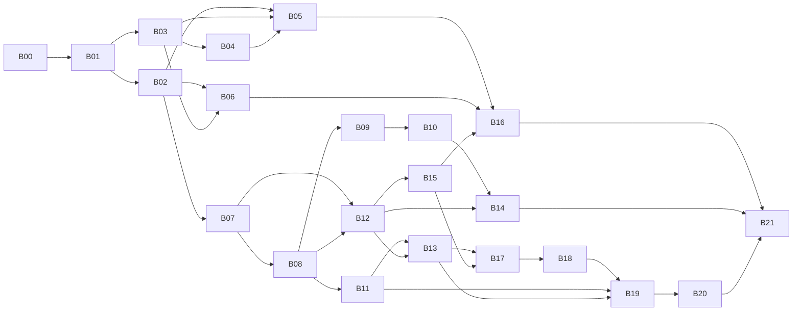

## 09 总体路线图：完整系统（前台 + 后台 + 采集）分批实施（MACC-23 / MACC-24 修订）

> **状态：路线图修订稿（MACC-24），待队长验收后定稿。** 本文只是计划，不实现任何产品功能，不部署，不访问线上站点或数据库。
>
> **依据与优先级**（从高到低）：
> 1. 用户 2026-10-16 在 MACC-23 追加的三条硬性要求：功能一样、MySQL 表一样、尽量不要外部调用（见第 1 节）。
> 2. MACC-23 任务说明（完整系统、批次化、验收与回滚要求、未获批准事项）。
> 3. `docs/analysis/03-migration-plan-draft.md`（以下简称"03 草稿"）。**03 草稿中与第 1 项冲突的设想全部作废**，逐条见第 2 节。
>
> 证据标记沿用 01 文档：【确认】读代码或本地运行确认；【静态】只读代码；【待核实】仓库证据不足。路径相对仓库根目录。

### 0. 一页摘要

- **范围**：新系统（Java，`backend/`）在功能上与旧 MacCMS v10 对齐，**不增不减**；沿用现有 26 张 `mac_*` 表，**零结构变更**（不建表、不加列、不改列，也不改索引、引擎、字符集、触发器）；运行时**默认不发起任何出站网络调用**。
- **配置与权限**：配置仍以 `application/extra/*.php`、`application/route.php` 这类 `var_export` 格式的 PHP 数组文件为唯一来源（与 `mac_arr2file` 相同，`application/common.php:126-139`）；管理员权限仍用 `mac_admin.admin_auth` 的 `,控制器/方法,` 文本语义；采集分类绑定仍在 `application/extra/bind.php`。
- **外部调用**：旧系统共 13 类出站或依赖外部平台的调用点（第 4 节），**全部"未获用户确认"**，全部不进入可实施批次。可以用本地替代的（采集→本地文件源，上传→本地存储等）放进可实施批次，只做本地版本；没有本地替代的（支付、短信、邮件、第三方登录等）单列为"待确认批次"，等用户决定。
- **批次**：本修订占用 MACC-24（B00）；实施批次 B01～B21 在建任务时依次取号（MACC-25 起），号码在第 5.1 节回填。顺序是：积压合并 → 只读补全 → 写入基础 → 会员与互动 → 后台（登录鉴权 → 内容 → 会员财务 → 系统配置 → 生成/定时）→ 采集（配置 → 本地预览 → 入库）→ 全量验收与切换演练。
- **待用户决策**：第 8 节共 9 项，每项都写明"等用户"要回答的问题。它们不影响 B01～B08 开工；B09 起各批开工前需要的决策在批次表中标出。

### 1. 硬性约束

#### 1.1 功能一样（不增不减）

- **对齐基线**：仓库中的旧代码（生产备份 2026-07-11）的可观察行为，包括页面与接口的输入输出、URL、写库效果、配置项及其生效方式、后台菜单与权限点（`application/admin/common/auth.php`）。线上配置与模板缺失（01 第 1 节），凡是依赖线上取值的地方按"仓库代码 + 配置项全部取值"对齐，线上取值【待核实】。
- **不增**：不加旧系统没有的功能或配置项。03 草稿中的"按资源站并发与限速、断点续采、TLS 校验开关、SSRF 网段屏蔽"（03 第 4.4 节）、"新系统自己的登录日志表"（03 第 4.3 (7) 节）等新增能力全部撤回。纯内部实现上的不同（例如进程内缓存代替 ThinkPHP 文件缓存、计数用原子 `x=x+1` 代替先读后写）不算功能增减，但要在对应批次文档里写明差异。
- **不减**：旧系统的每个功能都要么在某个可实施批次里实现，要么列在第 4 节（因外部调用待确认）或第 8 节（等用户决定），不允许无记录地丢掉。完整对照见第 3 节。
- **安全问题怎么算**：01 第 10 节的哈希登录、openid 直接登录、定时任务无鉴权等问题，修了是"行为不同"，不修是"复刻漏洞"。这不是功能增减，但仍要用户拍板，见第 8 节 D2。

#### 1.2 MySQL 表一样（零结构变更）

| 允许 | 不允许 |
|---|---|
| 对现有 `mac_*` 表执行 `SELECT/INSERT/UPDATE/DELETE`，按"表 + 操作"单一写入方规则（02 规范第 3 节）；写入只在本地开发库或一次性库上发生，直到用户批准切换 | `CREATE/ALTER/DROP/RENAME/TRUNCATE TABLE`；新增表、列、索引、FULLTEXT；修改列类型、长度、默认值；引擎（MyISAM→InnoDB）和字符集（utf8→utf8mb4）转换；触发器、存储过程、视图、事件；在应用代码里放 `schema.sql`、Flyway/Liquibase 等任何自动迁移 |
| 新系统自己的运行状态放在**库外**：会话在进程内存，缓存在进程内，采集预览缓存放在本地运行目录，日志写文件 | 为新系统的运行状态新建任何表（包括"新系统自己的日志表"、"采集断点表"、"权限拆行表"） |
| 测试时在一次性库 `maccms_it_*` 中原样导入 `application/install/sql/install.sql` | 在 `maccms_dev` 或任何已有库上导入、清空、改结构 |

- **没有结构迁移，也就没有迁移脚本**。旧数据**不需要迁移**：新旧系统读写同一套表。所谓"切换"只是某个"表 + 操作"的写入方从 PHP 换成 Java。原 MACC-23 要求的"新表/列的前向+回滚脚本"改为**数据层面的回滚演练**：切换前对受影响的表做快照，切换窗口内的新写入可以逐行核对，回滚时只用 DML 恢复。做法见 B07。
- **后果需要用户知道**（不是新的待决问题，而是本约束的直接结果）：
  - 资金类表（`mac_user` 积分、`mac_order`、`mac_card`、`mac_cash`）仍是 MyISAM，没有事务。新系统靠"单语句原子 + 条件更新 + 检查影响行数 + 固定写入顺序与补偿"保证一致，与旧系统相比只会更严，不会更松。
  - 密码仍是不加盐的 md5：`mac_user.user_pwd` 是 `varchar(32)`、`mac_admin.admin_pwd` 是 `char(32)`（`install.sql:633,75`），放不下 bcrypt/argon2 的输出，也不能加 v2 列，所以 03 第 4.3 (3)(7) 节的渐进升级整体撤回。是否接受这个风险见 D6。
  - 关键字搜索只能是 `LIKE '%x%'` 扫描，与旧系统相同；MACC-19 测得 100 万行时的代价不能靠 FULLTEXT 或换引擎解决，见 D7。

#### 1.3 尽量不要外部调用

- **默认**：新系统运行时不发起任何出站网络请求（HTTP、SMTP、FTP、第三方 SDK、DNS 查询外部主机等）。B02 增加一条静态护栏测试，扫描 `backend/src/main` 中的出站网络 API（`java.net.http`、`HttpURLConnection`、`URL.openConnection/openStream`、`Socket`、Spring `RestClient/RestTemplate/WebClient`、JavaMail、FTP 客户端、jsoup `Jsoup.connect` 等），只允许出现在一个**空的** `integration` 包白名单里；任何外部调用获批前，这个包保持为空。
- **入站接口不算出站**：Provide（对外提供资源）、Receive（外部推送入库）、Timming（外部 cron 触发）由别人调用本系统，本系统不因此向外发请求，可以进入可实施批次。微信公众号回调与支付回调虽然也是入站，但离开第三方平台就无法使用，所以放在第 4 节一起等用户决定。
- **获批流程**：第 4 节某一项需要实现时，先停下，在任务评论里告知调度员转报用户；用户明确同意后，把该项状态改为"已确认（日期、范围）"，再为它建批次。未确认之前，对应功能按第 4 节的"替代方案"实现，或者不实现、只保留配置项的读写。
- **构建期不在此列**：Maven Wrapper 和依赖下载发生在开发机构建时，不是运行时调用；生产包是自包含 jar。

### 2. 03 草稿中被本修订取代的设想

| 03 草稿位置 | 原设想 | 本修订的处理 |
|---|---|---|
| 第 2 节 阶段 A "拟新增的表或列" | `sys_config`（配置入库） | **撤回**。配置仍在 `application/extra/*.php` 和 `route.php`，格式与 `mac_arr2file` 相同。Java 读取见 B02，写回见 B15 |
| 同上 | `collect_bind`（分类绑定入库） | **撤回**。仍用 `application/extra/bind.php`，键为 `md5(采集URL)_远程分类ID`（`common/model/Collect.php:211-217`），见 B17 |
| 同上 | `admin_permission`（权限拆行） | **撤回**。Java 后台直接按 `admin_auth` 文本判定，权限码与 `auth.php` 一一对应，见 B12 |
| 同上；第 4.3 (3)(7) 节 | `mac_user.user_pwd_v2/_src`、`mac_admin.admin_pwd_v2/_src`、`BEFORE UPDATE` 触发器 | **撤回**。密码按旧语义只写 `user_pwd`、`admin_pwd`（03 第 4.3 (1) 节的逐入口字节语义仍然有效），见 B09、B12 与 D6 |
| 第 2 节 引擎与字符集转换 | MyISAM→InnoDB、utf8→utf8mb4 作为独立维护步骤 | **移出路线图**。属于表结构变更，本路线图不计划；以后若要做，需用户另行批准 |
| 第 4.3 (7) 节 | 新后台登录记录写到新系统自己的日志表 | **撤回**。写应用日志文件，不记录密码和会话标识 |
| 第 3.3 节 阶段 1 | 搜索结果缓存放在新系统自己的 Redis | **撤回**。不引入新的基础设施；需要缓存时用进程内缓存。`vod_search_optimise` 打开时，旧行为是写 `mac_vod_search`，新系统在 B11 按旧行为实现 |
| 第 4.4 节 | 采集新增能力：并发限速、断点续采、TLS 校验、SSRF 防护 | **撤回**（功能增加）。在线采集本身待确认（第 4 节 E01）；获批时再和用户确定 TLS 与 SSRF 的处理 |
| 第 4.4、4.6 节 | Timming 改为必须鉴权；Provide IP 白名单只信任可信代理 | **改为待决**，见 D2 |
| 第 3.2～3.7 节 | 分阶段绞杀：PHP 写入守卫 G1、内网入库端点 E1、到期降级开关 C1、会员组缓存 C2 等 PHP 改动，以及数据库账号表级权限 | **改为待决**，见 D3。开发与本地演练不依赖这些改动；推荐的"整体切换"不需要修改 PHP |
| 第 4.7 节 | 模板走改写（甲）还是兼容层（乙） | 前台已经按改写路线实施（MACC-7/9/13/14，jte）。由此带来的"后台模板在线编辑"等功能对齐问题见 D4 |
| 第 5 节 | 影子流量（nginx mirror） | 涉及部署与生产流量，仍未获批准；本路线图的验收只用本地黄金样本与一次性库 |

03 草稿中**仍然有效**的内容：第 3.1 节旧写入入口清单、第 4.1～4.2 节内容与播放串兼容、第 4.3 (1)(4)(6) 节密码字节语义/cookie/会员组规则、第 4.5～4.6 节 URL 与接口协议、第 5 节黄金样本方法（只在一次性库上采集）。

### 3. 现状盘点与功能对齐总表

#### 3.1 MACC-3～22 成果与合并状态

核对方式：2026-10-16 在本任务工作区执行 `git merge-base --is-ancestor`、`git cherry -v main <分支>`。main 当前为 `3f81c72`。Multica 上 MACC-3～20、22 状态均为 `in_review`，MACC-21 为 `todo`。

| 任务 | 成果 | main 合并状态 |
|---|---|---|
| MACC-3 | 现状分析、Go/Java 选型、迁移草稿（`docs/analysis/01～03`） | 已合入（分支头 `ca0b884` 是 main 祖先） |
| MACC-4 | Java 工程骨架、content 首批只读 API、契约 1.0.0 | 已合入（`3ba858b`，整合提交 `39d9039`） |
| MACC-5 | 前台页面与旧 URL 兼容清单（`docs/frontend/`） | 内容已由整合提交 `9af83fb` 合入；分支上的原始提交未作为祖先合入，无需再合 |
| MACC-6 | 前台只读页面方案（`03-frontend-readonly-plan.md`） | 已合入（等价提交 `a9dbdbc`、`e64f7b3`、`5303e8d`） |
| MACC-7 | 模板引擎选型实验（jte）（`04-site-template-spike.md`） | 已合入（`340b2f9`、`650c258`） |
| MACC-8 | content 已发布只读类型与依赖边界护栏 | 已合入（`9870f92`） |
| MACC-9 | site jte 骨架与站点配置 | 已合入（`a98b53d`） |
| MACC-10 | 旧 URL 生成/解析与 PHP 黄金向量 | 已合入（`255c471`、整合 `9413b74`） |
| MACC-11 | 图片地址规范化 | 已合入（`b3e7e1c`） |
| MACC-12 | 富文本白名单过滤 | 已合入（`143af3c`、`ac068f4`、`a96cfd3`） |
| MACC-13 | 视频卡片与分页组件、响应式样式 | 已合入（`1461539`）。Kimi 分支上另有 `1ac9f78`，经逐文件比对是 MACC-10 文件的副本（除 `05-site-skeleton.md` 的旧版外与 main 相同），**不合并** |
| MACC-14 | 首页、分类、视频详情 SSR 三页 | 三页已合入（`10a0701`）。**后续修复 `a0f49e6`（沿 cause 链识别被 MyBatis 包装的连接故障，返回 503）未合入 main，也不在整合分支里**；整合分支的 `ContentReadService` 仍只捕获外层异常类型。要在 B01 补上 |
| MACC-15 | 三页响应式样式与 CSS 护栏 | 已合入（`e947b1c`、`3f81c72`）。Kimi 分支上的 `4a05971` 只有 `.qwen/tmp/` 截图，**不合并** |
| MACC-16 | 搜索与筛选方案（`09-content-search-filter-plan.md`） | **未合入**，在整合分支 `agent/codex/macc-2` |
| MACC-17 | base-url 长度与旧 PHP 子目录兼容 | **未合入**，在整合分支 |
| MACC-18 | 搜索/筛选只读 API，契约 1.1.0 | **未合入**，在整合分支 |
| MACC-19 | 一次性库搜索性能、EXPLAIN 与表锁测量 | **未合入**，在整合分支 |
| MACC-20 | SSR 搜索页 | **未合入**，在整合分支 |
| MACC-21 | 搜索页响应式样式（Kimi） | 未开始（`todo`） |
| MACC-22 | MySQL 1028 排序中止归为 503 | **未合入**，在整合分支 |

整合分支 `agent/codex/macc-2`（头 `edd5eea`）的分叉点就是 main `3f81c72`，可以快进合并。合并后 `docs/architecture/` 下会同时有 `09-content-search-filter-plan.md` 和本文 `09-roadmap.md` 两个 09 编号，内容不冲突，本修订按任务要求保留文件名。

**已有能力**（合并整合分支之后）：视频分类、视频分页列表、视频公开详情、视频搜索与筛选（关键字默认关闭）的只读 API；首页、分类/筛选列表、视频详情、搜索四个 SSR 页面（只对游客，默认关闭）；旧 URL 生成与解析、图片地址、富文本过滤；模块边界、只读连接、异常日志脱敏等护栏。**没有任何写库路径，没有任何出站调用。**

#### 3.2 功能对齐总表（旧功能 → 批次）

"本地版"指去掉外部调用后能在本地实现的部分；"E0x"指第 4 节外部调用清单的编号；"Dx"指第 8 节待决事项。

| 旧功能（入口） | 批次 | 说明 |
|---|---|---|
| 首页、视频分类/筛选/详情/搜索（`index/controller/{Index,Vod,Search}`） | 已有 + B04 | 剩余筛选参数（`letter/state/version/actor/director/tag/ids/timeadd` 等）、`rnd` 在 B03/B04 |
| 视频播放、下载页，`player_aaaa`，观看密码，试看（`Vod::play/player/down/downer`、`Ajax::pwd`） | B05（游客）+ B10（会员权限与扣积分） | 前端播放器资源原样复用；播放器"解析接口"属于浏览器侧外部资源（第 4.2 节 W1） |
| 文章、专题、演员、角色、网址、剧情各页及 `ajax_*`、`rss`（`Art/Topic/Actor/Role/Website/Plot`） | B03 + B05 | |
| 地图、RSS（baidu/google/so/sogou/bing/sm）、自定义标签页、帮助、公告、版权页、二维码、桌面快捷方式、联想词、`ajax/data` | B06 | 二维码在本地生成 |
| 手机模板（`mob_status`）、语言包（`application/lang/zh-cn.php`、`zh-tw.php`） | B05、B12 | |
| 资源站对外接口 Provide（`api/controller/Provide.php`） | B06（只读）+ B11（`detail_inc_hits` 计数） | |
| 会员注册、登录、退出、资料、头像、密保找回（`index/controller/User.php`） | B08 + B09 | 短信/邮件验证码、绑定、找回走 E06/E07；第三方登录走 E10 |
| 会员中心：收藏、播放/下载记录、积分日志、购买观看权限、升级会员组、卡密充值、提现、推广、订单 | B10 | 在线支付下单与回调走 E04/E05；本地创建订单在 B10 |
| 评论、留言（`Comment`、`Gbook`）及顶踩、举报 | B11 | |
| 点击、顶踩、评分、网址访问计数、搜索优化写 `mac_vod_search` | B11 | |
| 后台登录、锁屏、管理员管理、权限、首页、清缓存 | B12 | |
| 后台内容管理：视频（含批量、分集剧情、查重）、分类（扩展、转移）、文章、专题、演员、角色、网址、友链、评论、留言、附件、图片、上传 | B13 | 远程图片同步走 E02；远程存储走 E08，本地上传在 B13 |
| 后台会员与财务：会员、会员组、卡密、订单、提现、积分日志、行为日志、推广访问 | B14 | |
| 后台系统配置（`System::config*` 各组）、URL 路由生成、播放器/服务器/下载器、站群、模板与广告、数据库工具、推送配置 | B15 | 模板在线编辑见 D4；插件见 D5；邮件测试走 E07；回链检测走 E11；推送执行走 E09 |
| 静态生成（`Make`）、定时任务（`Timming`） | B16 | 定时任务中的在线采集、规则采集、推送任务分别依赖 E01/E03/E09 |
| 采集源、分类绑定、采集参数、自定义规则节点管理 | B17 | |
| 资源站采集解析与预览 | B18（本地文件源） | 在线抓取走 E01 |
| 采集入库（合并规则）、Receive 入库接口 | B19 | |
| 自定义规则采集（`Cj`） | B20（本地 HTML 源） | 在线抓取走 E03 |
| 支付、短信、邮件、远程存储、搜索引擎推送、第三方登录、微信公众号 | 待确认批次 P01～P09 | 第 4 节 |
| 插件机制（`Addon`） | D5 | 仓库中只有一个未启用插件 |
| 在线升级（`Update`） | 不实施 | 旧代码中 `Update.php` 是空类（8 行），只有欢迎页留了链接（`welcome.html:45-46`）；对齐结果就是"无此功能" |
| 安装向导（`install.php`） | D8 | 新系统连接已有库，不需要建表；是否要一个等价的"首次初始化管理员"流程等用户决定 |

### 4. 外部调用清单

**状态说明**：本节所有条目当前均为 **"未获用户确认"**。获批后在"确认状态"列写明日期与范围。行号来自当前提交的静态核对【静态】。

#### 4.1 服务端出站调用与依赖外部平台的入站集成

| 编号 | 调用点（旧代码） | 目的 | 所属批次 | 无外部调用的替代方案 | 确认状态 |
|---|---|---|---|---|---|
| E01 | 资源站采集抓取：`application/common/model/Collect.php:169`（`vod_xml`）、`:319`（`vod_json`）、`:1078`（`art_json`）、`:1405`（`actor_json`）、`:1697`（`role_json`）、`:1996`（`website_json`）、`:2286`（`comment_json`）；底层 `mac_curl_get`（`application/common.php:607`）；入口 `admin/controller/Collect.php`，定时任务 `api/controller/Timming.php:64-70` | 从苹果CMS 资源站拉取 JSON/XML 数据 | 待确认批次 P01；B18/B19 只实现本地版 | **本地文件源**：后台上传或放入本地目录的 Provide 协议 JSON/XML 文件，走同一套解析、预览、入库（B18、B19）；外部推送用 Receive 入站接口（B19） | 未获用户确认 |
| E02 | 远程图片下载：`application/common/model/Image.php:23`（`down_load`），由采集同步图片 `common/model/Collect.php:400` 与后台图片同步 `admin/controller/Images.php:164,199` 调用 | 把远程图片下载到本地或远程存储 | P02 | 保持库内图片地址不变（相当于 `sync_pic_opt` 关闭）；后台图片同步只处理已在本地的文件 | 未获用户确认 |
| E03 | 自定义规则采集抓取：`application/common/util/Collection.php:236`；入口 `admin/controller/Cj.php`，定时任务 `api/controller/Timming.php:78` 起 | 按规则抓取任意网页并提取字段 | P03；B20 只实现本地版 | **本地 HTML 源**：规则作用于上传的 HTML 文件，提取、入库流程不变（B20） | 未获用户确认 |
| E04 | 支付下单：微信服务端请求 `common/extend/pay/Weixin.php:28`；支付宝、码支付、Zhapay 生成网关地址让浏览器跳转（`Alipay.php:26`、`Codepay.php:46`、`Zhapay.php:47`）；分发 `index/controller/User.php:523-526` | 在线充值 | P04 | 无等价替代。本地部分（`user/buy` 创建订单 `User.php:432-466`、卡密充值）在 B10 实现；"去支付"一步在获批前提示"支付未开通"（具体文案与旧版未配置支付时的表现对齐，B10 核对） | 未获用户确认 |
| E05 | 支付回调（入站，依赖支付平台）：`index/controller/Payment.php:13-30` → `common/extend/pay/*::notify` | 支付平台通知到账、加积分 | P04 | 无。后台手工处理订单（旧后台 `Order` 已有的功能）在 B14 实现 | 未获用户确认 |
| E06 | 短信：`mac_send_sms`（`application/common.php:379`）→ `common/extend/sms/Aliyun.php:62`、`Qcloud.php:150`；调用 `common/model/User.php:691`（注册、找回、绑定验证码） | 发送手机验证码 | P05 | 无。依赖短信的注册校验、手机找回、手机绑定在获批前不可用（与旧版"未配置短信"时的表现对齐，B09 核对）；密保问题找回不受影响 | 未获用户确认 |
| E07 | 邮件 SMTP：`mac_send_mail`（`application/common.php:406`）→ `common/extend/email/Phpmailer.php:20-22`；调用 `common/model/User.php:684`、后台测试发信 `admin/controller/System.php:34` | 发送邮箱验证码、测试邮件 | P06 | 无。同 E06 的处理；后台邮件配置页照常读写配置，"测试发信"在获批前不可用 | 未获用户确认 |
| E08 | 远程存储：`common/model/Upload.php:8-35`（`api()` 按 `upload.mode` 分发）→ `common/extend/upload/{Upyun,Qiniu,Ftp,Weibo,Alibaba,Uomg}`（如 `Alibaba.php:28`、`Uomg.php:35`、`common/util/SinaUpload.php:79,118`）；调用 `Upload.php:245-247`、`Image.php:89` | 上传后转存到第三方存储 | P07 | **本地存储**（`upload.mode=local`，旧版默认值之一）。获批前其他模式的配置项可读写，但上传一律落本地 | 未获用户确认 |
| E09 | 搜索引擎推送：`common/extend/urlsend/Baidu.php:20`、`Baidufast.php:20,34`；入口 `admin/controller/Urlsend.php:192-202`，定时任务 `api/controller/Timming.php:92` 起 | 向百度提交新 URL | P08 | 无出站替代。可在后台生成待推送 URL 列表供人工处理（旧版推送页本身就会列出 URL，B15 核对是否完全一致） | 未获用户确认 |
| E10 | 第三方登录：`index/controller/User.php:203-274`（`ThinkOauth::getInstance`、`getAccessToken`，`:207,219,223`）、`index/event/LoginEvent.php:10,27`；依赖的 `extend/login` 在仓库和备份中都缺失 | QQ/微信登录与绑定 | P09 | 无。获批前登录页不显示第三方登录（与旧版配置关闭时一致） | 未获用户确认 |
| E11 | 友链回链检测：`mac_check_back_link`（`application/common.php:432-444`）← `admin/controller/Index.php:192-196` | 抓取对方网站检查是否有本站链接 | 随 P08 一并决定 | 无。获批前该按钮返回"未开通" | 未获用户确认 |
| E12 | 微信公众号（入站，依赖微信平台）：`api/controller/Wechat.php:14-28`、`common/util/WechatPublic.php`（读 `php://input`，`:37`，被动回复，不发起出站请求） | 公众号关键字回复站内内容 | P09 | 无。获批前接口按旧版 `weixin.status=0` 的行为返回 `closed` | 未获用户确认 |
| E13 | 插件安装、升级：`admin/controller/Addon.php:143-162,314-332` → `think\addons\Service`（fastadmin-addons，在 `vendor/` 中、不在 git；是否联网下载【待核实】） | 安装、升级插件 | D5 | 不实现插件市场；本地插件机制见 D5 | 未获用户确认 |

#### 4.2 浏览器侧外部资源（服务端不发请求，列出备查）

| 编号 | 位置 | 说明 | 处理 |
|---|---|---|---|
| W1 | 播放器"解析接口"：`application/extra/vodplayer.php` 各播放器的 `parse` 字段，`static/js/player.js` 按 `ps=1` 走解析 iframe | 由站长配置的第三方解析地址，浏览器直接访问 | 属于站点数据与配置，新系统原样输出，不改变；不新增任何默认外部地址 |
| W2 | 库内的外链图片、外部播放地址（`vod_pic` 等 `http(s)` 地址，`mac:` 前缀规则见 06 文档） | 浏览器加载 | 原样输出（已在 MACC-11 实现） |
| W3 | 支付网关跳转（E04 中的支付宝、码支付、Zhapay） | 浏览器跳到第三方 | 随 E04 一并决定 |

前台和后台页面**不引用任何 CDN**：新页面只用 `backend/` 内或仓库 `static/` 中的本地静态资源，B05、B12 的验收各含一条"页面无外部域名资源"检查。

### 5. 批次划分

#### 5.1 总表

负责：C = Claude 后端，K = Kimi 前端/模板，队长 = Codex 队长（合并、拆解、验收）。"需决策"指开工前需要第 8 节相应答复。

| 批次 | 任务号 | 名称 | 负责 | 前置 | 需决策 | 写库 | 出站 |
|---|---|---|---|---|---|---|---|
| B00 | MACC-24 | 本路线图修订 | C | — | — | 否 | 否 |
| B01 | 待建 | 积压合并与主线校验 | 队长 + C + K（MACC-21） | B00 | — | 否 | 否 |
| B02 | 待建 | 出站护栏、表结构护栏与旧配置只读层 | C | B01 | — | 否 | 否 |
| B03 | 待建 | content 只读补全：多值字段编解码、其余内容类型 | C | B01 | — | 否 | 否 |
| B04 | 待建 | 视频列表/筛选参数补全 | C | B01、B03 | — | 否 | 否 |
| B05 | 待建 | 前台只读页补全：播放/下载、文章、专题、演员、角色、网址、剧情 | C + K | B02、B03、B04 | — | 否 | 否 |
| B06 | 待建 | 杂项只读页与 Provide 只读接口 | C + K | B02、B03 | D2 | 否 | 否 |
| B07 | 待建 | 写入基础设施与切换方案（含回滚演练工具） | C | B02 | D3（只影响文档中的推荐，不阻塞开工） | 仅一次性库 | 否 |
| B08 | 待建 | 会员登录态、验证码与频率限制 | C | B07 | — | 仅一次性库 | 否 |
| B09 | 待建 | 会员账号：注册、登录、资料、找回 | C + K | B08 | D2、D6 | 是 | 否 |
| B10 | 待建 | 会员权益与财务：购买权限、升级、卡密、提现、推广、订单 | C + K | B09 | — | 是 | 否 |
| B11 | 待建 | 评论、留言与内容计数写入 | C + K | B08 | — | 是 | 否 |
| B12 | 待建 | 后台框架：登录、会话、`admin_auth` 鉴权、管理员管理 | C + K | B07、B08 | D2、D6、D8 | 是 | 否 |
| B13 | 待建 | 后台内容管理 | C + K | B11、B12 | — | 是 | 否 |
| B14 | 待建 | 后台会员与财务管理 | C + K | B10、B12 | — | 是 | 否 |
| B15 | 待建 | 后台系统配置与运维（配置文件写回） | C + K | B12、B02 | D4、D5 | 是（文件 + 库） | 否 |
| B16 | 待建 | 静态生成与定时任务 | C | B05、B06、B15 | D2 | 是（文件） | 否 |
| B17 | 待建 | 采集配置管理（先只读，再编辑） | C + K | B13、B15 | — | 是 | 否 |
| B18 | 待建 | 采集解析与预览（本地文件源） | C + K | B17 | — | 否（只写本地缓存） | 否 |
| B19 | 待建 | 采集入库与 Receive 接口 | C | B18、B13、B11 | — | 是 | 否 |
| B20 | 待建 | 自定义规则采集（本地 HTML 源） | C + K | B19 | — | 是 | 否 |
| B21 | 待建 | 全量对齐验收与切换演练 | 队长 + C + K | B01～B20 | D3 | 仅一次性库 | 否 |
| P01～P09 | 不建 | 待确认批次（第 5.4 节） | — | 用户确认 | 第 4 节 | — | 是 |

#### 5.2 依赖关系

- **可以并行**：B02 / B03 并行；B05 / B06 / B07 并行；B09～B10 与 B11、B12 并行（不同表，见 5.3 的写入方矩阵）；B13 / B14 / B15 并行。每个 C + K 批次内部，Kimi 的模板与样式（`backend/src/main/jte/site/components/`、`backend/src/main/resources/static/site/`，以及 B12 起的后台组件目录）与 Claude 的后端代码并行，组件 `@param` 签名在批次开工时双方确认（02 规范第 7 节）。
- **必须串行**：B07（写入基础）在任何写库批次之前；content 写路径（B11 计数、B13 内容后台）在采集入库 B19 之前；采集按 B17 配置 → B18 预览 → B19 入库 → B20 规则采集；后台按 B12 登录鉴权 → B13 内容 → B15 系统配置；B21 在所有可实施批次之后。
- **同文件冲突**：B13、B14、B15 都会改后台菜单与权限映射，由 B12 先把 `auth.php` 的全部权限码一次性落地，后续批次只增实现、不改映射。

#### 5.3 各批次的交付物、验收、风险与回滚

**通用验收**（每批都适用，下文不再重复）：
- `./mvnw verify` 通过；改动 Mapper/SQL/数据访问时 `./mvnw verify -Pmysql-it` 通过（只用一次性库，02 规范第 5 节）。
- 契约、DTO、契约测试在同一提交里一致；与旧 PHP 的差异写进本批的 `docs/architecture/` 文档。
- **黄金样例**：凡是"与旧行为一致"的断言，都用旧 PHP 在一次性库上实际运行产生的向量（PHP CLI 脚本放在 `backend/src/test/php/`，只调用旧函数，不改旧代码；MACC-10/11 已有先例）。
- **护栏**：B02 的出站护栏、表结构护栏通过；只读批次另外确认没有新增写路径；写库批次只写 5.3 写入方矩阵中登记给本批的"表 + 操作"。
- **写库批次另加**：并发写测试（一次性库，多线程，覆盖本批每一个"先查后写"的操作）；回滚演练（B07 的工具：快照 → 运行本批写操作 → 只用 DML 恢复 → 与快照逐行比对为空）。
- **代码回滚**：每批以一个合并提交进入 main；出问题时 `git revert` 该合并提交，回到上一 main 快照，再跑 `./mvnw verify`。因为不改表结构、不改 PHP、不部署，代码回滚不涉及数据库或生产环境。下表"回滚"列只写本批额外需要的步骤。

| 批次 | 交付物 | 本批验收要点 | 主要风险 | 回滚（额外） |
|---|---|---|---|---|
| B01 | main 包含 MACC-16～20、22（快进合并整合分支 `edd5eea`）；MACC-14 的 `a0f49e6` 按整合后的 `ContentReadService` 重新实现（cause 链识别连接故障 → 503，含原测试）；MACC-21 由 Kimi 完成并合入 | 合并后 main 上 `./mvnw verify`、`-Pmysql-it` 通过（评论贴输出摘要）；`a0f49e6` 的三条测试在 main 上通过；`1ac9f78`、`4a05971` 确认不合并 | `a0f49e6` 与 MACC-18/22 对同一方法的改动冲突 | 无 |
| B02 | ① 出站护栏测试（1.3 节）；② 表结构护栏：静态扫描 `src/main` 中的 DDL 关键字（`CREATE/ALTER/DROP/RENAME/TRUNCATE`）；`-Pmysql-it` 结束时比对 `information_schema`（列、索引、引擎、字符集）与导入 `install.sql` 时完全一致；③ `legacyconfig` 模块：只读解析 `var_export` 格式的配置文件（数组、字符串转义、整数、浮点、布尔、`NULL`），目录由环境变量指定，按修改时间热加载，遇到非 `var_export` 结构直接拒绝（不执行任何 PHP） | 仓库内 `application/extra/*.php` 与 `route.php` 全部能解析；黄金向量：PHP `include` 后 `json_encode` 与 Java 解析结果逐项相等；畸形输入、超大文件、路径穿越被拒绝；`site` 已有的设置项改为从这里读取时行为不变（保留现有环境变量覆盖作为本地开发手段，是否保留由本批文档说明） | 线上配置文件可能含仓库里没有的写法【待核实】 | 无 |
| B03 | 播放串、下载串、分集剧情、文章分页等多值字段的编解码（与 `mac_play_list`、`mac_play_list_one` 等等价，`common.php:1294-1455`）；文章、专题、演员、角色、网址、友链、剧情的只读服务与 API（列表、详情、可见性） | 03 第 4.2 节列的边界向量全部与 PHP 一致；各类型列表的过滤与排序按各模型 `listCacheData` 对齐，ID 序列与 PHP 黄金样本一致 | 字段多、规则散在 3000 行的 `common.php` | 无 |
| B04 | 视频列表剩余参数：`letter/state/version/actor/director/tag/ids/timeadd/isend` 等、`rnd`、年份区间（MACC-16 方案中"暂缓"的部分） | 黄金样本 ID 序列一致；包含匹配类参数沿用 MACC-18 的时限、并发上限与 503 规则 | 包含匹配在大表上慢（MACC-19 结论） | 无 |
| B05 | SSR 页面：视频播放页（`player_aaaa` 结构与 `app.encrypt` 0/1/2，`common/controller/All.php:533-540`）、下载页、观看密码页、试看；文章、专题、演员、角色、网址、剧情各页与 `ajax_*` JSON、`rss`；手机模板切换；语言包 | `player_aaaa` 与 PHP 黄金样本逐字段一致；游客的播放/下载/试看权限按 `group_popedom` 判定一致；`static/js/player.js` 与 `static/player/*` 原样复用；页面无外部域名资源；键盘与窄屏检查（沿用 MACC-15 的护栏） | 线上模板缺失，页面外观无法与线上比对（D9） | 无 |
| B06 | 地图、RSS 各格式、自定义标签页、帮助、公告、版权、二维码（本地生成）、桌面快捷方式、联想词、`ajax/data`；Provide 只读（`ac=list/videolist/detail`，vod/art/actor/role/website/comment，JSON/XML，`closed`、`cachetime`、`charge` 白名单） | 输出与 PHP 黄金样本逐字节或按字段一致（XML 允许属性顺序不同，需在文档写明）；`detail_inc_hits` 开启时本批**不写计数**，在 B11 补齐，文档写明这段时间的差异 | Provide 的 IP 白名单依赖可伪造的请求头（01 第 10 节第 7 条，D2） | 无 |
| B07 | ① 可写数据源：与只读连接池分开，单独的环境变量账号，默认关闭；② "表 + 操作"写入方登记表（5.3 末尾矩阵）和对应的测试护栏（只有登记的模块的 Mapper 能写对应表）；③ 写 SQL 规范：单语句原子、条件更新并检查匹配行数（`useAffectedRows=false`，即按匹配行数）、多表写的固定顺序与补偿、幂等键；④ 并发写测试框架；⑤ 回滚演练工具（对一次性库中受影响的表做快照、逐行 diff、生成 DML 恢复语句）；⑥ 切换方案文档：整体切换与分阶段两种方式的步骤、封堵手段、回滚门槛（D3）；⑦ 更新 02 规范第 3 节（"DDL 独立评审"改为"禁止 DDL"） | 护栏能抓到"未登记模块写表"的合成用例；回滚工具在一次性库上完成一次"写入 → 恢复 → diff 为空"；可写数据源未开启时应用仍只读 | 规范与工具设计不当会拖累后续每个写批次 | 无 |
| B08 | 会员 cookie 校验与签发（`user_check = md5(user_random-用户名-ID-)`，同名、同 path、不设 domain，03 第 4.3 (4) 节）；会员组到期的内存判定与批量降级语句；验证码（本地生成，参数取 `application/extra/captcha.php`）；频率限制（`mac_get_time_span` 的语义，会话在进程内存） | cookie 编码黄金向量（含中文、`&` 等用户名）；到期边界 `user_end_time == now`；PHP 签发的 cookie 能被 Java 认，反之亦然 | 字节语义不一致导致会员被登出 | 一次性库回滚演练 |
| B09 | 注册（含 `regcheck`）、登录、退出、`ajax_login/ajax_info`、资料修改与改密、头像（本地上传）、密保问题找回与重置；依赖短信/邮件的步骤按 E06/E07 的替代方案处理 | 03 第 4.3 (1) 节逐入口的密码字节语义黄金向量全部通过；注销与改密是否更新 `user_random` 按 D2 的结论；并发：同名注册不产生两条记录（MyISAM 无唯一约束时用条件插入或串行化，方案写进本批文档）；回滚演练 | 无唯一约束下的并发重复注册；密码语义偏差 | 回滚演练 |
| B10 | `ajax_ulog`、收藏/播放/下载记录与删除、积分日志与删除、`ajax_buy_popedom` 与 `popedom`（积分购买观看）、`upgrade`（积分升级会员组）、卡密充值、提现申请与撤销、推广奖励与访问记录、订单列表与详情、`buy` 本地创建订单；会员组到期降级批量任务 | 扣积分用 `WHERE user_points >= ?` 的条件更新，只在匹配 1 行时写 `mac_ulog`/`mac_plog`；卡密用 `WHERE card_use_status=0` 条件更新；并发重复购买、重复用卡、重复提现的测试；对账脚本（积分、订单、卡密、提现总额）在一次性库上前后一致；回滚演练 | MyISAM 多表写入中途失败造成不一致 | 回滚演练 + 对账 |
| B11 | 评论与留言（列表、`ajax`、发表、举报、顶踩；审核开关、过滤词、验证码、频率限制）；`ajax/hits/digg/score/referer/pwd/verify_check/suggest`；`updateToday`（日/周/月点击重置）；Provide `detail_inc_hits`；`vod_search_optimise` 打开时写 `mac_vod_search` | 与 PHP 黄金样本的写库效果一致（逐列比对）；计数用原子自增，文档写明"并发时旧版会丢计数、新版不会"这一实现差异；并发计数测试；回滚演练 | 计数写与长查询在 MyISAM 上互相阻塞（MACC-19 已测到） | 回滚演练 |
| B12 | 后台框架：登录（`md5(原值)`，不 trim，03 第 4.3 (7) 节）、验证码、锁屏解锁、退出、首页、快捷菜单、清缓存；会话在进程内存；`admin_auth` 文本鉴权（`admin_id=1` 为超级管理员，`admin/controller/Base.php:42-58`），菜单与权限码完整照搬 `application/admin/common/auth.php`；管理员增删改与状态；后台入口路径可配置；后台页面复用仓库 `static/` 中的 layui 资源（本地） | 管理员密码黄金向量（含首尾空格、只含空格的密码）；`auth.php` 每个权限码都有对应路由或明确标注"由后续批次实现"；非超级管理员越权访问被拒绝；页面无外部域名资源；回滚演练 | 权限码映射遗漏导致越权 | 回滚演练 |
| B13 | 视频（列表、新增编辑、批量修改、删除、字段修改、分集剧情、查重、`updateToday`）；分类（扩展字典、转移）；文章、专题、演员、角色、网址、友链；评论、留言审核编辑；附件、图片（本地）、上传（本地存储） | 各表的增删改效果与 PHP 黄金样本逐列一致；后台视频表单带计数字段时的整行覆盖行为与旧版一致（03 第 3.1 节）；查重不使用临时表（旧版用 MyISAM 临时表，`admin/controller/Vod.php:103-105`；临时表虽不改已有表，但仍算 DDL，改为纯查询实现，文档写明）；并发编辑测试；回滚演练 | 表单字段多，遗漏字段导致数据被清空 | 回滚演练 |
| B14 | 会员（列表第 1 页的到期降级、编辑、删除、字段修改）、会员组（`group_type`、`group_popedom` JSON）、卡密（生成、导出、删除）、订单（含手工改状态）、提现审核、积分日志、行为日志、推广访问 | 同 B13；资金类对账；后台改会员密码按 `md5(原值)`、不 trim（与旧后台一致，03 第 4.3 (1) 节） | 后台手工改订单与会员中心并发 | 回滚演练 + 对账 |
| B15 | `System::config*` 各组配置写回 `application/extra/*.php`（输出与 PHP `var_export` + `mac_arr2file` 逐字节一致）；`route.php` 生成（`System::configurl`，`System.php:164-232`）；`static/js/playerconfig.js` 生成（`admin/controller/Base.php:85-103`、`System.php:675-690`）；播放器/服务器/下载器管理与导入导出；站群；模板列表与广告位；定时任务配置；数据库工具（备份、还原、优化、修复、批量替换、执行 SQL——这些是站长手工操作，不属于新系统自动 DDL）；推送配置页 | 写回文件与 PHP 生成的文件逐字节相同（黄金向量覆盖转义、浮点、空数组、中文）；写入用临时文件 + 原子改名，并检查读到的修改时间/哈希，防止两个管理员并发覆盖；B02 的读取层能读回本批写出的文件；回滚演练（文件快照 + 库快照） | 写坏配置文件会让 PHP（若仍在运行）和 Java 都无法启动 | 回滚演练：从快照恢复配置文件，diff 为空 |
| B16 | 静态生成（首页、分类、详情、专题、地图、RSS、标签页，写入配置的本地路径）；`Timming` 触发接口与任务调度（生成、清缓存；采集与推送任务只在相应外部调用获批或本地文件源模式下执行）；每次执行回写 `timming.php` 的 runtime（`api/controller/Timming.php:42`） | 生成的文件与 PHP 生成结果一致（允许时间戳等可变字段差异，需列明）；runtime 回写格式与 PHP 一致；Timming 的鉴权按 D2 的结论 | 大量文件写入的磁盘与耗时 | 删除本批生成的文件 |
| B17 | 采集源（`mac_collect`）、分类绑定（`extra/bind.php`）、采集规则参数（`maccms.php` 的 `collect.*`，配置页属于 B15，本批只处理绑定与采集源）、自定义规则节点（`mac_cj_node`）的管理页面。先交付只读查看，再交付编辑 | 增删改与 PHP 一致；`bind.php` 键算法 `md5(url)` 不变；**本批不发起任何请求**（"测试连接"类按钮按 E01 替代方案处理） | — | 回滚演练 |
| B18 | 本地文件源：后台上传或从配置的本地目录读取 Provide 协议文件（vod/art/actor/role/website/comment，JSON/XML）；解析（禁用 XML 外部实体，与 `Collect.php:175` 一致）、按绑定映射分类、按过滤规则筛选；结果存本地运行目录的缓存（**不写库**）；预览页 | 同一份文件经 PHP 解析与经 Java 解析得到的字段一致（PHP 侧用 `vod_xml($param, $html)` 可直接传入内容；JSON 路径的取数方式在本批文档说明）；畸形文件、超大文件被拒绝 | 资源站协议有非标准变体【待核实】 | 删除本地缓存 |
| B19 | 入库：`inrule` 查重、`uprule` a～w 更新规则、播放组按 `$$$` 追加或替换、`urlrole` 合并去重、`filter/filter_from/opt`、随机点击数、`mac_vod_search` 更新（`common/model/Collect.php:420-1015`）；入库来源为 B18 的本地缓存，或 Receive 入站接口（`api/controller/Receive.php`，`pass` 校验与长度要求不变）；入库串行 | **影子合并对比**：同一批输入，PHP 在一次性库 A 上执行 `Collect::*_data`，Java 在同样初始数据的一次性库 B 上入库，两库相关表逐行 diff 为空（或差异逐条有解释）；并发提交同一条视频不产生重复（入库排队）；回滚演练 | 合并规则复杂，误覆盖已有数据 | 回滚演练 |
| B20 | 自定义规则采集：规则执行（`common/util/Collection.php`）作用于上传的本地 HTML；`mac_cj_content`、`mac_cj_history` 写入；导入走 B19 | 同一规则与 HTML 在 PHP 与 Java 上提取结果一致；回滚演练 | 规则语法边界多 | 回滚演练 |
| B21 | 功能对齐总表（3.2 节）逐项 ✅ 或"经用户批准排除"；在本地开发库的**一次性副本**上演练 D3 选定的切换方式（含封堵、写入、对账、回滚）；全量护栏与性能冒烟 | 对齐总表无未处理项；切换演练记录（步骤、耗时、对账结果、回滚后 diff）；不部署 | 演练环境与线上差异（D9） | 演练副本直接删除 |

**写入方矩阵（开发期，均只在本地开发库或一次性库上生效）**：B07 落地时以此为初始登记表。

| 表 / 文件 | 写入批次 |
|---|---|
| `mac_user`（显式写入、到期降级） | B09、B10、B14 |
| `mac_group` | B14 |
| `mac_order`、`mac_card`、`mac_cash`、`mac_plog`、`mac_ulog`、`mac_visit`、`mac_msg` | B10、B14 |
| `mac_comment`、`mac_gbook` | B11、B13；采集评论 B19 |
| `mac_vod` 等内容表的计数字段 | B11（后台表单整行覆盖在 B13） |
| `mac_vod/art/topic/actor/role/website/link/type` 内容字段 | B13、B19、B20 |
| `mac_vod_search` | B11、B19 |
| `mac_admin` | B12 |
| `mac_annex` | B13 |
| `mac_collect`、`mac_cj_node` | B17；`mac_cj_content`、`mac_cj_history` 在 B20 |
| `application/extra/*.php`、`route.php`、`static/js/playerconfig.js` | B15（`bind.php` 在 B17，`timming.php` 的 runtime 在 B16） |
| 静态生成的 HTML 文件 | B16 |

#### 5.4 待确认批次（不进入可实施范围）

| 批次 | 内容 | 对应外部调用 | 获批后要补的验收 |
|---|---|---|---|
| P01 | 资源站在线采集、定时在线采集 | E01 | 只在用户批准的测试资源站上运行；不使用任何真实密钥；出站护栏白名单只放行本批的 `integration` 子包 |
| P02 | 远程图片下载与同步 | E02 | 同上；下载大小与类型限制按旧版 |
| P03 | 自定义规则在线抓取 | E03 | 同 P01 |
| P04 | 在线支付下单与回调 | E04、E05、W3 | 回调幂等（`WHERE order_status=0` 条件更新）；只用支付平台沙箱 |
| P05 | 短信验证码 | E06 | 只用测试账号；不在日志中记录手机号与验证码 |
| P06 | 邮件验证码、测试发信 | E07 | 同上 |
| P07 | 远程存储 | E08 | 只用测试空间 |
| P08 | 搜索引擎推送、回链检测 | E09、E11 | — |
| P09 | 第三方登录、微信公众号 | E10、E12 | openid 只在 OAuth 回调中使用（D2） |

### 6. 风险汇总与回滚原则

| 风险 | 影响 | 缓解 |
|---|---|---|
| 线上模板、配置、启用的服务都不在仓库中（01 第 1 节） | 只能与"仓库代码 + 配置全部取值"对齐，可能与线上实际表现不同 | D9：请用户提供脱敏后的线上配置与模板；B21 列出所有基于假设的项 |
| 零结构变更下没有事务（MyISAM） | 资金类多表写入中途失败造成不一致 | B07 写 SQL 规范；B10/B14 并发测试与对账；回滚演练 |
| 零结构变更下没有唯一约束可依赖（例如用户名、`cjflag` 去重） | 并发时产生重复记录 | 应用层串行化或条件插入，每个"先查后插"都有并发测试 |
| 密码只能保持不加盐 md5 | 库泄露时密码易被破解 | D6 由用户知情确认；新系统至少不新增弱点（例如不接受库内哈希直接登录，D2） |
| 关键字搜索只能全表扫描 | 大库下慢、与计数写入互相阻塞 | 沿用 MACC-18 的时限与并发上限；D7 |
| 配置文件由两个系统读写（若切换期 PHP 仍在运行） | 一方写坏另一方无法启动 | B15 原子写与逐字节一致的黄金向量；回滚用文件快照 |
| 外部调用长期未确认 | 支付、短信、邮件、第三方登录等功能缺失 | 第 4 节逐项记录替代方案；B21 的对齐总表把它们列为"待用户批准排除或实施" |
| 写库批次在开发期误连共享库 | 污染 `maccms_dev` | 集成测试只建一次性库（02 规范第 5 节）；可写数据源默认关闭 |

回滚原则：**代码**一律回到上一 main 快照（revert 合并提交）；**开发期数据**只存在于一次性库，删库即可；**切换期数据**（未获批准，只在 B21 本地演练）按 B07 的快照 + DML 恢复 + 逐行 diff 执行。

### 7. 不改动的边界（再强调）

- 新系统对生产**只读**，而且在用户批准部署前不连接生产；所有写库只发生在本地开发库或一次性库。
- 不修改旧 PHP 业务代码（黄金向量脚本是新增的测试文件，只调用旧函数）。
- 不修改任何数据库的表结构（第 1.2 节）；不新建或修改生产、共享数据库账号。
- 不读取、不复制仓库外的线上配置；不碰 prod-config。
- 不部署、不切 nginx 流量、不访问线上站点或数据库、不做线上核实。
- 未经用户确认，不实现第 4 节的任何外部调用；出站护栏白名单保持为空。
- 任务、评论、提交、日志、测试输出中不出现任何密码、密钥、token 或带凭证的 URL。

### 8. 待用户决策清单

每一项都**等用户**答复。括号内是需要答复的最晚时点；在那之前相关批次可以照常开工。

| 编号 | 问题（等用户） | 影响批次 | 建议 |
|---|---|---|---|
| D1 | 第 4 节 E01～E13 的外部调用，哪些要实现（请逐项回答"实现 / 永久不做"）？实现的，在哪个测试环境、用哪个测试账号？ | P01～P09；B21 的对齐结论 | 先确认 E01（采集）与 E04/E05（支付）是否需要；其余可等全部可实施批次完成后再定 |
| D2 | 旧系统中的安全问题，新系统是**修复**（行为与旧版不同）还是**照旧**？逐项：① 库内密码哈希可直接登录（`common/model/User.php:346`）；② 只凭 openid 登录（`User.php:331-354`）；③ 定时任务接口无鉴权（`api/controller/Timming.php`）；④ Provide IP 白名单信任可伪造的请求头（`common.php:950` 起）；⑤ 管理员停用/改密后已登录会话不失效（`common/model/Admin.php:145-176`）；⑥ 会员注销/改密不让旧 cookie 失效（`User.php:368,411-419`） | B06、B09、B12、B16（各批开工前） | 全部修复，并在各批文档中记为"有意差异"。这些修复不增加功能、不需要改表 |
| D3 | 将来上线时用哪种切换方式？甲：**整体切换**——所有功能在本地验收完后，一次停掉旧 PHP 的写入，由新系统接管（不需要改 PHP，回滚时整体切回）；乙：**分阶段切换**——按模块逐步接管，需要 03 草稿中的 PHP 改动（写入守卫、到期降级开关、会员组缓存等）和数据库账号表级权限调整 | B07 文档中的推荐、B21 演练内容；不阻塞开发 | 甲。乙需要修改旧 PHP 和数据库账号，这两件事都未获批准，而且分阶段期间两套系统都要写同一批表 |
| D4 | 后台"模板管理"（`admin/controller/Template.php`：模板文件在线编辑、向导、删除）如何对齐？新前台用的是编译型 jte 模板，无法在运行时在线编辑。可选：甲，保留模板列表与广告位管理，**取消在线编辑模板文件**（属于功能减少，需要用户同意）；乙，另做一套运行时可编辑的模板机制（工作量大） | B15（开工前） | 甲 |
| D5 | 插件机制（`admin/controller/Addon.php`）是否需要？仓库中只有一个未启用的插件 `addons/adminloginbg`，插件安装/升级可能联网（E13） | B15（开工前） | 不实现插件机制；把 `adminloginbg` 的功能（后台登录背景图）如有需要并入后台配置 |
| D6 | 由于不能加列，会员和管理员密码只能继续用不加盐 md5 存储（1.2 节），是否接受？ | B09、B12（开工前） | 接受，同时按 D2 修复哈希直接登录 |
| D7 | 关键字搜索在大库下只能全表扫描（MACC-19：100 万行时一次搜索 1.3 s 以上并阻塞计数写入）。是否接受与旧版相同的扫描方式？如不接受，唯一的出路是加索引或换引擎，属于表结构变更 | 搜索功能是否默认开启（B04、B11） | 接受旧版方式，保留 MACC-18 的时限与并发上限；是否开启由站长配置 |
| D8 | 安装向导（`install.php`）是否需要对应功能？新系统连接已有库、不建表，可能只需要"库里没有管理员时创建第一个管理员"的初始化流程 | B12（开工前） | 只做首次管理员初始化，不做建表 |
| D9 | 能否提供脱敏后的线上配置（`maccms.php` 的 rewrite/view/path、`route.php`、`bind.php`、`timming.php`、播放器配置、实际启用的支付/短信/存储/登录服务）和线上模板？（03 第 8 节第 8 条，至今未提供） | B05、B15、B21 的对齐精度 | 能提供则以线上取值做黄金样本；不能提供则 B21 把基于仓库默认值的结论单独列出 |

---

**修订记录**

- 2026-10-16 MACC-24（Claude 后端工程师）：按用户 2026-10-16 追加的三条要求新建本文：零结构变更（撤回 `sys_config`、`collect_bind`、`admin_permission`、密码 v2 列等）、外部调用清单（E01～E13、W1～W3，全部未确认）、功能对齐总表、批次 B01～B21 与待确认批次 P01～P09、待决 D1～D9。
