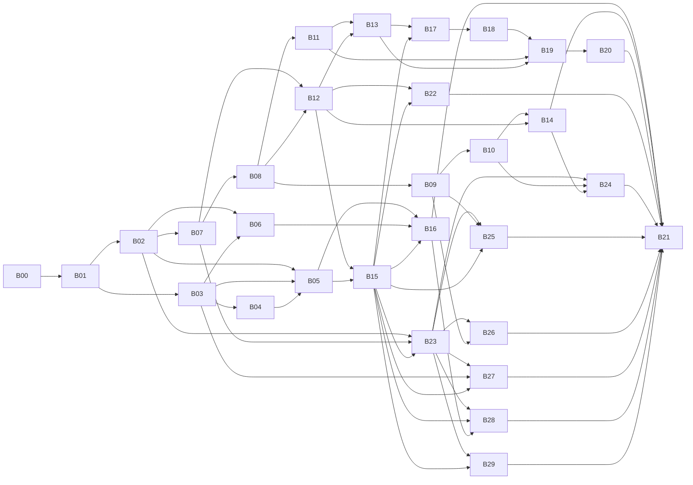

## 09 总体路线图：完整系统（前台 + 后台 + 采集）分批实施（MACC-23 / MACC-24 修订）

> **状态：路线图定稿稿（MACC-24 第五轮，队长 2026-10-16 采纳为路线图口径；D1～D8 已全部决定，只剩 D9 待用户补充）。** 本文只是计划，不实现任何产品功能，不部署，不访问线上站点或数据库。
>
> **依据与优先级**（从高到低）：
> 1. 用户 2026-10-16 在 MACC-23 追加的三条硬性要求：功能一样、MySQL 表一样、尽量不要外部调用（见第 1 节）。
> 2. 用户 2026-10-16 对 D1～D9 的答复（已决记录见第 9 节）：D1 保留 E04～E07、E09～E13，E01/E02/E03/E08 只做本地版本；"D1 已全部决定、只剩 D9"。唯一待补充的是 D9-a 前台模板来源、D9-b 线上配置（第 8 节）。
> 3. MACC-23 任务说明（完整系统、批次化、验收与回滚要求、未获批准事项）。
> 4. `docs/analysis/03-migration-plan-draft.md`（以下简称"03 草稿"）。**03 草稿中与第 1、2 项冲突的设想全部作废**，逐条见第 2 节。
>
> 证据标记沿用 01 文档：【确认】读代码或本地运行确认；【静态】只读代码；【待核实】仓库证据不足。路径相对仓库根目录。

### 0. 一页摘要

- **范围**：新系统（Java，`backend/`）在功能上与旧 MacCMS v10 对齐，**不增不减**；沿用现有 26 张 `mac_*` 表，**零结构变更**（不建表、不加列、不改列，也不改索引、引擎、字符集、触发器）；运行时的出站网络调用**只允许出现在用户已确认保留的外部调用中**，并且代码只能放在 `integration` 包的白名单子包里（第 1.3、4.3 节）。
- **配置与权限**：配置仍以 `application/extra/*.php`、`application/route.php` 这类 `var_export` 格式的 PHP 数组文件为唯一来源（与 `mac_arr2file` 相同，`application/common.php:126-139`）；管理员权限仍用 `mac_admin.admin_auth` 的 `,控制器/方法,` 文本语义；采集分类绑定仍在 `application/extra/bind.php`。
- **外部调用（D1 已决，2026-10-16）**：旧系统共 13 类服务端出站或依赖外部平台的调用点（E01～E13，第 4.1 节），另有 3 类由页面让浏览器访问外部地址的访问点（W1～W3，第 4.2 节）。用户决定：
  - **保留**：E04 支付下单、E05 支付回调、E06 短信、E07 邮件、E09 百度推送、E10 QQ/微信第三方登录、E11 友链回链检测、E12 微信公众号、E13 插件市场。另外，W3 支付网关跳转与 E04/E05 同步放行。这些项在核心批次之后的外部调用批次 B23～B29 中实现。
  - **只做本地版本，不发起出站请求**：E01 资源站采集、E02 远程图片下载、E03 规则采集、E08 远程存储。分别改为本地文件源、库内图片地址不变、本地 HTML 源、只存本地。
  - **按旧版放行**：W1 播放器解析与外部脚本、W2 外链图片与外部播放/下载地址。按用户"D1 已全部决定、只剩 D9"的口径落入可实施批次（B02、B05、B15），页面输出与旧版一致。这两项是浏览器访问外部地址，服务端不发请求，不进 `integration` 白名单（第 4.2 节）。
- **数据库工具与安装向导**：旧后台有四项会执行结构语句或表维护语句，分别是"还原备份""执行 SQL""优化表""修复表"；旧安装向导的"建库建表"也是如此。这五项按零结构变更的既定边界实施（第 1.2 节，硬性要求 2），不是待决项：
  - 数据库工具的四项在应用入口拒绝，页面给出固定提示，由部署方用库外运维手段完成（B15）。
  - 安装向导的建库建表由部署方在库外完成，向导只读校验表结构后继续其余步骤（B22）。
  - 与旧版的差异写进 B15、B22 的批次文档。
- **用户已决定（2026-10-16，记录见第 9 节）**：
  - D1：外部调用的取舍，见上文。
  - D2：六项安全问题全部修复。与旧版的行为差异逐条列在第 5.5 节，并写进对应批次的验收要点；E10 按修复后的方案实现。
  - D3：上线时整体切换；开发期新系统对生产只读，不改旧 PHP。
  - D4：保留模板在线编辑，用 jte 运行时重编译实现（B15）。
  - D5：保留本地插件（B15）；插件市场联网安装/升级属 E13，在 B29 实现。
  - D6：沿用不加盐 md5。
  - D7：接受全表扫描。
  - D8：保留完整的旧版安装向导（B22），建库建表一步按上文零结构变更边界处理。
- **批次**：本修订占用 MACC-24（B00）。实施批次 B01～B29 在建任务时依次取号（MACC-25 起），号码在第 5.1 节回填。顺序如下：
  - 积压合并 → 只读补全 → 写入基础 → 会员与互动；
  - 后台：登录鉴权 → 内容 → 会员财务 → 系统配置 → 生成/定时 → 安装向导；
  - 采集：配置 → 本地预览 → 入库；
  - 外部调用：integration 基础 → 支付、短信与邮件、第三方登录、公众号、推送与回链、插件市场；
  - 全量验收与切换演练。
- **仍等用户**：只剩 D9（第 8 节），不阻塞任何批次开工：
  - D9-a：仓库与备份 zip 里都没有可用的前台模板，需要用户补充模板来源。
  - D9-b：线上配置用户未答复。在用户答复之前，按 prod-config 红线不读取。

### 1. 硬性约束

#### 1.1 功能一样（不增不减）

- **对齐基线**：仓库中的旧代码（生产备份 2026-07-11）的可观察行为，包括页面与接口的输入输出、URL、写库效果、配置项及其生效方式、后台菜单与权限点（`application/admin/common/auth.php`）。线上配置与模板缺失（01 第 1 节），凡是依赖线上取值的地方按"仓库代码 + 配置项全部取值"对齐，线上取值【待核实】。
- **不增**：不加旧系统没有的功能或配置项。03 草稿中的"按资源站并发与限速、断点续采、TLS 校验开关、SSRF 网段屏蔽"（03 第 4.4 节）、"新系统自己的登录日志表"（03 第 4.3 (7) 节）等新增能力全部撤回。纯内部实现上的不同（例如进程内缓存代替 ThinkPHP 文件缓存、计数用原子 `x=x+1` 代替先读后写）不算功能增减，但要在对应批次文档里写明差异。
- **不减**：旧系统的每个功能，要么在某个可实施批次里实现，要么记录为"不实施或改为本地版本"的项，不允许无记录地丢掉（完整对照见第 3 节）。后者只有两类：
  - E01/E02/E03/E08 的在线部分：按 D1 只做本地版本，记录在第 4 节与第 9 节，B21 对齐总表记为"用户决定排除（D1）"。
  - 数据库工具中的四项、安装向导的建库建表：受零结构变更约束（第 1.2 节），改为入口拒绝或由部署方在库外完成。记录在 B15、B22，B21 对齐总表记为"按硬性要求 2 排除"。
- **安全问题怎么算**：01 第 10 节的哈希登录、openid 直接登录、定时任务无鉴权等六项问题，用户已决定**全部修复**（D2）。修复不增加功能、不改表，但对外行为与旧版不同；每一项的旧行为、新行为、所属批次与验收用例见第 5.5 节，并写进对应批次的验收要点，批次文档把它们记为"有意差异"。

#### 1.2 MySQL 表一样（零结构变更）

| 允许 | 不允许 |
|---|---|
| 对现有 `mac_*` 表执行 `SELECT/INSERT/UPDATE/DELETE`，按"表 + 操作"单一写入方规则（02 规范第 3 节）；写入只在本地开发库或一次性库上发生，直到用户批准切换 | `CREATE/ALTER/DROP/RENAME/TRUNCATE TABLE`（**无论由代码执行还是由管理员在后台手工执行**：旧后台"执行 SQL"、"还原备份"中的结构语句同样禁止，入口拒绝，见 B15；旧安装向导的 `CREATE DATABASE` 与执行 `install.sql` 建表同样禁止，由部署方在库外完成、向导只读校验，见 B22；插件 SQL 中的结构语句同样禁止，见 B15 与 B29）；新增表、列、索引、FULLTEXT；修改列类型、长度、默认值；引擎（MyISAM→InnoDB）和字符集（utf8→utf8mb4）转换；触发器、存储过程、视图、事件；在应用代码里放 `schema.sql`、Flyway/Liquibase 等任何自动迁移 |
| 新系统自己的运行状态放在**库外**：会话在进程内存，缓存在进程内，采集预览缓存放在本地运行目录，日志写文件 | 为新系统的运行状态新建任何表（包括"新系统自己的日志表"、"采集断点表"、"权限拆行表"） |
| 测试时在一次性库 `maccms_it_*` 中原样导入 `application/install/sql/install.sql` | 在 `maccms_dev` 或任何已有库上导入、清空、改结构 |

- **没有结构迁移，也就没有迁移脚本**。旧数据**不需要迁移**：新旧系统读写同一套表。所谓"切换"只是某个"表 + 操作"的写入方从 PHP 换成 Java。原 MACC-23 要求的"新表/列的前向+回滚脚本"改为**数据层面的回滚演练**：切换前对受影响的表做快照，切换窗口内的新写入可以逐行核对，回滚时只用 DML 恢复。做法见 B07。
- **后果需要用户知道**（不是新的待决问题，而是本约束的直接结果）：
  - 资金类表（`mac_user` 积分、`mac_order`、`mac_card`、`mac_cash`）仍是 MyISAM，没有事务。新系统靠"单语句原子 + 条件更新 + 检查影响行数 + 固定写入顺序与补偿"保证一致，与旧系统相比只会更严，不会更松。
  - 密码仍是不加盐的 md5：`mac_user.user_pwd` 是 `varchar(32)`、`mac_admin.admin_pwd` 是 `char(32)`（`install.sql:633,75`），放不下 bcrypt/argon2 的输出，也不能加 v2 列，所以 03 第 4.3 (3)(7) 节的渐进升级整体撤回。**用户已接受（D6）**。
  - 关键字搜索只能是 `LIKE '%x%'` 扫描，与旧系统相同；MACC-19 测得 100 万行时的代价不能靠 FULLTEXT 或换引擎解决。**用户已接受（D7）**：不加索引、不改引擎与字符集。

#### 1.3 尽量不要外部调用

- **默认**：新系统运行时不发起出站网络请求（HTTP、SMTP、FTP、第三方 SDK、DNS 查询外部主机等），只有用户已确认保留的外部调用例外（第 4 节，2026-10-16 D1）。
- **出站护栏（B02 建设，B23 起登记白名单）**：B02 增加一条静态护栏测试，扫描 `backend/src/main` 中的出站网络 API。扫描范围包括 `java.net.http`、`HttpURLConnection`、`URL.openConnection/openStream`、`Socket`、Spring `RestClient/RestTemplate/WebClient`、JavaMail、FTP 客户端、jsoup `Jsoup.connect` 等。这些 API 只允许出现在 `integration` 包的白名单子包里。
  - B02 交付时白名单为空。
  - B23～B29 每批只登记本批对应的子包（第 4.3 节）。
  - 其余任何位置（包括 E01/E02/E03/E08 的本地版本、采集、上传、图片处理）出现出站 API，护栏都会失败。
  - E05 支付回调、E12 公众号是入站接口，不发出站请求，代码不进白名单。
- **浏览器侧外部访问点同样受控**：页面让浏览器去访问外部地址（第 4.2 节 W1～W3）虽然不是服务端出站，也属于外部调用。B02 增加一个**部署级**的"浏览器侧外部地址放行"参数：
  - 用环境变量配置，按 W1/W2/W3 分项；
  - 不是站点配置项，不出现在后台，不写入 `application/extra/*.php`；
  - 打开时，页面输出与旧版一致；关闭时，页面不输出任何指向外部主机的地址，按第 4.2 节"关闭时的行为"处理。

  按 D1 已全部决定的口径：W1、W2 按旧版放行，在 B02、B05、B15 实施，生产默认打开；W3 随 B24（支付）打开。关闭状态只是给部署方的可选项，也用于测试中的"无外部主机"断言，不改变上述决定。
- **入站接口不算出站**：Provide（对外提供资源）、Receive（外部推送入库）、Timming（外部 cron 触发）由别人调用本系统，本系统不因此向外发请求，可以进入可实施批次。微信公众号回调与支付回调虽然也是入站，但离开第三方平台就无法使用，所以归入第 4 节，与对应的保留项同批实现（B24、B27）。
- **新增外部调用的流程**：D1 已定稿。第 4 节以外如果发现新的外部调用点，或者想实现 E01/E02/E03/E08 的在线部分，都属于改变用户决定，必须先停下，在任务评论里告知调度员转报用户，用户明确同意后再建批次。
- **构建期不在此列**：Maven Wrapper 和依赖下载发生在开发机构建时，不是运行时调用；生产包是自包含 jar。

### 2. 03 草稿中被本修订取代的设想

| 03 草稿位置 | 原设想 | 本修订的处理 |
|---|---|---|
| 第 2 节 阶段 A "拟新增的表或列" | `sys_config`（配置入库） | **撤回**。配置仍在 `application/extra/*.php` 和 `route.php`，格式与 `mac_arr2file` 相同。Java 读取见 B02，写回见 B15 |
| 同上 | `collect_bind`（分类绑定入库） | **撤回**。仍用 `application/extra/bind.php`，键为 `md5(采集URL)_远程分类ID`（`common/model/Collect.php:211-217`），见 B17 |
| 同上 | `admin_permission`（权限拆行） | **撤回**。Java 后台直接按 `admin_auth` 文本判定，权限码与 `auth.php` 一一对应，见 B12 |
| 同上；第 4.3 (3)(7) 节 | `mac_user.user_pwd_v2/_src`、`mac_admin.admin_pwd_v2/_src`、`BEFORE UPDATE` 触发器 | **撤回**。密码按旧语义只写 `user_pwd`、`admin_pwd`（03 第 4.3 (1) 节的逐入口字节语义仍然有效），见 B09、B12 与 D6 |
| 第 2 节 引擎与字符集转换 | MyISAM→InnoDB、utf8→utf8mb4 作为独立维护步骤 | **移出路线图**。属于表结构变更，本路线图不计划；以后若要做，需用户另行批准 |
| 第 4.3 (7) 节 | 新后台登录记录写到新系统自己的日志表 | **撤回**。写应用日志文件，不记录密码和会话标识 |
| 第 3.3 节 阶段 1 | 搜索结果缓存放在新系统自己的 Redis | **撤回**。不引入新的基础设施；需要缓存时用进程内缓存。`vod_search_optimise` 打开时，旧行为是写 `mac_vod_search`，新系统在 B11 按旧行为实现 |
| 第 4.4 节 | 采集新增能力：并发限速、断点续采、TLS 校验、SSRF 防护 | **撤回**（功能增加）。按 D1，在线采集（E01）不实施，只做本地文件源（B18/B19），所以不涉及 TLS 与 SSRF |
| 第 4.4、4.6 节 | Timming 改为必须鉴权；Provide IP 白名单只信任可信代理 | **按 D2（已决：修复）实施**，鉴权与可信代理都用部署级参数（环境变量），不新增站点配置项，见第 5.5 节 ③④ |
| 第 3.2～3.7 节 | 分阶段绞杀：PHP 写入守卫 G1、内网入库端点 E1、到期降级开关 C1、会员组缓存 C2 等 PHP 改动，以及数据库账号表级权限 | **撤回**（D3 已决：上线时整体切换）。不改旧 PHP、不调整数据库账号；切换前的并行开发期新系统对生产只读 |
| 第 4.7 节 | 模板走改写（甲）还是兼容层（乙） | 前台已经按改写路线实施（MACC-7/9/13/14，jte）。D4 已决保留模板在线编辑：用 jte 运行时重编译实现，见 B15 与第 5.6 节 |
| 第 5 节 | 影子流量（nginx mirror） | 涉及部署与生产流量，仍未获批准；本路线图的验收只用本地黄金样本与一次性库 |

03 草稿中**仍然有效**的内容：第 3.1 节旧写入入口清单、第 4.1～4.2 节内容与播放串兼容、第 4.3 (1)(4)(6) 节密码字节语义/cookie/会员组规则、第 4.5～4.6 节 URL 与接口协议、第 5 节黄金样本方法（只在一次性库上采集）。

### 3. 现状盘点与功能对齐总表

#### 3.1 MACC-3～22 成果与合并状态

核对方式：2026-10-16 在本任务工作区执行 `git merge-base --is-ancestor`、`git cherry -v main <分支>`。main 当前为 `3f81c72`。Multica 上 MACC-3～20、22 状态均为 `in_review`，MACC-21 为 `todo`。

| 任务 | 成果 | main 合并状态 |
|---|---|---|
| MACC-3 | 现状分析、Go/Java 选型、迁移草稿（`docs/analysis/01～03`） | 已合入（分支头 `ca0b884` 是 main 祖先） |
| MACC-4 | Java 工程骨架、content 首批只读 API、契约 1.0.0 | 已合入（`3ba858b`，整合提交 `39d9039`） |
| MACC-5 | 前台页面与旧 URL 兼容清单（`docs/frontend/`） | 内容已由整合提交 `9af83fb` 合入；分支上的原始提交未作为祖先合入，无需再合 |
| MACC-6 | 前台只读页面方案（`03-frontend-readonly-plan.md`） | 已合入（等价提交 `a9dbdbc`、`e64f7b3`、`5303e8d`） |
| MACC-7 | 模板引擎选型实验（jte）（`04-site-template-spike.md`） | 已合入（`340b2f9`、`650c258`） |
| MACC-8 | content 已发布只读类型与依赖边界护栏 | 已合入（`9870f92`） |
| MACC-9 | site jte 骨架与站点配置 | 已合入（`a98b53d`） |
| MACC-10 | 旧 URL 生成/解析与 PHP 黄金向量 | 已合入（`255c471`、整合 `9413b74`） |
| MACC-11 | 图片地址规范化 | 已合入（`b3e7e1c`） |
| MACC-12 | 富文本白名单过滤 | 已合入（`143af3c`、`ac068f4`、`a96cfd3`） |
| MACC-13 | 视频卡片与分页组件、响应式样式 | 已合入（`1461539`）。Kimi 分支上另有 `1ac9f78`，经逐文件比对是 MACC-10 文件的副本（除 `05-site-skeleton.md` 的旧版外与 main 相同），**不合并** |
| MACC-14 | 首页、分类、视频详情 SSR 三页 | 三页已合入（`10a0701`）。**后续修复 `a0f49e6`（沿 cause 链识别被 MyBatis 包装的连接故障，返回 503）未合入 main，也不在整合分支里**；整合分支的 `ContentReadService` 仍只捕获外层异常类型。要在 B01 补上 |
| MACC-15 | 三页响应式样式与 CSS 护栏 | 已合入（`e947b1c`、`3f81c72`）。Kimi 分支上的 `4a05971` 只有 `.qwen/tmp/` 截图，**不合并** |
| MACC-16 | 搜索与筛选方案（`09-content-search-filter-plan.md`） | **未合入**，在整合分支 `agent/codex/macc-2` |
| MACC-17 | base-url 长度与旧 PHP 子目录兼容 | **未合入**，在整合分支 |
| MACC-18 | 搜索/筛选只读 API，契约 1.1.0 | **未合入**，在整合分支 |
| MACC-19 | 一次性库搜索性能、EXPLAIN 与表锁测量 | **未合入**，在整合分支 |
| MACC-20 | SSR 搜索页 | **未合入**，在整合分支 |
| MACC-21 | 搜索页响应式样式（Kimi） | 未开始（`todo`） |
| MACC-22 | MySQL 1028 排序中止归为 503 | **未合入**，在整合分支 |

整合分支 `agent/codex/macc-2`（头 `edd5eea`）的分叉点就是 main `3f81c72`，可以快进合并。合并后 `docs/architecture/` 下会同时有 `09-content-search-filter-plan.md` 和本文 `09-roadmap.md` 两个 09 编号，内容不冲突，本修订按任务要求保留文件名。

**已有能力**（合并整合分支之后）：视频分类、视频分页列表、视频公开详情、视频搜索与筛选（关键字默认关闭）的只读 API；首页、分类/筛选列表、视频详情、搜索四个 SSR 页面（只对游客，默认关闭）；旧 URL 生成与解析、图片地址、富文本过滤；模块边界、只读连接、异常日志脱敏等护栏。**没有任何写库路径，没有任何出站调用。**

#### 3.2 功能对齐总表（旧功能 → 批次）

"本地版"指去掉外部调用后能在本地实现的部分；"E0x"、"Wx"指第 4 节外部调用清单的编号；"Dx"指用户决策编号（第 9 节已决，第 8 节待补充）。

| 旧功能（入口） | 批次 | 说明 |
|---|---|---|
| 首页、视频分类/筛选/详情/搜索（`index/controller/{Index,Vod,Search}`） | 已有 + B04 + B05 | URL 可达的剩余筛选参数在 B04（MACC-28，契约 1.3.0，`14-video-list-filter-completion.md`）：`letter/state/version/actor/director/tag/name/ids`、年份区间、`rnd`；旧模板标签专属的列表条件（`isend`、`timeadd/timehits/time`、点击数范围、`not/rel/typenot/tv/weekday/plot`、`start/half`）不是 URL 输入，在 B05 作为内部查询能力实现；`area/lang/class` 逗号多值随 B04 补入 1.3.0（队长裁定 Q1）；`tid`（SSR 内部条件 `type_id OR type_id_1`，API 不加别名）、SSR 搜索页承接 B04 新键与 `by=rnd`、`vodsearch`/`vodshow` 位置参数路由、逐键零值归一归 B05（队长裁定 Q2，14 文档第 5.2 节）；页面中的外链图片（W2）按旧版放行，B02 接入放行参数 |
| 视频播放、下载页，`player_aaaa`，观看密码，试看（`Vod::play/player/down/downer`、`Ajax::pwd`） | B05（游客）+ B10（会员权限与扣积分） | 前端播放器资源原样复用（含 `iva` 播放器）；播放器解析接口与外部脚本（W1）、外部播放/下载地址（W2）按旧版放行，见第 4.2 节 |
| 文章、专题、演员、角色、网址、剧情各页及 `ajax_*`、`rss`（`Art/Topic/Actor/Role/Website/Plot`） | B03 + B05 | |
| 地图、RSS（baidu/google/so/sogou/bing/sm）、自定义标签页、帮助、公告、版权页、二维码、桌面快捷方式、联想词、`ajax/data` | B06 | 二维码在本地生成 |
| 手机模板（`mob_status`）、语言包（`application/lang/zh-cn.php`、`zh-tw.php`） | B05、B12 | B12 实现选择语义与前台接线（21 文档第 12 节）；缺失的旧手机模板内容与模板内 `{:lang()}` 对齐在 B21 |
| 资源站对外接口 Provide（`api/controller/Provide.php`） | B06（只读）+ B11（`detail_inc_hits` 计数） | |
| 会员注册、登录、退出、资料、头像、密保找回（`index/controller/User.php`） | B08 + B09 + B25 + B26 | 短信/邮件验证码、绑定、找回（E06/E07）在 B25；第三方登录与绑定（E10）在 B26 |
| 会员中心：收藏、播放/下载记录、积分日志、购买观看权限、升级会员组、卡密充值、提现、推广、订单 | B10 + B24 | 本地创建订单在 B10；在线支付下单、回调与网关跳转（E04/E05/W3）在 B24 |
| 评论、留言（`Comment`、`Gbook`）及顶踩、举报 | B11 | |
| 点击、顶踩、评分、网址访问计数、搜索优化写 `mac_vod_search` | B11 | |
| 后台登录、锁屏、管理员管理、权限、首页、清缓存 | B12 | |
| 后台内容管理：视频（含批量、分集剧情、查重）、分类（扩展、转移）、文章、专题、演员、角色、网址、友链、评论、留言、附件、图片、上传 | B13 | 远程图片同步（E02）按 D1 只处理已在本地的文件；远程存储（E08）按 D1 只存本地，本地上传在 B13 |
| 后台会员与财务：会员、会员组、卡密、订单、提现、积分日志、行为日志、推广访问 | B14 | |
| 后台系统配置（`System::config*` 各组）、URL 路由生成、播放器/服务器/下载器、站群、模板管理（含在线编辑、向导、删除）与广告、数据库工具、推送配置 | B15 + B25 + B28 | 模板在线编辑按 D4 保留（jte 运行时重编译，第 5.6 节）；播放器管理照常读写解析地址并生成 `playerconfig.js`（W1）；数据库工具中的"还原备份、执行 SQL、优化表、修复表"受零结构变更约束，入口拒绝，由部署方在库外完成；邮件测试（E07）在 B25；回链检测（E11）与推送执行（E09）在 B28 |
| 静态生成（`Make`）、定时任务（`Timming`） | B16 + B28 | 定时任务的执行文件 `collect`（定时资源站采集）不提供（2026-10-28 用户决定，27 文档 D-B19-15）；规则采集只在本地 HTML 源模式下执行（E03 只做本地版）；推送任务（E09）在 B28 接入 |
| 采集源、分类绑定、采集参数、自定义规则节点管理 | B17 | |
| 资源站采集解析与预览 | B18（本地文件源） | 在线抓取（E01）按 D1 不实施 |
| 采集入库（合并规则）、Receive 入库接口 | B19 | |
| 自定义规则采集（`Cj`） | B20（本地 HTML 源） | 在线抓取（E03）按 D1 不实施 |
| 在线支付、短信、邮件、搜索引擎推送与回链检测、第三方登录、微信公众号、插件市场 | B23～B29 | D1 保留，第 4 节与第 5.4 节 |
| 资源站在线采集、远程图片下载、规则在线抓取、远程存储 | 不实施在线部分（用户决定排除） | D1：E01/E02/E03/E08 只做本地版本。B21 对齐总表记为"用户决定排除（D1，2026-10-16）" |
| 浏览器侧的播放器解析与外部脚本、外链图片与外部播放/下载地址 | B02 + B05 + B15 | W1/W2 按旧版放行（第 4.2 节） |
| 插件机制（`Addon`）：本地插件列表、启用/禁用、配置、卸载；插件市场安装、升级 | B15 + B29 | D5 已决保留本地插件，做法见第 5.7 节；插件市场联网安装/升级（E13）在 B29 |
| 在线升级（`Update`） | 不实施 | 旧代码中 `Update.php` 是空类（8 行），只有欢迎页留了链接（`welcome.html:45-46`）；对齐结果就是"无此功能" |
| 安装向导（`install.php`，`application/install/controller/Index.php`） | B22 | D8 已决保留完整旧版向导；"建库建表"两步受零结构变更约束，由部署方在库外导入，向导只读校验结构 |

### 4. 外部调用清单

**状态说明**：D1 已于 2026-10-16 由用户逐项答复，本节各项的"确认状态"列即最终口径。行号来自当前提交的静态核对【静态】。

**统一口径**：
- **E04、E05、E06、E07、E09、E10、E11、E12、E13：2026-10-16 用户确认保留**。在外部调用批次 B23～B29 中实现（第 5.4 节），排在核心功能批次之后。实施规则见第 4.3 节：密钥红线、测试账号/沙箱前置条件、E10 安全方案、`integration` 白名单。
- 某项的实现批次合入之前，或者部署时没有配置对应的商户号、密钥，该功能都走旧版"未配置/关闭"时的表现（见各行"未配置时的行为"），不阻塞任何核心批次。
- **E01、E02、E03、E08：用户未列入保留范围**。只实施本地替代版本，不发起出站请求，在线部分不实施。
- **W1、W2、W3（浏览器侧，第 4.2 节）**：W3 与 E04/E05 同步，在 B24 放行；W1、W2 按"D1 已全部决定、只剩 D9"的口径按旧版放行，在 B02、B05、B15 实施。
- 第 4 节各项都已落入可实施批次或"只做本地版本"，**不再有待确认批次或待决的外部调用项**。

#### 4.1 服务端出站调用与依赖外部平台的入站集成

| 编号 | 调用点（旧代码） | 目的 | 实现批次 | 实施方式（本地版本 / 未配置时的行为） | 确认状态 |
|---|---|---|---|---|---|
| E01 | 资源站采集抓取：`application/common/model/Collect.php:169`（`vod_xml`）、`:319`（`vod_json`）、`:1078`（`art_json`）、`:1405`（`actor_json`）、`:1697`（`role_json`）、`:1996`（`website_json`）、`:2286`（`comment_json`）；底层 `mac_curl_get`（`application/common.php:607`）；入口 `admin/controller/Collect.php`，定时任务 `api/controller/Timming.php:64-70` | 从苹果CMS 资源站拉取 JSON/XML 数据 | B18/B19 只实现本地版；在线抓取不实施 | **本地文件源**：后台上传或放入本地目录的 Provide 协议 JSON/XML 文件，走同一套解析、预览、入库（B18、B19）；外部推送用 Receive 入站接口（B19）。采集页的在线抓取与"测试连接"显示固定提示，不发请求；`collect/timing` 定时挂机页与定时任务的 `collect` 执行文件不提供（2026-10-28 用户决定，27 文档 D-B19-15） | 2026-10-16 用户决定：只做本地版本，不发起出站请求 |
| E02 | 远程图片下载：`application/common/model/Image.php:23`（`down_load`），由采集同步图片 `common/model/Collect.php:400` 与后台图片同步 `admin/controller/Images.php:164,199` 调用 | 把远程图片下载到本地或远程存储 | B13/B19 中按本地版处理；下载不实施 | 保持库内图片地址不变（相当于 `sync_pic_opt` 关闭）；后台图片同步只处理已在本地的文件；`img_api` 代理不提供（第 4.2 节 W2） | 2026-10-16 用户决定：只做本地版本，不发起出站请求 |
| E03 | 自定义规则采集抓取：`application/common/util/Collection.php:236`；入口 `admin/controller/Cj.php`，定时任务 `api/controller/Timming.php:78` 起 | 按规则抓取任意网页并提取字段 | B20 只实现本地版；在线抓取不实施 | **本地 HTML 源**：规则作用于上传的 HTML 文件，提取、入库流程不变（B20） | 2026-10-16 用户决定：只做本地版本，不发起出站请求 |
| E04 | 支付下单：微信服务端请求 `common/extend/pay/Weixin.php:28`；支付宝、码支付、Zhapay 生成网关地址让浏览器跳转（`Alipay.php:26`、`Codepay.php:46`、`Zhapay.php:47`）；分发 `index/controller/User.php:523-526` | 在线充值 | **B24**（本地订单部分在 B10） | B24 实现四种支付方式，与旧版一致。B24 之前，或部署时没有配置对应支付方式，"去支付"一步按旧版未配置支付时的表现提示（文案在 B10 核对）。浏览器跳转部分即 W3，与本项同步放行 | **2026-10-16 用户确认保留** |
| E05 | 支付回调（入站，依赖支付平台）：`index/controller/Payment.php:13-30` → `common/extend/pay/*::notify` → `common/model/Order.php:104` 起（`notify`，先查 `order_status` 再更新） | 支付平台通知到账、加积分 | **B24** | 签名校验算法与旧版一致；到账改为 `WHERE order_status=0` 条件更新，重复通知幂等。未配置时按旧版返回提示（`Payment.php:19-22`）。旧后台没有手工改订单状态的入口（`admin/controller/Order.php` 只有 `index`、`del`，auth.php 只有 `order/index`、`order/del`），按"功能一样、不增不减"不新增，B14、B24 都不做（2026-10-26 队长裁定，MACC-38） | **2026-10-16 用户确认保留** |
| E06 | 短信：`mac_send_sms`（`application/common.php:379`）→ `common/extend/sms/Aliyun.php:62`、`Qcloud.php:150`；调用 `common/model/User.php:691`（注册、找回、绑定验证码；成功后写 `mac_msg`，`:696-706`） | 发送手机验证码 | **B25** | B25 实现阿里云、腾讯云两种通道。B25 之前，或部署时未配置，依赖短信的注册校验、手机找回、手机绑定按旧版"未配置短信"时的表现处理（B09 核对）；密保问题找回不受影响 | **2026-10-16 用户确认保留** |
| E07 | 邮件 SMTP：`mac_send_mail`（`application/common.php:406`）→ `common/extend/email/Phpmailer.php:20-22`；调用 `common/model/User.php:684`、后台测试发信 `admin/controller/System.php:34` | 发送邮箱验证码、测试邮件 | **B25** | B25 实现 SMTP 发信与后台测试发信。B25 之前或未配置时同 E06 的处理；后台邮件配置页照常读写配置（B15） | **2026-10-16 用户确认保留** |
| E08 | 远程存储：`common/model/Upload.php:8-35`（`api()` 按 `upload.mode` 分发）→ `common/extend/upload/{Upyun,Qiniu,Ftp,Weibo,Alibaba,Uomg}`（如 `Alibaba.php:28`、`Uomg.php:35`、`common/util/SinaUpload.php:79,118`）；调用 `Upload.php:245-247`、`Image.php:89` | 上传后转存到第三方存储 | B13 只实现本地存储；远程转存不实施 | **本地存储**（`upload.mode=local`，旧版默认值之一）。其他模式的配置项可读写（B15），但上传一律落本地，后台配置页对非本地模式显示固定提示 | 2026-10-16 用户决定：只做本地版本，不发起出站请求 |
| E09 | 搜索引擎推送：`common/extend/urlsend/Baidu.php:20`、`Baidufast.php:20,34`；入口 `admin/controller/Urlsend.php:192-202`，定时任务 `api/controller/Timming.php:92` 起 | 向百度提交新 URL | **B28** | B28 实现普通推送与快速收录推送（含定时任务）。B28 之前推送页只列出待推送 URL（与旧版推送页的列表一致，B15 核对），"推送"按钮返回旧版未配置时的提示 | **2026-10-16 用户确认保留** |
| E10 | 第三方登录：`index/controller/User.php:203-274`（`ThinkOauth::getInstance`、`getAccessToken`，`:207,219,223`）、`index/event/LoginEvent.php:10,27`；依赖的 `extend/login` 在仓库和备份中都缺失 | QQ/微信登录与绑定 | **B26** | **必须按修复后的安全方案实现**（第 4.3 节 ③），不复刻旧版凭 openid 直接登录的行为（D2 ②）。B26 之前或未配置时，登录页不显示第三方登录（与旧版配置关闭时一致）；普通登录入口从 B09 起就不接受 `openid`/`col` 参数 | **2026-10-16 用户确认保留** |
| E11 | 友链回链检测：`mac_check_back_link`（`application/common.php:432-444`）← `admin/controller/Index.php:192-196` | 抓取对方网站检查是否有本站链接 | **B28** | B28 实现。B28 之前该按钮返回固定提示，不发请求 | **2026-10-16 用户确认保留** |
| E12 | 微信公众号（入站，依赖微信平台）：`api/controller/Wechat.php:14-28`、`common/util/WechatPublic.php`。被动回复，不发起出站请求；读 `php://input`（`:37`）。签名只在 `echostr` 接入验证时校验（`:12-33`），消息回复不校验 | 公众号关键字回复站内内容 | **B27** | B27 实现接入验证与关键字回复，行为与旧版一致；`weixin.status=0` 时返回 `closed`（`Wechat.php:17-20`），B27 之前同样返回 `closed`。消息 XML 解析禁用外部实体（与旧版 `libxml_disable_entity_loader` 一致） | **2026-10-16 用户确认保留** |
| E13 | 插件市场安装、升级：`admin/controller/Addon.php:143-172`（`install`）、`:314-340`（`upgrade`）→ `think\addons\Service::install/upgrade`（fastadmin-addons，在 `vendor/` 中、不在 git，备份 zip 中有）。【确认】`Service::install` 第一步就是 `Service::download`（`vendor/karsonzhang/fastadmin-addons/src/addons/Service.php:261-268`），后者用 `Http::sendRequest` 请求 `config('fastadmin.api_url')/addon/download` 下载插件包（`:28-50`、`:625-628`）；下载后还会执行插件包内的 SQL（`importsql`，`:174-190`、`:322`、`:531`）。另外，这份生产代码已经去掉了插件市场列表的拉取（`Addon.php:88` 注释"仅支持本地插件"），本地上传 zip 安装也已关闭（`Addon::local` 在 `:236` 直接输出 `closed`） | 从插件市场下载、安装、升级插件 | **B29**（本地插件在 B15） | B29 实现联网下载、安装、升级；插件包内的 SQL 只执行 DML，含结构语句的插件包拒绝安装（1.2 节）。B29 之前"安装""升级"按钮返回固定提示，不发请求；本地上传安装与旧版一致返回 `closed` | **2026-10-16 用户确认保留** |

#### 4.2 浏览器侧外部访问点（服务端不发请求，同样按 D1 处理）

这三项由页面输出外部地址、让访客的浏览器去访问，服务端本身不发请求，但同样属于外部调用。D1 的最终口径：
- **W3**：与 E04/E05 同步，2026-10-16 用户确认保留，在 B24 放行。
- **W1、W2**：用户 2026-10-16 表示"D1 已全部决定、只剩 D9"，队长据此把两项落为可实施项，**按旧版放行**。用户的 D1 答复没有逐项点名 W1/W2，本节如实记录这一口径的来源。实施批次：W2 图片在 B02（及之后所有输出图片的页面批次），W1 与 W2 播放/下载地址在 B05，播放器配置的生成在 B15。
- 三项都只是页面输出外部地址，服务端不发请求，所以代码不进 `integration` 白名单，也不触发出站护栏。

控制手段是 B02 的部署级"浏览器侧外部地址放行"参数（第 1.3 节，按 W1/W2/W3 分项）。生产默认值：W1、W2 打开；W3 在 B24 合入后打开。关闭状态是部署方可选项，也用于测试断言。"外部地址"指绝对地址（`http://`、`https://`、协议相对 `//`，包括 `mac:` 前缀换成协议后的结果，以及拼上 `upload.img_api`、`upload.remoteurl` 等前缀后的结果）中主机不是本站的地址；"本站"按配置的 `maccms.site.base-url` 的主机名判定，不看请求的 Host、X-Forwarded-Host（B02，`11-guards-and-legacy-config.md` 第 5 节）。

| 编号 | 调用点（旧代码） | 目的 | 实施批次 | 放行时的实施方式（与旧版一致） | 关闭时的行为（部署可选项，测试用） | 确认状态 |
|---|---|---|---|---|---|---|
| W1 | ① 播放器解析接口：`static/js/player.js:2` 中 `player_list[from].ps=="1"` 时改用解析地址（播放器自己的 `parse`，为空时用全局 `MacPlayerConfig.parse`），以 iframe 打开；地址来自 `application/extra/vodplayer.php` 各播放器的 `parse` 字段与 `application/extra/maccms.php:592` 的 `play.parse`，经 `static/js/playerconfig.js` 输出（生成见 `admin/controller/Base.php:85-103`、`System.php:675-690`）；② 播放前缓冲/预加载页：`maccms.php:590-591` 的 `play.prestrain`、`play.buffer`（`player.js:2` 中作为 iframe 地址）；③ 播放器自身加载外部脚本：`static/player/iva.js:2`、`static/player/iva.html:11`（videojj CDN） | 由站长配置的第三方解析服务播放需要解析的地址；播放前展示缓冲页；`iva` 播放器的功能脚本 | B05（播放页、`playerconfig.js` 输出）；B15（播放器管理、`playerconfig.js` 生成） | `playerconfig.js` 与 `player_aaaa` 按旧版输出 `parse`、`prestrain`、`buffer`；`static/js/player.js` 与 `static/player/*`（含 `iva`）原样复用；`ps=1` 的来源由浏览器按旧版用解析地址打开。验收：`player_aaaa`、`playerconfig.js` 与 PHP 黄金样本逐字段一致 | 页面与 `playerconfig.js` 中不出现外部解析地址；`ps=1` 的来源在播放页显示固定的本地提示（不加载 iframe），文案在 B05 定稿；`prestrain`/`buffer` 为外部地址时不加载；`iva` 不加载外部脚本。后台播放器管理照常读写这些配置项 | **2026-10-16 放行**：按用户"D1 已全部决定、只剩 D9"的口径落为可实施（用户未逐项点名） |
| W2 | ① 外链图片：`vod_pic`、`vod_pic_thumb`、`vod_pic_slide` 及其他内容表的图片字段中的外部地址，经 `mac_url_img`（`application/common.php:1633` 起；`mac:` 前缀、`img_api` 代理、`remote` 模式前缀见 06 文档）输出到页面；Java 侧已由 MACC-11 实现并在 MACC-14 的三页中原样输出（已合入 main）；② 外部播放/下载地址：`vod_play_url`、`vod_down_url` 中的外部地址，经 `player_aaaa.url`/`url_next`（`common/controller/All.php:533-540`）交给浏览器中的播放器直接请求 | 浏览器加载外部图片、外部视频与下载文件 | 图片：B02（放行参数接入已合入页面）及之后所有输出图片的页面批次（B05、B06、B12～B15）；播放/下载：B05 | 图片地址按 MACC-11 的规范化逻辑原样输出（含 `mac:`、`img_api`、`remote` 前缀拼接），与黄金向量一致；`player_aaaa` 按旧版输出外部播放/下载地址。`img_api` 默认值是站内路径 `/img.php?url=`（`application/extra/maccms.php:148`），对应的代理脚本不在仓库中；新系统也不提供这个代理，因为提供它就是服务端出站，属于 E02，只做本地版本。所以该模式下图片不能显示，这与仓库中旧版的表现相同 | 外部图片显示本地占位（B02 用组件已有的占位元素，正文中的外部图片整张删除；如需换成 `static/` 中的图片由前端改组件，见 11 文档第 5 节），不拼接 `img_api`、`remoteurl` 等前缀；`player_aaaa` 中不输出外部播放/下载地址，播放页、下载页显示固定的本地提示，文案在 B05 定稿 | **2026-10-16 放行**：同 W1 |
| W3 | 支付网关跳转：支付宝 `common/extend/pay/Alipay.php:26`、码支付 `Codepay.php:46`、Zhapay `Zhapay.php:47` 生成第三方网关地址，经 `index/controller/User.php:523-526` 让浏览器跳转（与 E04 同一组调用点，E04 是其中微信的服务端请求部分） | 浏览器跳到第三方支付页面付款 | 本地行为在 B10；**放行在 B24**（与 E04、E05 同批） | B24 实现四种支付方式的网关地址与跳转，参数、签名与 PHP 黄金样本一致（假密钥） | B24 之前，或部署时某支付方式未配置：不生成该方式的网关地址、不跳转，"去支付"一步按旧版未配置支付时的表现提示（B10 核对） | **2026-10-16 用户确认保留**（随 E04/E05） |

**需要知道的后果**（D1 定稿的直接结果，不是新的待决问题）：
- 本地开发库和线上导出的数据中，绝大多数图片地址和播放地址是外部地址。W1、W2 放行后，页面输出与旧版相同，访客浏览器会直接访问这些外部主机。
- 外部主机不可用时，页面会出现破图或无法播放，这与旧版相同，不是缺陷。本地开发机不联网时同样如此。
- 第三方解析接口在播放页以 iframe 打开，解析服务的内容由第三方控制，这与旧版同级，见第 6 节。

前台和后台页面**自身的静态资源不引用任何 CDN**：新页面的 CSS、JS、字体、图标只用 `backend/` 内或仓库 `static/` 中的本地资源。外部地址只能来自 W1/W2/W3 这类由数据或配置决定的输出，以及第三方登录跳转到 QQ/微信授权页的地址（B26，E10 的必要组成部分）。

B02 起每个输出页面的批次（B02、B05、B06、B09～B15、B24～B26）的验收都有两条检查：
- **页面自身资源检查**：页面引用的静态资源（CSS/JS/字体/图标）没有外部主机。
- **放行参数两态检查**：
  - 打开时，外部图片、外部播放/下载地址、外部解析地址的输出与 PHP 黄金样本一致。
  - 关闭时，用同样的测试数据渲染页面与 `playerconfig.js`，断言输出中没有任何外部主机。

#### 4.3 已保留外部调用的实施规则（B23～B29 通用）

1. **密钥管理红线（不变）**：
   - 任务、评论、提交、代码、日志、测试输出里都不得出现任何真实的商户号、API 密钥、token、SMTP 密码、OAuth `appsecret`、公众号 token、插件市场凭证，也不得出现带凭证的 URL。
   - 这些值由用户在部署阶段通过本地配置文件提供，不入 git。新系统读取的是 B02 环境变量指向的配置目录，这个目录可以放在仓库之外。
   - 仓库中的 `application/extra/*.php` 对应字段保持为空。
   - 测试一律使用一看即知是假的占位值（例如 `test-only-not-a-secret`）。
   - B23 提供日志脱敏：配置中的密钥字段、第三方请求与响应中的签名、`access_token`、验证码、手机号一律不写入日志与异常信息。
   - 后台配置页对这些字段的显示与读写方式与旧版一致。
2. **测试账号/沙箱前置条件**：
   - 每个外部调用批次开工时，在任务说明中列出所需的测试账号或沙箱：支付沙箱商户、短信测试签名与模板、测试邮箱 SMTP、百度站长测试站点、QQ 互联/微信开放平台测试应用、公众号测试号、插件市场测试源。
   - 这些账号由队长通过调度员向用户索取。工作组**不自行注册，不使用任何生产凭证**。
   - 账号到位之前，批次照常开发，只对本机回环地址上的模拟服务（测试内桩）做测试；`./mvnw verify` 全程不访问任何外部主机（B23 的测试期出站护栏）。
   - 沙箱联调列为批次验收中单独的一条。账号未到位时这一条记为"待联调"，批次可以先合并，这一条转入 B21 的清单，在 B21 之前补齐。
3. **E10 必须采用修复后的第三方登录安全方案**（D2 ②），不复刻旧版：
   - 普通登录入口（`user/login` 等）从 B09 起忽略 `openid`、`col` 参数。
   - openid 只能来自 OAuth 授权码流程中，服务端用 `code` 向 QQ/微信换取的结果，绝不取自浏览器提交的参数。
   - 发起授权时生成一次性、有时效、与会话绑定的 `state`，回调时校验，校验失败则拒绝。
   - 回调地址取部署配置中的固定值，不接受请求中传入的跳转地址。
   - 已绑定的 openid 登录后签发与普通登录相同的 `user_check` cookie（B08）。
   - 绑定、解绑只能在会员已登录时进行，写入 `user_openid_qq`/`user_openid_weixin` 现有列。
   - 未绑定的 openid 按旧版自动注册新会员；旧版给这类账号设置可猜测的密码 `time()`（`index/controller/User.php:262-264`），新版改为不可猜测的随机值。
   - 旧版依赖的 `extend/login` 在仓库和备份中都缺失，旧版的具体协议细节【待核实】。B26 按 QQ 互联、微信开放平台公开的授权码流程实现，与旧版的差异写进批次文档。
4. **`integration` 白名单出站护栏**：
   - B02 的静态护栏照常建设；B23 起白名单按子包登记：`integration.pay`（B24）、`integration.sms`、`integration.mail`（B25）、`integration.oauth`（B26）、`integration.urlsend`、`integration.backlink`（B28）、`integration.addonmarket`（B29）。
   - 每批只能登记本批的子包，登记改动必须出现在该批的合并提交中。
   - 其余任何位置使用出站 API，护栏都会失败。E01/E02/E03/E08 的本地版本和采集链永远不登记。
   - 白名单子包内的出站请求统一经过 B23 的出站客户端：设连接与读取超时、记录目标主机（不记录凭证）、在测试配置下只允许回环地址。
5. **零结构变更不受影响**：B23～B29 只写第 5.3 节写入方矩阵中登记的现有表与列，不新增任何表、列或索引。B29 安装的插件包如果含结构语句，整包拒绝。

### 5. 批次划分

#### 5.1 总表

负责：C = Claude 后端，K = Kimi 前端/模板，队长 = Codex 队长（合并、拆解、验收）。"开工前置条件"指代码依赖以外、开工前需要准备的事项。D1～D8 已全部决定，没有批次需要等用户决策；D9 待补充（第 8 节），但不阻塞任何批次开工。

| 批次 | 任务号 | 名称 | 负责 | 前置 | 开工前置条件 | 写库 | 出站 |
|---|---|---|---|---|---|---|---|
| B00 | MACC-24 | 本路线图修订 | C | — | — | 否 | 否 |
| B01 | 待建 | 积压合并与主线校验 | 队长 + C + K（MACC-21） | B00 | — | 否 | 否 |
| B02 | 待建 | 出站护栏、表结构护栏、浏览器侧外部地址放行参数（W2 图片按旧版放行）与旧配置只读层 | C | B01 | — | 否 | 否 |
| B03 | 待建 | content 只读补全：多值字段编解码、其余内容类型 | C | B01 | — | 否 | 否 |
| B04 | 待建 | 视频列表/筛选参数补全 | C | B01、B03 | — | 否 | 否 |
| B05 | 已实施，独立验收返工后待复验（`15-b05-readonly-pages.md`；裁定 D-B05-1～8，返工见第 13 节） | 前台只读页补全：播放/下载/密码/试看（W1、W2 按旧版放行，四种组合可关闭）、文章、专题、演员、角色、网址、剧情各页与单条 RSS；各模块 `show`（含无分类的 `role/show`）/`search` 页与 `ajax_detail/ajax_show/ajax_search` HTML 片段（D-B05-5），按旧 URL 语义的 SSR 内部查询（逗号多值、intval 键、`rnd`/`in`/`referer*`，剧情经视频链；公开 API 不变）；验证码接线前 `show_verify`/`search_verify` 临时关闭对应页面（B08/B11）；`vod/show` 分类筛选页（D-B05-7）；SSR 搜索补全（B04 新键、`by=rnd`、`tid`、位置参数路由、零值归一、兼容模式 `s`、`ajax` 接受并忽略） | C + K | B02、B03、B04 | — | 否 | 否 |
| B06 | 待建 | 杂项只读页与 Provide 只读接口（含客户端 IP 解析，D2 ④） | C + K | B02、B03 | — | 否 | 否 |
| B07 | 待建 | 写入基础设施与整体切换方案（含回滚演练工具） | C | B02 | — | 仅一次性库 | 否 |
| B08 | 已验收（MACC-32，main `363d7bf`；`17-b08-member-session-captcha.md`） | 会员登录态、验证码（含中文 useZh）与频率限制；到期降级只做测试侧演练，正式写库归 B09/B10/B14 | C | B07 | — | 仅一次性库 | 否 |
| B09 | 已验收（MACC-33，main `b5f1bbf`；`18-b09-member-account.md`；WebP 头像按 MACC-23 裁定方案 B 实施，第 14 节） | 会员账号：注册、登录、资料、找回（D2 ①②⑥） | C + K | B08 | — | 是 | 否 |
| B10 | 已验收（MACC-34，main `3f26190`；`19-b10-member-finance.md`） | 会员权益与财务：购买权限、升级、卡密、提现、推广、订单 | C | B09 | — | 是 | 否 |
| B11 | 已验收（MACC-35，main `4db4c6d`；`20-b11-comment-gbook-counters.md`） | 评论、留言与内容计数写入 | C | B08 | — | 是 | 否 |
| B12 | 已验收（MACC-36，main `6a9054d`；`21-b12-admin-framework.md`；旧后台结构与静态资产原样复用，未另做视觉设计，`static/admin-assets/` 由后端维护；D-B12-6 队长已接受；D-B05-8 前台接线已完成非共享部分——手机 Logo、`Vary`、`lang()` 文字，外壳/组件/`static/site/` 未改，可选的手机样式类待队长与前端另定，第 12 节） | 后台框架：登录、会话、`admin_auth` 鉴权、管理员管理（D2 ⑤） | C + K | B07、B08 | — | 是 | 否 |
| B13 | 已合并（MACC-37，main `8bfce79`；`22-b13-admin-content.md`；同作者复核后合入，未经队长独立测试，不算独立验收；D-B09-9 头像登记附件已用 PHP 黄金补齐；友链"类型"下拉框已定保持旧行为） | 后台内容管理 | C + K | B11、B12 | — | 是 | 否 |
| B14 | 已合并（MACC-38，main `769bfd6`；`23-b14-admin-member.md`；第二轮候选 `32e3878` 经同作者复核与前端独立只读复核后合入，主线 `verify -Pmysql-it` 2667/92 全过；回滚点 `d7bddf8`） | 后台会员与财务管理 | C + K | B10、B12 | — | 是 | 否 |
| B15 | 已合并（MACC-39，main `1a0ac63`；`24-b15-admin-system.md`；候选 `449fc8a` 经前端独立只读验收后合入，主线 `verify` 2696/0、`-Pmysql-it` 96 个 IT 0 失败（跳过 1 个原有项）；回滚点 `2d2b7e8`；D-B15-18 已决：配置写回后，前台启动时构建的设置重启生效，见该文档第 12 节） | 后台系统配置与运维（配置文件写回、模板在线编辑、本地插件） | C + K | B12、B02、B05 | — | 是（文件 + 库） | 否 |
| B16 | 已合并（MACC-40，main `5f48e8b`；`25-b16-static-timming.md`；候选 `c0f48b7`（已合入 main `2b895db`，定时任务 `cj` 接 B20 `CjColAll`、`collect` 按 D-B19-15 固定不提供，D-B16-16/17）经同作者按队长指派复核、干净检出复跑 `verify -Pmysql-it` 2808/0、123 个 IT 0 失败（跳过 1 个原有项）后合入，未经队长独立测试，不算独立验收；回滚点 `2b895db`；D-B16-1 前台链接仍为动态地址，待队长确认） | 静态生成与定时任务（D2 ③） | C | B05、B06、B15 | — | 是（文件；`*_time_make` 三列沿用 content / UPDATE 登记） | 否 |
| B17 | 已合并（MACC-41，main `94e5f7b`；`25-b17-collect-config.md`；不发起任何请求，`collect/test` 返回固定提示） | 采集配置管理（先只读，再编辑） | C + K | B13、B15 | — | 是 | 否 |
| B18 | 已合并（MACC-42，main `39b9902`；`26-b18-collect-preview.md`；候选 `519122d` 合入时主线 `verify` 2726/0、`-Pmysql-it` 103 个 IT 0 失败（跳过 1 个原有项）；回滚点 `714b3ab`；不写库、不发请求，解析结果只存本机预览缓存；`collect/load` 归 B19） | 采集解析与预览（本地文件源） | C + K | B17 | — | 否（只写本地缓存） | 否 |
| B19 | 已合并（MACC-43，`27-b19-collect-ingest.md`；增量 1 视频入库核心 + Receive `vod` 已合并（main `738352f`，候选 `032ad14`；合入后主线 `verify` 2738/0、`-Pmysql-it` 106 个 IT 0 失败（跳过 1 个原有项）；回滚点 `b673c71`）；增量 2 文章、演员、角色、网址、评论与对应 Receive 入口已合并（main `644b74c`，候选 `3eb9652`；独立验收在 PHP 8.0/7.3 上重新生成黄金与提交版一致（只差时间、随机列与换行），合入后主线 `verify` 2750/0、`-Pmysql-it` 109 个 IT 0 失败（跳过 1 个原有项）；回滚点 `5367468`）；增量 3 后台入库按钮与断点续采、按 2026-10-28 用户决定删除 `collect/timing` 与定时任务的 `collect` 执行文件（D-B19-15）已合并（main `bec5117`，候选 `6b27a49` + `ab15960`；合入前候选 `verify` 2765/0、`-Pmysql-it` 115 个 IT 0 失败（跳过 1 个原有项）；回滚点 `a9a036d`）） | 采集入库与 Receive 接口 | C | B18、B13、B11 | — | 是 | 否 |
| B20 | 已合并（MACC-44，main `9dca2fc`，候选 `882a893`；`28-b20-cj-local-html.md`；合入后主线 `verify` 2782/0、`-Pmysql-it` 119 个 IT 0 失败（跳过 1 个原有项）；回滚点 `32b747d`；规则执行对 PHP 7.3/8.0 黄金 55 个用例逐值一致（8.0 的内容采集在旧代码里整页报错，按 7.3）；写入登记新增 collect 对 `mac_cj_history` INSERT、`mac_cj_content` INSERT/UPDATE，导入经 B19） | 自定义规则采集（本地 HTML 源） | C + K | B19 | — | 是 | 否 |
| B22 | 候选（MACC-45，分支 `agent/claude/macc-45`；`31-b22-install-wizard.md`；单独的安装模式 `MACCMS_INSTALL_MODE=true`，连接写进部署配置文件 `MACCMS_DEPLOY_CONFIG`、正常模式经 `spring.config.import` 读取（D-B22-1/3 待队长确认）；PHP 7.3/8.0 黄金 47 步一致，安装后 `mac_type`/`mac_admin` 与旧版逐行相同；不建库建表，只读核对结构与 install.sql 一致、数据与刚导入时相同；只支持 `mac_` 前缀；MySQL 8 未验证） | 安装向导（旧版完整流程，D8；建库建表由部署方在库外完成，向导只读校验） | C + K | B12、B15 | — | 是（文件 + 库） | 否 |
| B23 | 已合并（MACC-46，main `a9ce377`；`26-b23-integration-foundation.md`；候选 `5325969`（已合入 main `3e4a07f`，02 规范 B23 小节改为 2.9）经同作者按队长指派复核、干净检出复跑 `verify -Pmysql-it` 2846/0、123 个 IT 0 失败（跳过 1 个原有项）后合入，未经队长独立测试，不算独立验收；回滚点 `3e4a07f`；不登记任何业务子包、不发任何对外请求；D-B23-a 已定（2026-10-28 队长采用方案 A）：生产默认出站模式保持 `open`，与旧版一致，各功能按旧版站点配置开关决定是否发请求；紧急停止全部出站设 `MACCMS_INTEGRATION_OUTBOUND_MODE=loopback-only` 后重启，见 26 文档第 11、12 节） | integration 基础：白名单子包登记机制、出站客户端、密钥配置读取与日志脱敏、本机模拟服务测试框架 | C | B02、B07、B15 | — | 否 | 机制（不含任何对外调用） |
| B24 | 待建 | 在线支付：E04 下单、E05 回调、W3 网关跳转 | C + K | B23、B10、B14 | 支付沙箱商户（第 4.3 节 ②；不阻塞开发，阻塞沙箱联调） | 是 | 是（`integration.pay`；W3） |
| B25 | 待建 | 短信与邮件：E06、E07（注册校验、找回、绑定、后台测试发信） | C + K | B23、B09、B15 | 短信测试签名/模板、测试 SMTP 邮箱（同上） | 是 | 是（`integration.sms`、`integration.mail`） |
| B26 | 待建 | 第三方登录：E10 QQ/微信登录与绑定（修复后的安全方案） | C + K | B23、B09 | QQ 互联、微信开放平台测试应用（同上） | 是 | 是（`integration.oauth`） |
| B27 | 已合并（MACC-50，main `f532cba`；`29-b27-wechat.md`；候选 `46eb277`（实现 `0a224d0`，基于 main `36e6a07`）经同作者按队长指派复核、干净检出复跑 `verify -Pmysql-it` 2859/0、125 个 IT 0 失败（跳过 1 个原有项）后合入，未经队长独立测试，不算独立验收；回滚点 `36e6a07`；黄金 PHP 7.3/8.0 58 步中 50 步逐字节一致，8 步为登记差异 D-B27-3/4/5；只读，全部请求前后表校验和不变；受 `maccms.openapi.enabled` 控制，生产搜索开关默认关闭时关键字搜索回复"没找到"（D-B27-5）；公众号测试号联调待联调，转 B21） | 微信公众号：E12 接入验证与关键字回复（入站） | C | B23、B03、B15 | 公众号测试号（同上） | 否 | 否（只入站） |
| B28 | 候选（MACC-51，分支 `agent/claude/macc-51`，已合入 main `111dbfd`；`30-b28-urlsend-backlink.md`；PHP 7.3/8.0 黄金两版 102 步一致；PHP 8.0 下旧版推送因 curl 选项报错，新版以 7.3 为准（D-B28-1）；百度站长沙箱联调"待联调"转 B21；百度接口暂按旧版 http、地址可配（队长 2026-10-28 定），是否改 https 随联调转 B21） | 百度推送与友链回链检测：E09（含定时推送与推送页 `urlsend/data` 列表）、E11 | C + K | B23、B15、B16 | 百度站长测试站点（同上，待用户提供）；E11 不需要账号 | 否（推送配置的保存在 B15，定时任务 runtime 回写在 B16） | 是（`integration.urlsend`、`integration.backlink`） |
| B29 | 待建 | 插件市场：E13 联网下载、安装、升级 | C + K | B23、B15 | 插件市场测试源与地址（同上） | 是（文件；插件 SQL 只 DML） | 是（`integration.addonmarket`） |
| B21 | 待建 | 全量对齐验收与整体切换演练 | 队长 + C + K | B01～B20、B22～B29 | 外部调用批次中记为"待联调"的项全部补齐 | 仅一次性库 | 否（沙箱联调在各批完成） |

#### 5.2 依赖关系

- **可以并行**：
  - B02 / B03 并行；B05 / B06 / B07 并行；B09～B10 与 B11、B12 并行（不同表，见 5.3 的写入方矩阵）；B13 / B14 / B15 并行；B16 / B22 / 采集链 B17～B20 并行。
  - B23 之后，B24～B29 之间互不依赖，可以并行。B25 与 B26 都写 `mac_user`，但列不同（绑定手机/邮箱、openid），写入方矩阵分别登记。
  - B22～B29 的编号排在 B21 之后，只是因为它们是后续修订新增的批次；执行顺序都在 B21 之前。
- **外部调用批次排在核心批次之后**：B23 要等核心后台（B07、B15）就绪才开工。调度上，同一时间有核心批次（B01～B20、B22）可以开工时，优先派核心批次；外部调用批次不占用核心批次的关键路径。各外部调用批次开工时，同步通过调度员向用户索取测试账号（第 4.3 节 ②），这样账号准备与开发可以并行。每个 C + K 批次内部，Kimi 的模板与样式（`backend/src/main/jte/site/components/`、`backend/src/main/resources/static/site/`，以及 B12 起的后台组件目录）与 Claude 的后端代码并行，组件 `@param` 签名在批次开工时双方确认（02 规范第 7 节）。
- **必须串行**：B07（写入基础）在任何写库批次之前；content 写路径（B11 计数、B13 内容后台）在采集入库 B19 之前；采集按 B17 配置 → B18 预览 → B19 入库 → B20 规则采集；后台按 B12 登录鉴权 → B13 内容 → B15 系统配置 → B22 安装向导（复用 B12 的管理员写入与 B15 的配置文件写回）；B15 的模板在线编辑依赖 B05 把前台页面全部落成 jte 模板；外部调用批次都在 B23 之后，且分别在它所依附的本地功能之后：支付 B24 在 B10/B14 之后，短信与邮件 B25、第三方登录 B26 在 B09 之后，推送 B28 在 B16 之后；B21 在所有可实施批次之后。
- **同文件冲突**：B13、B14、B15 都会改后台菜单与权限映射，由 B12 先把 `auth.php` 的全部权限码一次性落地，后续批次只增实现、不改映射。

#### 5.3 各批次的交付物、验收、风险与回滚

**通用验收**（每批都适用，下文不再重复）：
- `./mvnw verify` 通过；改动 Mapper/SQL/数据访问时 `./mvnw verify -Pmysql-it` 通过（只用一次性库，02 规范第 5 节）。
- 契约、DTO、契约测试在同一提交里一致；与旧 PHP 的差异写进本批的 `docs/architecture/` 文档。
- **黄金样例**：凡是"与旧行为一致"的断言，都用旧 PHP 在一次性库上实际运行产生的向量（PHP CLI 脚本放在 `backend/src/test/php/`，只调用旧函数，不改旧代码；MACC-10/11 已有先例）。
- **护栏**：B02 的出站护栏、表结构护栏通过；只读批次另外确认没有新增写路径；写库批次只写 5.3 写入方矩阵中登记给本批的"表 + 操作"。
- **写库批次另加**：并发写测试（一次性库，多线程，覆盖本批每一个"先查后写"的操作）；回滚演练（B07 的工具：快照 → 运行本批写操作 → 只用 DML 恢复 → 与快照逐行比对为空）。
- **代码回滚**：每批以一个合并提交进入 main；出问题时 `git revert` 该合并提交，回到上一 main 快照，再跑 `./mvnw verify`。因为不改表结构、不改 PHP、不部署，代码回滚不涉及数据库或生产环境。下表"回滚"列只写本批额外需要的步骤。

| 批次 | 交付物 | 本批验收要点 | 主要风险 | 回滚（额外） |
|---|---|---|---|---|
| B01 | main 包含 MACC-16～20、22（快进合并整合分支 `edd5eea`）；MACC-14 的 `a0f49e6` 按整合后的 `ContentReadService` 重新实现（cause 链识别连接故障 → 503，含原测试）；MACC-21 由 Kimi 完成并合入 | 合并后 main 上 `./mvnw verify`、`-Pmysql-it` 通过（评论贴输出摘要）；`a0f49e6` 的三条测试在 main 上通过；`1ac9f78`、`4a05971` 确认不合并 | `a0f49e6` 与 MACC-18/22 对同一方法的改动冲突 | 无 |
| B02 | ① 出站护栏测试（1.3 节）；② 表结构护栏：静态扫描 `src/main` 中的 DDL 关键字（`CREATE/ALTER/DROP/RENAME/TRUNCATE`）；`-Pmysql-it` 结束时比对 `information_schema`（列、索引、引擎、字符集）与导入 `install.sql` 时完全一致；③ `legacyconfig` 模块：只读解析 `var_export` 格式的配置文件（数组、字符串转义、整数、浮点、布尔、`NULL`），目录由环境变量指定，按修改时间热加载，遇到非 `var_export` 结构直接拒绝（不执行任何 PHP）；④ 浏览器侧外部地址放行参数（1.3 节、4.2 节）：W1/W2/W3 分项；生产默认 W1、W2 打开（按旧版放行），W3 在 B24 合入前关闭；在已合入 main 的页面（MACC-11 图片地址、MACC-14 三页）上接入 W2 图片的两态：打开时按旧版输出，关闭时输出本地占位；⑤ SQL 入口护栏：所有 SQL 都是代码中写死的参数化语句，不存在把请求内容作为整条 SQL 执行的路径；静态扫描禁止 `java.sql.Statement` 的 `execute*/addBatch(String)` 接收非常量参数，MyBatis `${}` 只允许用于各批文档登记的白名单标识符（经 `SHOW COLUMNS`/表清单校验的表名、列名，排序方向） | 仓库内 `application/extra/*.php` 与 `route.php` 全部能解析；黄金向量：PHP `include` 后 `json_encode` 与 Java 解析结果逐项相等；畸形输入、超大文件、路径穿越被拒绝；`site` 已有的设置项改为从这里读取时行为不变（逐字段环境变量优先，`base-url` 仍由环境变量提供且必填，旧配置中新版不支持的 URL 形态启动失败；启动时读取一次，site 设置的热加载随 B15；同一组取值经环境变量与经旧配置渲染的三页逐字节相同，见 11 文档第 4.4 节）；用含外部图片地址（含 `mac:`、`img_api`、`remote` 前缀各分支）的测试数据渲染首页、分类、详情三页：W2 打开（生产默认）时输出与 MACC-11 黄金向量一致，关闭时输出中没有外部主机；页面自身静态资源无外部主机；SQL 入口护栏能抓到"把请求参数拼成整条 SQL 执行"的合成用例 | 线上配置文件可能含仓库里没有的写法【待核实】（D9-b）；默认放行与关闭两态的输出分支多，测试数据要覆盖每个前缀分支 | 无 |
| B03 | 播放串、下载串、分集剧情、文章分页等多值字段的编解码（与 `mac_play_list`、`mac_play_list_one` 等等价，`common.php:1294-1455`）；文章、专题、演员、角色、网址、友链、剧情的只读服务与 API（列表、详情、可见性） | 03 第 4.2 节列的边界向量全部与 PHP 一致；各类型列表的过滤与排序按各模型 `listCacheData` 对齐，ID 序列与 PHP 黄金样本一致 | 字段多、规则散在 3000 行的 `common.php` | 无 |
| B04 | 视频列表中 URL 可达的剩余参数（MACC-16 方案中"暂缓"的部分）：`letter/state/version`、`actor/director/tag/name`、`ids`（`all` 或最多 100 个）、年份区间、`rnd`（两种旧算法与 2000 行阈值）；`area/lang/classes` 的逗号多值（队长裁定 Q1：`area/lang` 按 IN、`classes` 按各项 LIKE 的 OR，保留空项，补入尚未合并的 1.3.0）；固定旧 URL（查询串与 `vodsearch`/`vodshow` 位置参数地址）到 API 参数的映射。`isend`、`timeadd/timehits/time` 等标签专属条件移交 B05（14 文档第 2.1 节）；`tid` 与 SSR 搜索页的承接移交 B05（Q2）。API 字面 `0`、严格 `categoryId`、旧 `rnd` 算法（Q3）维持既定契约 | 黄金样本 ID 序列、总数与分页窗口一致（PHP 8.0 与 7.3 两份）；`rnd` 两种算法、2000 阈值两侧、稀疏 ID、候选全不命中按旧算法对照；包含匹配类参数沿用 MACC-18 的开关、时限、并发上限与 503 规则，许可在所有分支归还；count 与列表条件一致；所有 IN/OR 列表有上限；Q1 补充：真实 Java HTTP + MySQL 覆盖多值并集、空项与尾逗号、全角逗号、单值回归、开关拒绝、许可归还、超时 503、count/list 一致，以及 SSR 筛选与分页链接往返 | 包含匹配在大表上慢（MACC-19 结论）；年份区间与候选段未做规模测量 | 无 |
| B05 | SSR 页面：视频播放页（`player_aaaa` 结构与 `app.encrypt` 0/1/2，`common/controller/All.php:533-540`）、下载页、观看密码页、试看；文章、专题、演员、角色、网址、剧情各页与 `ajax_*` HTML 片段（队长裁定 D-B05-5 更正：旧版为模板片段，不是 JSON；含各模块 `show`/`search` 页）、`rss`；手机模板切换与语言包（D-B05-8：B05 只登记差异，归 B12）；旧模板标签专属的视频列表条件（`isend`、`timeadd/timehits/time`、`hitsmonth/hitsweek/hitsday/hits` 点击数范围、`not/rel/typenot/tv/weekday/plot`、`start/half`，`application/common/model/Vod.php:273-499`，B04 移交）作为页面使用的内部查询能力，不新增前台 URL 输入；SSR 搜索页补全（B04 移交，队长裁定 Q2，14 文档第 5.2 节）：承接 B04 新键（`letter/state/version/actor/director/tag/name/ids`）与 `by=rnd`、`tid`、`vodsearch`/`vodshow` 位置参数地址的 Java 路由、逐键零值归一；开工时先与前端定筛选区、隐藏字段与链接键序的契约 | `player_aaaa` 与 PHP 黄金样本逐字段一致；SSR 搜索：`tid` 按旧版 `intval` 后以内部条件 `type_id = tid OR type_id_1 = tid` 筛选（API 不新增 `tid`，不映射为 `categoryId`），可见性仍按 1.0.0 起已接受的限制（停用/无权限分类不出现），`intval` 为 0 时不筛选、为负时照旧版筛选（结果为空），不得归一为不筛选；各键零值按旧版"`intval` 或 `trim` 后 `empty()`"逐键归一（如 `level=00`、`year=0000` 不筛选），API 的字面 `0` 不变；位置参数地址与 `LegacyVodUrlMappingTest` 的黄金样本逐位一致；新键与 `rnd` 的链接生成与回读不变式成立；游客的播放/下载/试看权限按 `group_popedom` 判定一致；`static/js/player.js` 与 `static/player/*`（含 `iva`）原样复用；**W1、W2 按旧版放行**：W1、W2 打开（生产默认）时，外部解析地址、外部 `prestrain`/`buffer`、外部播放/下载地址在 `player_aaaa` 与 `playerconfig.js` 中的输出与 PHP 黄金样本逐字段一致；关闭时按 4.2 节，这些地址都不出现在页面、`player_aaaa` 与 `playerconfig.js` 中；页面自身静态资源无外部主机；键盘与窄屏检查（沿用 MACC-15 的护栏） | 线上模板缺失，页面外观无法与线上比对（D9-a）；第三方解析页由外部控制（与旧版同级，第 6 节） | 无 |
| B06 | 地图、RSS 各格式、自定义标签页、帮助、公告、版权、二维码（本地生成）、桌面快捷方式、联想词、`ajax/data`；Provide 只读（`ac=list/videolist/detail`，vod/art/actor/role/website/comment，JSON/XML，`closed`、`cachetime`、`charge` 白名单） | 输出与 PHP 黄金样本逐字节或按字段一致（XML 允许属性顺序不同，需在文档写明）；`detail_inc_hits` 开启时本批**不写计数**，在 B11 补齐，文档写明这段时间的差异；**D2 ④**：客户端 IP 解析组件（B08、B09、B11 起复用）按第 5.5 节实施，用例覆盖"伪造 `CF-Connecting-IP`/`Client-IP`/`X-Real-IP` 冒充白名单 IP 被拒绝"与"来自可信代理的转发头被采用"，差异写进本批文档 | 可信代理参数配错时，记录的 IP 全部变成代理 IP | 无 |
| B07 | ① 可写数据源：与只读连接池分开，单独的环境变量账号，默认关闭；② "表 + 操作"写入方登记表（5.3 末尾矩阵）和对应的测试护栏（只有登记的模块的 Mapper 能写对应表）；③ 写 SQL 规范：单语句原子、条件更新并检查匹配行数（`useAffectedRows=false`，即按匹配行数）、多表写的固定顺序与补偿、幂等键；④ 并发写测试框架；⑤ 回滚演练工具（对一次性库中受影响的表做快照、逐行 diff、生成 DML 恢复语句）；⑥ 整体切换方案文档（D3 已决）：上线窗口内停止旧 PHP 的全部写入、由新系统一次接管的步骤、对账与回滚门槛、整体切回旧 PHP 的步骤；不含任何 PHP 改动或数据库账号调整，开发期新系统对生产只读；⑦ 更新 02 规范第 3 节（"DDL 独立评审"改为"禁止 DDL"） | 护栏能抓到"未登记模块写表"的合成用例；回滚工具在一次性库上完成一次"写入 → 恢复 → diff 为空"；可写数据源未开启时应用仍只读 | 规范与工具设计不当会拖累后续每个写批次 | 无 |
| B08 | 会员 cookie 校验与签发辅助（`user_check = md5(user_random-用户名-ID-)`，同名、同 path、不设 domain，03 第 4.3 (4) 节；`user_check` 加 HttpOnly，其余 5 个按旧契约不加；实际登录响应由 B09 接入）；会员组到期的内存判定；到期降级语句（批量 `<=`、单行 `<`）**只在测试侧演练**，正式业务写入登记仍为空——单行降级写库归 B09，批量任务归 B10，后台会员列表第 1 页归 B14；验证码（本地生成，参数取 `application/extra/captcha.php`，含 `useZh` 中文验证码；`verify/check` 忽略 `id`、只校验默认槽）；频率限制（`mac_get_time_span` 的语义，会话在进程内存） | cookie 编码黄金向量（含中文、`&` 等用户名）；到期边界 `user_end_time == now`；PHP 签发的 cookie 能被 Java 认，反之亦然；HttpOnly 的 `user_check` 与 PHP 自己 `httponly` 写出的字节相同；中文验证码的生成、校验、过期与重放；经控制器的 `verify/check` 分槽回归 | 字节语义不一致导致会员被登出 | 一次性库回滚演练（测试侧降级语句：批量边界、单行 16 线程并发、续费与降级竞态、DML 恢复、结构指纹不变） |
| B09 | 注册（含 `regcheck`）、登录、退出、`ajax_login/ajax_info`、资料修改与改密、头像（本地上传）、密保问题找回与重置；依赖短信/邮件的步骤在 B25 接入前按旧版未配置短信/邮件时的表现处理；**B08 留下的会员登录态接线**：登录/注销响应签发 B08 的 `MemberCookies`（`user_check` 带 HttpOnly）、`checkLogin` 到期的**单行降级写库**（`group_id=2`，条件带 `group_id > 2 AND user_end_time < now`，B08 测试侧语句）与 `group_id`/`group_name` cookie 重发、`label_user` 失败时的游客 cookie 回写（`user_id=0`、`user_name=游客`）、页面会员权限接线（分类、播放、下载、试看按有效会员组判定，替换现在一律按游客的 `GuestPermission`） | 03 第 4.3 (1) 节逐入口的密码字节语义黄金向量全部通过；B08 接线逐条验收：到期会员访问时库内降级、并发只命中 1 行、续费后不误降级，重发的组 cookie 与游客回写与 PHP 黄金字节一致（接线前先在一次性库上复现 PHP 7.3 的 `label_user/expiry-5-g3--1`：`333b73e` 的 7.3 黄金记录了 4 个 `Set-Cookie`，`group_id`/`group_name` 各发两遍，`0417c14` 重新生成后为 2 个，PHP 8.0 两轮都是 2 个；查明能否复现及原因，再定组 cookie 重发的对照基准，结论写进本批文档），页面权限按会员组与 PHP 黄金一致（含到期会员按 2 组）；**D2 ①②⑥** 按第 5.5 节实施并逐条验收：提交库内 md5 值作为密码登录失败、普通登录入口带 `openid`/`col` 参数不能登录、注销与改密后旧 `user_check` cookie 失效，三条差异写进本批文档；并发：同名注册不产生两条记录（MyISAM 无唯一约束时用条件插入或串行化，方案写进本批文档）；回滚演练 | 无唯一约束下的并发重复注册；密码语义偏差 | 回滚演练 |
| B10 | `ajax_ulog`、收藏/播放/下载记录与删除、积分日志与删除、`ajax_buy_popedom` 与 `popedom`（积分购买观看）、`upgrade`（积分升级会员组）、卡密充值、提现申请与撤销、推广奖励与访问记录、订单列表与详情、`buy` 本地创建订单；会员组到期降级批量任务（`user_end_time <= now`，边界按 B08 黄金 `expire` 段，语句即 B08 测试侧演练语句） | 批量降级命中行数与 `<=` 逐行判定一致、与续费并发不误降级、DML 回滚演练；扣积分用 `WHERE user_points >= ?` 的条件更新，只在匹配 1 行时写 `mac_ulog`/`mac_plog`；卡密用 `WHERE card_use_status=0` 条件更新；并发重复购买、重复用卡、重复提现的测试；对账脚本（积分、订单、卡密、提现总额）在一次性库上前后一致；B24 接入前（及部署未配置支付时）"去支付"不生成任何网关地址、不跳转、服务端不发请求，提示与旧版未配置支付时一致；回滚演练；**B09 延后（D-B09-7）**：注册带有效邀请人（`uid`，B09 已写 `user_pid` 链）时给邀请人加 `invite_reg_points` 积分并写 `mac_plog`，积分与流水逐列对照 PHP 黄金样本，同一邀请人并发注册时加分总额与流水条数与注册数一致；**B09 延后（D-B09-11）**：会员组 ≤2 访问收费数据时按 `mac_ulog` 判断是否已购买（B09 统一按"需要积分"），已购、未购两态对照 PHP 黄金样本（D-B09-7/11 见 `18-b09-member-account.md` 第 10 节） | MyISAM 多表写入中途失败造成不一致 | 回滚演练 + 对账 |
| B11 | 评论与留言（列表、`ajax`、发表、举报、顶踩；审核开关、过滤词、验证码、频率限制）；`ajax/hits/digg/score/referer/pwd/verify_check/suggest`；`updateToday`（日/周/月点击重置；注：旧 `updateToday` 是只读的后台查询，日/周/月重置在 `ajax/hits`、`ajax/referer` 内，已在 B11 实现，`updateToday` 本身归 B13/B16，见 20 文档第 10.3 节）；Provide `detail_inc_hits`；`vod_search_optimise` 打开时写 `mac_vod_search` | 与 PHP 黄金样本的写库效果一致（逐列比对）；计数用原子自增，文档写明"并发时旧版会丢计数、新版不会"这一实现差异；并发计数测试；回滚演练 | 计数写与长查询在 MyISAM 上互相阻塞（MACC-19 已测到） | 回滚演练 |
| B12 | 后台框架：登录（`md5(原值)`，不 trim，03 第 4.3 (7) 节）、验证码、锁屏解锁、退出、首页、快捷菜单、清缓存；会话在进程内存；`admin_auth` 文本鉴权（`admin_id=1` 为超级管理员，`admin/controller/Base.php:42-58`），菜单与权限码完整照搬 `application/admin/common/auth.php`；管理员增删改与状态；后台入口路径可配置；后台页面复用仓库 `static/` 中的 layui 资源（本地） | 管理员密码黄金向量（含首尾空格、只含空格的密码）；**D2 ⑤** 按第 5.5 节实施并验收：管理员被停用、被改密、被改权限后，其已登录会话的下一个请求按新状态处理（停用/改密 → 退出登录；改权限 → 按新权限判定），差异写进本批文档；`auth.php` 每个权限码都有对应路由或明确标注"由后续批次实现"；非超级管理员越权访问被拒绝；页面无外部域名资源；回滚演练 | 权限码映射遗漏导致越权 | 回滚演练 |
| B13 | 视频（列表、新增编辑、批量修改、删除、字段修改、分集剧情、查重、`updateToday`）；分类（扩展字典、转移）；文章、专题、演员、角色、网址、友链；评论、留言审核编辑；附件、图片（本地）、上传（本地存储） | 各表的增删改效果与 PHP 黄金样本逐列一致；后台视频表单带计数字段时的整行覆盖行为与旧版一致（03 第 3.1 节）；查重不使用临时表（旧版用 MyISAM 临时表，`admin/controller/Vod.php:103-105`；临时表虽不改已有表，但仍算 DDL，改为纯查询实现，文档写明）；并发编辑测试；回滚演练；**B09 延后（D-B09-9）**：前台头像上传（`user/portrait`）成功后登记 `mac_annex`（旧版 `common/model/Upload.php:268-289`），登记的是新版重新编码后的 JPEG，登记行除 `annex_size`（按新版 JPEG 实际大小）外逐列对照 PHP 黄金样本（`18-b09-member-account.md` 第 10 节） | 表单字段多，遗漏字段导致数据被清空 | 回滚演练 |
| B14 | 会员（列表第 1 页的到期降级、编辑、删除、字段修改）、会员组（`group_type`、`group_popedom` JSON）、卡密（生成、导出、删除）、订单（列表、删除；旧后台没有手工改状态，不新增）、提现审核、积分日志、行为日志、推广访问 | 同 B13；会员列表第 1 页的 `expire()`（旧 `admin/controller/User.php:19`）与 B10 共用 `<=` 降级语句，打开列表第 1 页后到期会员降为 2 组、第 2 页不触发；资金类对账；后台改会员密码按 `md5(原值)`、不 trim（与旧后台一致，03 第 4.3 (1) 节） | 提现审核、删除与会员中心的提现、撤销并发 | 回滚演练 + 对账 |
| B15 | `System::config*` 各组配置写回 `application/extra/*.php`（输出与 PHP `var_export` + `mac_arr2file` 逐字节一致），写回后 site 设置在重启后生效（B02 只在启动时读取；原计划本批补上热加载，2026-10-26 D-B15-18 已决为重启生效，见 24 文档第 12 节）；`route.php` 生成（`System::configurl`，`System.php:164-232`）；`static/js/playerconfig.js` 生成（`admin/controller/Base.php:85-103`、`System.php:675-690`；W1 按旧版放行，`parse`、`prestrain`、`buffer` 原样写入）；播放器/服务器/下载器管理与导入导出；站群；模板管理（`admin/controller/Template.php`：模板文件列表、**在线编辑**、向导、删除，按 D4 保留，jte 运行时重编译，做法见第 5.6 节）与广告位；**本地插件**（`admin/controller/Addon.php` 的列表、启用/禁用、配置、卸载，按 D5 保留，做法见第 5.7 节）；定时任务配置；数据库工具中**只读或纯 DML 的部分**：表状态列表（`SHOW TABLE STATUS`，`admin/controller/Database.php:54`）、查看列（`:273-285`）、备份导出（`:62` 起；`SHOW CREATE TABLE` 与 `SELECT` 写成备份文件，格式与旧版相同，`common/util/Database.php:110-125`；文件里的 `DROP/CREATE TABLE` 只是文本，新系统从不执行它）、删除备份文件（`:222-235`）、批量替换（`:287-323`，`UPDATE … SET 列=REPLACE(列, ?, ?)`，表名、列名按白名单校验）；推送配置页。**不在本批**：还原备份（`:141-180`，逐条执行备份文件，其中含 `DROP TABLE`/`CREATE TABLE`，`common/util/Database.php:118,180`）、执行 SQL（`:237-271`，旧版对 `select` 开头等语句直接忽略、其余任意语句含 DDL 都执行）、优化表（`OPTIMIZE TABLE`，`:182-200`）、修复表（`REPAIR TABLE`，`:202-220`）——这四项受零结构变更的既定边界约束（第 1.2 节，硬性要求 2），**入口拒绝**：对应菜单与权限码保留，页面显示固定提示，说明这些操作由部署方用库外运维手段（如 `mysqldump`/`mysql` 命令行）完成；页面不接受也不执行任何 SQL 文本。**与旧版的差异**写进 B15 文档：旧版可在后台直接还原、执行任意 SQL、优化或修复表；新版这四项只能在库外完成。B21 对齐总表记为"按硬性要求 2 排除" | 写回文件与 PHP 生成的文件逐字节相同（黄金向量覆盖转义、浮点、空数组、中文）；**模板在线编辑**按第 5.6 节验收并**现场演示**（编辑生效、编译失败回退与提示、启动回退）；**本地插件**按第 5.7 节验收（启用/禁用/配置/卸载与旧版文件效果一致，市场安装/升级返回"未开通"且无出站请求）；数据库工具：新系统的任何入口都拒绝 DDL 与表维护语句，管理员手工操作不例外；测试断言备份导出只发出 `SHOW`/`SELECT`，批量替换只发出一条 `UPDATE`，`-Pmysql-it` 前后 `information_schema` 不变；备份文件中的 `DROP/CREATE TABLE` 文本是 B02 静态 DDL 扫描唯一登记的例外，测试断言该文本只写入文件、从不进入 JDBC；写入用临时文件 + 原子改名，并检查读到的修改时间/哈希，防止两个管理员并发覆盖；B02 的读取层能读回本批写出的文件；回滚演练（文件快照 + 库快照） | 写坏配置文件会让 PHP（若仍在运行）和 Java 都无法启动；在线编辑的 jte 模板会被编译成 Java 代码执行，后台账号被盗即等于服务器被控（与旧版可编辑模板的风险同级，第 6 节） | 回滚演练：从快照恢复配置文件与模板目录，diff 为空 |
| B16 | 静态生成（首页、分类、详情、专题、地图、RSS、标签页，写入配置的本地路径）；`Timming` 触发接口与任务调度（生成、清缓存；规则采集任务只在本地 HTML 源模式下执行；执行文件为 `collect` 的任务不执行（D-B19-15，后台已不能新建或保存这类任务）；推送任务在 B28 接入）；每次执行回写 `timming.php` 的 runtime（`api/controller/Timming.php:42`） | 生成的文件与 PHP 生成结果一致（允许时间戳等可变字段差异，需列明）；runtime 回写格式与 PHP 一致；**D2 ③** 按第 5.5 节实施并验收：未通过部署级鉴权的请求（含带 `enforce=1` 的）不执行任何任务、不回写 runtime，差异写进本批文档 | 大量文件写入的磁盘与耗时 | 删除本批生成的文件 |
| B17 | 采集源（`mac_collect`）、分类绑定（`extra/bind.php`）、采集规则参数（`maccms.php` 的 `collect.*`，配置页属于 B15，本批只处理绑定与采集源）、自定义规则节点（`mac_cj_node`）的管理页面。先交付只读查看，再交付编辑 | 增删改与 PHP 一致；`bind.php` 键算法 `md5(url)` 不变；**本批不发起任何请求**（"测试连接"类按钮按 E01 的本地版本处理，显示固定提示） | — | 回滚演练 |
| B18 | 本地文件源：后台上传或从配置的本地目录读取 Provide 协议文件（vod/art/actor/role/website/comment，JSON/XML）；解析（禁用 XML 外部实体，与 `Collect.php:175` 一致）、按绑定映射分类、按过滤规则筛选；结果存本地运行目录的缓存（**不写库**）；预览页 | 同一份文件经 PHP 解析与经 Java 解析得到的字段一致（PHP 侧用 `vod_xml($param, $html)` 可直接传入内容；JSON 路径的取数方式在本批文档说明）；畸形文件、超大文件被拒绝 | 资源站协议有非标准变体【待核实】 | 删除本地缓存 |
| B19 | 入库：`inrule` 查重、`uprule` a～w 更新规则、播放组按 `$$$` 追加或替换、`urlrole` 合并去重、`filter/filter_from/opt`、随机点击数、`mac_vod_search` 更新（`common/model/Collect.php:420-1015`）；入库来源为 B18 的本地缓存，或 Receive 入站接口（`api/controller/Receive.php`，`pass` 校验与长度要求不变）；入库串行 | **影子合并对比**：同一批输入，PHP 在一次性库 A 上执行 `Collect::*_data`，Java 在同样初始数据的一次性库 B 上入库，两库相关表逐行 diff 为空（或差异逐条有解释）；并发提交同一条视频不产生重复（入库排队）；回滚演练 | 合并规则复杂，误覆盖已有数据 | 回滚演练 |
| B20 | 自定义规则采集：规则执行（`common/util/Collection.php`）作用于上传的本地 HTML；`mac_cj_content`、`mac_cj_history` 写入；导入走 B19 | 同一规则与 HTML 在 PHP 与 Java 上提取结果一致；回滚演练 | 规则语法边界多 | 回滚演练 |
| B22 | 安装向导（D8 已决保留完整旧版流程，`install.php` → `application/install/controller/Index.php`）：① 环境检测与目录权限检测（`checkNnv/checkDir/checkFunc`，`:278` 起；其中 `curl` 一项只做"扩展/能力是否存在"的检测，不发请求）；② 数据库连接参数填写与连接测试（`step4`，`:109-170`），写数据库配置文件（`mkDatabase`，`:375` 起；新系统写自己读取的部署配置，格式与位置在本批文档写明，不入 git）；③ 导入初始数据 `initdata.sql`（`:238-251`，纯 `INSERT`）；④ 创建第一个管理员（`:254-265`，密码语义同 B12）；⑤ 写站点基本配置（`maccms.php`，`:215`，复用 B15 的写回）；⑥ 写安装锁（`:266`），已安装时所有向导入口拒绝访问。**建库建表按零结构变更的既定边界处理（第 1.2 节，由部署方在库外完成，向导只读校验）**：旧版的 `CREATE DATABASE`（`:162`）、执行 `install.sql`（`:220-235`，含每张表的 `DROP TABLE IF EXISTS` 与 `CREATE TABLE`）、"覆盖已有数据库"选项（`cover`，`:123,155`）不在应用内执行。向导在该步给出部署方在库外用 `mysql` 命令行导入仓库原样 `install.sql` 的说明，然后校验目标库已含与 `install.sql` 完全一致的 26 张表（按 `information_schema` 比对列、索引、引擎、字符集）；一致才进入下一步，不一致则停在该步并列出差异，不执行任何 DDL | 向导各步的页面、校验规则、提示与旧版对齐（黄金样本：旧向导在一次性库上的写入结果）；`initdata.sql` 导入后与 PHP 导入的结果逐行一致；向导全程只发出 `SELECT`/`INSERT`/`SHOW`，测试断言没有任何 DDL 进入 JDBC，`-Pmysql-it` 前后 `information_schema` 不变；已安装时访问向导被拒绝；旧版允许自定义表前缀（`mac_parse_sql` 的前缀替换，`:225`），新系统对非 `mac_` 前缀的支持情况在本批核对并写明【待核实】 | 向导写坏部署配置导致无法启动；"建库建表"一步与旧版不同：旧版由向导建库建表，可选覆盖已有库；新版由部署方在库外导入，向导只读校验，不提供覆盖。B22 文档记为与旧版的差异，B21 对齐总表记为"按硬性要求 2 排除" | 删除本批写入的配置文件与安装锁；一次性库直接删除 |
| B23 | ① `integration` 白名单按子包登记的机制（第 4.3 节 ④），护栏测试改为"只允许已登记子包使用出站 API"；② 统一出站客户端：超时、目标主机记录（不记凭证）、测试配置下只允许回环地址；③ 第三方配置的读取（经 B02 的 `legacyconfig` 读取 `maccms.php` 中 `pay/sms/email/connect/weixin/urlsend` 等配置组，与旧版取值方式一致）；④ 日志与异常脱敏规则（第 4.3 节 ①）；⑤ 本机模拟服务测试框架（在回环地址上模拟第三方接口，供 B24～B29 复用）；⑥ 测试期出站护栏：`./mvnw verify` 中任何对非回环地址的连接都会让测试失败 | 白名单外的合成出站用例被护栏拦下；登记子包内用例通过；含假密钥的配置、第三方响应经日志输出后不含密钥、签名、token、验证码、手机号；测试期护栏能抓到"连接外部主机"的合成用例；仓库 `application/extra/*.php` 的密钥字段为空（静态检查） | 白名单机制设计过松，使后续批次在任意位置出站 | 无 |
| B24 | E04 四种支付方式下单（微信 NATIVE 服务端下单与本地二维码展示，支付宝、码支付、Zhapay 生成网关地址）、W3 网关跳转（打开 W3 分项）；E05 回调（`payment/notify/pay_type/*`）的签名校验与到账：`mac_order` 用 `WHERE order_status=0` 条件更新，匹配 1 行才给 `mac_user` 加积分并写 `mac_plog`，与旧版 `Order::notify`（`common/model/Order.php:104` 起）的写库效果一致；按支付方式的"未配置"表现与旧版一致 | 下单请求与网关地址的参数、签名与 PHP 黄金样本逐字段一致（用假密钥生成）；回调签名正确/错误/重复通知三类用例；**并发**：同一订单的重复回调并发到达只加一次积分；对账（订单金额、积分、`mac_plog`）前后一致；签名比较用严格相等（旧版是 `==`，作为实现差异写进文档）；沙箱联调（支付沙箱，第 4.3 节 ②）；页面除 W3 网关地址外无外部域名资源；回滚演练 | 回调伪造或重放导致重复加积分；MyISAM 下订单与积分两表写入中途失败 | 回滚演练 + 对账 |
| B25 | E06 短信（阿里云、腾讯云）、E07 邮件（SMTP）发送验证码，写 `mac_msg`（`common/model/User.php:696-706`）；注册时的手机/邮箱验证（`common/model/User.php:197-221`）、手机/邮箱找回与重置（`:772-840`）、绑定与解绑（`:714-765`）；后台"测试发信"（`admin/controller/System.php:34`）；发送频率限制与验证码有效期按旧版 | 短信/邮件请求参数与签名和 PHP 黄金样本一致（假密钥）；验证码校验、过期、重复使用、频率限制用例与旧版一致；找回与重置成功时按 D2 ⑥ 更换 `user_random`；日志中不出现手机号、邮箱地址全文与验证码；沙箱联调（测试签名/测试邮箱）；回滚演练 | 验证码被刷（频率限制与旧版一致，不额外加强）；第三方通道异常时的提示与旧版不一致 | 回滚演练 |
| B26 | E10 QQ/微信第三方登录与绑定，按第 4.3 节 ③ 的修复后方案实现：授权跳转（`state` 一次性、绑定会话、有时效）→ 回调校验 `state` → 服务端用 `code` 换取 openid → 服务端取用户信息（QQ `user/get_user_info`、微信 `sns/userinfo`，`index/event/LoginEvent.php`）。之后的流程按旧版 `logincallback`（`index/controller/User.php:212-274`）：已登录会员 → 改绑（旧版会先清除其他账号上的同一 openid）；未登录且已绑定 → 登录（签发 B08 的 cookie）；未绑定 → 自动注册（用户名取 openid 前 10 位、昵称取平台昵称）再登录，写 `user_openid_qq`/`user_openid_weixin`。**自动注册的密码**：旧版是可猜测的 `time()`（`User.php:262-264`），新版改为不可猜测的随机值，作为 E10 安全方案的一部分写进差异 | **安全用例**：伪造或重放 `state` → 拒绝；直接向任何入口提交 `openid`/`col` → 不能登录（复验 D2 ②）；回调中的跳转地址参数被忽略；未登录不能绑定/解绑；正常授权流程（模拟服务）登录成功，写库效果与旧版对应流程一致（`extend/login` 缺失，旧版协议细节【待核实】的部分逐条写明差异）；沙箱联调（测试应用）；回滚演练 | 回调处理不严导致账号被接管 | 回滚演练 |
| B27 | E12 公众号：`api.php/wechat/index` 的接入验证（`echostr` 签名校验，`WechatPublic.php:12-33`）与关键字回复（文本/图文，按 `maccms.php` 的 `weixin` 配置组查询站内内容）；`weixin.status=0` 返回 `closed` | 接入验证签名正确/错误用例；关键字回复的 XML 与 PHP 黄金样本逐字段一致（允许时间戳不同）；XML 解析禁用外部实体（XXE 用例被拒）；消息回复不校验签名，与旧版一致（`WechatPublic.php` 只在 `valid()` 中校验），作为已知风险写进文档；只读，不写库；沙箱联调（公众号测试号） | 消息接口不校验签名，任何人都能借它查询站内公开内容（与旧版相同） | 无 |
| B28 | E09 百度普通推送与快速收录推送（`common/extend/urlsend/Baidu.php`、`Baidufast.php`）：后台推送页的手动推送与定时任务中的推送（接入 B16 的调度）；E11 友链回链检测（`mac_check_back_link`，后台友链列表的检测按钮） | 推送请求的 URL 列表、参数与 PHP 黄金样本一致（假 token）；推送结果的提示与旧版一致；回链检测对"含/不含本站链接"的模拟页面结果与旧版一致；检测请求的超时与响应大小设上限（内部实现，不新增配置项）；百度推送接口地址可配置，默认值与旧版相同（HTTP）；沙箱联调（百度站长测试站点） | 回链检测会请求管理员录入的任意友链地址（与旧版相同，不额外加网段限制），可能被用来探测内网 | 无 |
| B29 | E13 插件市场：`install`/`upgrade` 按旧版 `Service::download → 解包 → 校验 → importsql → enable` 的步骤实现（市场地址取部署配置，对应旧版 `fastadmin.api_url`）；解包限制在 `addons/<名称>/` 内（拒绝路径穿越）；插件包 SQL 逐条解析，只允许 DML，含任何结构语句则整包拒绝、不落盘；安装后的启用沿用第 5.7 节的规则（没有 Java 实现的插件保持禁用） | 用本机模拟市场完成安装与升级，文件效果与 PHP 操作结果一致；含 `CREATE/ALTER/DROP` 的插件包被拒绝且 `information_schema` 不变；路径穿越 zip 被拒绝；下载失败、校验失败时不残留文件；沙箱联调（用户提供的插件市场测试源）；回滚演练（`addons/` 与 `application/extra/addons.php` 快照） | 第三方插件是 PHP 代码，新系统中安装后通常不能启用（第 5.7 节差异）；插件包来源不可信 | 回滚演练：恢复 `addons/` 与 `addons.php` 快照 |
| B21 | 功能对齐总表（3.2 节）逐项 ✅，或记为"用户决定排除（D1）"（E01/E02/E03/E08 的在线部分）、"按硬性要求 2 排除"（数据库工具四项、安装向导建库建表）；外部调用批次的"待联调"项全部补齐；在本地开发库的**一次性副本**上演练整体切换（D3：停旧 PHP 写入 → 新系统接管 → 写入 → 对账 → 整体切回，全程不改 PHP）；第 5.5 节六项安全差异逐条复验；全量护栏与性能冒烟 | 对齐总表无未处理项；切换演练记录（步骤、耗时、对账结果、回滚后 diff）；不部署 | 演练环境与线上差异（D9） | 演练副本直接删除 |

**写入方矩阵（开发期，均只在本地开发库或一次性库上生效）**：B07 落地时以此为初始登记表。

| 表 / 文件 | 写入批次 |
|---|---|
| `mac_user`（显式写入、到期降级） | B09、B10、B14；支付到账加积分 B24；绑定手机/邮箱 `user_phone`/`user_email` B25；`user_openid_qq`/`user_openid_weixin` 与第三方自动注册 B26 |
| `mac_group` | B14 |
| `mac_order`、`mac_card`、`mac_cash`、`mac_plog`、`mac_ulog`、`mac_visit` | B10、B14；`mac_order` 到账与 `mac_plog` 也由 B24 写入；`mac_visit` 另由 B11 写入（`ajax/referer` 的游客来路记录，复用 B10 的条件插入） |
| `mac_msg`（短信/邮件验证码；旧版只有 `common/model/User.php:705` 一处写入，后台没有管理页） | B25 |
| `mac_comment`、`mac_gbook` | B11、B13；采集评论 B19 |
| `mac_vod` 等内容表的计数字段 | B11（后台表单整行覆盖在 B13） |
| `mac_vod/art/topic/actor/role/website/link/type` 内容字段 | B13、B19、B20 |
| `mac_vod_search` | B11、B19；后台"清理缓存"删除过期行由 B12 写入（21 文档第 4.6 节） |
| `mac_admin` | B12 |
| `mac_annex` | B13 |
| `mac_collect`、`mac_cj_node` | B17；`mac_cj_content`、`mac_cj_history` 在 B20（B17 只在删除规则节点时照旧连带删除，25 文档第 6 节）；B20 写节点的采集时间与发布方案沿用 B17 登记的 `mac_cj_node` UPDATE（28 文档第 5 节） |
| `application/extra/*.php`、`route.php`、`static/js/playerconfig.js` | B15（`bind.php` 在 B17，`timming.php` 的 runtime 在 B16，安装时的 `maccms.php` 在 B22） |
| 模板目录中的模板文件与广告文件、`addons/` 插件目录与 `application/extra/addons.php` | B15；插件市场安装/升级 B29 |
| 数据库工具"批量替换"：管理员手工对任一 `mac_*` 表的一列做 `REPLACE`（单表 UPDATE，表与列按白名单） | B15（`mac_admin` 沿用 B12 的登记；24 文档第 9.4 节） |
| `application/data/backup/`（数据库备份文件、在线编辑模板的上一版） | B15 |
| 新系统的部署配置文件（数据库连接）与安装锁、`mac_admin` 第一个管理员、`initdata.sql` 的 `mac_type` 数据 | B22 |
| 静态生成的 HTML 文件（及其登记文件 `application/data/backup/static-pages/generated.txt`）；`mac_vod`/`mac_art`/`mac_topic` 的 `*_time_make`（沿用 B11 已登记的 content / UPDATE，经 B13 的按主键列表修改，不新增登记，25 文档第 5 节） | B16 |

#### 5.4 外部调用批次与不实施的在线部分（D1 已决）

D1 定稿后不再有"待确认批次"，也不再有待决的外部调用项。原 P01～P11 的去向如下：

| 原批次 | 内容 | 对应外部调用 | 去向 |
|---|---|---|---|
| P04 | 在线支付下单与回调、支付网关跳转 | E04、E05、W3 | **B24**（2026-10-16 用户确认保留） |
| P05、P06 | 短信验证码；邮件验证码、测试发信 | E06、E07 | **B25**（同上） |
| P08 | 搜索引擎推送、回链检测 | E09、E11 | **B28**（同上） |
| P09 | 第三方登录；微信公众号 | E10；E12 | **B26**（E10，修复后的安全方案）；**B27**（E12）（同上） |
| P11 | 插件市场联网安装、升级 | E13 | **B29**（同上） |
| P01、P03 | 资源站在线采集、规则在线抓取（含定时在线采集） | E01、E03 | **不实施**：用户决定只做本地版本（B18～B20 本地文件源/本地 HTML 源），不发起出站请求 |
| P02 | 远程图片下载与同步 | E02 | **不实施**：库内图片地址不变，后台图片同步只处理本地文件 |
| P07 | 远程存储 | E08 | **不实施**：上传只存本地（B13） |
| P10 | 浏览器侧外部访问放行（播放器解析与外部 `prestrain`/`buffer`、`iva` 外部脚本、外链图片、外部播放/下载地址） | W1、W2 | **可实施，按旧版放行**：按用户"D1 已全部决定、只剩 D9"的口径并入 B02（W2 图片）、B05（W1、W2 播放/下载）、B15（`playerconfig.js` 生成），第 4.2 节 |

所有外部调用批次（B23～B29）除第 5.3 节"通用验收"外，还要满足第 4.3 节的五条实施规则：密钥红线、测试账号/沙箱前置条件、E10 安全方案、`integration` 白名单、零结构变更。"不实施"的各项在 B21 对齐总表中记为"用户决定排除（D1，2026-10-16）"。

#### 5.5 D2 安全修复：与旧版的行为差异（已决：全部修复）

六项都只改行为、不改表、不新增站点配置项（需要的参数是部署级环境变量，不出现在后台，也不写入 `application/extra/*.php`）。每一项在所属批次的文档中记为"有意差异"，验收用例同时断言"旧版行为在新系统上不再成立"和"正常用法与旧版一致"。B21 逐条复验。

| # | 旧行为（代码位置） | 新行为 | 批次 | 验收用例 | 对用户/站长可见的差异 |
|---|---|---|---|---|---|
| ① | 会员登录的密码条件是 `user_pwd = md5(输入) OR user_pwd = 输入`（`common/model/User.php:346`，注释引用上游 issue #781 "兼容密码"），拿到库里的 32 位 md5 值就能直接登录 | 只比较 `md5(输入)`（字节语义仍按 03 第 4.3 (1) 节）；输入恰好等于库内哈希时按密码错误处理 | B09 | 用库内 `user_pwd` 原值作为密码登录 → 失败，返回与"密码错误"相同的提示；用原密码登录 → 成功，写库效果与 PHP 黄金样本一致 | 依赖"用 md5 值登录"的旧客户端或脚本不再能登录 |
| ② | `user/login` 收到非空 `openid` 参数时跳过用户名密码，按 `col`（`user_openid_qq`/`user_openid_weixin`）+ `openid` 直接查人登录（`User.php:331-355`），任何人知道 openid 就能登录 | 普通登录入口忽略 `openid`、`col` 参数，只走用户名/邮箱 + 密码；凭 openid 登录只能发生在第三方登录的 OAuth 回调内部，openid 来自服务端换取的结果（E10，按第 4.3 节 ③ 在 B26 实现；B26 之前不存在该入口） | B09（入口修复）；B26（OAuth 实现，复验本项） | 向登录接口提交 `openid` + `col`（库中存在对应 openid 的会员）→ 不能登录，按"缺少用户名或密码"处理；正常用户名密码登录不受影响 | 无正常用法受影响；旧版靠伪造请求登录的方式失效 |
| ③ | 定时任务接口 `api.php/timming/index` 不做任何鉴权（`api/controller/Timming.php:12-45`），任何人都能触发，带 `enforce=1` 还能无视时间表强制执行并回写 runtime | 只有通过部署级鉴权的请求才执行：默认只接受来自本机回环地址的请求；需要外部 cron 服务触发时，由部署方配置一个触发口令（环境变量，不入 git、不进日志）并在请求中携带。未通过的请求返回固定提示，不执行任务、不回写 `timming.php` | B16 | 非回环地址、无口令的请求（含 `enforce=1`）→ 拒绝且 `timming.php` 不变；本机请求或口令正确 → 执行与回写格式与 PHP 一致；口令不出现在任何日志 | 站长原来用外部 cron 网站直接请求公网地址的方式需要改为本机 cron 或带口令 |
| ④ | 客户端 IP 取 `CF-Connecting-IP`、`Ali-CDN-Real-IP`、`Client-IP`、`Proxy-User`、`X-Real-IP` 等可伪造请求头（`application/common.php:950` 起 `mac_get_client_ip`），Provide 接口的 IP 白名单（`api/controller/Provide.php:787`）、登录 IP 记录、评论 IP、频率限制都受影响 | 默认只用连接的对端地址；部署方配置了可信代理网段（环境变量）时，只有对端在可信网段内才采用转发头中的地址。Provide 白名单、登录 IP、评论/留言 IP、频率限制全部用同一个解析组件 | B06（组件与 Provide）；B08、B09、B11 复用 | 伪造上述任一请求头冒充白名单 IP 访问 Provide → 拒绝；来自可信代理的转发头 → 采用；未配置可信代理时记录的 IP 等于对端地址 | 部署在 CDN/反向代理后面但未配置可信代理网段时，记录的 IP 是代理的地址（需在部署说明中写明配置方法） |
| ⑤ | 管理员登录后把整行 `mac_admin` 存进会话（`common/model/Admin.php:145-146`），之后每个请求只看会话快照（`Admin::checkLogin`，`:166-176`；鉴权用快照里的 `admin_auth`，`admin/controller/Base.php:30,47`）；管理员被停用、改密、改权限后，已登录的会话照旧可用、照旧按旧权限 | 每个后台请求按会话中的 `admin_id` 重新读取 `mac_admin` 当前行：`admin_status` 不为 1 或 `admin_pwd` 与登录时不同 → 立即退出登录；`admin_auth` 按当前值判定 | B12 | 会话建立后在库中停用该管理员 / 修改其密码 → 下一个请求被要求重新登录；修改其 `admin_auth` → 下一个请求按新权限放行或拒绝；正常操作的权限判定与 PHP 黄金样本一致 | 改权限立即生效（旧版要重新登录才生效）；被停用或改密的管理员会被立即踢出 |
| ⑥ | 会员注销只清 cookie（`User.php:411-420`），改密（`info`，`User.php:292` 起）与找回重置密码（`:515`、`:840`）都不更新 `user_random`；`user_check = md5(user_random-用户名-ID-)`（`:446`），所以注销前或改密前被窃取的 cookie 在下次登录前一直有效 | 注销、改密、找回重置成功时都把 `user_random` 换成新的随机值（对现有列的 `UPDATE`，不改表），旧 `user_check` 立即失效；登录时生成 `user_random` 的方式与旧版相同 | B09 | 保存注销前的 cookie，注销后带它访问会员中心 → 未登录；改密/重置后旧 cookie → 未登录；新签发的 cookie 与 PHP 的校验算法互认（B08 黄金向量） | 在一处注销或改密后，该账号在所有设备上都需要重新登录（旧版只有"在别处登录"才会挤掉其他设备） |

#### 5.6 模板在线编辑（D4 已决：保留）

**旧行为**（`admin/controller/Template.php`）：列出 `./template/` 下的文件（`index`，`:12-105`）；在线编辑并保存（`info`，`:149-211`）——路径必须在 `./template` 内且不能含第二个 `./`，扩展名只允许 `html/htm/js/xml`，内容命中安全过滤（`<?`、`php`、`eval`、`{$`、`{:` 等，`:177`）则拒绝，保存后下一次请求即生效；删除文件（`del`，`:214-235`）；标签向导（`wizard`，生成模板标签代码片段）；广告文件管理（`ads`，`:108-146`）。

**新系统的做法**（B15 实现，B05 先把前台页面全部落成 jte 模板）：

1. **两层模板来源**：jar 内预编译的 jte 模板是内置版本；部署级参数指定一个外部模板目录（按 `site.template_dir`/`html_dir` 组织，与旧版目录约定一致），首次启用在线编辑时从内置版本导出一份。外部目录存在且整体编译通过时，前台使用外部目录的编译结果；否则使用内置版本。
2. **保存即重编译**：保存时先做旧版同等的检查（路径限定在模板目录内、扩展名白名单改为 `jte/js/xml/html`——`jte` 代替旧的 `html/htm` 模板文件，`js/xml/html` 仍是静态文件——以及安全过滤，见第 4 点）；然后把"外部目录当前内容 + 本次修改"放进临时副本，用一个新的 jte 引擎对整套模板重新编译（jte `DirectoryCodeResolver` + 独立的类输出目录与类加载器）。
3. **失败回退与提示**：编译失败时**不写入**外部目录、不切换引擎，前台继续用上一版；编辑页保留管理员提交的内容，并显示 jte 返回的错误（模板文件名、行号、错误信息）。编译成功时，用临时文件 + 原子改名写入该文件，再原子替换当前使用的引擎引用：新请求用新版本，进行中的请求在旧版本上完成；上一版文件保留一份，编辑页提供"恢复上一版"。并发保存按文件的修改时间/哈希做乐观检查，后保存的一方收到"文件已被他人修改"的提示。
4. **安全过滤**：jte 模板会被编译成 Java 代码运行，风险高于旧版（旧版过滤器至少挡住了 PHP 代码与 ThinkPHP 表达式）。在线编辑沿用"命中就拒绝"的方式，规则针对 jte 语法：禁止 `@import`、`!{…}` 代码块、`$unsafe{…}`、`.class`、`new `、`Class.forName`、`Runtime`、`ProcessBuilder`、`System.`、反射与文件/网络 API 等；完整规则表与正反向用例在 B15 文档定稿。这只是纵深防御，不是沙箱——风险见第 6 节。
5. **删除与向导**：删除时先确认整套模板在没有该文件时仍能编译，不能则拒绝并说明被谁引用（旧版直接删除，可能让页面报错）；标签向导改为生成等价的 jte 片段（旧版生成 MacCMS 标签语法）。广告文件按旧版原样管理（它们是 `js` 静态文件，不参与编译）。
6. **运行与启动**：运行时编译需要 JDK 自带的编译器；部署环境只有 JRE 时，编辑页显示"当前运行环境不支持在线编译"，拒绝保存，前台不受影响。启动时外部目录编译失败 → 记录错误、后台首页提示、前台回退到内置版本，站点不因模板错误而无法启动。

**与旧版的差异**（写进 B15 文档）：模板语法从 MacCMS/ThinkPHP 标签变为 jte，旧版模板文件不能直接放进来使用（与 D9 相关）；可编辑扩展名 `html/htm` 换成 `jte`；保存前先编译，编译失败不生效（旧版保存即生效，出错时页面直接报错）；删除被引用的模板会被拒绝；安全过滤规则随语法改变。

**验收演示**（B15 验收时现场演示并在评论中附记录）：① 在后台编辑首页模板中的一段文字并保存，不重启，刷新前台首页即看到变化；② 保存一个有语法错误的模板，编辑页显示文件名与行号，前台仍显示上一版；③ "恢复上一版"后前台回到修改前；④ 提交含 `@import`/`!{` 等禁止内容的模板被拒绝；⑤ 手工把外部目录中的某个模板改坏后重启，站点用内置版本正常启动、后台有提示；⑥ 两个管理员同时保存同一文件，后者收到冲突提示。

#### 5.7 本地插件（D5 已决：保留；插件市场 E13 已确认保留，B29）

**旧行为**：插件放在 `addons/<名称>/`（`info.ini` 元信息与启用状态、`config.php` 配置、PHP 插件类与控制器）。后台可以列出本地插件（`Addon::downloaded`，`:81-136`，这份生产代码已去掉市场列表）、启用/禁用（`state`，`:204-224` → `Service::enable/disable`：复制插件资源文件、刷新 `application/extra/addons.php` 的钩子表）、修改配置（`config`，`:26-74`）、卸载（`uninstall`，`:177-199`）。"安装"和"升级"走插件市场联网下载（E13）；本地上传 zip 安装已关闭（`local`，`:236` 输出 `closed`）。所以旧版中"本地插件的安装"就是把插件目录放进 `addons/` 后它出现在列表里，本路线图按这个含义对齐，不新增上传安装。仓库中只有一个插件 `addons/adminloginbg`（后台登录背景图，`state = 0`，通过 `adminLoginInit` 钩子生效）。

**新系统的做法**（B15）：读取 `addons/*/info.ini` 与 `config.php` 列出插件；启用/禁用写回 `info.ini` 的 `state` 与 `application/extra/addons.php`，格式与 PHP 生成的逐字节一致；配置页读写 `config.php`；卸载按旧版 `Service::uninstall` 的步骤删除插件资源与插件目录（`Service.php:337` 起）。**插件里的 PHP 代码不能在 Java 中运行**：新系统用 Java 实现插件钩子（与旧版钩子同名，如 `adminLoginInit`），并为仓库中已有的 `adminloginbg` 提供等价的 Java 实现；`addons/` 中出现没有 Java 实现的插件时，列表照常显示，启用时提示"该插件没有新系统实现"并保持禁用。插件包里的 SQL 只在安装/升级时执行（`Service::importsql`，属于 E13 路径），B29 实现时只允许 DML，含结构语句的插件包整包拒绝。"安装""升级"按钮在 B29 合入前返回固定提示，不发任何请求。

**与旧版的差异**：第三方 PHP 插件不能运行（只有提供了 Java 实现的插件可启用）；其余列表、启用/禁用、配置、卸载的效果与旧版一致。验收：`adminloginbg` 启用后后台登录页背景按配置显示、禁用后恢复，`info.ini`/`addons.php` 与 PHP 操作后的文件逐字节一致；市场安装/升级在 B29 合入前返回固定提示，出站护栏无命中（B29 的验收见第 5.3 节）。

### 6. 风险汇总与回滚原则

| 风险 | 影响 | 缓解 |
|---|---|---|
| 线上模板、配置、启用的服务都不在仓库中（01 第 1 节；模板缺失已于 2026-10-16 复核，第 8 节） | 只能与"仓库代码 + 配置全部取值"对齐，可能与线上实际表现不同；前台外观没有可对照的旧模板 | D9-a（第 8 节）：请用户补充模板来源；D9-b：线上配置用户未答复，答复前按红线不读取；B21 列出所有基于仓库默认值的结论 |
| 零结构变更下没有事务（MyISAM） | 资金类多表写入中途失败造成不一致 | B07 写 SQL 规范；B10/B14 并发测试与对账；回滚演练 |
| 零结构变更下没有唯一约束可依赖（例如用户名、`cjflag` 去重） | 并发时产生重复记录 | 应用层串行化或条件插入，每个"先查后插"都有并发测试 |
| 密码只能保持不加盐 md5 | 库泄露时密码易被破解 | 用户已知情接受（D6）；按 D2 ① 不再接受库内哈希直接登录 |
| 关键字搜索只能全表扫描 | 大库下慢、与计数写入互相阻塞 | 用户已接受（D7）；沿用 MACC-18 的时限与并发上限 |
| 配置文件由两个系统读写（若切换期 PHP 仍在运行） | 一方写坏另一方无法启动 | B15 原子写与逐字节一致的黄金向量；回滚用文件快照 |
| 外部调用批次的测试账号/沙箱迟迟不到位 | B24～B29 只能对本机模拟服务验收，与真实平台的差异要到联调时才暴露 | 第 4.3 节 ②：开工时即通过调度员索取；未到位的联调项记为"待联调"，在 B21 之前补齐，B21 不放过任何"待联调"项 |
| 第三方密钥泄露（E04～E07、E09～E13 需要真实凭证） | 资金损失、短信/邮件通道被盗用、账号被接管 | 第 4.3 节 ①：凭证只在部署阶段由用户放进不入 git 的本地配置；测试只用假值；B23 日志脱敏与仓库密钥字段为空的静态检查 |
| 第三方登录（E10）与支付回调（E05）是账号与资金的入口 | 回调伪造、重放、`state` 缺失导致账号被接管或重复到账 | E10 按第 4.3 节 ③ 的修复后方案（不复刻旧版凭 openid 登录、自动注册密码不可猜测）；E05 签名校验 + `WHERE order_status=0` 条件更新 + 并发重复回调测试（B24） |
| 出站代码扩散到 `integration` 白名单之外 | 违反"尽量不要外部调用"，本地版本（E01/E02/E03/E08）意外出站 | B02/B23 的静态护栏按子包登记；测试期出站护栏只允许回环地址 |
| W1、W2 按旧版放行（第 4.2 节） | 访客浏览器访问外部图片、播放、解析地址，外部主机不可用时破图或无法播放；第三方解析页以 iframe 嵌入播放页，内容由第三方控制（均与旧版同级） | 页面自身静态资源不引用 CDN；放行参数保留关闭态作为部署方可选项；两态都有黄金样本或"无外部主机"断言 |
| 管理员在后台执行结构语句 | 旧版"执行 SQL""还原备份"、安装向导的建库建表、插件 SQL 可以改表结构，违反 1.2 节 | 按零结构变更的既定边界：数据库工具四项入口拒绝（B15）；建库建表由部署方在库外完成、向导只读校验（B22）；插件包含结构语句整包拒绝（B29）；B02 的 SQL 入口护栏与 `information_schema` 比对 |
| 回链检测（E11，B28）请求管理员录入的任意友链地址 | 可被用来探测内网（与旧版相同） | 不新增网段限制（功能一样）；设超时与响应大小上限；只有具备友链权限的管理员能触发 |
| 生产出站默认 `open`（D-B23-a，2026-10-28 队长定） | 部署后 B24～B29 的功能按站点配置直接访问外部主机；某个第三方异常或出站被滥用时需要快速止损 | 与旧版一致，各功能仍受旧版站点配置开关控制；紧急停止全部出站：部署方设环境变量 `MACCMS_INTEGRATION_OUTBOUND_MODE=loopback-only` 并重启，所有对外请求以 `TARGET_REJECTED` 失败（入站与本地功能不受影响），恢复时去掉该变量或设回 `open` 再重启；B21 演练把这一切换列为检查项 |
| 模板在线编辑等于在服务器上编译运行管理员提交的代码（D4） | 后台账号被盗即服务器被控；jte 过滤器不是沙箱 | 第 5.6 节的 jte 安全过滤、独立类加载器与编译失败不生效；后台权限码照搬旧版（`template/*`），D2 ⑤ 让停用/改密立即生效；部署说明建议只给必要的管理员该权限 |
| 插件的 PHP 代码不能在 Java 中运行（D5） | 第三方插件在新系统中无法启用 | 第 5.7 节：只有提供 Java 实现的插件可启用，仓库中的 `adminloginbg` 提供实现；差异写进 B15 文档 |
| D2 修复改变了对外行为（第 5.5 节） | 依赖旧行为的外部 cron、CDN 部署、旧客户端可能受影响 | 每项差异写进批次文档与部署说明；③④ 的部署级参数在 B21 演练中验证 |
| 写库批次在开发期误连共享库 | 污染 `maccms_dev` | 集成测试只建一次性库（02 规范第 5 节）；可写数据源默认关闭 |
| 旧站文件的黄金哈希依赖检出时的换行（仓库存 LF，本机 `autocrlf=true` 检出为 CRLF） | LF 检出（主仓库工作区、Linux CI、`autocrlf=false`）上 B12/B15 的哈希锁失败，主线验证只能在全新的 CRLF 检出上跑 | 已缓解（MACC-56，main `e0e7ef6`）：测试辅助类 `LegacyCheckout` 先比原始字节，对不上再按 CRLF 规范化后比对；黄金不变。LF 与 CRLF 两种检出上 `verify`、`-Pmysql-it` 均已实测通过，主线验证不再依赖本机 git 配置 |

回滚原则：**代码**一律回到上一 main 快照（revert 合并提交）；**开发期数据**只存在于一次性库，删库即可；**切换期数据**（未获批准，只在 B21 本地演练）按 B07 的快照 + DML 恢复 + 逐行 diff 执行。

### 7. 不改动的边界（再强调）

- 新系统对生产**只读**，而且在用户批准部署前不连接生产；所有写库只发生在本地开发库或一次性库。上线时整体切换（D3），切换前的整个并行开发期都保持这一点。
- 不修改旧 PHP 业务代码（黄金向量脚本是新增的测试文件，只调用旧函数）；整体切换方案也不需要任何 PHP 改动。
- 不修改任何数据库的表结构（第 1.2 节）；不新建或修改生产、共享数据库账号。
- 不读取、不复制仓库外的线上配置；不碰 prod-config。
- 不部署、不切 nginx 流量、不访问线上站点或数据库、不做线上核实。
- 只实现用户已确认保留的外部调用（E04～E07、E09～E13，B23～B29）。出站代码只能放在 `integration` 白名单子包内，其余位置一律禁止出站。E01/E02/E03/E08 只做本地版本，不发起出站请求。
- 浏览器侧外部访问：W1、W2 按旧版放行（B02、B05、B15），W3 随支付放行（B24），第三方登录跳转授权页随 E10 实现（B26）。这些都只是页面输出外部地址，服务端不发请求；页面自身的静态资源不引用任何 CDN。
- 外部平台联调只用用户提供的测试账号或沙箱，不自行注册，不使用生产凭证；`./mvnw verify` 不访问任何外部主机。
- 新系统的任何入口都不执行 DDL 或表维护语句：数据库工具的还原备份、执行 SQL、优化表、修复表入口拒绝（B15）；安装向导的建库建表由部署方在库外完成，向导只读校验（B22）；插件包中的结构语句整包拒绝（B15、B29）。
- 任务、评论、提交、代码、日志、测试输出中不出现任何密码、密钥、token、商户号或带凭证的 URL；第三方凭证只在部署阶段由用户通过不入 git 的本地配置文件提供。

### 8. 待用户补充清单（等用户）

D1～D8 已全部决定（记录见第 9 节），第 4 节的外部调用与第 1.2 节的零结构变更边界都已落入可实施批次。本节只剩 D9 的两项，都不阻塞任何批次开工。

| 编号 | 需要补充的内容（等用户） | 仓库现状（2026-10-16 复核） | 影响 | 补充前的处理 |
|---|---|---|---|---|
| D9-a | **前台模板来源**。用户答复"源码里面就是上线模板"，但与仓库现状不一致。请用户补充模板的实际出处：是否另有模板包，或者线上 `template/` 目录的备份 | 【确认】仓库 `template/` 下只有 `template/default/html/index.html` 一个文件，大小 0 字节（git 中同样如此，引入于快照提交 `a7e93b9`）。备份 `maccms10-prod-20260711.zip` 中 `maccms/template/` 也只有这一个 0 字节文件。`application/extra/maccms.php:34-38` 配置的模板目录是 `default/html`。本地用 PHP 7.3 运行旧代码实测：首页、分类页、搜索页、会员登录页都返回 500"模板文件不存在"，缺的是 `index\index.html`、`vod\type.html`、`vod\search.html`、`user\login.html`。后台模板（`application/admin/view/`）是完整的 | 前台页面外观与标签用法无法与线上对照；影响 B05、B15（模板在线编辑的初始内容）、B21 的对齐精度 | 不阻塞任何批次。新前台按已合入的 jte 页面与旧代码的数据/URL 行为对齐，外观以 MACC-14/15 的设计为准；B21 把"外观未与线上模板对照"列为基于假设的项。用户提供的旧模板是 MacCMS 标签语法，不能直接用于 jte，届时需要另建转换批次，由队长拆分给 Kimi |
| D9-b | **线上配置**。用户对 D9 的答复只涉及模板，线上配置部分未答复。请用户说明：是否提供去掉密钥后的线上配置（`application/extra/*.php` 等的线上取值）用于对齐，以及提供方式 | 线上配置在仓库外，仓库中的数据库配置指向本地开发库、密钥类配置已清空。按 prod-config 红线，工作组**不读取、不复制**仓库外的线上配置 | 凡是依赖线上取值的行为（启用了哪些功能、播放器与解析地址、URL 规则、缓存与生成参数等）只能按"仓库代码 + 配置项全部取值"对齐，线上实际取值【待核实】；影响 B02（配置写法覆盖）、B21 的对齐精度 | 不阻塞任何批次。答复前红线不变；各批按仓库配置及每个配置项的全部取值做黄金样本；B21 列出所有基于仓库默认值的结论。用户提供后，也只用于对照，不把任何密钥写进仓库、评论或日志 |

### 9. 已决事项记录（2026-10-16，不是待决项）

| 编号 | 问题 | 决定 | 落实位置 |
|---|---|---|---|
| D1 | 第 4 节外部调用 E01～E13、W1～W3 的取舍 | **用户决定**：E04、E05、E06、E07、E09、E10、E11、E12、E13 **全部保留**（"2026-10-16 用户确认保留"），W3 与 E04/E05 同步放行；E01、E02、E03、E08 只做本地替代版本，不发起出站请求。用户表示"D1 已全部决定、只剩 D9"，W1、W2 据此按旧版放行，落入可实施批次（用户未逐项点名，见第 4.2 节） | 第 4 节；第 4.3 节实施规则；B02、B05、B15（W1/W2）；B23～B29；第 5.4 节 |
| D2 | 旧系统六项安全问题修复还是照旧 | **用户决定：全部修复**；与旧版的行为差异要在对应批次验收标准中逐条列明 | 第 5.5 节；B06（④）、B09（①②⑥）、B12（⑤）、B16（③）的验收要点；E10 按修复后方案实现（第 4.3 节 ③，B26 复验 ②）；B21 复验 |
| D3 | 上线切换方式 | **用户决定：上线时整体切换**；不改旧 PHP、不做分阶段写入方切换；切换前的并行开发期新系统对生产只读 | 第 2 节撤回分阶段方案；B07 ⑥ 只写整体切换方案；B21 演练整体切换；第 7 节 |
| D4 | 后台模板在线编辑 | **用户决定：保留**；实现方式由工作组设计，验收时演示在线编辑并生效 | 第 5.6 节（jte 运行时重编译、编译失败回退与提示、验收演示）；B15 |
| D5 | 插件机制 | **用户决定：需要**，保留本地插件机制；插件市场联网安装/升级（E13）随 D1 保留 | 第 5.7 节；B15（本地插件）；B29（插件市场） |
| D6 | 不加盐 md5 密码存储 | **用户决定：接受**，零结构变更 | 第 1.2 节；B09、B12 按旧语义读写 `user_pwd`、`admin_pwd` |
| D7 | 关键字搜索全表扫描 | **用户决定：接受**；不加索引、不改引擎/字符集 | 第 1.2 节；沿用 MACC-18 的时限与并发上限 |
| D8 | 安装向导 | **用户决定：保留完整的旧版安装向导**，不缩减为"仅首次创建管理员" | B22（建库建表一步按第 1.2 节的零结构变更边界：部署方在库外完成，向导只读校验） |

---

**修订记录**

- 2026-10-26 MACC-40（Claude 后端工程师）：B16 交付——第 5.1 节 B16 行改为交付待验收；写入方矩阵"静态生成"一行补上登记文件与 `*_time_make` 三列（沿用 content / UPDATE，不新增登记）；D2 ③ 按 `25-b16-static-timming.md` 第 7.1 节实施（默认关闭、本机或请求头口令）。
- 2026-10-16 MACC-24（Claude 后端工程师）：按用户 2026-10-16 追加的三条要求新建本文：零结构变更（撤回 `sys_config`、`collect_bind`、`admin_permission`、密码 v2 列等）、外部调用清单（E01～E13、W1～W3，全部未确认）、功能对齐总表、批次 B01～B21 与待确认批次 P01～P09、待决 D1～D9。
- 2026-10-16 MACC-24 第二轮（Claude 后端工程师）：按队长首轮验收意见修订：第 4.2 节 W1～W3 改为与 4.1 节同格式，逐项写明调用点、所属批次、替代方案、未批准前的行为与"未获用户确认"状态，补充 `prestrain`/`buffer` 与 `iva` 外部脚本，W3 与 E04 同步；第 0、1.3 节与 D1 的外部调用范围明确包含 W1～W3，B02 增加默认关闭的浏览器侧外部地址放行参数与 SQL 入口护栏，新增待确认批次 P10；第 1.2 节与 B15 明确数据库工具任何入口都拒绝 DDL、管理员手工操作不例外，"还原备份、执行 SQL、优化表、修复表"移出可实施范围，新增 D10。
- 2026-10-16 MACC-24 第三轮（Claude 后端工程师）：按用户对 D2～D9 的答复定稿：D2～D8 移入第 8.1 节"已决事项"；新增第 5.5 节（D2 六项安全修复与旧版行为差异，逐条落到 B06/B09/B12/B16 验收）、第 5.6 节（D4 模板在线编辑：jte 运行时重编译、失败回退与提示、验收演示）、第 5.7 节（D5 本地插件；E13 核实为联网下载，移入新待确认批次 P11）；D3 改为整体切换（撤回分阶段方案，B07/B21 相应修改）；D8 新增批次 B22 安装向导，其建库建表步骤与零 DDL 冲突，新增 D11；D9 复核仓库与备份 zip 的模板现状并拆为第 8.3 节待补充 D9-a（模板缺失）、D9-b（线上配置未答复）；D1 仍未决，E04～E13 获批前统一走未开通/禁用路径，不采纳评论中"E04～E13 已保留"的冲突说法，请调度员核实。
- 2026-10-16 MACC-24 第四轮（Claude 后端工程师）：按用户对 D1 的答复定稿，待决只剩 D9。
  - E04～E07、E09～E13 标为"2026-10-16 用户确认保留"，W3 随 E04/E05 放行。原待确认批次 P04/P05/P06/P08/P09/P11 改为外部调用批次 B23～B29，排在核心批次之后。
  - 新增第 4.3 节实施规则：密钥红线、测试账号/沙箱前置条件、E10 修复后的安全方案（含自动注册密码不可猜测）、`integration` 白名单子包登记、零结构变更。
  - E01/E02/E03/E08 定为只做本地版本，W1/W2 定为不放行；P01/P02/P03/P07/P10 取消，在 B21 记为"用户决定排除"。
  - D10、D11 按零 DDL 无例外收口（方案甲、乙），移入第 8.1 节，注明用户未另行表态。
  - 第 8 节只留 D9（前台模板来源），线上配置不再作为待补充项。
  - 修正此前修订记录与风险表中误写的日期 2026-10-17 为 2026-10-16。
- 2026-10-16 MACC-24 第五轮（Claude 后端工程师）：按队长转达的用户口径"D1 已全部决定、只剩 D9"修订。
  - W1、W2 改为按旧版放行，落入可实施批次 B02（W2 图片）、B05（W1、W2 播放/下载）、B15（`playerconfig.js` 生成）。放行参数保留关闭态，作为部署方可选项和测试断言；页面自身静态资源仍不引用 CDN。第 4.2 节、第 5.4 节 P10、风险表、第 7 节同步修改。
  - 删除 D10、D11 两个决策条目。数据库工具四项（入口拒绝）与安装向导建库建表（部署方在库外完成，向导只读校验）改为按第 1.2 节零结构变更的既定边界实施，与旧版的差异写进 B15、B22，B21 记为"按硬性要求 2 排除"。
  - 第 8 节改为只列待用户补充的 D9-a（前台模板来源）、D9-b（线上配置未答复，红线不变）；D1～D8 的已决记录移到新增的第 9 节。
- 2026-10-16 MACC-26（Claude 后端工程师）：队长确认第五轮为路线图口径（W1/W2 默认打开并保留关闭态，W1 接受 true，W3 在 B24 前关闭；属已作出的方案选择，不新增用户决策），本文随 B02 进入 main。B02 行与第 4.2 节按实际交付补正："本站"按 `base-url` 主机判定；关闭态的占位用组件已有元素；site 设置从旧配置读取的规则（逐字段环境变量优先、`base-url` 必填、不支持的 URL 形态拒绝、启动时读取）；site 设置的热加载并入 B15。
- 2026-10-16 MACC-28（Claude 后端工程师）：按队长对 B04 的 Q1/Q2 裁定同步：`area/lang/class` 逗号多值补入 B04（契约 1.3.0，第 3.2 节对齐表、第 5.3 节 B04 行）；`tid`（旧 `intval` + `type_id OR type_id_1` 的 SSR 内部条件，API 不加别名，负值不归一为不筛选）、SSR 搜索页承接 B04 新键与 `by=rnd`、位置参数路由、逐键零值归一并入 B05（第 5.1 节总表、第 5.3 节 B05 行）；API 字面 `0`、严格 `categoryId`、旧 `rnd` 算法维持既定契约。均为队长已作出的方案选择，不新增用户决策。
- 2026-10-26 MACC-38（Claude 后端工程师）：按队长对 B14 的裁定，更正 B14 行与 E05 中"订单含手工改状态""后台手工处理订单在 B14"的误记：旧后台没有这一入口（`admin/controller/Order.php` 只有 `index`、`del`，auth.php 只有 `order/index`、`order/del`），按"功能一样、不增不减"不新增，也不挪到 B24；B24 照旧实现已批准的支付回调与到账语义。B14 的风险栏相应改为提现审核、删除与会员中心并发。
- 2026-10-26 MACC-39（Claude 后端工程师）：B15 经前端独立只读验收后合入 main（`1a0ac63`）。按队长决定，D-B15-18 采用方案 (b)"配置修改后重启生效"，B15 行与第 5.3 节 B15 验收行同步更新；热加载如需与旧版一致，另开任务。
- 2026-10-28 MACC-23（Claude 后端工程师）：按队长决定，D-B23-a 采用方案 A：生产出站默认模式保持 `open`（与旧版一致），不新增 `deny` 模式；紧急切换 `MACCMS_INTEGRATION_OUTBOUND_MODE=loopback-only` 写进 B23 行、风险表与 26 文档第 11、12 节，B21 演练列为检查项。B28（MACC-51）由待建改为可开工，补写目标、边界、回滚点与待联调标记（百度站长测试站点未到位）；推送页 `urlsend/data` 列表并入 B28（`AdminPermissions.java` 把该权限划给 B28）。B21 仍在所有可实施批次之后。
- 2026-10-28 MACC-23（Claude 后端工程师）：按队长决定，B28 的百度推送接口暂按旧版使用 HTTP（`http://data.zz.baidu.com/urls`），接口地址必须做成配置项（默认值与旧版相同），写进 B28 状态行与验收行；是否改 HTTPS 留到百度站长测试站点到位后在 B21 联调时复核。
