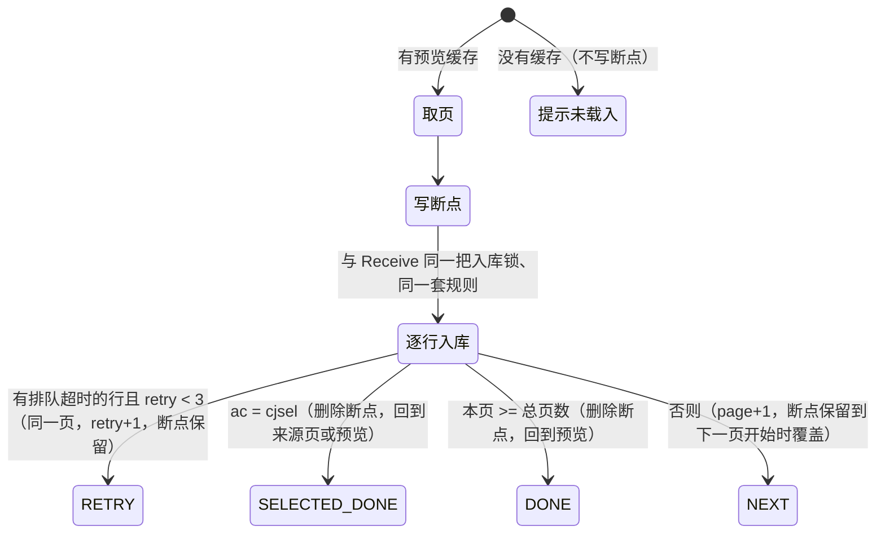

## B19 采集入库与 Receive 入站接口（路线图 B19，MACC-43）

> **状态：增量 1（视频入库核心 + Receive `vod`）已合并（main `738352f`）；增量 2（文章、演员、角色、网址、评论）已合并（main `644b74c`）；增量 3（后台入库按钮与断点续采）交付待验收（第 12 节）。** 依据：
> - 路线图 `09-roadmap.md` 第 3.2 节 B19 行、第 5.3 节 B19 验收行（影子合并对比、并发提交同一条视频不重复、Receive 校验、回滚演练）、E01/E02 行（只做本地版本，不发请求、不下载图片）、第 1.2 节（零结构变更）；
> - B07 `12-write-infrastructure.md`（可写数据源、写入登记、回滚演练工具）、B13 `22-b13-admin-content.md`（`formatDataBeforeDb`、`mac_substring` 的 D-B13-5、严格模式报错的 D-B13-3）、B11 `20-b11-comment-gbook-counters.md`（视频搜索缓存）、B18 `26-b18-collect-preview.md`（解析结果与值的表示）。
>
> 旧代码位置一律相对仓库根目录；新代码写作 `…`。

### 0. 起点与分支

| 项 | 值 |
|---|---|
| 起点 | 增量 1：main `b673c71`（含 B18 合并 `39b9902`）；平台基线提交 `0f8ada9` 的树与它相同。增量 2：main `5367468`（含增量 1 合并 `738352f`）。增量 3：main `a9a036d`（含增量 2 合并 `644b74c`；平台基线提交 `82f685b` 的树与它相同） |
| 分支 | `agent/claude/macc-23`（本任务的工作分支），只用普通提交 |
| 回滚点 | 增量 1：main `b673c71`；增量 2：main `5367468`；增量 3：main `a9a036d` |

### 1. 范围与增量

B19 的旧代码是 `common/model/Collect.php` 的六个 `{种类}_data`（约 1 500 行）、`api/controller/Receive.php` 六个入口，以及后台 `collect/api` 的入库动作与断点续采。按种类分三次交付，每次都带影子对比：

| 增量 | 内容 | 状态 |
|---|---|---|
| 1 | 视频入库核心（`vod_data`，`Collect.php:419-1015`）：过滤、`strip_tags`、拼音、`inrule` 查重（含 `vod_search_optimise` 的主演结果编号）、新增、`uprule` a～w 更新、播放组与下载组的追加/替换/`urlrole` 合并去重、`opt`/`filter`/`filter_from`、随机点击顶踩评分、伪原创替换、搜索缓存追加；入库锁；Receive 构造函数三道检查与 `vod`、`index` | 已合并（main `738352f`） |
| 2 | 文章、演员、角色、网址、评论的 `*_data`（`Collect.php:1126-2532`）与对应的 Receive 入口 `art/actor/role/website/comment`（第 3.2、5 节），共用入库锁 | 已合并（main `644b74c`） |
| **3** | 后台 `collect/api` 的 `cj`/`cjsel`/`cjday`/`cjall`（从 B18 的预览缓存入库，`show=1` 的逐行输出与跳页）、`collect/load` 断点续采、采集源列表与断点采集页的断点按钮（第 12 节） | **本次交付** |

| 不在本批 | 归属 |
|---|---|
| 远程图片下载（`syncImages` 的 `down_load`） | 不实施（E02）：库内图片地址保持提交的值，相当于 `sync_pic_opt` 关闭 |
| 在线抓取资源站 | 不实施（E01） |
| 自定义规则采集 | B20 |
| `collect/timing`（浏览器端定时页：按间隔在 iframe 里打开 `collect/apis` 与生成静态页） | **不提供**（2026-10-28 用户决定删除，D-B19-15）：请求固定返回"该功能未在新系统中提供"；定时任务的执行文件 `collect` 一并不提供 |
| 直接访问 `collect/vod`、`collect/art` 等 | 不实施：旧方法要求参数，直接访问在旧版是 500（ArgumentCountError）；仍是"由 B19 批次提供"的提示 |

### 2. 模块与依赖

| 包 | 内容 |
|---|---|
| `collect.application` | `KindIngest`（增量 2：文章、演员、角色、网址、评论一行的入库规则，纯计算，经 `KindIngest.Store` 查重、关联查找与写入）、`VodIngest`（一行的入库规则，纯计算，经 `Store` 查重与写入）、`IngestPhp`（旧 PHP 函数：`mac_format_text`、`mac_txt_merge`、`mac_txt_explain`、`mac_rep_pse_syn/rnd`、`mac_array_filter`、`mac_like_arr`、`mac_substring`（含起点）与 PHP 8 的宽松比较、`intval`、`floatval`）、`CollectIngestService`（入库锁、配置读取、`Store` 的实现、列值换算）、`ReceiveService`（Receive 的检查、参数整理、分类名映射、JSON 输出） |
| `collect.infrastructure` | `CollectIngestMapper`（查重；增量 2 另加五个种类的查重、角色的关联视频与评论的关联数据，`mapper/collect/CollectIngestMapper.xml`）、`CollectIngestWriteMapper` + `CollectIngestWrites`（`mac_vod` 与增量 2 的 `mac_art`/`mac_actor`/`mac_role`/`mac_website`/`mac_comment` 的新增与修改，`mapper-write/collect/CollectIngestWriteMapper.xml`，列清单与 install.sql 相同） |
| `collect.api` | `ReceiveController`：`/api.php/receive/<操作>`，可写数据源打开时注册 |
| 增量 3 | `collect.application.CollectRunService`（一页入库、断点、重试、完成；经 `CollectIngestService` 入库，与 Receive 同一把锁、同一套规则）、`CollectPreviewService.select`（从预览缓存取要入库的一页）；`collect.infrastructure.FileCollectBreakpointStore`（断点文件）；`admin.web.AdminCollectActions` 的 `collect/api` 入库分支与 `collect/load`；`CollectListView`、`collect/index.jte`、`collect/union.jte` 的断点按钮 |
| 复用 | content：`LegacyPinyin`、`PhpText`（`strip_tags`、`mac_filter_xss`、`mb_substr`、`urldecode`）、`PhpIntval`、`AdminRowValues`/`AdminTable`（列值规则同 B13）、`VodSearchCache`（主演结果编号与新增视频追加，同 B11/B13）、分类缓存（`type_pid` 与分类名 → 编号）；common：`PhpInput`（按字节解析 GET/POST）、`LegacyJson`、`LegacyLang`；legacyconfig：`maccms.php`、`vodplayer.php`、`voddowner.php` |

- **写入登记**（`WriteRegistry`）：`collect / mac_vod / INSERT、UPDATE / B19`；增量 2 另加 `collect / mac_art、mac_actor、mac_role、mac_website、mac_comment / INSERT、UPDATE / B19`（共 105 项）；不登记 DELETE。增量 3 不新增登记：后台入库经同一个 `CollectIngestService` 写这几张表。搜索缓存的写入沿用 content 已登记的 `mac_vod_search`。五张表都在路线图写入方矩阵的 B19 范围内。
- 依赖方向符合 `ModuleBoundaryTest`：collect 只引用 content、common、legacyconfig 的 `application` 公开类型与 common 的支持类。

### 3. 入库规则（`VodIngest`，与 `vod_data` 逐步对应）

1. **跳过**：`type_id == 0` → `type_err`；`vod_name` 为空 → `name_err`；名称含过滤词（`collect.vod.filter`）→ `name_in_filter_err`。
2. **整理**：去掉 `vod_id`；除键名含 `_content` 与 `vod_plot_detail` 外每个字段 `strip_tags`；`type_id_1` 取本站分类的 `type_pid`；`vod_en` 拼音、`vod_letter` 首字母（提交的值不起作用）；`vod_time_add` 不是 10 位时取当前时间，`vod_time_update` 是 10 位时作 `vod_time`；`vod_status` 一律取配置（提交的不起作用，照旧）；整数字段 `intval`、`vod_score` `floatval`；`vod_class` 与 `type_name` 合并（`class_filter` 打开时去掉"片""剧"）；主演、导演、扩展分类、标签 `mac_format_text`；剧情名与详情去掉两端的 `$`；随机点击、顶踩、评分；伪原创（名称、正文随机词、同义词、播放器、地区、语言）；简介为空时取正文 `mac_substring(strip_tags(正文), 100)`。
3. **查重**（`inrule`）：名称 `mac_filter_xss` 后相等，另按 b 分类、c 年份、d 地区、e 语言相等；f 主演 `LIKE` 任一（逗号拆开，不转义通配符）；g 导演相等。f 与 g 同时参与且导演非空时变成 `(导演相等 OR 主演条件)`，开启 `vod_search_optimise` 的 collect 时主演条件换成搜索缓存的结果编号（不超过 1000 个时）。不排序取第一行。
4. **播放组与下载组**：按 `$$$` 拆开，类型为空或不在播放器（下载器）配置里的组整组去掉；播放地址去掉末尾 `#`、下载地址去掉末尾空白；`filter > 0` 时类型出现在 `,filter_from,` 里（子串匹配）的组另记一份。
5. **新增**：`opt == 2` → `not_check_add`；`filter` 为 1 或 2 时只写另记的那份；`formatDataBeforeDb`（列出的字段 `mac_filter_xss` 后按字符数截断）；写库；开启 collect 搜索优化时把新视频追加进已有的搜索结果。
6. **更新**：`uprule` 为空 → `uprule_empty`；锁定 → `data_lock`；`opt == 1` → `not_check_update`；否则 a 播放组、b 下载组（`filter` 为 1 或 3 时用另记的那份；新类型追加，同类型地址不同时按 `urlrole` 替换或合并去重，说明文字逐组累加）、c 连载（都是整数时取较大值）、d～w 各字段（非空且与库里不同才更新，n 扩展分类与库里的合并，j 图片只在库里是 http 开头或为空时更新）。有更新时写 `vod_time` 并 `formatDataBeforeDb`；没有时 `not_need_update`。
7. **结果**：绿色（新增、有更新）为 `code=1`，否则 `1001`；`msg` 是旧版的说明文字。

比较一律按 PHP 8 的宽松比较（数字串按数值，`"1e1" == "10"`），与 B18 相同。

#### 3.2 文章、演员、角色、网址、评论（`KindIngest`，增量 2）

五个种类的规则比视频简单，共同部分与差别如下（旧代码 `Collect.php` 的 `art_data:1126`、`actor_data:1453`、`role_data:1725`、`website_data:2044`、`comment_data:2314`）。结果的 `msg` 是"名称 + 空格 + 说明"（评论是"内容 + 空格 + 说明"），更新成功时说明为空（如 `"旧文 "`）——视频只有说明，照旧不同。

| 步骤 | 文章 | 演员 | 网址 | 角色 | 评论 |
|---|---|---|---|---|---|
| 跳过 | `type_id == 0`；名称为空；名称含过滤词 | 同左；名称或性别为空时说明是旧代码少了开头 m 的键名 `odel/collect/actor_data_require`（语言包里没有，原样输出） | 同文章 | 角色名、演员名、`vod_name` 任一为空 → `role_data_require`；角色名含过滤词 | 昵称、内容、`rel_name` 任一为空 → `comment_data_require`；**内容**含过滤词 |
| 整理 | 去掉主键；除键名含 `_content` 外 `strip_tags`；名称 `trim`；`type_id_1`；拼音、首字母；`*_time_add`、`*_time` 一律当前时间（提交的不起作用）；状态取配置；整数与评分字段；随机点击、顶踩、评分；正文的随机词与同义词 | 同左 | 同左 | 同左，但名称不 `trim`、没有分类 | 只有 `comment_time`（当前时间）、状态取配置、顶踩与 `comment_mid` 取整、IP 不是数字时按 `mac_get_ip_long` 换成整数（不是点分十进制 IPv4 时为 0）、随机顶踩、正文伪原创 |
| 简介 | 为空时 `mac_substring(strip_tags(去掉 $$$ 的正文), 100)` | 为空时 `mac_substring(strip_tags(正文), 100)` | 同演员 | 无 | 无 |
| 分页 | 标题、备注按正文 `$$$` 的页数对齐（多的丢弃，少的补空串） | — | — | — | — |
| 查重 | 名称相等；b 另按分类 | 名称相等；b 性别、c 分类 | 名称相等；b 分类 | 先找关联视频：`douban_id` 非空时按 `vod_douban_id`（并从数据里去掉），否则按 `vod_name`；c 另加 `vod_actor LIKE` 演员名的任一项、d 另加 `vod_director LIKE`，两者都有时 `(导演条件 OR 主演条件)`；找不到 → `not_found_rel_vod`。再按角色名、演员名、`role_rid` 查重 | `rel_id` 非空时直接用作关联编号；否则按 `comment_mid` 查：1 视频（`douban_id` 非空按豆瓣编号，否则名称）、2 文章、3 专题、8 演员、9 角色、11 网址，其他模块找不到；找不到 → `not_found_rel_data`。inrule b 内容、c 昵称参与查重，都不参与时不查、直接新增 |
| 新增 | 图片写 `(string)` 后的值 | 图片写提交的原值，**没有提交时为 NULL**（D-B19-9） | 同演员 | 同演员 | — |
| 更新 | `uprule` 为空跳过；锁定跳过；a 正文、b 作者、c 来源、d 图片、e 标签、f 简介 | a 正文、b 简介、c 备注、d 作品、e 图片 | a 正文、b 简介、c 备注、d 跳转地址、e 图片 | a 正文、b 备注、c 图片 | 没有锁定；a：库里的 `comment_time` 与当前时间不同就改成当前时间 |

- 各字段的更新条件同视频："提交的值非空且与库里不同"；图片是"库里是 http 开头或为空，且提交的值与库里不同"（所以没提交图片而库里是远程图片时，文章把图片清成空串，演员、角色、网址写 NULL 报错，D-B19-9）。有更新项时另写 `*_time`。
- 写库只写表里有的列（`vod_name`、`rel_name`、`douban_id`、`type_name` 等丢弃）；列值规则同第 4 节。

### 4. 入库锁、查重与写入（`CollectIngestService`）

- **入库串行**：每一行的"查重 → 新增或更新"（增量 2 含角色、评论的关联查找）在进程内的公平锁里执行，六个种类共用一把锁；等锁超过 30 秒时放弃本行（Receive 返回 503 与"入库排队超时，请稍后重试"）。所以同一部视频的并发提交只会新增一次，其余按更新规则处理（`ReceiveGoldenMySqlIT` ②）。旧版没有锁，并发时可能写出重复行（D-B19-2）。
- **查重**走只读连接池（自动提交，读到已提交的写入）；**写入**走可写数据源（B07，自动提交、不开事务）。
- **列值**：只写 `mac_vod` 里有的列（旧版 `fields_strict=false` 静默丢弃其他键，如 `pass`、`type_name`）；值按 PHP 字符串转换后经 B13 的 `AdminRowValues`（数值列空串写 0；超长、非法 UTF-8、4 字节字符拒绝）。MySQL 严格模式下的数据错误（如缺 `vod_content`，见第 8 节）换成"参数错误"，不写库。

### 5. Receive 入站接口（`/api.php/receive/<操作>`）

| 步骤 | 规则 |
|---|---|
| 路由 | 同 Provide（B06）：路径解码一次，去掉 `.html` 等后缀与首尾 `/`，`/键/值` 为路径参数；操作名只认小写；GET/HEAD/POST；POST 只认 urlencoded 正文（上限 2MB，超过 413）。可写数据源关闭时不注册（404） |
| 参数 | ThinkPHP `input('', '', 'trim,urldecode')`：GET → POST → 路径参数合并（后者覆盖前者），每个值先 `trim` 再 `urldecode`（所以 `%2541` 最终是 `A`），值整段是查询表达式关键字（`LIKE`、`not in`、`Null` 等，不区分大小写）时末尾补一个空格（`Request::filterExp`） |
| 检查 | 顺序不变：`interface.status != 1` → 3001；`interface.pass != pass`（宽松比较，`1e15` 等于 `1000000000000000`）→ 3002；`strlen(interface.pass) < 16` → 3003 |
| `vod` | 名称为空 → 2001；`type_id` 与 `type_name` 都为空 → 2002；`type_id` 为空时按 `interface.vodtype` 映射（每行 `本站分类名=接口分类名`，换成本站分类编号，没有该分类时 0）；然后按第 3 节入库一行（`$param = []`） |
| `index` | 空白（200） |
| `art`、`website` | 名称为空 → 2001；`type_id` 与 `type_name` 都为空 → 2002；`type_id` 为空时按 `interface.arttype`/`websitetype` 映射（规则同 `vodtype`）；然后按第 3.2 节入库一行 |
| `actor` | 演员名为空 → 2001；性别为空（含 `"0"`）→ 2002；分类都为空 → 2003；按 `interface.actortype` 映射 |
| `role` | 角色名为空 → 2001；演员名为空 → 2002；`vod_name` 与 `douban_id` 都为空 → 2003（只给 `douban_id` 时入库仍要求 `vod_name`，得到 `role_data_require`，照旧） |
| `comment` | 昵称为空 → 2001；内容为空 → 2002；`comment_mid` 为空（含 `"0"`）→ 2004；`rel_name` 与 `douban_id` 都为空 → 2003。2001 与 2002 的说明都是"评论内容必须err"（旧语言包里 `api/require_comment_name` 写了两次，后者覆盖前者，照旧） |
| 响应 | `text/html; charset=utf-8`，正文 `{"code":…,"msg":"…"}`（`json_encode(…, JSON_UNESCAPED_UNICODE)`，`LegacyJson`） |

### 6. 配置

不新增配置项。读取的旧配置：`maccms.php` 的 `interface`（`status`、`pass`、`vodtype`）、`collect.vod`（第 3 节各项）、`app.lang`、`app.vod_search_optimise`；`vodplayer.php`、`voddowner.php` 的键。

### 7. PHP 与 Java 的影子对比（黄金）

- `src/test/php/receive_golden.php` 在 PHP 8.0.30 与 7.3.33 上，经 `legacy_http_child.php`（api 入口）以 php-cgi 跑**完整的 ThinkPHP 路由、`Receive` 控制器与旧 `Collect::vod_data`**（不改旧代码），对一次性库 `maccms_it_*` 发出真实请求；每个场景先清空 `mac_vod`、`mac_vod_search` 并复位自增、写入种子行，用自己的配置与运行目录。记录每一步的状态码、Content-Type、正文、两张表的全部行（十六进制）与请求前后的时间。
- **22 个场景、42 步**：接口关闭、密码错误与缺失、密码数值相等、密码太短与为空、名称与分类必填、分类名映射（已映射、未映射、本站没有该分类、`type_id=0`）、缺 `vod_content`、`index`；整行新增（`strip_tags`、拼音、扩展分类合并、主演分隔符、未知播放器与空类型的组、地址末尾 `#`、下载地址末尾空白、剧情 `$$$`、时间字段、提交的 `vod_status`/`vod_letter`/`vod_id` 被忽略、多余字段）；过滤词；伪原创名称；播放组"地址相同 + 新增组"、同类型替换、同组无需更新、没有播放组；`urlrole=1` 合并去重与下载组新增；`uprule` a～w 全部字段（含连载取较大值、库里是本地图片时不更新图片、扩展分类合并）；锁定；`uprule` 为空；无需更新；`inrule` 主演导演混合匹配的四种情况；`inrule` 分类、年份、地区、语言；路径参数与查询串（双重解码）；`trim` 与查询表达式补空格；`<script>` 名称与 iframe/link 播放器；`vod_search_optimise=collect` 的主演结果编号查重与新增后追加；随机点击顶踩评分。
- 两份黄金互相比较：除 PHP 8 的 `mac_substring` 把 ASCII 字符换成空格（简介由纯 ASCII 正文生成的 4 行，B13 已登记为 D-B13-5，新版按 7.3）外完全相同。
- **增量 2**：同一脚本在 `GOLDEN_SET=kinds` 时改跑 `receive_kinds_scenarios.php`，输出 `php80-kinds-golden.json`、`php73-kinds-golden.json`；每步记录 `mac_art`、`mac_actor`、`mac_role`、`mac_website`、`mac_comment`、`mac_vod`、`mac_topic` 七张表（与本场景上一步相同的表记为 null，减小体积）；另加 6 个分类（文章、明星、网址各一个顶级与子分类）。**32 个场景、98 步**：五个入口的必填检查与编号、分类名映射（已映射、未映射、映射到 0、`type_id=0`）、密码错误；整行新增（`strip_tags`、名称 `trim`、拼音、提交的状态/首字母/拼音/主键被忽略、多余字段、文章分页对齐、简介生成含纯 ASCII 正文、子分类的 `type_id_1`）；过滤词（评论按内容）；更新规则全部字段、无需更新、库里是本地图片时不改图片、文章没提交图片时清空图片、锁定、`uprule` 为空、inrule 不含分类时跨分类命中；演员按性别、分类区分；角色的关联视频（名称、豆瓣编号、找不到、inrule c/d 的主演/导演 LIKE 与两者混合、多个演员名）；评论的六种关联模块、未知模块、找不到、直接给 `rel_id`、`comment_mid` 为 `1abc`、IP 三种写法、按内容与昵称查重后更新时间；同义词替换；随机点击顶踩评分；以及旧版整页 500 的 8 步（没提交图片、缺正文、更新时没提交图片）。
- 两份增量 2 的黄金互相比较：除 D-B13-5 的简介（由纯 ASCII 正文生成的行）与随机列外完全相同。

### 8. 测试与验证

| 内容 | 测试 / 证据 |
|---|---|
| 影子合并对比 | `ReceiveGoldenMySqlIT` ①：以真实 HTTP 启动应用，逐场景写入同样的旧配置与种子，发送同样的请求；状态码、正文与 PHP 8.0、7.3 逐字节相同（Content-Type 只差参数前的空格，Tomcat 统一去掉），两张表逐行逐列相同（写入时刻按各自的请求时间窗比较，随机列按旧版范围比较；8.0 的简介按 D-B13-5 取 7.3 的值）；登记差异 `require/no-content` 断言新版行为。变异检查：故意改坏播放组追加，该测试即报出 4 处行差异 |
| 入库排队 | `ReceiveGoldenMySqlIT` ②：16 个并发请求提交同一部新视频，只有 1 个"新加入库"，其余 15 个"播放组(dplayer)，更新ok。"，表里只有 1 行 |
| 回滚演练 | `ReceiveGoldenMySqlIT` ③：快照 → 场景 update-fields 的 3 次更新与 1 次新增 → `DmlRestore` 只用 DML 恢复 → 与快照逐行 diff 为空 → 表结构指纹与导入时相同 |
| 增量 2 影子对比 | `ReceiveGoldenMySqlIT` ④：同 ①，复放增量 2 的黄金（7 张表；8 步登记差异断言"参数错误"且不写库）。变异检查：故意把文章分页的标题全写空串，该测试即对 8.0、7.3 两份黄金都报出 `art_title` 差异 |
| 增量 2 入库排队 | `ReceiveGoldenMySqlIT` ⑤：16 个并发请求提交同一篇新文章（正文各不相同），只有 1 个"新加入库"，其余 15 个按更新规则改正文（`"并发文 "`），表里只有 1 行 |
| 增量 2 回滚演练 | `ReceiveGoldenMySqlIT` ⑥：快照 7 张表 → 评论场景的 11 步与文章更新、演员更新、角色新增、网址新增 → `DmlRestore` 只用 DML 恢复 → diff 为空 → 表结构不变 |
| 增量 2 规则分支 | `KindIngestTest`：数组字段拒绝、演员必填的语言键、文章分页对齐、演员与网址的 NULL 图片被列值规则拒绝、宽松比较与本地图片、锁定、评论不查重时直接新增、未知模块不查库、豆瓣编号只对视频生效、角色的 LIKE 条件与找不到关联视频、`mac_get_ip_long`、随机项范围（评论只有顶踩）、伪原创只改正文、分类为 0 与过滤词在查库前跳过 |
| 规则分支与旧函数 | `VodIngestTest`：`opt`、`filter` 1/2/3 与 `filter_from` 子串匹配、随机项范围、搜索优化的结果编号与追加、`tag=1`、连载规则与 D-B19-4、数组字段拒绝、旧 PHP 文本函数、`mac_rep_pse_rnd` 的 crc32 选词、Receive 参数整理、分类名映射 |
| 增量 3 编排 | `CollectRunServiceTest`（12 例，入库用替身、不连库）：逐页走完时断点的写下与删除、跳转参数（下一页、完成回到预览、`cjsel` 去掉 `ids`）、从断点续上只重做那一页、"参数错误"的行不中断本页、排队超时同一页重试到 3 次后照常翻页、`cjsel` 选中的行一次入库、`t`/`wd`/`h`/`rday` 筛选、`h` 的窗口边界（视频与其他种类）、文章走 `KindIngest`、没有载入时不记断点、越界页、`collect_timespan` 的空值规则、断点文件只在 `breakpoints/` 且清除预览缓存不影响。变异检查：去掉"完成时删除断点"，3 例报错。`AdminCollectJumpTest`：跳转地址的本站检查与 `urldecode` |
| 增量 3 端到端（HTTP 契约 + 真实 MySQL） | `AdminCollectIngestMySqlIT`（6 例，一次性库）：① 45 部视频"采集所有"按 `data-url` 逐页走完 3 页——每页的状态码、Content-Type、内容安全策略头、标题与样式段、`[vod_data]` 页码与文件名、逐行结果（新增、分类未绑定、过滤词）、`progress.js` 跳转与 `collect_timespan` 秒数、完成提示；过程中采集源列表与断点采集页出现"【进入视频断点采集】"、`collect/load` 输出"正在载入断点位置"并跳到断点；完成后断点消失；`collect/load` 没有断点时跳回来源页（`urldecode`）或采集源列表，别站来源 403；库里 43 行、名称不重复。② 同一批再走一遍：全部"无需更新"，全库快照逐行不变（幂等）。③ 50 部做完 2 页后中断，经 `collect/load` 从断点（第 2 页）续上：这一页没有新增、续完后 48 行不重复、断点消失。④ `cjsel` 选中 3 行一次入库并回到来源页，没有来源页回到预览，别站来源 403 且不入库；文章"采集当天"`h=24` 只入库一天内的、分类按绑定。⑤ 没有载入：提示、全库不变、无断点；8 个并发请求入库同一页 20 部：合计只新增 18 次、库里 18 行。⑥ 回滚演练：快照全库 → 25 部视频两页入库 + 改一部的播放地址 → `DmlRestore` 只用 DML 恢复 → 逐行 diff 为空 → 表结构不变；结束时删库并确认不存在 |
| 增量 3 随改的已有测试 | `AdminCollectPreviewMySqlIT` ⑥：去掉"入库按钮与 `collect/load` 是 501"的预期，改为没有断点时 `collect/load` 只跳转、全库不变 |
| 护栏 | `WriteGuardTest`、`WriteRegistryTest`（登记 105 项）、`WriteInfrastructureMySqlIT`（B19 只允许 collect 对 mac_vod、mac_art、mac_actor、mac_role、mac_website、mac_comment 的新增与修改）、`ModuleBoundaryTest`、`ReadOnlyGuardrailsTest`、`OutboundNetworkGuardTest`、`SchemaGuardTest`、`CollectPreviewGuardTest` |

### 9. 风险与遗留

| 项 | 说明 |
|---|---|
| 入库锁是进程内的 | 多实例部署时各实例的锁互不相干；Receive 与后台入库要落在同一实例（与 B18 的预览缓存相同的部署约束）。需要多实例时改成数据库命名锁，届时在 B21 演练 |
| 严格模式 | 旧表 `vod_content` 等 TEXT 列没有默认值，严格模式下缺这些列的新增失败（旧版 500，新版"参数错误"）。生产库的 `sql_mode` 未核实（D9-b）；若生产不是严格模式，旧版会写入空值，新版仍拒绝——B21 演练时核对 |
| 入库是 GET | 旧版的入库按钮、跳页与断点都是 GET 链接，新版照旧（逐页跳转靠 `location.href`）。后台入口对 GET 也要求同源（D-B12-3），别的站点发起的入库请求在入口处 403（`AdminCollectIngestMySqlIT` ④） |
| 断点与预览缓存是本机文件 | 断点在 `<cache-dir>/breakpoints/`，与预览缓存同目录；多实例部署时载入、预览、入库与断点续采要落在同一实例（同 B18） |
| 从断点续上时重做断点那一页 | 与旧版相同：断点是"正在做的那一页"的地址，续采时整页重做；已入库的行按查重走更新一支（同样的数据得到"无需更新"，不新增重复行，IT ②③）。若两次之间改了 `uprule`，重做的行会按新规则更新 |
| `collect/timing` | 已按用户决定删除（D-B19-15）。权限码 `collect/timing` 与"定时挂机"菜单项（旧版就是 `show=0` 的隐藏项）仍在权限树里，与 auth.php 逐项相同（`AdminPermissionsGoldenTest` 锁定），勾选与否都只会得到固定提示。现有 `timming.php` 里 `file=collect` 的任务照旧列出、可删除、可改状态；B16 实现执行时不执行这类任务（路线图 B16 行） |
| 演员、角色、网址必须带图片 | 旧版没提交图片时整页 500（D-B19-9），新版照旧拒绝（"参数错误"）。资源站数据一般带图片，影响有限；若要改成"没有图片时写空串"属于功能调整，需队长决定 |
| `mac_get_ip_long` | 新版只认标准点分十进制（每段 0～255、没有前导 0）；PHP `ip2long` 依赖系统 `inet_pton`，个别写法（如前导 0）可能因平台而异 |
| 图片同步 | 不下载（E02）；`pic=1` 时旧版会下载失败并保留原地址（本机无网络时的结果与新版相同），能下载时旧版换成本地地址，新版不换 |

### 10. 与旧版的差异

| 编号 | 旧版 | 新版 | 原因 |
|---|---|---|---|
| D-B19-1 | 图片同步打开时下载远程图片 | 不下载，保持提交的地址 | E02（只做本地版本） |
| D-B19-2 | 查重与写入之间没有锁，并发提交同一部视频可能写出重复行 | 入库锁内串行，只新增一次 | 路线图"入库串行"、验收"并发不重复" |
| D-B19-3 | 数组参数、数组字段（PHP 8 类型错误）、MySQL 严格模式下的数据错误（如缺 `vod_content`）：整页 500 | 不写库，`{"code":1001,"msg":"参数错误"}`；参数含非法 UTF-8 同样处理 | 同 D-B13-3 |
| D-B19-4 | 更新连载时库里的值不是数字串：PHP 8 `floor()` 类型错误（500），PHP 7 当作非整数 | 按 PHP 7 的结果写提交的值 | 健壮性 |
| D-B19-5 | 新增时 `filter` 为 1/2 而没有一组匹配：PHP 8 `join(null)` 类型错误（500），PHP 7 写空串 | 四列写空串 | 健壮性 |
| D-B19-6 | `mac_txt_explain` 用 `html_entity_decode` 解码全部 HTML 实体 | 只解码五个基本实体与数字实体，其他命名实体原样保留 | 伪原创词表里实际只用到这几种；完整实体表收益小 |
| D-B19-7 | `mac_interface_type` 的第一步结果放在缓存里，改配置后要等缓存失效 | 每次按当前配置计算 | 配置改动立即生效 |
| D-B19-8 | Receive 正文没有大小上限 | urlencoded 正文上限 2MB（413） | 资源边界 |
| D-B19-9 | 演员、角色、网址新增时没有提交图片（`$tmp['pic']` 为 null），或更新时没有提交图片而库里的图片是远程地址或为空：把 NULL 写进不允许 NULL 的图片列，整页 500，不写库 | 不写库，`{"code":1001,"msg":"参数错误"}`（同 D-B19-3）；文章照旧转成空串 | 旧版报错时的统一处理 |
| D-B19-10 | 后台入库时 `t`、`ids`、`wd`、`h`（视频另有 `rday`）交给资源站筛选，每次取资源站的一页 | 从预览缓存本地筛选：`t` 远程分类编号相等、`wd` 名称包含（同 D-B18-2）；`ids` 非空时只取 `<种类>_id` 在逗号列表里的行，并且选中的行一次入库（不按 `limit` 分页，最多 1000 行）；`h` 大于 0 时按旧 Provide 接口的窗口取 `<种类>_time`（视频：大于"现在 − h 小时"；其他种类：大于那一天的零点；都小于明天零点；PRC 时区；`Y-m-d H:i:s` 或时间戳，取不出时不入选）；每页 `limit` 条（按钮里是没替换的占位符，取默认 20）；页码超过总页数时为空页并结束 | 本地文件就是全部数据（E01） |
| D-B19-11 | 一行在 PHP 里报错时整页 500，后面的行不再入库，也不跳页 | 这一行输出"参数错误"（同 D-B19-3），继续本页；入库锁等待超时的行输出"入库排队超时，请稍后重试"，本页结束后同一页自动重来（`retry` 参数，最多 3 次），仍超时就照常翻页 | 健壮性；入库锁是新版加的（D-B19-2），排队超时只会在新版出现 |
| D-B19-12 | `mac_jump` 把地址原样写进内联脚本；`cjsel` 完成后跳到 `$_SERVER['HTTP_REFERER']`；`collect/load` 没有断点时跳到 `mac_get_refer()`，没有来源页时跳到空地址（不停地重新载入本页） | 跳转改由 `progress.js` 的 `data-url`（内容安全策略，同 B13 第 8.4 节），地址转义；来源页与断点地址只认站内路径或与后台对外地址同源的 http(s) 地址，否则 `cjsel` 回到预览、`collect/load` 跳到采集源列表 | 安全（脚本注入、开放跳转）；修掉死循环 |
| D-B19-13 | 断点存在站点缓存（`Cache::set`，与其他缓存一起清除）；进入入库分支就写下断点，资源站请求失败时也写 | 断点是缓存目录下 `breakpoints/collect_break_<种类>.url`（重启后仍在，清除预览缓存不影响）；没有载入的本地文件时提示"没有载入的本地文件（或已过期），请先在资源库页面载入文件"，不写断点、不写库 | 本地文件源；没有数据就没有可续的断点 |
| D-B19-14 | 逐行输出名称、说明与文件名原样输出；`sync_pic_opt` 打开时附带图片下载结果 | 名称、说明、文件名转义后输出；不下载图片，所以没有下载结果（D-B19-1） | 同 D-B13-19；E02 |
| D-B19-15 | 后台 `collect/timing`"定时挂机"页（浏览器按间隔调用在线采集 `collect/apis` 与生成静态页）；定时任务（`extra/timming.php`）可选执行文件 `collect`，由 `api.php/timming` 定时连资源站采集（`api/controller/Timming.php:64-70`） | `collect/timing` 固定返回"该功能未在新系统中提供"（501；Ajax 为 `{"code":0,…}`，`AdminPermissions.NOT_PROVIDED`），不再是批次提示；定时任务编辑页新建时的执行文件下拉框没有 `collect`（默认改为 `make`），已有 `collect` 任务的编辑页仍选中它并标明"新系统不提供"；保存执行文件为 `collect` 的任务固定拒绝"定时采集（collect）未在新系统中提供，请改选其他执行文件"，不写文件。其他执行文件（`make`、`cj`、`cache`、`urlsend`）不变 | 2026-10-28 用户决定删除：旧版定时自动连资源站采集与本地文件源方针（D1/E01）冲突 |
| — | `mac_substring` 在 PHP 8 把 ASCII 字符换成空格 | 按 PHP 7.3 | 沿用 D-B13-5 |
| — | Content-Type `text/html;charset=utf-8` 与 `text/html; charset=utf-8` 两种写法 | 一律 `text/html;charset=utf-8`（Tomcat 输出） | 语义相同 |

验证（D-B19-15）：`AdminMvcTest`（超级管理员逐个访问已知动作，`collect/timing` 为固定提示、501）、`AdminSystemGoldenTest.timmingCollectTaskTypeIsNotProvided`（新建表单无 `collect`、已有任务仍选中并标明、保存 `collect` 被拒且文件不变、改选 `make` 后正常保存）；B15 黄金复放中新建任务表单的默认执行文件登记为有意差异（`JAVA_FORM`）。

### 11. 回滚

- **代码**：每个增量以普通提交进入 main；出问题时 `git revert` 对应提交。撤回增量 3 回到 `a9a036d` 的行为（入库按钮与 `collect/load` 回到 501"由 B19 批次提供"，断点按钮不显示）；另可删除缓存目录下的 `breakpoints/`（只是断点文件，删掉后不再显示断点按钮）。撤回增量 2 回到 `5367468` 的行为（`art/actor/role/website/comment` 回到 501；`WriteRegistry` 去掉五张表的十项）；再撤回增量 1 回到 `b673c71` 的行为（`/api.php/receive/*` 404；去掉 collect 对 mac_vod 的两项）。不涉及表结构与配置项。
- **数据**：入库只有对现有列的 DML；回滚演练（第 8 节 ③）证明一批入库可以用 `DmlRestore` 只用 DML 恢复。生产切换时按 13 文档在停止写入后取快照。
- **开关**：Receive 本身受旧配置 `interface.status` 控制，关闭即 3001、不写库。后台入库只在载入了本地文件时写库；清除预览缓存（`ac=localclear`）后入库按钮只提示、不写库。

### 12. 增量 3：后台入库按钮与断点续采

#### 12.1 范围核对（main `a9a036d`）

| 旧代码 | 行为 | 新版 |
|---|---|---|
| `admin/controller/Collect.php:140-171` `api` | `pg` 换成 `page`，按 `mid` 分派 | 不变（B18） |
| `Collect.php:251-283` `vod($param)` 等五个（`:285-333`、`:335-…`） | `ac != 'list'`：`Cache::set(collect_break_<种类>, url('collect/api') . '?' . http_build_query($param))`；向资源站取一页（失败 → `error`）；视频先输出 `<title>{(int)page}/{pagecount} collecting..</title>`；都输出样式段，然后调 `{种类}_data($param, $res)` | `CollectRunService.run` + `AdminCollectActions.ingest`（12.2） |
| `common/model/Collect.php:420-1049` `vod_data` 等（`show=1`） | 输出 `[{种类}_data] ` + `data_tip1`（页、总页数、地址）；逐行入库并输出 `序号、名称 说明`（其他种类没有"、"与空格，`color` 不加引号）；之后：`cjsel` → 删除断点、"数据采集完成。"、去掉 `ids`、`ac=list`，有来源页时跳来源页；最后一页 → 删除断点、完成、去掉 `page`/`ids`、`ac=list`；否则 `page + 1`；跳转等待 `collect_timespan` 秒（空时 3） | 相同（12.2）；行的规则就是增量 1、2 的 `VodIngest`/`KindIngest` |
| `Collect.php:126-137` `load` | 有断点 → 输出 `load_break` 并立即跳到断点；否则跳到 `mac_get_refer()` | 相同；跳转地址只认本站（D-B19-12） |
| `Collect.php:14-52`、`:101-120` `index`、`union`；`view/collect/index.html`、`union.html` | 五个种类有断点时显示"【进入××断点采集】"按钮（`load?flag=种类`） | 相同（`CollectListView.breakpoints`） |
| `vod_data` 的 `ENTRANCE == 'api'` 一支 | 定时任务里一直取下一页直到最后一页 | 不在本增量（定时任务的执行属 B16；在线采集 E01 不实施） |

#### 12.2 接口与状态

请求都是 GET（与旧版相同），权限码仍是 `collect/api`、`collect/load`；后台入口的同源检查（D-B12-3）照常生效。

| 请求 | 响应（`text/html;charset=UTF-8`，后台的安全头与内容安全策略） |
|---|---|
| `collect/api?ac=<非 list/localload/localclear>&cjflag&mid&type&param&t&ids&wd&h&rday&opt&filter&filter_from&sync_pic_opt&page&limit&retry` | 没有这个来源的预览缓存：`error("没有载入的本地文件（或已过期），请先在资源库页面载入文件")`，不写库、不写断点。否则：写断点 → 取这一页 → 逐行入库 → 输出（视频的 `<title>`、样式段、`[vod_data] 当前采集任务…页 采集地址&nbsp;<文件名>`、逐行结果、重试或完成提示、`progress.js` 跳转与"暂停 N 秒后继续"链接） |
| `collect/load?flag=vod|art|actor|role|website` | 有断点：`正在载入断点位置，请稍后。。。` + 立即跳到断点；没有：跳到来源页（`urldecode` 后 `trim`）；没有来源页：跳到采集源列表 |
| `collect/index`、`collect/union` | 有断点的种类显示"【进入××断点采集】" |

**一次入库请求的状态**（`CollectRunService.End`）：

- **断点**：`FileCollectBreakpointStore`，`<maccms.collect.local.cache-dir>/breakpoints/collect_break_<种类>.url`，内容是这一页的后台地址（白名单参数 `http_build_query`），先写临时文件再原子改名；只在这五个文件名上读写。断点在页开始时写下，所以中断后续采会把那一页整页重做。
- **重试**：只针对入库锁等待超时（`CollectIngestService.Busy`，等锁超过 30 秒）；"参数错误"的行是确定性的，不重试。
- **幂等**：重做一页时，已入库的行按 `inrule` 查到、走 `uprule` 更新一支；数据相同则"无需更新"、不写库（IT ② 全库快照不变）。查重与写入在入库锁内，并发的入库请求（含 Receive）不会写出重复行（IT ⑤）。
- **回滚**：只有对现有列的 DML，`DmlRestore` 可以恢复（IT ⑥）；代码回滚见第 11 节。

#### 12.3 验证

见第 8 节"增量 3"三行；与旧版的差异 D-B19-10～14 见第 10 节。旧版这一段需要连资源站，没有做 PHP 影子对比：逐行的入库规则沿用增量 1、2 的黄金（`ReceiveGoldenMySqlIT`），本增量的输出格式、翻页与断点按旧代码逐段对照（12.1），由 `CollectRunServiceTest` 与 `AdminCollectIngestMySqlIT` 断言。
