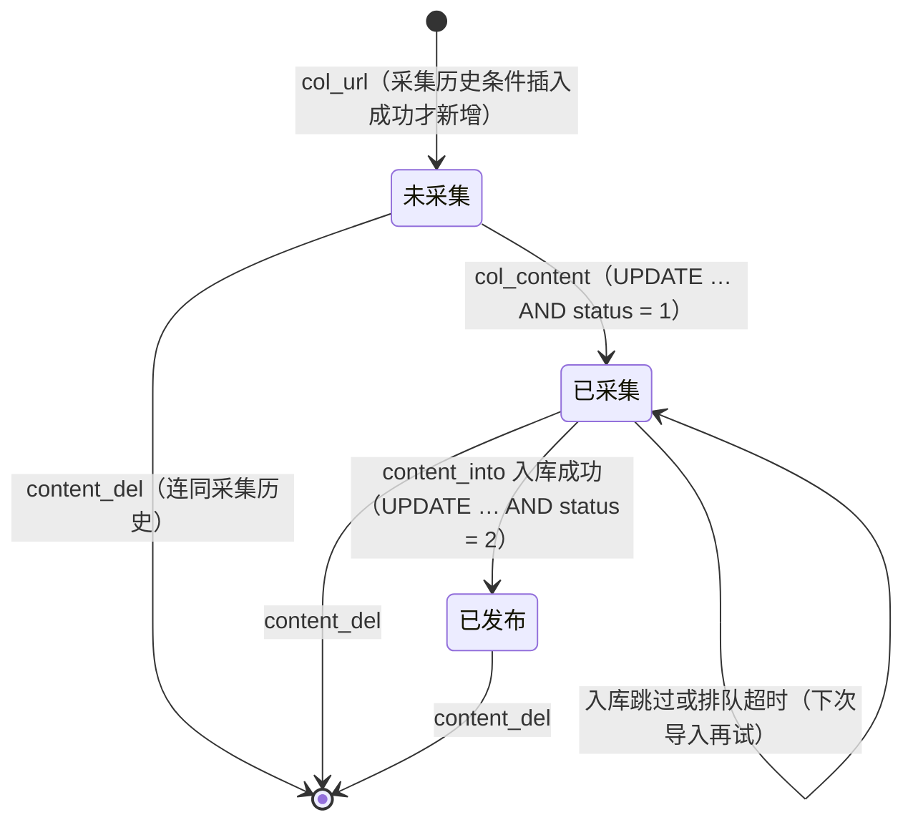

## B20 自定义规则采集本地 HTML 源（路线图 B20，MACC-44）

> **状态：交付待验收。** 依据：
> - 路线图 `09-roadmap.md` 第 3.2 节 B20 行、第 5.3 节 B20 验收行（同一规则与 HTML 在 PHP 与 Java 上提取结果一致；回滚演练）、E03 行（2026-10-16 用户决定：只做本地版本，规则作用于本地 HTML，不发起出站请求）、第 1.2 节（零结构变更）、写入方矩阵（`mac_cj_content`、`mac_cj_history` 在 B20）；
> - B17 `25-b17-collect-config.md`（规则节点的读写、删除节点时连带删除）、B19 `27-b19-collect-ingest.md`（入库锁与入库规则，导入走 B19）、B07 `12-write-infrastructure.md`（写入登记、并发测试、回滚演练）；
> - 用户决定（2026-10-17）：后台复用旧后台 HTML 结构与静态资产，转成 jte，不做新视觉设计。
>
> 旧代码位置一律相对仓库根目录；新代码写作 `…`。

### 0. 起点与分支

| 项 | 值 |
|---|---|
| 起点 | main `32b747d`（含 B19 增量 3 合并 `bec5117`）；平台基线提交 `99903da` 的树与它相同 |
| 分支 | `agent/claude/macc-44`，只用普通提交 |
| 回滚点 | main `32b747d` |

### 1. 范围

| 旧代码 | 本批实现 |
|---|---|
| `application/common/util/Collection.php`（`url_list`、`get_url_lists`、`get_content`、`cut_html`、`replace_item`、`replace_sg`、`url_check`、`get_html`） | `collect.application.CjRules` + `CjPcre`，页面来自本地 HTML 目录（第 3、4 节） |
| `admin/controller/Cj.php` 的 `show_url`、`col_url`、`col_content`、`publish`、`show`、`content_del`、`content_into`、`program`、`col_all` | `collect.application.CjRunService` + `admin.web.AdminCjActions`（第 6 节） |
| `admin/view/cj/{show_url,col_url,publish,show,program}.html` | `src/main/jte-admin/admin/pages/cj/*.jte`（第 8 节）；`col_content.html` 是没有被使用的空模板，不转写 |

| 不在本批 | 归属 |
|---|---|
| 按网址在线抓取 | 不实施（E03） |
| 规则节点的列表、表单、删除、导入导出 | B17（已合并） |
| 定时任务里执行 `cj`（`api/controller/Timming.php:78-83` 调 `col_all`） | B16（执行时调用本批的 `CjRunService`，见第 6.2 节） |
| 下载内容里的图片（`down_attachment`） | 旧版是空函数体，本来就不下载；不实施（E02） |

### 2. 模块与依赖

| 包 | 内容 |
|---|---|
| `collect.application` | `CjRules`（规则执行，纯计算，经 `Pages` 取页面）、`CjPcre`（过滤规则的 PCRE → Java 正则与 `preg_replace` 语义）、`CjRunService`（九个动作的业务规则与写库）；`CollectAdminServices` 增加 `cj` |
| `collect.infrastructure` | `LocalHtmlFiles`（本地 HTML 目录）、只读 `CjMapper`（`mapper/collect/CjMapper.xml`）、写 `CjWriteMapper` + `CjWrites`（`mapper-write/collect/CjWriteMapper.xml`）；`CollectLocalProperties` 增加 `html-dir` |
| `admin.web` | `AdminCjActions`（`AdminCollectActions` 把九个动作交给它）；视图 `view/collect/{CjShowUrlView,CjColUrlView,CjPublishView,CjShowView,CjProgramView}` |
| 复用 | collect：`CollectIngestService`（B19 入库锁与规则）、`ReceiveService.interfaceTypes`（`mac_interface_type`）、`CollectAdminMapper.selectCjNode`、`CollectAdminWrites.updateCjNode`/`deleteCjHistories`（B17 已登记的写入）、`CollectBindings.flag`（`md5`）；content：`PhpText.stripTags`、`PhpJson`、`AdminIds`、`AdminPaging`、`AdminTable`（列清单） |

- 依赖方向符合 `ModuleBoundaryTest`；`CjRules`、`CjPcre` 不引用数据访问与网络类型；`OutboundNetworkGuardTest` 不变（没有出站网络 API）。

### 3. 规则执行（`CjRules`）

#### 3.1 字节语义

旧代码的 `explode`、`str_replace`、`trim`、`strpos` 与不带 `u` 修饰符的 PCRE 都按字节处理。`CjRules` 里的文字一律是"一个字符一个字节"的 ISO-8859-1 字符串：规则从库里的 UTF-8 文字换成字节，页面按字节读入（`sourcecharset` 不是 `UTF-8` 时先按 `iconv(…, 'UTF-8//TRANSLIT//IGNORE')` 转码，无法转换的字节丢掉，不认识的编码当作取不到页面）。所以规则里的中文、`.` 匹配一个字节、`[中文]` 是字节集合等行为与旧版逐字节相同（黄金用例 `content-html-rule-bytes`）。

#### 3.2 步骤（与旧代码逐步对应）

| 函数 | 规则 |
|---|---|
| `url_list` | `sourcetype` 宽松比较：1 序列网址（`pagesize_start` 到 `pagesize_end`，步长 `par_num`，`(*)` 换成页码；结束页小于开始页时只有开始页）；2 按 `\r\n` 拆开；3、4 单一网址；其他没有网址 |
| `get_url_lists` | 取页面 → `cut_html(url_start, url_end)` → 去掉换行、`</a>`/`</A>` 后补换行 → `/<a ([^>]*)>([^\/a>].*)<\/a>/i`（名称以 `/`、`a`、`A`、`>` 开头的链接取不到，照旧）→ 每个链接取 `href`，按 `url_contain`/`url_except` 筛选，`url_check` 补全，名称 `strip_tags`；保留匹配的序号作键 |
| `get_content` | 第 0 页：标题、分类、`time`、自定义项（`customize_config` 解码后逐项，规则为空的跳过；英文名按 PHP 数组键规则）；每页：正文；分页：`content_page_start/end` 都非空时，"上下页"模式按 `content_nextpage` 找链接逐页递归（访问过的地址不再访问，同一实例内累积，同旧 `static $oldurl`），"全部列出"模式取全部链接（`array_unique`，以及旧代码 `$out[1][$k] == '#'` 的写法原样），按 `content_page` 用 `[page]` 或空串连接 |
| `cut_html` | 去掉换行；按 `trim` 后的开始标记取第一段之后、再按结束标记取之前，`trim` |
| `replace_sg` | 按 `[内容]` 拆开，每段 `trim` 后去掉换行；不含 `[内容]` 的规则就是规则本身（固定值） |
| `replace_item` | 规则为 `empty()` 时原样；按 `\n` 拆行（行尾的 `\r` 留在替换串里，照旧），空行跳过，每行 `模式[|]替换` → `preg_replace(['/'.str_replace('/','\/',模式).'/i', …], [替换, …])`；一行都没有时 `false`；任一模式无效或匹配出错时 `null` |
| `url_check` | 有 `://` 的原样；以 `/` 开头的接协议与主机（端口、账号丢掉，照旧）；有 `page_base` 时接它；否则接列表页的目录（`dirname`，根目录下的文件得到 `//`，照旧） |
| `json` | 旧 col_content 写进 `data` 的 `json_encode($html)`：默认选项（中文写成 `\uXXXX`、`/` 写成 `\/`）；取不到页面时 `null`；值含非法 UTF-8 时 PHP 返回 false、写库为空串 |

#### 3.3 过滤规则的 PCRE（`CjPcre`）

- **模式**：同 PHP 找结束分隔符（反斜杠转义下一个字符）与修饰符；`i m s x S X` 与空白照常，其他修饰符（含 PHP 认得的 `A D U u J n`）按无效。正文转写：字符类里的 `[`、`&` 转义，POSIX 类 `[:alpha:]` 等换成 Java 写法，不构成量词的 `{` 是普通字符，`\x`（0～2 位）、八进制（`\0`、`\o{}`、`\101` 按 PCRE 的"反向引用还是八进制"规则）、`(?P<名>)`、`(?P=名)`、`(?'名')`、`\g`、`\k`、`(?#注释)`、`\Q…\E`。引用不存在的分组、Java 不支持的构造（递归、条件、`(*动词)`、`(?|`、`\K` 等）按无效——与 PHP 编译失败一样，整条过滤规则的结果是 `null`。
- **替换串**：同 `php_pcre_replace_impl`：`\n`、`$n`、`${n}`（一到两位数字）是分组引用，没有该分组或分组没有参与时为空串；`\\`、`\$` 写出后一个字符。
- **时限**：一条过滤规则（一组模式）最多匹配 2 秒，超时按匹配出错（PHP 超过 `pcre.backtrack_limit` 时同样返回 null），防止灾难性回溯占住线程。

#### 3.4 畸形规则与上限

| 输入 | 旧版 | 新版 |
|---|---|---|
| 页码递增 `par_num` 为 0 | 死循环直到超时 | "页码递增必须大于 0"，不采集 |
| 序列网址超过 10 000 个 | 全部展开 | 提示缩小页码范围，不采集 |
| 一次正文采集（含分页）读取超过 100 个页面 | 没有上限（"全部列出"模式） | 这一条写 `null`、说明原因，继续下一条 |
| 开始或结束标记为空（`[内容]</h1>`、列表区间为空等） | PHP 8 ValueError（500），7.3 得到空串 | 空串（按 7.3） |
| 无效或不支持的正则、匹配超时 | `null`（PHP 8、7.3 相同） | `null` |
| 下一页规则为空 | PHP 8 跟随所有链接，7.3 一个都不跟随 | 不跟随（按 7.3） |
| `sourcetype = 4`（RSS，表单里没有，只能经导入出现） | 缺少 `pc_base` 类，500 | "RSS 网址类型在旧版不可用"，不采集 |
| `customize_config` 不是合法 JSON、不是数组、项不是对象或规则不是字符串 | 跳过（对象以外的项在 PHP 8 报错） | 跳过 |

### 4. 本地 HTML 源（`LocalHtmlFiles`）

| 参数（环境变量） | 默认 | 说明 |
|---|---|---|
| `maccms.collect.local.html-dir`（`MACCMS_COLLECT_HTML_DIR`） | 空（未配置） | 规则采集读取的本地 HTML 目录；未配置时采集动作提示"未配置本地 HTML 目录"，不写库 |
| `maccms.collect.local.max-file-bytes` | 10 240 000 | 每个页面的大小上限（与 B18 共用） |

规则里的网址不去请求，而是按"镜像目录"的约定映射到文件（与 `wget --mirror` 的布局相同，可以直接用镜像工具准备数据）：

```
http(s)://主机[:端口]/路径/文件?查询   →   <html-dir>/主机[_端口]/路径/文件@查询
```

- 只认 `http`、`https`；主机转小写，只能是字母、数字、`.`、`-`；默认端口不写；账号与 `#` 之后忽略。路径按 `/` 分段、`%XX` 解码（必须是合法 UTF-8），不能是 `.`/`..`、不能含 `\ : * ? " < > |` 与控制字符、不能以空格或点结尾、不能是 Windows 设备名；空段跳过；路径为空或以 `/` 结尾时文件名是 `index.html`；查询串接在 `@` 之后（`/ \ : * ? " < > |` 与控制字符写成 `%XX`）。
- 读取时路径上每一级都不能是符号链接、必须在目录之内且是普通文件，超过上限不读。不满足任何一条时当作"取不到页面"（同旧版请求失败）。
- 规则表单的"测试"（`show_url`）在每个列表页地址后显示对应的本地文件与是否存在；内容采集时缺失的页面在逐行结果里标出本地路径。
- 本地目录只读：不写、不删、不列出。

### 5. 数据访问与写入

| 模块 | 表 | 操作 | 语句 | 登记 |
|---|---|---|---|---|
| collect | `mac_cj_history` | INSERT | `insertHistory`：`INSERT … SELECT … FROM DUAL WHERE NOT EXISTS`（条件插入；主键冲突也当作已有） | B20（新） |
| collect | `mac_cj_content` | INSERT | `insertContent`（`status = 1`，`data` 写空串） | B20（新） |
| collect | `mac_cj_content` | UPDATE | `updateCollected`（`… WHERE id AND nodeid AND status = 1`）、`updatePublished`（`… WHERE id IN (…) AND status = 2`） | B20（新） |
| collect | `mac_cj_content` | DELETE | `deleteContents`（`id IN`）、`deleteAllContents`（`id > 0`） | 沿用 B17 |
| collect | `mac_cj_history` | DELETE | B17 的 `deleteCjHistories` | 沿用 B17 |
| collect | `mac_cj_node` | UPDATE | B17 的 `updateCjNode`（只写 `lastdate`；发布方案另写 `program_config`） | 沿用 B17（矩阵里 `mac_cj_node` 属 B17，本批不新增登记） |
| collect | `mac_vod`、`mac_art` | INSERT、UPDATE | 导入经 B19 的 `CollectIngestService` | 沿用 B19 |

- 只读查询（`CjMapper.xml`）：采集历史计数、发布页的计数与分页（`id desc`）、按编号取一条、未采集的前 20 条（按编号升序）、可导入的计数与"编号大于上一页"的一页、删除时按编号分批取网址。
- 全部是单表 DML，不建表、不改结构（`SchemaGuardTest`、`WriteGuardTest`、`WriteRegistryTest` 锁定，登记共 108 项）。MySQL 严格模式下的数据错误换成"参数错误"或这一行的说明，不整页 500。

### 6. 后台动作（权限码不变）

请求都是旧版的方法（GET；`content_del`、`program` 保存为表单 POST）；后台入口的同源检查（D-B12-3）照常生效。

| 动作 | 行为 |
|---|---|
| `cj/show_url` | 按表单的 `data[...]` 与 `urlpage<sourcetype>` 展开列表页地址（不读库），每个地址后标出本地文件 |
| `cj/col_url?id&page` | 取第 `page` 页列表页（缺省 1）的内容网址：名称或地址为空、采集历史里已有的计为重复；其余条件插入采集历史，记下的才新增"未采集"的内容行（写不进去时撤回采集历史）。最后一页时写节点采集时间。页面同旧版：先输出"让服务器休息一会"并 3 秒后跳到下一页，或"URL采集完成"，再输出本页统计与网址列表 |
| `cj/col_content?id&page` | 取 20 条"未采集"的内容（按编号升序），逐条按规则取字段，写成 JSON 并改为"已采集"（只改仍是"未采集"的行）；逐行输出 `网址&nbsp;&nbsp;ok`（取不到页面或被其他请求处理时输出说明）；还有未采集的就跳到下一批，否则写节点采集时间并输出"采集完成"；开始时就没有时"内容采集完成" |
| `cj/publish?id&status&page&limit` | 节点下的内容，`status` 非空时筛选，`id desc`，每页 `intval < 20` 时为后台每页条数；分页脚本 `admin-list.js` |
| `cj/show?id` | 一条内容的网址、标题与解码后的各字段 |
| `cj/content_del?ids[&all=1]` | 删除这些内容（`all=1` 时全部节点的全部内容，照旧），先删它们全部网址的采集历史 |
| `cj/content_into?id&ids|all&page&limit&total&after` | 节点下"已采集"的内容按发布方案换成视频（`mid = 2` 时文章）的列，经 B19 入库（`$param` 为空），成功的改为"已发布"；逐行输出入库说明；还有下一页时带上总数与 `after`（本页最后一行的编号）跳到下一页，否则"导入完成"。没有发布方案时每行输出空行、不入库（同旧版 `vod_data` 返回 null） |
| `cj/program?id` | GET：每个数据库列一行（列清单取 install.sql，`AdminTable`），选节点字段（标题、分类、内容与自定义项）与处理函数（去空格）；POST：`map[列] = 节点字段`、`funcs[列] = 函数`（节点字段为空的列不记），`json_encode` 后与 `lastdate` 一起写回节点 |
| `cj/col_all?id&page` | 一轮：采集一页网址 →"URL采集完成"→ 采集一批内容 → 导入这一批（每页 999）→"内容入库完成"，不跳转（定时任务 cj 调它） |

- 没有节点时"获取失败"；需要读页面的动作（`col_url`、`col_content`、`col_all`）在未配置本地 HTML 目录时提示，不写库。
- 跳转由 `progress.js` 的 `data-*` 完成（内容安全策略，同 B13/B19），地址只带上表列出的参数。

#### 6.1 状态与并发



- 同一网址只进一次内容表：采集历史的条件插入在 MyISAM 表锁下是原子的，另有主键兜底（并发时只有一个请求记下）。
- 同一条内容只写一次采集结果：`status = 1` 的前置条件；没改到的请求输出"已由其他请求采集"。
- 导入的查重与写入在 B19 的入库锁内，并发导入同一条不会写出重复视频（B19 已验证）；发布状态的更新带 `status = 2` 前置条件，重复执行是空操作。

#### 6.2 给 B16 的入口

定时任务执行文件 `cj`（旧 `Timming::cj` → `Cj::col_all($output)`）由 B16 调用 `collect.application.CjColAll`：与后台 `cj/col_all` 共用同一实现（`colUrl`、`colContent`、`contentInto` 一轮），B16 合入时接上（25 文档第 7.3 节、D-B16-16）。

### 7. PHP 与 Java 的提取一致（黄金）

- `src/test/php/cj_rules_golden.php` 在 PHP 7.3.33 与 8.0.30 上**直接调用旧 `Collection.php`**，不改旧代码、不连库、不联网：类在命名空间 `app\common\util` 里以非限定名调用 `mac_curl_get()`、`time()`，脚本在同一命名空间定义同名函数（返回用例的页面、记下请求的地址；固定时间）。`get_content` 的 `static $oldurl` 在一个 PHP 进程内累积，所以每个用例在单独的子进程里执行。
- **55 个用例、59 个操作**：序列网址（步长、结束页小于开始页、0）、多网址（`\r\n` 与 `\n` 混合、空行、空格）、单一网址、未知类型、数字串类型；列表页（相对、根相对、绝对、单双引号与无引号、大写 `</A>`、名称带标签、以 `a`/`/` 开头的名称、没有 `href`、`#`、`../`、带参数、包含与不包含筛选、`page_base`、列表页在根目录、以 `/` 结尾、没有路径、带账号端口查询与片段、区间找不到、开始标记重复、区间为空、页面缺失、内容为 `0` 与空串、GBK、GBK 当 UTF-8、小写 `utf-8`）；正文（固定值规则、过滤规则的各种替换引用与转义、无效正则、空行、`0`、`/` 与 `<\/a>`、按字节匹配、提前结束分隔符后的修饰符、空模式、27 个 PCRE 语法探针、自定义项（空规则、固定值、覆盖标题与时间、空英文名、数字英文名、`content` 键）、坏 JSON、标量 JSON、没有任何规则、页面缺失、规则找不到、空开始标记、多个 `[内容]`、BIG5、非法 UTF-8）；分页（上下页、不分页连接、下一页缺失、下一页规则为空、全部列出、重复与自身链接、多次采集共享已访问地址、空白开始标记）。
- `CjRulesGoldenTest`：Java 对同一节点与页面的结果逐值相同（带类型、保持键的顺序、字符串按字节），`json_encode` 的文字相同，按顺序读取的页面地址相同。
- **PHP 8.0**：内容采集一律 TypeError（第 3 节开头），`explode('')` 为 ValueError；测试核对 8.0 只在这两类错误上与 7.3 不同（33 个操作），其余操作 8.0 与 7.3 的黄金逐字节相同。新版的这部分按 7.3。

### 8. 页面

- 旧 `cj/show_url`、`col_url`、`publish`、`show`、`program` 逐个转写为 jte，标签、类名、布局原样；文字取语言包；原样输出的文字按 D-B13-19 的同一规则转义。
- 最小改动：`publish` 的分页脚本换成 `admin-list.js`（`data-*`）；`col_url`、`show`、`show_url` 里没有作用的内联脚本不输出（`col_url` 的脚本只算页码、跳转被注释掉了；`show` 的校验规则没有对应的字段；`show_url` 的脚本是空的）；`publish`、`program` 补上旧模板缺的 `<tbody>` 开始标签（浏览器原本也会补上，jte 的 HTML 检查要求成对）；`show_url` 与 `col_url` 增加本地文件的提示（第 4 节）。
- `AdminTemplatePolicyTest` 不变且通过（无内联脚本与事件属性、`<script>` 只带 `type/src/data-*`）。

### 9. 测试与验证

| 内容 | 测试 / 证据 |
|---|---|
| PHP/Java 提取一致 | `CjRulesGoldenTest`（PHP 7.3 的 59 个操作逐值相同；PHP 8.0 的 26 个不报错的操作相同、33 个报错的操作只在已登记的两类错误上） |
| 畸形规则与上限 | `CjRulesTest`：灾难性回溯 200 毫秒内按匹配出错返回 null、页码递增为 0、序列网址上限、RSS、分页读取上限（且按每条重新计数）、上下页循环靠已访问地址结束、不支持的 PCRE 构造与修饰符、转写保持 PCRE 语义、替换串引用规则、`url_check`/`dirname`/`parse_url`、非法 UTF-8 的 JSON |
| 本地 HTML 目录 | `LocalHtmlFilesTest`：镜像布局映射（端口、查询串、百分号编码、中文、默认页）、不安全网址（`..`、编码的分隔符、设备名、控制字符、非法 UTF-8 等 18 种）、只读目录内的普通文件、大小上限、未配置、符号链接不跟随 |
| 端到端（HTTP 契约 + 真实 MySQL） | `AdminCjMySqlIT`（一次性库）：① 测试网址显示本地文件 → 没有节点"获取失败" → 采集网址两页按跳转走完（统计、重复、缺名称、采集时间只在最后一页写）→ 再采一遍全部重复 → 采集内容（JSON 文字逐字节、缺页写 `null`、`script` 被过滤）→ 没有可采时"内容采集完成" → 发布页与查看 → 发布方案保存（JSON 逐字节）与回显 → 导入全部（6 部入库、缺页那条跳过、状态改为已发布）→ 再导入不新增；② 8 个并发请求采集同一节点的网址：合计只记下 10 个、表里 10 行不重复；8 个并发请求采集内容：每条只由一个请求写入；③ 删除 3 条内容连同 3 个网址的采集历史，非法编号"参数错误"，删掉的网址能重新采集；④ 回滚演练：快照全库 → 采集网址、内容、保存方案、导入 → `DmlRestore` 只用 DML 恢复 → 逐行 diff 为空 → 表结构不变；结束时删库并确认不存在 |
| 护栏 | `WriteGuardTest`、`WriteRegistryTest`（登记 108 项）、`ModuleBoundaryTest`、`ReadOnlyGuardrailsTest`、`OutboundNetworkGuardTest`、`SchemaGuardTest`、`SqlEntryGuardTest`、`AdminTemplatePolicyTest` |

### 10. 与旧版的差异

| 编号 | 旧版 | 新版 | 原因 |
|---|---|---|---|
| D-B20-1 | 按网址请求目标站 | 读本地 HTML 目录里按网址镜像存放的文件（第 4 节）；未配置目录时采集动作提示、不写库 | E03（只做本地版本） |
| D-B20-2 | `sourcetype = 4`（RSS）缺少 `pc_base` 类，500 | 提示"RSS 网址类型在旧版不可用"，不采集 | 健壮性 |
| D-B20-3 | 正文图片地址补全的回调类名不存在：PHP 8 内容采集整页 500；7.3 原样返回正文 | 不改写图片地址（按 7.3） | 旧版实际从未生效 |
| D-B20-4 | 空的开始/结束标记：PHP 8 ValueError（500），7.3 空串；下一页规则为空：PHP 8 跟随所有链接，7.3 不跟随 | 按 7.3 | 与已登记的 PHP 版本差异同一处理（D-B13-5） |
| D-B20-5 | 页码递增为 0 死循环；序列网址、分页读取没有上限；正则只受 `pcre.backtrack_limit` 约束 | 拒绝递增为 0、序列网址最多 10 000 个、一条正文（含分页）最多 100 个页面、一条过滤规则最多匹配 2 秒（超时同回溯超限，结果 null） | 资源边界 |
| D-B20-6 | PCRE | 转写成 Java 正则；Java 不支持的构造与修饰符按无效（结果 null）；空匹配之后不再在同一位置重试非空匹配（只影响"优先匹配空串"的模式） | 技术栈 |
| D-B20-7 | `col_url` 新增内容行不写 `data`（`NOT NULL` 且无默认值：严格模式下 500，且采集历史已先写入，这个网址以后永远算重复）；标题超过 100 字或网址超过 255 字：严格模式 500、非严格截断；列表页缺失：PHP 8 500、7.3 统计为"共 1 条" | `data` 写空串；不符合表结构的网址不记、计数显示，写不进去时撤回采集历史；列表页缺失统计为 0 并提示本地路径；采集历史用条件插入（并发不重复） | 健壮性；并发 |
| D-B20-8 | `col_content` 按 `page($total_page - 1, 20)` 取一批、按页码判断结束（未采集的超过两批时会剩下一部分）；忽略取不到页面的情况，一律输出 ok | 每批取编号最小的 20 条，直到没有未采集的为止；取不到页面、被其他请求处理时输出说明；改状态带前置条件 | 修掉漏采；并发 |
| D-B20-9 | `content_into` 按页码分页，但入库成功的行离开了"已采集"，第 2 页起会跳过一部分 | 按编号接着上一页取（`after` 参数），总数随跳转带回 | 修掉漏导 |
| D-B20-10 | `content_del` 只删最后一个网址的采集历史（用错变量），删掉的网址再采仍算重复；`ids` 非数字时不删 | 删全部网址的采集历史；`ids` 非数字"参数错误"（同 D-B12-10） | 修 bug |
| D-B20-11 | 发布方案的处理函数：取的是 `$v['data'][$b]`（JSON 文字的下标：PHP 7.3 得到 `{`，8.0 报错），并且按提交的函数名调用任意 PHP 函数 | 只认 `trim`，对字段值去空格；其他函数名当作没有 | 修 bug；安全（任意函数调用） |
| D-B20-12 | 跳转把全部参数原样 `http_build_query` 进内联脚本；页面原样输出网址与标题 | 只带本动作的参数，经 `progress.js` 跳转；输出转义 | 安全（脚本注入），同 D-B19-12、D-B13-19 |
| D-B20-13 | 发布方案的列表来自 `SHOW COLUMNS` | 来自 install.sql 的列清单（`AdminTable`，`AdminTableSchemaTest` 锁定与表结构一致） | 不执行 SHOW 语句 |
| D-B20-14 | `col_content` 接受 `total` 参数（跳转从不带） | 每次按条件计数 | 跳转本来就不带 |
| — | `content_del?all=1`（发布页的"清空"）删除**全部节点**的内容 | 相同 | 行为兼容（见第 12 节待确认） |
| — | `col_all` 只做一页网址、一批内容 | 相同 | 行为兼容 |

### 11. 回滚

- **代码**：以普通提交进入 main；出问题时 `git revert`，回到 `32b747d` 的行为（九个动作回到"由 B20 批次提供"）。不涉及表结构与配置项迁移；新增的 `MACCMS_COLLECT_HTML_DIR` 不设置时规则采集只提示。
- **数据**：只有对现有列的 DML；回滚演练（第 9 节 ④）证明一轮采集与导入可以用 `DmlRestore` 恢复。开启前建议备份 `mac_cj_content`、`mac_cj_history`、`mac_cj_node` 与 `mac_vod`/`mac_art`。
- **文件**：本地 HTML 目录只读，本批不写任何文件。

### 12. 风险与待确认

| 项 | 说明 |
|---|---|
| "清空"的范围 | 发布页的"清空"（`content_del?ids=1&all=1`）在旧版删除所有节点的内容，新版照旧。按页面位置，用户可能以为只清当前节点；是否改成只清当前节点需队长决定 |
| 转码 | 黄金在 Windows 的 PHP（libiconv）上生成；生产若是 Linux（glibc iconv），个别 GBK/BIG5 码位与 `//IGNORE` 的处理可能不同【待核实】。Java 用 JDK 的 GBK、Big5 解码器 |
| PCRE 子集 | 第 3.3 节以外的少见语法按"无效"处理；若现有规则用到，需逐条核对（规则在 `mac_cj_node`，可在 B21 演练时统计） |
| 本地 HTML 的准备 | 需要部署方按镜像布局放置页面；不提供上传（单页上传对规则采集意义不大，且受 2MB 上传上限约束）。若需要上传入口属功能调整 |
| 图片地址 | 旧版没有补全（D-B20-3），镜像页面里的相对图片地址照样写进正文 |
| 严格模式 | 生产库的 `sql_mode` 未核实（D9-b）；新版不依赖它 |
